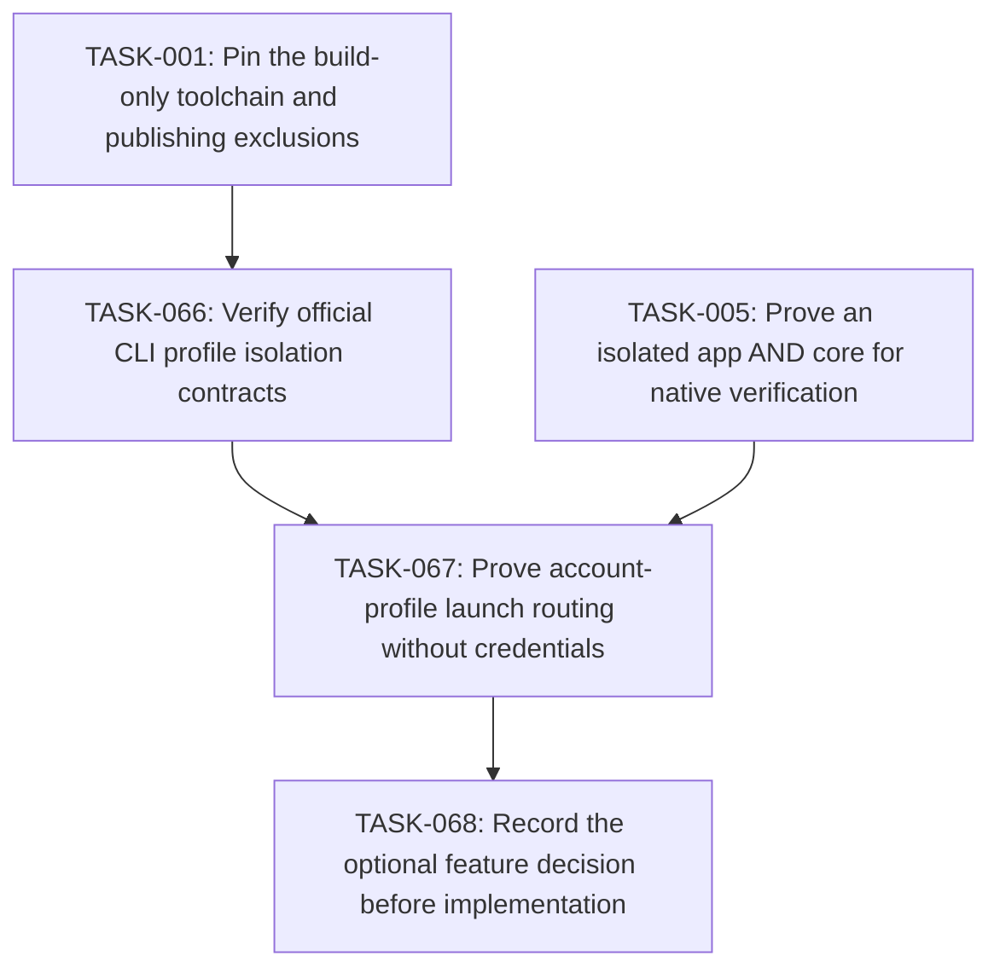

# Plan: Mission Control accounts feasibility gate

## Overview

Separate account-switching mod feasibility: verify safe profile isolation and launch-time account selection before adding implementation tasks. Keep the requested account panel open; this gate alone does not ship it or establish hot switching of an existing session.

Mode: **HOLD**. Review default: **codex**. Status: **deferred-optional**. Tasks: **3**.

Canonical source: [mission-control-accounts.json](mission-control-accounts.json).

## Scope Challenge

Keep this bounded feasibility gate independent of required quota and layout delivery. TASK066 has actual anonymous profile evidence; production account controls need native routing proof, supported credential contracts and a reviewed implementation expansion. No user authorization to drop the account-panel request is inferred from the earlier optional two-view toggle discussion.

## Prerequisites

- Herdr app 0.1.9 / hc 0.1.14 were observed; re-read installed declarations before execution and stop on incompatible contracts.
- All plans must pass founder review at their current hashes before implementation.
- Source, mounted native UI, authenticated provider checks, install and public publishing are separate gates.

Cross-plan prerequisites:

- TASK-001: [mission-control](mission-control.md) — Pin the build-only toolchain and publishing exclusions
- TASK-005: [mission-control](mission-control.md) — Prove an isolated app AND core for native verification

## Non-Goals

- No modification of shipped mods/layouts, generated Herdr type files, AGENTS.md, existing user sessions or credential stores.
- No Jira/GitHub workflow mutation, autonomous issue assignment or paid agent calls for fetching boards.
- No claim that the HTML mockup or load-only native check proves live behavior.
- No login/logout, credential copying, auth-file/keychain replacement or account mutation during feasibility. No promise of hot switching a running agent.

## Contracts

- Native GPUI JavaScript only: gpui-kit / gpui-base / herdr are runtime externals. No DOM, Node, CSS or setTimeout in GPUI. Helpers run out of process through exec; cx is not retained across awaits.
- Source paths are observed under src/, scripts/, tests/ and evidence/. Existing completed foundation and mod outputs are recorded in .ulpi/execution.json; new targets remain explicit task-owned creates. A changed completed contract reopens its owner task, marks its current files Modify and removes the old scheduling completion until replacement evidence passes. Prototypes and external examples remain references, not native reuse.
- All TASK IDs are globally unique. dependsOn can refer to another plan; externalDependencies records the owning JSON and its provided capability. The generated index resolves and validates the union DAG. There is no master execution plan.
- Canonical JSON is the source of truth. Markdown, dependency maps, execution layers and critical paths are derived. A change invalidates the reviewed SHA256 of that plan and all materially affected consumers.
- Build compilation may produce multiple artifacts. generatedArtifacts are compiler / capture outputs, never hand-edited source. Each task has at most three authored files. The package builder owns compilation and materialization; output manifests enumerate hashes and source provenance.
- Every standalone package is <name>/mods/<name>/ plus RECIPE.md, actual preview.png, optional keys.json and notices; no layouts/. It must work after copying only that mod directory. Shared source is bundled inside main.js / backend.mjs or copied as collector.py inside that same mod, with no runtime cross-mod code imports.
- Layout package mission-control/ contains both layouts and byte-equivalent copies of required standalone mods. One public GitHub repository may hold all complete package folders and both topics herdr-mod and herdr-layout, as the installed sharing rules explicitly allow.
- IDs and caches qualify machine, canonical repo root, source, account/connection, site and issue/session ID. A null machine means local. Never select a different repo or account as fallback. Remote paths are not local paths.
- Herdr exec(command,args,{cwd,on}) has no stdin or env option, rejects unreachable hosts and bounds requests to 30 s / 8 MiB. Use argv arrays, not interpolated shell. run returns null, not created IDs. Acknowledged creation uses exec("herdr-app",["do","tab.new",JSON.stringify(args)]) and validates its actual result shape before recording success.
- Settings persist in appHome()/mission-control/config.json via writeTextFile(path,text,expected) CAS. Credentials never enter shared state, logs, exported packages, arguments or screenshots. Shared keys are mission-control-* and versioned. CAS conflict reloads and retries boundedly or reports conflict.
- RepoBinding v1: {machine:null|string,repoRoot:string,jira?:{connectionId,project?:string,jql?:string},github?:{connectionId,owner,repo,status?:{labels?:{todo:[],inProgress:[],done:[]},project?:{owner,number,fieldId,options:{todo:string[],inProgress:string[],done:string[]},unmapped:"error"}}},mountedLocalPath?:string}. Reusable connections are configured separately; migration or invalid v1 data never overwrites the original.
- LaunchRequest v1: {requestId:string,idempotencyKey:string,originId:string,spaceId,machine,repoRoot,checkoutRoot?:string,toolKey,source?:{kind,connectionId,site,id,key,url,title,body},worktree:boolean,worktreePath?:string,branch?,model?,reasoning?,instructions?,skill?,subagents?}. LaunchResult is {ok:true,tabId,terminalId?,folder,reused:boolean} or {ok:false,code,message,recovery?}; unsupported options fail before spawning. repoRoot is canonical repository identity; checkoutRoot captures the actual selected worktree execution root and defaults explicitly to repoRoot only for tracker-bound cards without a live checkout. Before launch, validate checkoutRoot belongs to the same canonical Git common directory; current-checkout launches use checkoutRoot, never the common main checkout by accident.
- Source Issue v1: {identity:{kind,connectionId,site,id},key,title,url,body,statusGroup:"todo"|"inProgress"|"done",statusName,priority?,repoBinding,updatedAt?}. Source categories/mappings determine status; running agents do not move issue cards. Invalid status / wrong identity is an error, not an arbitrary category.
- Snapshot<T> v1: {data:T[],fetchedAt,scope,cursor?,truncated:boolean,error?:{code,message,retryAt?}}. Scope/account changes clear visible old-scope data immediately; same-scope failures may show timestamped stale data. Cap 1000 records per scope, page 50, explicit Load more / truncated label, concurrency <=4 and one in-flight request per scope.
- Only read-only Jira/GitHub/MCP requests are in scope. Each connection is opt-in, has an allowlisted HTTPS origin and explicit adapter. Redirects and tool responses cannot redirect credentials to another origin. Helper output is normalized and redacted; external prose is task data, never an executable shell command.
- UI uses graphite chrome #101114, surfaces #17191d, subdued #2a2d33 separators, muted labels and blue focus. Agent task titles get actual tool icons. Icons are local SVG/image assets or declared shipped icons, never font glyph dependencies or mojibake.
- Native isolation is owned once by TASK005 in mission-control.json: use its exact NativeIsolationReceiptV2, FixtureEnvironment ABI and validateNativeIsolationReceipt(receipt,{receiptPath?}) contract. Existing app/core instances are never queried or mutated. New proof binds fresh private selector roots, task-created Unix listeners and process generations; no new receipt claims an observed unchanged user PID. Package checks consume the canonical validator, including only the exact pinned historical legacy receipts. Missing, failed, downgraded or tampered proof cannot release a package or publishable preview.
- Node >=22 and Python >=3 are declared optional-helper prerequisites, probed on the execution host. Remote collector runs as exec("python3",["-c",ownCollectorSource,JSON.stringify(request)],{on:machine}); no assumption that a local helper file exists remotely. Missing Python reports unsupported host metrics/history without hiding agents or blocking terminals.
- SessionIdentity v1 is {machine:null|string,provider:string,credentialScope:string,providerRoot:string,sessionId:string}. All context/history/bindings carry the full value. TerminalIdentity is {machine,address,createdMs,foregroundPid}; a changed generation invalidates correlation. Active agents have no native provider-session field in the observed hc schema. Only caller-assigned exact IDs, explicit resume argv or a verified provider-native/PID-file handshake bind them; cwd/title/recency never do.
- TabNameOwnership v1 is owned upstream by TASK-070, keyed by stable originId with optional exact SessionIdentity and current tab instance. launch/resume/reopen transfer ownership only after acknowledgment; observers bundled into standalone tabs/sessions/reopen record manual edits under one CAS lease. Unknown imported histories use reported-title fallback and have no invented manual name.
- Generic launch idempotencyKey identifies one UI intent, not every new-agent request in a repo. Separate generic intents mint distinct keys; retries retain the same key. Issue/PR quick-start dedup uses qualified host/repo/source/connection/site/item plus tool policy. Origin IDs remain distinct from source item keys and from ephemeral tab IDs.
- knownAgents().installed/run is authority for base generic launch, including shell functions/wrappers. Help probes only grant advanced/model/reasoning/caller-session/resume capabilities. A failed probe disables those options; it does not block a supported base run. An explicitly requested unsupported advanced option fails before side effects.
- JiraConnection v1 is discriminated: api {id,kind:"api",site:httpsOrigin,cloudId?:uuid,auth:{kind:"basic",usernameEnv,tokenEnv}|{kind:"bearer",tokenEnv}}; cli {id,kind:"cli",site,execution:{machine:null,command,argsTemplate:string[]},mapping:{issuesPath,nextCursorPath?,fields,statusGroups}}; mcp-stdio {id,kind:"mcp-stdio",site,execution:{machine:null,command,args:string[],envRefs:Record<string,string>},search:{tool,argsTemplate,resultMapping}}; mcp-http {id,kind:"mcp-http",site,url:httpsURL,auth?:{kind:"basic",usernameEnv,tokenEnv}|{kind:"bearer",tokenEnv},search:{tool,argsTemplate,resultMapping}}. Basic username/token are resolved only in helper memory. credentialEnv/envRefs contain environment variable names, never credentials. In this entire union, site means the canonical Jira serverInfo.baseUrl HTTPS origin, not a custom displayUrl; issue links deliberately use that canonical site.
- Jira API routing is explicit: Basic without cloudId uses the configured tenant site (unscoped token); an explicit cloudId routes Basic/Bearer through https://api.atlassian.com/ex/jira/{cloudId}, and serverInfo.baseUrl must match the configured canonical tenant origin before fetching issues. Setup labels site as canonical Jira base URL; if a custom displayUrl differs, show canonical-base-URL guidance and publish no mismatched cards, without silently rewriting the saved site. Bearer without cloudId discovers https://api.atlassian.com/oauth/token/accessible-resources, selects the unique Jira-scoped resource matching the exact tenant URL, then uses that gateway route. Never infer token type or select the first accessible site. OAuth access tokens are existing env references; this release does not implement OAuth login/refresh. Credential origins are only the configured tenant or the fixed official gateway for the selected route; issue links always retain the tenant site. cloudId/auth/profile/query changes invalidate cursors and cached scope.
- Jira CLI and stdio MCP execute locally in the panel helper in this release; execution.machine must be null and a remote value is a setup error, never local fallback. Repo execution machine is independent and can be remote. A remote integration may expose explicitly configured HTTPS MCP; no local backend path is assumed present on a server. Existing agent MCP configuration requires explicit server/tool/profile selection, not automatic process sharing.
- GitHub Projects mapping uses stable fieldId and option IDs grouped into todo/inProgress/done; setup fetches field/options and saves explicit selection. Unknown/unmapped or multiply mapped option is an actionable configuration error. Without any status mapping, closed is Done and open is To do with an explicit unmapped-progress explanation.
- GitHub PullRequest v1 and PRActionRequest v1 are defined once by TASK044 in .ulpi/plans/mission-control-github.json, including author, explicit ref availability, independent discussion access and action-specific task mapping. That owning contract is canonical; this plan does not duplicate or redefine the PR schema. The layout consumes the GitHub mod views; unrelated mods do not acquire a runtime dependency on its model.
- All Node tests that import GPUI modules use node --import ./tests/support/native-loader.mjs --test <owned test>. TASK-078 supplies a strict recording tree/action seam, not a real renderer. Actual UI proof requires TASK-077 PID-bound native input plus before/after status/frame assertions; structural commands alone never prove a click.
- Usage/history source access implements the already-requested features: read-only documented standard provider session roots on their own host, with source settings and exact path disclosures, no extra permission prompt. Extra roots/legacy cache paths are explicitly configured. Disable/change cancels publication, clears related bindings/caches and stops subsequent reads. No auth files, credential copying or automatic hook rewrites.
- Launch source.id is stable provider identity; source.key is the visible naming snapshot. Issue mappings copy identity.id separately from key. GitHub PR canonical owner/repo#number identity, immutable captured checkout and action task mapping are owned by TASK044 in .ulpi/plans/mission-control-github.json. Existing source/path/ref snapshots stay immutable for acknowledged requests; unsafe or occupied fresh worktree targets remain errors.



## Existing Code Leverage

| Observed path / reference | Classification | Use |
| --- | --- | --- |
| AGENTS.md | inspected reference | Existing repository guidance; preserve this file unchanged. |
| DESIGN-NOTES.md | inspected reference | Accepted requirements and explicit packaging / planning instructions. |
| work/mission-control-two-views.html | inspected reference | Visual / interaction reference only; no HTML is used by the native runtime. |
| /Users/ciprian/.config/herdr-app/AGENTS.md | inspected reference | Installed Herdr rules, read on 2026-10-30, including sharing / recipe requirements at lines 403-457. |
| /Users/ciprian/.config/herdr-app/herdr.d.ts | inspected reference | Installed API truth: exec, knownAgents, readTextFile, writeTextFile, spaces, agents, layout and overlay commands. |
| /Users/ciprian/.config/herdr-app/mods/tabs/main.js | inspected reference | External installed implementation inspected for tab semantics; do not import or read another mod at runtime. |

## Tasks

### TASK-066: Verify official CLI profile isolation contracts

Inspect installed Claude/Codex help and official documentation for CLAUDE_CONFIG_DIR / CODEX_HOME, OS credential backend and logout scope. Run only non-authenticating status/help in fresh temporary profile directories with redacted output. Record versioned evidence and failure modes; do not touch existing credentials.

**Type:** test  
**Priority:** P1  
**Effort:** L  
**Agent:** nodejs-cli-senior-engineer  
**Review:** codex  
**Depends on:** TASK-001

**Acceptance Criteria:**

- A versioned matrix distinguishes separate profile state, credential isolation and already-running-session behavior with direct evidence.
- An unsupported/keychain-global backend is marked unsupported; no existing profile/config/auth file is copied, changed or logged.

**Write scope:**

| File | Action | Role |
| --- | --- | --- |
| docs/account-profile-capabilities.md | Create | Evidence-backed profile/credential-backend support matrix, dates and source links. |
| tests/account-profile-probe.test.mjs | Create | Read-only fresh-profile probes asserting existing auth/config paths are untouched. |

**Validate:**

```sh
node --test tests/account-profile-probe.test.mjs
```

### TASK-067: Prove account-profile launch routing without credentials

Use a toy command in an isolated core to test whether a supported tab.new/hc launch path can select per-process profile directories while preserving tool/task identity for new launches only. The Herdr exec API has no env option; investigate hc exec --env or explicit env argv as capabilities, not assumed signatures. Do not log in or run paid agent turns. Its generated native receipt must pass the exact canonical TASK005 validator; no arbitrary legacy-format success is accepted.

**Type:** test  
**Priority:** P1  
**Effort:** L  
**Agent:** general-purpose  
**Review:** codex  
**Depends on:** TASK-066, TASK-005

**Acceptance Criteria:**

- Toy child processes report separate intended profile roots and preserve the expected task/agent routing only if actually supported.
- Unsupported env wrappers or shell/agent task misclassification fail the capability gate; no workaround mutates global authentication.

**Write scope:**

| File | Action | Role |
| --- | --- | --- |
| tests/native/account-profile.mjs | Create | Toy-process native routing/identity and environment isolation probe. |
| evidence/native/account-profile.json | Create | Actual success/failure, profile routing and process identity without credentials. |

**Validate:**

```sh
node scripts/native-harness.mjs run account-profile
```

### TASK-068: Record the optional feature decision before implementation

Record GO only if both credential and launch identity isolation have passed; otherwise defer with precise unsupported boundary. GO requires expanding this same mod plan with bounded implementation/QA/package tasks and another founder review; it is not permission to build from an unreviewed appendix. No empty account package is published. GO is limited to demonstrated new-launch profile routing; provider-specific resume requires its own future credential-safe evidence and reviewed implementation tasks, never the toy-process result. Require the canonical validator result for the referenced TASK067 receipt.

**Type:** docs  
**Priority:** P1  
**Effort:** M  
**Agent:** general-purpose  
**Review:** codex  
**Depends on:** TASK-067

**Acceptance Criteria:**

- Decision references exact probe receipts and makes no seamless running-session or account quota guarantee.
- A failed or absent prerequisite yields DEFER; required layout/mods and quota never depend on this optional decision.

**Write scope:**

| File | Action | Role |
| --- | --- | --- |
| docs/account-switching-decision.md | Create | Explicit evidence-based GO / DEFER verdict and limits on existing sessions. |

**Validate:**

```sh
node scripts/project.mjs inspect-docs docs/account-profile-capabilities.md docs/account-switching-decision.md
```

## Failure Modes

| Failure | Containment / recovery |
| --- | --- |
| Official docs/help/version drift | Record exact versions and force DEFER when the declared profile/auth backend behavior cannot be reproduced. |
| Unexpected Keychain / OS credential-store access | Abort before approval/login or secret retrieval; keep existing credentials untouched and record DEFER. |
| Secret-bearing output | Discard/redact output, stop the probe and do not persist raw content; no successful receipt. |
| Ambiguous/global backend or unsupported wrapper | Force DEFER. Do not copy auth files or change global login, and do not claim provider resume from a toy process. |

## Ship Cut

No production account mod or placeholder package is shipped by this feasibility plan. Required quota indicators and all other packages ship independently. A demonstrated supported profile contract triggers a concrete implementation revision and founder re-review before account-mod code is built.

## Test Coverage Map

| Task | Paths | Gate |
| --- | --- | --- |
| TASK-066 | docs/account-profile-capabilities.md, tests/account-profile-probe.test.mjs | subprocess / network integration: node --test tests/account-profile-probe.test.mjs |
| TASK-067 | tests/native/account-profile.mjs, evidence/native/account-profile.json | mounted native integration: node scripts/native-harness.mjs run account-profile |
| TASK-068 | docs/account-switching-decision.md | artifact / package validation: node scripts/project.mjs inspect-docs docs/account-profile-capabilities.md docs/account-switching-decision.md |

## Execution Summary

| Metric | Derived value |
| --- | --- |
| Tasks | 3 |
| Local roots | TASK-066 |
| Union DAG layers reached | 2, 4, 5 |
| Critical path including prerequisite plans | TASK-001 → TASK-002 → TASK-005 → TASK-067 → TASK-068 |
| Cross-plan task dependencies | 2 |

Layers (global prerequisite depth, not arbitrary serial order):

- Layer 2: TASK-066
- Layer 4: TASK-067
- Layer 5: TASK-068

## Task Dependencies

```json
{
  "TASK-066": [
    "TASK-001"
  ],
  "TASK-067": [
    "TASK-066",
    "TASK-005"
  ],
  "TASK-068": [
    "TASK-067"
  ]
}
```
