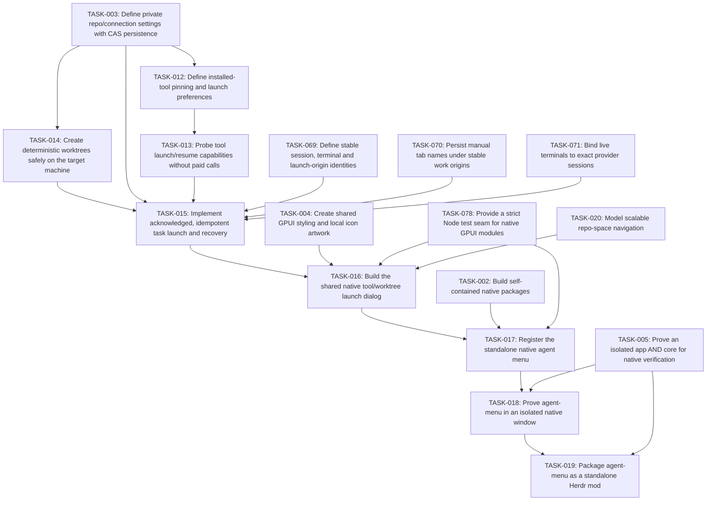

# Plan: Mission Control agent menu

## Overview

Provide a clean installed-tool picker, Agent shortcuts settings and the shared safe launch service used by generic, issue and PR starts. All importing mods compile these helpers into their own folder; installing this menu mod is not a runtime prerequisite for those other packages.

Mode: **EXPANSION**. Review default: **codex**. Status: **draft**. Tasks: **8**.

Canonical source: [mission-control-agent-menu.json](mission-control-agent-menu.json).

## Scope Challenge

The approved feature scope is frozen. The implementation is greenfield native GPUI, so EXPANSION accurately describes the repository work; it does not add features beyond DESIGN-NOTES.md. Codex remains the review default. Atomic three-file scopes explain the task count.

## Prerequisites

- Herdr app 0.1.9 / hc 0.1.14 were observed; re-read installed declarations before execution and stop on incompatible contracts.
- All plans must pass founder review at their current hashes before implementation.
- Source, mounted native UI, authenticated provider checks, install and public publishing are separate gates.

Cross-plan prerequisites:

- TASK-003: [mission-control](mission-control.md) — Define private repo/connection settings with CAS persistence
- TASK-069: [mission-control](mission-control.md) — Define stable session, terminal and launch-origin identities
- TASK-070: [mission-control](mission-control.md) — Persist manual tab names under stable work origins
- TASK-071: [mission-control-agents](mission-control-agents.md) — Bind live terminals to exact provider sessions
- TASK-004: [mission-control](mission-control.md) — Create shared GPUI styling and local icon artwork
- TASK-078: [mission-control](mission-control.md) — Provide a strict Node test seam for native GPUI modules
- TASK-020: [mission-control-spaces](mission-control-spaces.md) — Model scalable repo-space navigation
- TASK-002: [mission-control](mission-control.md) — Build self-contained native packages
- TASK-005: [mission-control](mission-control.md) — Prove an isolated app AND core for native verification

## Non-Goals

- No modification of shipped mods/layouts, generated Herdr type files, AGENTS.md, existing user sessions or credential stores.
- No Jira/GitHub workflow mutation, autonomous issue assignment or paid agent calls for fetching boards.
- No claim that the HTML mockup or load-only native check proves live behavior.

## Contracts

- Native GPUI JavaScript only: gpui-kit / gpui-base / herdr are runtime externals. No DOM, Node, CSS or setTimeout in GPUI. Helpers run out of process through exec; cx is not retained across awaits.
- Source paths are observed under src/, scripts/, tests/ and evidence/. Existing completed foundation and mod outputs are recorded in .ulpi/execution.json; new targets remain explicit task-owned creates. A changed completed contract reopens its owner task, marks its current files Modify and removes the old scheduling completion until replacement evidence passes. Prototypes and external examples remain references, not native reuse.
- All TASK IDs are globally unique. dependsOn can refer to another plan; externalDependencies records the owning JSON and its provided capability. The generated index resolves and validates the union DAG. There is no master execution plan.
- Canonical JSON is the source of truth. Markdown, dependency maps, execution layers and critical paths are derived. A change invalidates the reviewed SHA256 of that plan and all materially affected consumers.
- Build compilation may produce multiple artifacts. generatedArtifacts are compiler / capture outputs, never hand-edited source. Each task has at most three authored files. The package builder owns compilation and materialization; output manifests enumerate hashes and source provenance.
- Every standalone package is <name>/mods/<name>/ plus RECIPE.md, actual preview.png, optional keys.json and notices; no layouts/. It must work after copying only that mod directory. Shared source is bundled inside main.js / backend.mjs or copied as collector.py inside that same mod, with no runtime cross-mod code imports.
- Layout package mission-control/ contains both layouts and byte-equivalent copies of required standalone mods. One public GitHub repository may hold all complete package folders and both topics herdr-mod and herdr-layout, as the installed sharing rules explicitly allow.
- IDs and caches qualify machine, canonical repo root, source, account/connection, site and issue/session ID. A null machine means local. Never select a different repo or account as fallback. Remote paths are not local paths.
- Herdr exec(command,args,{cwd,on}) has no stdin or env option, rejects unreachable hosts and bounds requests to 30 s / 8 MiB. Use argv arrays, not interpolated shell. run returns null, not created IDs. Acknowledged creation uses exec("herdr-app",["do","tab.new",JSON.stringify(args)]) and validates its actual result shape before recording success.
- Settings persist in appHome()/mission-control/config.json via writeTextFile(path,text,expected) CAS. Credentials never enter shared state, logs, exported packages, arguments or screenshots. Shared keys are mission-control-* and versioned. CAS conflict reloads and retries boundedly or reports conflict.
- RepoBinding v1: {machine:null|string,repoRoot:string,jira?:{connectionId,project?:string,jql?:string},github?:{connectionId,owner,repo,status?:{labels?:{todo:[],inProgress:[],done:[]},project?:{owner,number,fieldId,options:{todo:string[],inProgress:string[],done:string[]},unmapped:"error"}}},mountedLocalPath?:string}. Reusable connections are configured separately; migration or invalid v1 data never overwrites the original.
- LaunchRequest v1: {requestId:string,idempotencyKey:string,originId:string,spaceId,machine,repoRoot,checkoutRoot?:string,toolKey,source?:{kind,connectionId,site,id,key,url,title,body},worktree:boolean,worktreePath?:string,branch?,model?,reasoning?,instructions?,skill?,subagents?}. LaunchResult is {ok:true,tabId,terminalId?,folder,reused:boolean} or {ok:false,code,message,recovery?}; unsupported options fail before spawning. repoRoot is canonical repository identity; checkoutRoot captures the actual selected worktree execution root and defaults explicitly to repoRoot only for tracker-bound cards without a live checkout. Before launch, validate checkoutRoot belongs to the same canonical Git common directory; current-checkout launches use checkoutRoot, never the common main checkout by accident.
- Source Issue v1: {identity:{kind,connectionId,site,id},key,title,url,body,statusGroup:"todo"|"inProgress"|"done",statusName,priority?,repoBinding,updatedAt?}. Source categories/mappings determine status; running agents do not move issue cards. Invalid status / wrong identity is an error, not an arbitrary category.
- Snapshot<T> v1: {data:T[],fetchedAt,scope,cursor?,truncated:boolean,error?:{code,message,retryAt?}}. Scope/account changes clear visible old-scope data immediately; same-scope failures may show timestamped stale data. Cap 1000 records per scope, page 50, explicit Load more / truncated label, concurrency <=4 and one in-flight request per scope.
- Only read-only Jira/GitHub/MCP requests are in scope. Each connection is opt-in, has an allowlisted HTTPS origin and explicit adapter. Redirects and tool responses cannot redirect credentials to another origin. Helper output is normalized and redacted; external prose is task data, never an executable shell command.
- UI uses graphite chrome #101114, surfaces #17191d, subdued #2a2d33 separators, muted labels and blue focus. Agent task titles get actual tool icons. Icons are local SVG/image assets or declared shipped icons, never font glyph dependencies or mojibake.
- Native isolation is owned once by TASK005 in mission-control.json: use its exact NativeIsolationReceiptV2, FixtureEnvironment ABI and validateNativeIsolationReceipt(receipt,{receiptPath?}) contract. Existing app/core instances are never queried or mutated. New proof binds fresh private selector roots, task-created Unix listeners and process generations; no new receipt claims an observed unchanged user PID. Package checks consume the canonical validator, including only the exact pinned historical legacy receipts. Missing, failed, downgraded or tampered proof cannot release a package or publishable preview.
- Node >=22 and Python >=3 are declared optional-helper prerequisites, probed on the execution host. Remote collector runs as exec("python3",["-c",ownCollectorSource,JSON.stringify(request)],{on:machine}); no assumption that a local helper file exists remotely. Missing Python reports unsupported host metrics/history without hiding agents or blocking terminals.
- SessionIdentity v1 is {machine:null|string,provider:string,credentialScope:string,providerRoot:string,sessionId:string}. All context/history/bindings carry the full value. TerminalIdentity is {machine,address,createdMs,foregroundPid}; a changed generation invalidates correlation. Active agents have no native provider-session field in the observed hc schema. Only caller-assigned exact IDs, explicit resume argv or a verified provider-native/PID-file handshake bind them; cwd/title/recency never do.
- TabNameOwnership v1 is owned upstream by TASK-070, keyed by stable originId with optional exact SessionIdentity and current tab instance. launch/resume/reopen transfer ownership only after acknowledgment; observers bundled into standalone tabs/sessions/reopen record manual edits under one CAS lease. Unknown imported histories use reported-title fallback and have no invented manual name.
- Generic launch idempotencyKey identifies one UI intent, not every new-agent request in a repo. Separate generic intents mint distinct keys; retries retain the same key. Issue/PR quick-start dedup uses qualified host/repo/source/connection/site/item plus tool policy. Origin IDs remain distinct from source item keys and from ephemeral tab IDs.
- knownAgents().installed/run is authority for base generic launch, including shell functions/wrappers. Help probes only grant advanced/model/reasoning/caller-session/resume capabilities. A failed probe disables those options; it does not block a supported base run. An explicitly requested unsupported advanced option fails before side effects.
- JiraConnection v1 is discriminated: api {id,kind:"api",site:httpsOrigin,cloudId?:uuid,auth:{kind:"basic",usernameEnv,tokenEnv}|{kind:"bearer",tokenEnv}}; cli {id,kind:"cli",site,execution:{machine:null,command,argsTemplate:string[]},mapping:{issuesPath,nextCursorPath?,fields,statusGroups}}; mcp-stdio {id,kind:"mcp-stdio",site,execution:{machine:null,command,args:string[],envRefs:Record<string,string>},search:{tool,argsTemplate,resultMapping}}; mcp-http {id,kind:"mcp-http",site,url:httpsURL,auth?:{kind:"basic",usernameEnv,tokenEnv}|{kind:"bearer",tokenEnv},search:{tool,argsTemplate,resultMapping}}. Basic username/token are resolved only in helper memory. credentialEnv/envRefs contain environment variable names, never credentials. In this entire union, site means the canonical Jira serverInfo.baseUrl HTTPS origin, not a custom displayUrl; issue links deliberately use that canonical site.
- Jira API routing is explicit: Basic without cloudId uses the configured tenant site (unscoped token); an explicit cloudId routes Basic/Bearer through https://api.atlassian.com/ex/jira/{cloudId}, and serverInfo.baseUrl must match the configured canonical tenant origin before fetching issues. Setup labels site as canonical Jira base URL; if a custom displayUrl differs, show canonical-base-URL guidance and publish no mismatched cards, without silently rewriting the saved site. Bearer without cloudId discovers https://api.atlassian.com/oauth/token/accessible-resources, selects the unique Jira-scoped resource matching the exact tenant URL, then uses that gateway route. Never infer token type or select the first accessible site. OAuth access tokens are existing env references; this release does not implement OAuth login/refresh. Credential origins are only the configured tenant or the fixed official gateway for the selected route; issue links always retain the tenant site. cloudId/auth/profile/query changes invalidate cursors and cached scope.
- Jira CLI and stdio MCP execute locally in the panel helper in this release; execution.machine must be null and a remote value is a setup error, never local fallback. Repo execution machine is independent and can be remote. A remote integration may expose explicitly configured HTTPS MCP; no local backend path is assumed present on a server. Existing agent MCP configuration requires explicit server/tool/profile selection, not automatic process sharing.
- GitHub Projects mapping uses stable fieldId and option IDs grouped into todo/inProgress/done; setup fetches field/options and saves explicit selection. Unknown/unmapped or multiply mapped option is an actionable configuration error. Without any status mapping, closed is Done and open is To do with an explicit unmapped-progress explanation.
- GitHub PullRequest v1 and PRActionRequest v1 are defined once by TASK044 in .ulpi/plans/mission-control-github.json, including author, explicit ref availability, independent discussion access and action-specific task mapping. That owning contract is canonical; this plan does not duplicate or redefine the PR schema. The layout consumes the GitHub mod views; unrelated mods do not acquire a runtime dependency on its model.
- All Node tests that import GPUI modules use node --import ./tests/support/native-loader.mjs --test <owned test>. TASK-078 supplies a strict recording tree/action seam, not a real renderer. Actual UI proof requires TASK-077 PID-bound native input plus before/after status/frame assertions; structural commands alone never prove a click.
- Usage/history source access implements the already-requested features: read-only documented standard provider session roots on their own host, with source settings and exact path disclosures, no extra permission prompt. Extra roots/legacy cache paths are explicitly configured. Disable/change cancels publication, clears related bindings/caches and stops subsequent reads. No auth files, credential copying or automatic hook rewrites.
- Launch source.id is stable provider identity; source.key is the visible naming snapshot. Issue mappings copy identity.id separately from key. GitHub PR canonical owner/repo#number identity, immutable captured checkout and action task mapping are owned by TASK044 in .ulpi/plans/mission-control-github.json. Existing source/path/ref snapshots stay immutable for acknowledged requests; unsafe or occupied fresh worktree targets remain errors.



## Existing Code Leverage

| Observed path / reference | Classification | Use |
| --- | --- | --- |
| AGENTS.md | inspected reference | Existing repository guidance; preserve this file unchanged. |
| DESIGN-NOTES.md | inspected reference | Accepted requirements and explicit packaging / planning instructions. |
| work/mission-control-two-views.html | inspected reference | Visual / interaction reference only; no HTML is used by the native runtime. |
| /Users/ciprian/.config/herdr-app/AGENTS.md | inspected reference | Installed Herdr rules, read on 2026-10-30, including sharing / recipe requirements at lines 403-457. |
| /Users/ciprian/.config/herdr-app/herdr.d.ts | inspected reference | Installed API truth: exec, knownAgents, readTextFile, writeTextFile, spaces, agents, layout and overlay commands. |
| /Users/ciprian/.config/herdr-app/mods/tabs/main.js | inspected reference | External installed implementation inspected for tab semantics; do not import or read another mod at runtime. |
| /Users/ciprian/.config/herdr-app/mods/worktree/main.js | external installed semantics inspected; new source required | Port live-cwd repo/worktree and target-host argv semantics; add own CAS idempotency/ownership and never import shipped mod code at runtime. |

## Tasks

### TASK-012: Define installed-tool pinning and launch preferences

Own launch preferences v1, three quick pins ordered Claude/Codex/Grok when installed, per-host discovery and per-tool launch options. More than three installed tools remain searchable in overflow; hidden/uninstalled tools cannot start from quick buttons.

**Type:** feature  
**Priority:** P1  
**Effort:** L  
**Agent:** general-purpose  
**Review:** codex  
**Depends on:** TASK-003

**Acceptance Criteria:**

- Quick buttons show at most three installed pinned tools in saved order; settings can replace/order them and persist across layouts.
- Missing / newly uninstalled tools are omitted from quick actions but other tools stay available; invalid model/reasoning/tool options fail schema validation.

**Write scope:**

| File | Action | Role |
| --- | --- | --- |
| src/shared/launch-preferences.js | Create | Pure pin/order/preferences schema, target-host installed list reconciliation and exports used by all launch surfaces. |
| tests/launch-preferences.test.mjs | Create | Defaults, >3 installs, pin changes, host distinction and unsupported preference validation. |

**Validate:**

```sh
node --test tests/launch-preferences.test.mjs
```

### TASK-013: Probe tool launch/resume capabilities without paid calls

Own an explicit installed-tool capability registry backed by target-host --help and documented CLI flags. Preserve knownAgents.run as argv and only append options verified for that tool/version; arbitrary installed agents support generic launch with no invented options. Model/reasoning controls appear only when supported. No agent invocation is used to fetch issue data. Base generic run is authorized by knownAgents installed/run even when a direct --help exec cannot resolve an interactive shell function. In that case mark advanced/resume capabilities unavailable; preserve base launch.

**Type:** feature  
**Priority:** P1  
**Effort:** L  
**Agent:** general-purpose  
**Review:** codex  
**Depends on:** TASK-012

**Acceptance Criteria:**

- Claude, Codex and installed Grok launch flags/resume behavior are checked against actual local help; version/host are part of capability cache identity.
- An installed shell-function/wrapper with failed direct help probing still supports its base knownAgents.run; uninstalled tools or explicitly requested unsupported flags fail before any mutation.

**Write scope:**

| File | Action | Role |
| --- | --- | --- |
| src/shared/tool-capabilities.js | Create | Target-host help probes, capability schema and argument construction. |
| tests/tool-capabilities.test.mjs | Create | Captured help fixtures plus adversarial options, unknown tools and wrong-host cache tests. |

**Validate:**

```sh
node --test tests/tool-capabilities.test.mjs
```

### TASK-014: Create deterministic worktrees safely on the target machine

Resolve the canonical repo with git rev-parse and create worktrees through argv-only exec with {on:machine}. Default sibling worktree root is .herdr-worktrees under the repo parent, leaf <space-name>-<issue-id> sanitized and bounded. Validate git worktree list --porcelain and branch refs before mutation; never reuse a pre-existing unowned path silently. WorktreeSpec v1 is discriminated: issue/PR default leaf <spaceSlug>-<issueKeySlug>, branch mission-control/<leaf>; generic default leaf <spaceSlug>-task-<requestIdDigest12>, branch mission-control/<leaf>. requestIdDigest12 is the first 12 hex characters of a deterministic digest of the immutable requestId, computed by the owned helper; capture leaf/ref/base commit before the first mutation and persist them in the launch journal. A retry reuses the exact captured path/ref; a distinct generic intent gets a different pair. Explicit branch/path overrides are validated and become immutable after first attempt. Validate branch with git check-ref-format --branch and never overwrite an existing unowned path/ref. Inputs are explicitly LaunchRequest.source.key (display key) versus source.id (stable dedup identity), and optional LaunchRequest.worktreePath. Validate this shape and reject worktreePath with worktree=false. The deterministic suffix helper is pure JavaScript for naming, not a Node crypto import in GPUI; collisions always fail ownership checks instead of reusing another request's tree. Capture checkoutRoot separately from canonical repoRoot. Validate it is a real worktree of the same Git common directory before side effects; worktree=false launches in checkoutRoot, while new-worktree base HEAD comes from that selected checkout. Canonical binding/idempotency keys continue to use repoRoot.

**Type:** feature  
**Priority:** P1  
**Effort:** L  
**Agent:** general-purpose  
**Review:** codex  
**Depends on:** TASK-003

**Acceptance Criteria:**

- Issue client-portal/WEB-142 creates client-portal-WEB-142; two concurrent independent generic intents create distinct request-derived safe leaf/ref pairs and retries retain the original pair. A real linked worktree launches in its selected checkout with worktree=false and retains the common canonical binding identity; wrong-repo checkoutRoot fails before mutation.
- Existing unowned path/ref, changed retry parameters, symlink escape or dirty tree fails without overwriting/deleting any user work; explicit overrides obey the same ownership checks. Stable source id distinct from mutable WEB-142 display key and an explicit path override follow the exact LaunchRequest schema; wrong-shape/contradictory overrides fail. Missing checkoutRoot on a generic request is rejected before Git calls; only a validated Jira/GitHub issue or PR source may explicitly default to repoRoot.

**Write scope:**

| File | Action | Role |
| --- | --- | --- |
| src/shared/worktrees.js | Create | Repo/worktree resolution, naming, conflict and ownership metadata. |
| tests/worktrees.test.mjs | Create | Real disposable Git repositories covering collisions, concurrent creates, dirty existing trees and hostile issue names. |

**Validate:**

```sh
node --test tests/worktrees.test.mjs
```

### TASK-015: Implement acknowledged, idempotent task launch and recovery

Own launch(request,io) with a persistent CAS journal appHome()/mission-control/launches.json. Lock key includes host/repo/source/connection/site/issue; same-tool repeat focuses acknowledged live IDs, while a different-tool concurrent start conflicts with an explicit choose-existing/separate-worktree option. Journal records creating/worktree-ready/tab-created/failed states and reconciles actual tabs after a crash. Validate real tab.new CLI output before saving created IDs; task text passes only as data. Generic requests lock by unique idempotencyKey and independent intents create separate tabs; issue/PR repeat locks remain stable per item/tool policy. Persist originId, acknowledged TerminalIdentity and caller-provisioned SessionIdentity only after actual creation, and publish ownership transfer through TASK-070. Before mutation call TASK-071 propose(requestId,originId,sessionProposal); persist captured WorktreeSpec. After tab.new acknowledgment, hydrate its actual full terminal identity, save tab-created/binding-commit-pending in launches.json, call commitAcknowledged on TASK-071's durable authority, then complete name transfer/state. If commit fails after tab creation, retain the acknowledged IDs and retry only the idempotent commit; repeated launch focuses that existing tab rather than spawning. A crash before acknowledged IDs were saved is recovery-required until a real created tab can be verified; never guess by title/time and blindly retry. Capture checkoutRoot separately from canonical repoRoot. Validate it is a real worktree of the same Git common directory before side effects; worktree=false launches in checkoutRoot, while new-worktree base HEAD comes from that selected checkout. Canonical binding/idempotency keys continue to use repoRoot.

**Type:** feature  
**Priority:** P1  
**Effort:** L  
**Agent:** general-purpose  
**Review:** codex  
**Depends on:** TASK-014, TASK-003, TASK-013, TASK-069, TASK-070, TASK-071

**Acceptance Criteria:**

- Two independent generic request IDs create two tabs; two submissions of one intent or same-tool qualified issue start create exactly one acknowledged tab/worktree and focus it on repeat.
- Crash/offline/malformed acknowledgment cannot claim success or create an unsafe second worktree; recovery never removes an existing/dirty tree or runs on another host. A new telemetry-side instance reads the committed binding after launch-side restart; tab-created/commit-pending recovery retries only commit, and unacknowledged uncertain creation remains a conflict rather than spawning again.

**Write scope:**

| File | Action | Role |
| --- | --- | --- |
| src/shared/launch.js | Create | Shared launch orchestration and bounded CAS lock/journal recovery; no runtime cross-mod imports. |
| tests/launch.test.mjs | Create | Real temporary journal/Git and fake process boundary tests for races, CLI malformed acknowledgment and partial failure. |

**Validate:**

```sh
node --test tests/launch.test.mjs
```

### TASK-016: Build the shared native tool/worktree launch dialog

Create a GPUI dialog component that can be bundled into any owning mod and opened via that same mod props view. It shows repo/host destination, installed tool icons, current checkout/new worktree, supported advanced options and launch feedback; Settings → Agent shortcuts controls pinning/order/automatic worktrees. The dialog owns wiring to config, capabilities and launch, not to another runtime mod. The options dialog passes explicit worktreePath only when new worktree is enabled; it copies source.key separately from source.id. Use TASK-020 src/shared/space-repo.js to resolve the captured space before generic launch/setup. Ambiguous, unbound or error results block starts; SpaceInfo.folder is never a repo fallback. Capture checkoutRoot separately from canonical repoRoot. Validate it is a real worktree of the same Git common directory before side effects; worktree=false launches in checkoutRoot, while new-worktree base HEAD comes from that selected checkout. Canonical binding/idempotency keys continue to use repoRoot.

**Type:** feature  
**Priority:** P1  
**Effort:** L  
**Agent:** general-purpose  
**Review:** codex  
**Depends on:** TASK-015, TASK-004, TASK-078, TASK-020

**Acceptance Criteria:**

- Generic New agent asks tool and worktree choice; issue quick starts use saved defaults without opening the dialog.
- Changing active space while a dialog is open cannot retarget its captured repo/host; failed discovery/launch preserves entries and shows the reason. A stale SpaceInfo.folder cannot override the captured live linked-worktree checkoutRoot; ambiguous/unbound resolver results produce zero launch/worktree side effects.

**Write scope:**

| File | Action | Role |
| --- | --- | --- |
| src/shared/launch-dialog.js | Create | Reusable GPUI menu/settings/dialog implementation bundled at build time into consumers. |
| tests/launch-dialog.test.mjs | Create | Event contract tests for clicked-space target, saved pins, option rejection and loading/error state. |

**Validate:**

```sh
node --import ./tests/support/native-loader.mjs --test tests/launch-dialog.test.mjs
```

### TASK-017: Register the standalone native agent menu

Register the menu and settings/launch props roles. Show repo/machine context, tool icons, a compact search list and customization view; keep Terminal, New space and Worktree actions distinct. Popup shortcuts are scoped to this popup. No network or history reads occur merely to discover installed tools.

**Type:** feature  
**Priority:** P1  
**Effort:** L  
**Agent:** general-purpose  
**Review:** codex  
**Depends on:** TASK-016, TASK-002, TASK-078

**Acceptance Criteria:**

- The standalone mod opens a working installed-agent menu and its own settings/launch roles without any sibling custom mod installed.
- An offline target or empty installed list disables starts with a clear reason while allowing close; popup shortcuts do not capture terminal keys after closing.

**Write scope:**

| File | Action | Role |
| --- | --- | --- |
| src/mods/mission-control-agent-menu/main.js | Create | Native entry exporting the GPUI View and wiring shared dialog / prefs actions. |
| src/mods/mission-control-agent-menu/mod.json | Create | Title/place/commands manifest for standalone menu opening. |
| tests/agent-menu.test.mjs | Create | Manifest/props/action contract and no-wrong-target / no-duplicate-launch tests. |

**Validate:**

```sh
node --import ./tests/support/native-loader.mjs --test tests/agent-menu.test.mjs && node scripts/project.mjs check mission-control-agent-menu
```

**Generated outputs (not authored source):**

- mission-control-agent-menu/mods/mission-control-agent-menu/main.js
- mission-control-agent-menu/mods/mission-control-agent-menu/mod.json
- mission-control-agent-menu/mods/mission-control-agent-menu/assets/*.svg

### TASK-018: Prove agent-menu in an isolated native window

Exercise popup keyboard scope, target selection, pins/settings, current-checkout and new-worktree launches. Verify real created core argv/cwd and no duplicate tab after repeat. Require two independent generic New agent→new worktree requests in the same repo to produce distinct stable branch/path pairs, and same-request retries to focus/reuse. Recreate the telemetry consumer after a launch binding commit and verify it reads the durable mapping. Native regression must use a stale SpaceInfo.folder and a focused linked-worktree live cwd, assert current-checkout launches there with the original canonical binding, and prove ambiguous/unbound targets cause zero creation.

**Type:** test  
**Priority:** P1  
**Effort:** L  
**Agent:** general-purpose  
**Review:** codex  
**Depends on:** TASK-017, TASK-005

**Acceptance Criteria:**

- A standalone install containing only this mod passes herdr-app check and the mounted scenario; capture its actual rendered preview with zero app errors.
- A missing capability / empty-state scenario is exercised; no generated success receipt or screenshot is accepted when an assertion or isolation proof fails.

**Write scope:**

| File | Action | Role |
| --- | --- | --- |
| tests/native/agent-menu.mjs | Create | Native scenario, uses the shared harness and asserts actual UI / command outcomes. |
| evidence/native/agent-menu.json | Create | Machine-readable commands, outcomes, isolation identities, errors and screenshot hashes; generated evidence, no private content. |

**Validate:**

```sh
node scripts/native-harness.mjs run agent-menu
```

**Generated outputs (not authored source):**

- mission-control-agent-menu/preview.png

### TASK-019: Package agent-menu as a standalone Herdr mod

Write the six-part reconstruction brief from the finished files. Validate the package in a fresh folder with no other custom mod installed; include access / program / network disclosures and applicable attribution. Consume TASK005 validateNativeIsolationReceipt for both genuine retained legacy receipts and new private-only proof, without asserting an observed unchanged user PID for a run that never queried it. Preserve recipe/import/asset/current-source/artifact/preview checks.

**Type:** docs  
**Priority:** P1  
**Effort:** L  
**Agent:** general-purpose  
**Review:** codex  
**Depends on:** TASK-018, TASK-005

**Acceptance Criteria:**

- Copying only mods/mission-control-agent-menu/ is sufficient; no sibling mod code or repository path is read at runtime.
- The exact preview hash matches the passed native receipt; missing recipe, fake/absent preview or any layouts/ folder fails package validation.
- The package check rejects missing or invalid native isolation, accepts genuine retained legacy evidence and the new private-only ownership receipt without inventing a live-user PID observation.

**Write scope:**

| File | Action | Role |
| --- | --- | --- |
| mission-control-agent-menu/RECIPE.md | Modify existing source or prior task output | Recipe in Herdr order: summary + preview, What you see, How it behaves, Built from, Watch out, Done when. |
| tests/package-agent-menu.test.mjs | Modify existing source or prior task output | Asserts self-contained runtime imports, own assets/helpers, recipe sections and absence of layouts/. Import the canonical TASK005 receipt validator; reject absent/invalid isolation while retaining actual legacy evidence support. |
| mission-control-agent-menu/preview.png | Modify existing source or prior task output | Actual native frame from the preceding scenario, not a browser mock or generated illustration. |

**Validate:**

```sh
node scripts/project.mjs build mission-control-agent-menu && node --test tests/package-agent-menu.test.mjs
```

**Generated outputs (not authored source):**

- mission-control-agent-menu/mods/mission-control-agent-menu/main.js
- mission-control-agent-menu/mods/mission-control-agent-menu/mod.json
- mission-control-agent-menu/mods/mission-control-agent-menu/assets/*.svg

## Failure Modes

| Failure | Containment / recovery |
| --- | --- |
| Invalid / outdated config | Keep the original bytes, display the validation error and edit/retry; never reset silently. |
| Offline host / missing executable / timeout | Keep correctly scoped timestamped data, disable only the affected action, show host and retry; never execute locally as fallback. |
| Partial install / package collision | Refuse overwrites, retain the previous layout and owned-file receipt; rollback removes only newly installed matching-hash files. |
| Wrong account or malformed provider output | Reject the response, redact error details and clear wrong-scope data. Authentication never switches global CLI state. |
| Duplicate launch / interrupted worktree creation | CAS journal reconciliation focuses a proven live tab or offers recovery; never retries a non-idempotent creation blindly. |
| Task-local assertion / native check failure | Do not advance dependent tasks, install or publish. Fix within the task scope, rerun its scoped validation and refresh any invalidated consumer evidence. |

## Ship Cut

Do not publish or install a partially working package. A checked, self-contained standalone mod may ship after its own native evidence, recipe and real preview; the layout waits for all mandatory mod plans.

## Test Coverage Map

| Task | Paths | Gate |
| --- | --- | --- |
| TASK-012 | src/shared/launch-preferences.js, tests/launch-preferences.test.mjs | unit / contract plus native gate: node --test tests/launch-preferences.test.mjs |
| TASK-013 | src/shared/tool-capabilities.js, tests/tool-capabilities.test.mjs | unit / contract plus native gate: node --test tests/tool-capabilities.test.mjs |
| TASK-014 | src/shared/worktrees.js, tests/worktrees.test.mjs | unit / contract plus native gate: node --test tests/worktrees.test.mjs |
| TASK-015 | src/shared/launch.js, tests/launch.test.mjs | unit / contract plus native gate: node --test tests/launch.test.mjs |
| TASK-016 | src/shared/launch-dialog.js, tests/launch-dialog.test.mjs | unit / contract plus native gate: node --import ./tests/support/native-loader.mjs --test tests/launch-dialog.test.mjs |
| TASK-017 | src/mods/mission-control-agent-menu/main.js, src/mods/mission-control-agent-menu/mod.json, tests/agent-menu.test.mjs | unit / contract plus native gate: node --import ./tests/support/native-loader.mjs --test tests/agent-menu.test.mjs && node scripts/project.mjs check mission-control-agent-menu |
| TASK-018 | tests/native/agent-menu.mjs, evidence/native/agent-menu.json | mounted native integration: node scripts/native-harness.mjs run agent-menu |
| TASK-019 | mission-control-agent-menu/RECIPE.md, tests/package-agent-menu.test.mjs, mission-control-agent-menu/preview.png | artifact / package validation: node scripts/project.mjs build mission-control-agent-menu && node --test tests/package-agent-menu.test.mjs |

## Execution Summary

| Metric | Derived value |
| --- | --- |
| Tasks | 8 |
| Local roots | TASK-012, TASK-014 |
| Union DAG layers reached | 3, 4, 6, 7, 8, 9, 10 |
| Critical path including prerequisite plans | TASK-001 → TASK-003 → TASK-012 → TASK-013 → TASK-071 → TASK-015 → TASK-016 → TASK-017 → TASK-018 → TASK-019 |
| Cross-plan task dependencies | 9 |

Layers (global prerequisite depth, not arbitrary serial order):

- Layer 3: TASK-012, TASK-014
- Layer 4: TASK-013
- Layer 6: TASK-015
- Layer 7: TASK-016
- Layer 8: TASK-017
- Layer 9: TASK-018
- Layer 10: TASK-019

## Task Dependencies

```json
{
  "TASK-012": [
    "TASK-003"
  ],
  "TASK-013": [
    "TASK-012"
  ],
  "TASK-014": [
    "TASK-003"
  ],
  "TASK-015": [
    "TASK-014",
    "TASK-003",
    "TASK-013",
    "TASK-069",
    "TASK-070",
    "TASK-071"
  ],
  "TASK-016": [
    "TASK-015",
    "TASK-004",
    "TASK-078",
    "TASK-020"
  ],
  "TASK-017": [
    "TASK-016",
    "TASK-002",
    "TASK-078"
  ],
  "TASK-018": [
    "TASK-017",
    "TASK-005"
  ],
  "TASK-019": [
    "TASK-018",
    "TASK-005"
  ]
}
```
