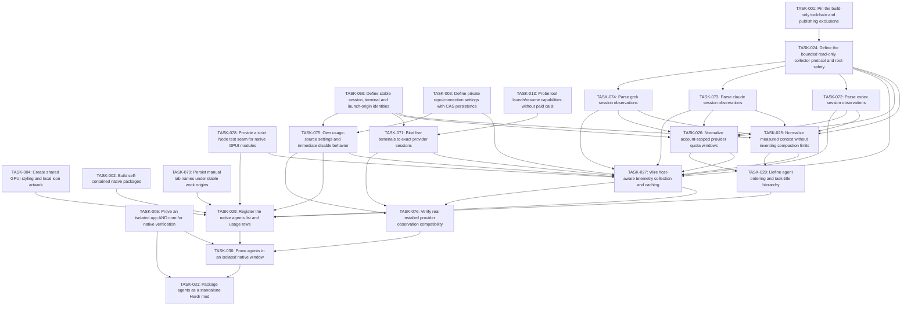

# Plan: Mission Control agents

## Overview

Show task-named agents with their actual tool icons, independent session context remaining and shared account quota remaining, priority/space grouping and truthful missing/stale states across machines.

Mode: **EXPANSION**. Review default: **codex**. Status: **draft**. Tasks: **14**.

Canonical source: [mission-control-agents.json](mission-control-agents.json).

## Scope Challenge

The approved feature scope is frozen. The implementation is greenfield native GPUI, so EXPANSION accurately describes the repository work; it does not add features beyond DESIGN-NOTES.md. Codex remains the review default. Atomic three-file scopes explain the task count.

## Prerequisites

- Herdr app 0.1.9 / hc 0.1.14 were observed; re-read installed declarations before execution and stop on incompatible contracts.
- All plans must pass founder review at their current hashes before implementation.
- Source, mounted native UI, authenticated provider checks, install and public publishing are separate gates.

Cross-plan prerequisites:

- TASK-001: [mission-control](mission-control.md) — Pin the build-only toolchain and publishing exclusions
- TASK-069: [mission-control](mission-control.md) — Define stable session, terminal and launch-origin identities
- TASK-003: [mission-control](mission-control.md) — Define private repo/connection settings with CAS persistence
- TASK-078: [mission-control](mission-control.md) — Provide a strict Node test seam for native GPUI modules
- TASK-004: [mission-control](mission-control.md) — Create shared GPUI styling and local icon artwork
- TASK-002: [mission-control](mission-control.md) — Build self-contained native packages
- TASK-070: [mission-control](mission-control.md) — Persist manual tab names under stable work origins
- TASK-005: [mission-control](mission-control.md) — Prove an isolated app AND core for native verification
- TASK-013: [mission-control-agent-menu](mission-control-agent-menu.md) — Probe tool launch/resume capabilities without paid calls

## Non-Goals

- No modification of shipped mods/layouts, generated Herdr type files, AGENTS.md, existing user sessions or credential stores.
- No Jira/GitHub workflow mutation, autonomous issue assignment or paid agent calls for fetching boards.
- No claim that the HTML mockup or load-only native check proves live behavior.

## Contracts

- Native GPUI JavaScript only: gpui-kit / gpui-base / herdr are runtime externals. No DOM, Node, CSS or setTimeout in GPUI. Helpers run out of process through exec; cx is not retained across awaits.
- Source paths are observed under src/, scripts/, tests/ and evidence/. Existing completed foundation and mod outputs are recorded in .ulpi/execution.json; new targets remain explicit task-owned creates. A changed completed contract reopens its owner task, marks its current files Modify and removes the old scheduling completion until replacement evidence passes. Prototypes and external examples remain references, not native reuse.
- All TASK IDs are globally unique. dependsOn can refer to another plan; externalDependencies records the owning JSON and its provided capability. The generated index resolves and validates the union DAG. There is no master execution plan.
- Canonical JSON is the source of truth. Markdown, dependency maps, execution layers and critical paths are derived. A change invalidates the reviewed SHA256 of that plan and all materially affected consumers.
- Build compilation may produce multiple artifacts. generatedArtifacts are compiler / capture outputs, never hand-edited source. Each task has at most three authored files. The package builder owns compilation and materialization; output manifests enumerate hashes and source provenance.
- Every standalone package is <name>/mods/<name>/ plus RECIPE.md, actual preview.png, optional keys.json and notices; no layouts/. It must work after copying only that mod directory. Shared source is bundled inside main.js / backend.mjs or copied as collector.py inside that same mod, with no runtime cross-mod code imports.
- Layout package mission-control/ contains both layouts and byte-equivalent copies of required standalone mods. One public GitHub repository may hold all complete package folders and both topics herdr-mod and herdr-layout, as the installed sharing rules explicitly allow.
- IDs and caches qualify machine, canonical repo root, source, account/connection, site and issue/session ID. A null machine means local. Never select a different repo or account as fallback. Remote paths are not local paths.
- Herdr exec(command,args,{cwd,on}) has no stdin or env option, rejects unreachable hosts and bounds requests to 30 s / 8 MiB. Use argv arrays, not interpolated shell. run returns null, not created IDs. Acknowledged creation uses exec("herdr-app",["do","tab.new",JSON.stringify(args)]) and validates its actual result shape before recording success.
- Settings persist in appHome()/mission-control/config.json via writeTextFile(path,text,expected) CAS. Credentials never enter shared state, logs, exported packages, arguments or screenshots. Shared keys are mission-control-* and versioned. CAS conflict reloads and retries boundedly or reports conflict.
- RepoBinding v1: {machine:null|string,repoRoot:string,jira?:{connectionId,project?:string,jql?:string},github?:{connectionId,owner,repo,status?:{labels?:{todo:[],inProgress:[],done:[]},project?:{owner,number,fieldId,options:{todo:string[],inProgress:string[],done:string[]},unmapped:"error"}}},mountedLocalPath?:string}. Reusable connections are configured separately; migration or invalid v1 data never overwrites the original.
- LaunchRequest v1: {requestId:string,idempotencyKey:string,originId:string,spaceId,machine,repoRoot,checkoutRoot?:string,toolKey,source?:{kind,connectionId,site,id,key,url,title,body},worktree:boolean,worktreePath?:string,branch?,model?,reasoning?,instructions?,skill?,subagents?}. LaunchResult is {ok:true,tabId,terminalId?,folder,reused:boolean} or {ok:false,code,message,recovery?}; unsupported options fail before spawning. repoRoot is canonical repository identity; checkoutRoot captures the actual selected worktree execution root and defaults explicitly to repoRoot only for tracker-bound cards without a live checkout. Before launch, validate checkoutRoot belongs to the same canonical Git common directory; current-checkout launches use checkoutRoot, never the common main checkout by accident.
- Source Issue v1: {identity:{kind,connectionId,site,id},key,title,url,body,statusGroup:"todo"|"inProgress"|"done",statusName,priority?,repoBinding,updatedAt?}. Source categories/mappings determine status; running agents do not move issue cards. Invalid status / wrong identity is an error, not an arbitrary category.
- Snapshot<T> v1: {data:T[],fetchedAt,scope,cursor?,truncated:boolean,error?:{code,message,retryAt?}}. Scope/account changes clear visible old-scope data immediately; same-scope failures may show timestamped stale data. Cap 1000 records per scope, page 50, explicit Load more / truncated label, concurrency <=4 and one in-flight request per scope.
- Only read-only Jira/GitHub/MCP requests are in scope. Each connection is opt-in, has an allowlisted HTTPS origin and explicit adapter. Redirects and tool responses cannot redirect credentials to another origin. Helper output is normalized and redacted; external prose is task data, never an executable shell command.
- UI uses graphite chrome #101114, surfaces #17191d, subdued #2a2d33 separators, muted labels and blue focus. Agent task titles get actual tool icons. Icons are local SVG/image assets or declared shipped icons, never font glyph dependencies or mojibake.
- Native isolation is owned once by TASK005 in mission-control.json: use its exact NativeIsolationReceiptV2, FixtureEnvironment ABI and validateNativeIsolationReceipt(receipt,{receiptPath?}) contract. Existing app/core instances are never queried or mutated. New proof binds fresh private selector roots, task-created Unix listeners and process generations; no new receipt claims an observed unchanged user PID. Package checks consume the canonical validator, including only the exact pinned historical legacy receipts. Missing, failed, downgraded or tampered proof cannot release a package or publishable preview.
- Node >=22 and Python >=3 are declared optional-helper prerequisites, probed on the execution host. Remote collector runs as exec("python3",["-c",ownCollectorSource,JSON.stringify(request)],{on:machine}); no assumption that a local helper file exists remotely. Missing Python reports unsupported host metrics/history without hiding agents or blocking terminals.
- SessionIdentity v1 is {machine:null|string,provider:string,credentialScope:string,providerRoot:string,sessionId:string}. All context/history/bindings carry the full value. TerminalIdentity is {machine,address,createdMs,foregroundPid}; a changed generation invalidates correlation. Active agents have no native provider-session field in the observed hc schema. Only caller-assigned exact IDs, explicit resume argv or a verified provider-native/PID-file handshake bind them; cwd/title/recency never do.
- TabNameOwnership v1 is owned upstream by TASK-070, keyed by stable originId with optional exact SessionIdentity and current tab instance. launch/resume/reopen transfer ownership only after acknowledgment; observers bundled into standalone tabs/sessions/reopen record manual edits under one CAS lease. Unknown imported histories use reported-title fallback and have no invented manual name.
- Generic launch idempotencyKey identifies one UI intent, not every new-agent request in a repo. Separate generic intents mint distinct keys; retries retain the same key. Issue/PR quick-start dedup uses qualified host/repo/source/connection/site/item plus tool policy. Origin IDs remain distinct from source item keys and from ephemeral tab IDs.
- knownAgents().installed/run is authority for base generic launch, including shell functions/wrappers. Help probes only grant advanced/model/reasoning/caller-session/resume capabilities. A failed probe disables those options; it does not block a supported base run. An explicitly requested unsupported advanced option fails before side effects.
- JiraConnection v1 is discriminated: api {id,kind:"api",site:httpsOrigin,cloudId?:uuid,auth:{kind:"basic",usernameEnv,tokenEnv}|{kind:"bearer",tokenEnv}}; cli {id,kind:"cli",site,execution:{machine:null,command,argsTemplate:string[]},mapping:{issuesPath,nextCursorPath?,fields,statusGroups}}; mcp-stdio {id,kind:"mcp-stdio",site,execution:{machine:null,command,args:string[],envRefs:Record<string,string>},search:{tool,argsTemplate,resultMapping}}; mcp-http {id,kind:"mcp-http",site,url:httpsURL,auth?:{kind:"basic",usernameEnv,tokenEnv}|{kind:"bearer",tokenEnv},search:{tool,argsTemplate,resultMapping}}. Basic username/token are resolved only in helper memory. credentialEnv/envRefs contain environment variable names, never credentials. In this entire union, site means the canonical Jira serverInfo.baseUrl HTTPS origin, not a custom displayUrl; issue links deliberately use that canonical site.
- Jira API routing is explicit: Basic without cloudId uses the configured tenant site (unscoped token); an explicit cloudId routes Basic/Bearer through https://api.atlassian.com/ex/jira/{cloudId}, and serverInfo.baseUrl must match the configured canonical tenant origin before fetching issues. Setup labels site as canonical Jira base URL; if a custom displayUrl differs, show canonical-base-URL guidance and publish no mismatched cards, without silently rewriting the saved site. Bearer without cloudId discovers https://api.atlassian.com/oauth/token/accessible-resources, selects the unique Jira-scoped resource matching the exact tenant URL, then uses that gateway route. Never infer token type or select the first accessible site. OAuth access tokens are existing env references; this release does not implement OAuth login/refresh. Credential origins are only the configured tenant or the fixed official gateway for the selected route; issue links always retain the tenant site. cloudId/auth/profile/query changes invalidate cursors and cached scope.
- Jira CLI and stdio MCP execute locally in the panel helper in this release; execution.machine must be null and a remote value is a setup error, never local fallback. Repo execution machine is independent and can be remote. A remote integration may expose explicitly configured HTTPS MCP; no local backend path is assumed present on a server. Existing agent MCP configuration requires explicit server/tool/profile selection, not automatic process sharing.
- GitHub Projects mapping uses stable fieldId and option IDs grouped into todo/inProgress/done; setup fetches field/options and saves explicit selection. Unknown/unmapped or multiply mapped option is an actionable configuration error. Without any status mapping, closed is Done and open is To do with an explicit unmapped-progress explanation.
- GitHub PullRequest v1 and PRActionRequest v1 are defined once by TASK044 in .ulpi/plans/mission-control-github.json, including author, explicit ref availability, independent discussion access and action-specific task mapping. That owning contract is canonical; this plan does not duplicate or redefine the PR schema. The layout consumes the GitHub mod views; unrelated mods do not acquire a runtime dependency on its model.
- All Node tests that import GPUI modules use node --import ./tests/support/native-loader.mjs --test <owned test>. TASK-078 supplies a strict recording tree/action seam, not a real renderer. Actual UI proof requires TASK-077 PID-bound native input plus before/after status/frame assertions; structural commands alone never prove a click.
- Usage/history source access implements the already-requested features: read-only documented standard provider session roots on their own host, with source settings and exact path disclosures, no extra permission prompt. Extra roots/legacy cache paths are explicitly configured. Disable/change cancels publication, clears related bindings/caches and stops subsequent reads. No auth files, credential copying or automatic hook rewrites.
- ProviderObservation v1 is discriminated: available {state:"available",identity:SessionIdentity,provenance:{provider,format,formatVersion:null|string,sourceDigest,observedAt:null|number},title?:string,cwd?:string,context:null|{usedTokens:null|number,windowTokens:null|number,compactionLimitTokens:null|number,reportedUsedPercent:null|number},quota:null|{proof:{kind:"provider-account"|"session-account-digest"|"session-report"|"none",machine,credentialScope,accountId:null|string,poolId:null|string},windows:[{name,remainingPercent,observedAt:null|number,resetsAt:null|number}]} } | unavailable {state:"unavailable",identity:SessionIdentity|null,provenance:{provider,format,formatVersion:null|string,sourceDigest,observedAt:null|number},code,reason}. Error envelopes use {state:"error",code,reason,scope} with no raw file content. Null/missing reported context/account/window means unavailable at normalization, never guessed. TASK-024 owns this boundary; TASK-072/073/074 emit it and TASK-025/026 consume it.
- Launch source.id is stable provider identity; source.key is the visible naming snapshot. Issue mappings copy identity.id separately from key. GitHub PR canonical owner/repo#number identity, immutable captured checkout and action task mapping are owned by TASK044 in .ulpi/plans/mission-control-github.json. Existing source/path/ref snapshots stay immutable for acknowledged requests; unsafe or occupied fresh worktree targets remain errors.



## Existing Code Leverage

| Observed path / reference | Classification | Use |
| --- | --- | --- |
| AGENTS.md | inspected reference | Existing repository guidance; preserve this file unchanged. |
| DESIGN-NOTES.md | inspected reference | Accepted requirements and explicit packaging / planning instructions. |
| work/mission-control-two-views.html | inspected reference | Visual / interaction reference only; no HTML is used by the native runtime. |
| /Users/ciprian/.config/herdr-app/AGENTS.md | inspected reference | Installed Herdr rules, read on 2026-10-30, including sharing / recipe requirements at lines 403-457. |
| /Users/ciprian/.config/herdr-app/herdr.d.ts | inspected reference | Installed API truth: exec, knownAgents, readTextFile, writeTextFile, spaces, agents, layout and overlay commands. |
| /Users/ciprian/.config/herdr-app/mods/tabs/main.js | inspected reference | External installed implementation inspected for tab semantics; do not import or read another mod at runtime. |
| /Users/ciprian/work_cip/herdr-agent-usage/src/cache.rs | inspected external reference | External local legacy-plugin cache schema inspected, not a dependency or source module in this repo. Optional read-only sanitized cache compatibility must pass identity/schema checks. |
| /Users/ciprian/.config/herdr-app/mods/agents/main.js | external installed semantics inspected | Port status ordering, sub-agent traversal, program icons/focus and setAgentOrder semantics with native regression proof; new telemetry rows and identity contracts are separate. |
| /Users/ciprian/work_cip/herdr-agent-usage/src/model.rs | external serialized-schema reference read | ProviderSnapshot/UsageWindow/session account/scopes inspected; accept only pinned sanitized shapes, never old Herdr agent_session API assumptions. |
| /Users/ciprian/work_cip/herdr-agent-usage/src/identity.rs | external identity reference read | Legacy plugin names/cache sources establish compatibility filenames, not a runtime dependency or credential source. |

## Tasks

### TASK-024: Define the bounded read-only collector protocol and root safety

Implement the portable Python protocol/security foundation with SessionIdentity-qualified request/response, allowed provider roots, symlink containment, bounded files/bytes/time, paging and incremental scan cursors. This task does not implement provider parsers. Registry functions collect_codex/collect_claude/collect_grok are supplied by separate tasks; the builder concatenates those trusted function modules before one final entrypoint, producing a standalone collector.py <=64 KiB for remote python3 -c. No remote imports of local repository files. Never read auth files or emit raw transcripts. ProviderObservation v1 is discriminated: available {state:"available",identity:SessionIdentity,provenance:{provider,format,formatVersion:null|string,sourceDigest,observedAt:null|number},title?:string,cwd?:string,context:null|{usedTokens:null|number,windowTokens:null|number,compactionLimitTokens:null|number,reportedUsedPercent:null|number},quota:null|{proof:{kind:"provider-account"|"session-account-digest"|"session-report"|"none",machine,credentialScope,accountId:null|string,poolId:null|string},windows:[{name,remainingPercent,observedAt:null|number,resetsAt:null|number}]} } | unavailable {state:"unavailable",identity:SessionIdentity|null,provenance:{provider,format,formatVersion:null|string,sourceDigest,observedAt:null|number},code,reason}. Error envelopes use {state:"error",code,reason,scope} with no raw file content. Null/missing reported context/account/window means unavailable at normalization, never guessed. TASK-024 owns this boundary; TASK-072/073/074 emit it and TASK-025/026 consume it. Own the shared JavaScript union validator in provider-observation.js so both context and quota validate the complete envelope before consuming any field. Cross-language boundary fixtures run from collector_test.py, preserving the three-file task scope.

**Type:** feature  
**Priority:** P1  
**Effort:** L  
**Agent:** python-senior-engineer  
**Review:** codex  
**Depends on:** TASK-001

**Acceptance Criteria:**

- Protocol fixtures enforce <=50 records/page, <=1000 indexed records/scope, <=4 MiB aggregate scanned content/request, bounded per-file tails and a 10s deadline; explicit cursor/truncated state replaces silent omission.
- Unknown root/provider/operation, traversal/symlink escape, missing/rotating file or oversized request yields a scoped error without private file contents; protocol tests do not pretend to validate missing provider parsers.

**Write scope:**

| File | Action | Role |
| --- | --- | --- |
| src/shared/collector.py | Create | Portable read-only collector, sanitized JSON request/response protocol and bounded incremental file scans. |
| tests/collector_test.py | Create | Temporary Claude/Codex/Grok trees with corrupt/truncated/oversized records, pagination and wrong-session/path tests. |
| src/shared/provider-observation.js | Create | Shared strict JavaScript validator for the whole ProviderObservation v1 union, imported by context and quota consumers; Python protocol tests verify cross-language agreement. |

**Validate:**

```sh
python3 -m unittest discover -s tests -p collector_test.py
```

### TASK-025: Normalize measured context without inventing compaction limits

Own ContextReading v1 {identity:SessionIdentity,state:"available"|"stale"|"unavailable",remainingPercent:null|number,basis:"reported"|"estimate"|"unavailable",observedAt,reason?}. Codex token_count uses its reported window; Claude requires reported context-window/statusline metadata, not a guessed model capacity. Report before-compaction only when its threshold is known; otherwise label the estimate honestly. Consume only the validated ProviderObservation v1 union owned by TASK-024; malformed observation shape is a reasoned unavailable/error, not a partial success.

**Type:** feature  
**Priority:** P1  
**Effort:** L  
**Agent:** general-purpose  
**Review:** codex  
**Depends on:** TASK-024, TASK-072, TASK-073, TASK-074, TASK-069

**Acceptance Criteria:**

- Two sessions of one provider retain distinct context readings; values clamp valid reported quantities and distinguish estimates from reported compaction remaining.
- Missing/contradictory window or stale/wrong session returns unavailable/stale with reason, never a fabricated 100% allowance.

**Write scope:**

| File | Action | Role |
| --- | --- | --- |
| src/shared/context.js | Create | Exact session matching, token-window interpretation, age and reason formatting. |
| tests/context.test.mjs | Create | Known window, reserved budget, missing threshold, cache tokens and wrong-session tests. |

**Validate:**

```sh
node --test tests/context.test.mjs
```

### TASK-026: Normalize account-scoped provider quota windows

Own QuotaIdentity v1 {machine,provider,credentialScope,poolId:null|string,accountId:null|string,session?:SessionIdentity} and QuotaReading v1 {identity,state:"available"|"stale"|"unavailable",windows:[{name,remainingPercent,resetsAt?}],observedAt:null|number,scope:"shared-account"|"session-observation"|"unknown",reason?}. Share only with every required identity component verified; poolId null is valid only when the provider explicitly has no pool dimension. Codex session rate_limits without serving-account proof remains a session observation, never an account-wide guess. Legacy compatibility accepts ONLY explicitly configured codex-app-server.json, claude-statusline.json, grok-cli-billing.json in a bounded allowed cache root. Validate provider/source/fetched_at_unix and windows {kind,used_percent,remaining_percent,resets_at}; Claude session_quota_only/session_contexts/session_windows/session_accounts/session_quota_observations must be keyed by the exact session, and account digests must match before sharing. Legacy quota_scope_windows and absent/unknown account/profile proofs are not shared. No token/auth-file reads or refreshing the old plugin. Consume only the validated ProviderObservation v1 union owned by TASK-024; malformed observation shape is a reasoned unavailable/error, not a partial success.

**Type:** feature  
**Priority:** P1  
**Effort:** L  
**Agent:** general-purpose  
**Review:** codex  
**Depends on:** TASK-024, TASK-072, TASK-073, TASK-074, TASK-069

**Acceptance Criteria:**

- Agents with fully proven host/provider/credential/account/pool identity share the newest trustworthy quota reading; session-local observations remain labeled as such.
- Unknown/switched account/pool, unsupported filename/source/schema, stale freshness or missing session-account proof yields explicit unavailable/stale and never shares another account reading.

**Write scope:**

| File | Action | Role |
| --- | --- | --- |
| src/shared/quota.js | Create | Quota identity matching, percent/reset normalization and safe legacy-cache compatibility. |
| tests/quota.test.mjs | Create | Same account across sessions, multiple accounts/pools, stale windows, missing identity and malformed cache. |

**Validate:**

```sh
node --test tests/quota.test.mjs
```

### TASK-027: Wire host-aware telemetry collection and caching

Own the GPUI bridge that reads its own bundled collector.py and runs it using exec python3 -c on the actual host, with one request/host at a time and bounded request subsets. Cache per-host/session/account; active context refresh <=30 s, quota <=60 s when observations exist; stale after 2 min context / 5 min quota. Do not install hooks or read remote local paths accidentally. Use full SessionIdentity/QuotaIdentity and TASK-071 proof bindings. Source disable/root change aborts or ignores outstanding publication and clears affected caches; no inferred active session fallback. Read only committed bindings from appHome()/mission-control/session-bindings.json through TASK-071, revalidate full raw terminal generation, and never rely on another module instance's memory.

**Type:** feature  
**Priority:** P1  
**Effort:** L  
**Agent:** general-purpose  
**Review:** codex  
**Depends on:** TASK-024, TASK-025, TASK-026, TASK-003, TASK-072, TASK-073, TASK-074, TASK-071, TASK-075, TASK-078

**Acceptance Criteria:**

- A local Python subprocess returns normalized observations and a remote request carries the selected on: host; helper output contains no transcripts or secrets.
- Missing Python/offline host/oversized response or mismatched scope leaves agents visible with unavailable readings and cannot fall back to local data.

**Write scope:**

| File | Action | Role |
| --- | --- | --- |
| src/shared/telemetry.js | Create | Native async collector transport, capability checks, bounded host concurrency and normalized output cache. |
| tests/telemetry.test.mjs | Create | Protocol/transport integration with local Python plus recording remote executor, timeout and account-switch invalidation. |

**Validate:**

```sh
node --import ./tests/support/native-loader.mjs --test tests/telemetry.test.mjs
```

**Generated outputs (not authored source):**

- mission-control-agents/mods/mission-control-agents/collector.py

### TASK-028: Define agent ordering and task-title hierarchy

Order Priority as blocked > done > working > idle, stable within groups, or group by space/machine in display order. Preserve sub-agent focus behavior and setAgentOrder consistently with the actually displayed rows. Use task metadata/title/owned auto-title before a neutral Agent label; do not repeat the provider name as the task title.

**Type:** feature  
**Priority:** P1  
**Effort:** L  
**Agent:** general-purpose  
**Review:** codex  
**Depends on:** TASK-025, TASK-026

**Acceptance Criteria:**

- Priority and Spaces modes retain every running visible agent, and display order matches native agent.next/prev order.
- Unknown readings keep two explicit context/quota unavailable indicators, and duplicate provider/host/session names never merge agents.

**Write scope:**

| File | Action | Role |
| --- | --- | --- |
| src/mods/mission-control-agents/model.js | Create | Agent filtering/group/order, title fallback and context/quota row model. |
| tests/agents-model.test.mjs | Create | All four statuses, parent/sub-agent, cross-host same IDs, filters and missing metadata. |

**Validate:**

```sh
node --test tests/agents-model.test.mjs
```

### TASK-029: Register the native agents list and usage rows

Render collapsible Agents with compact grouping icon buttons, actual tool icons beside task names and two subordinate context/quota readings with account scope/age hover details. Wire agent.focus / sub-agent focus and telemetry refresh lifecycle using cx.timer/cx.spawn safely; independent collapse/grouping state persists. Provide this same mod's Usage sources settings role, path disclosure and enable/disable/root controls wired to TASK-075. Unknown correlations render both indicators with a specific unavailable reason.

**Type:** feature  
**Priority:** P1  
**Effort:** L  
**Agent:** general-purpose  
**Review:** codex  
**Depends on:** TASK-028, TASK-027, TASK-004, TASK-002, TASK-075, TASK-070, TASK-078

**Acceptance Criteria:**

- Every agent row shows task title, actual icon, context remaining and account quota remaining; working/blocked/done/idle states remain distinct.
- Slow/failing telemetry cannot block native rendering/focus or retain stale cx; empty lists, missing artwork and offline hosts remain usable.

**Write scope:**

| File | Action | Role |
| --- | --- | --- |
| src/mods/mission-control-agents/main.js | Create | GPUI list, timers, telemetry state and native focus/order actions. |
| src/mods/mission-control-agents/mod.json | Create | Standalone agents manifest and grouping commands. |
| tests/agents.test.mjs | Create | Rendered row/action contracts, independent collapse and lifecycle cancellation tests. |

**Validate:**

```sh
node --import ./tests/support/native-loader.mjs --test tests/agents.test.mjs && node scripts/project.mjs check mission-control-agents
```

**Generated outputs (not authored source):**

- mission-control-agents/mods/mission-control-agents/main.js
- mission-control-agents/mods/mission-control-agents/mod.json
- mission-control-agents/mods/mission-control-agents/assets/*.svg

### TASK-030: Prove agents in an isolated native window

Exercise dozens of fixture agents, all statuses, priority/space toggle, actual/native focus, two sessions sharing quota, distinct context and offline/missing observation states. Check bounded refresh and responsive native search/scroll. Exercise two same-repo sessions with distinct exact bindings, fresh unbound Codex, restarted terminal and source disable during scan. Distinguish fixture UI evidence from TASK-076 actual local provider compatibility.

**Type:** test  
**Priority:** P1  
**Effort:** L  
**Agent:** general-purpose  
**Review:** codex  
**Depends on:** TASK-029, TASK-005, TASK-076

**Acceptance Criteria:**

- A standalone install containing only this mod passes herdr-app check and the mounted scenario; capture its actual rendered preview with zero app errors.
- A missing capability / empty-state scenario is exercised; no generated success receipt or screenshot is accepted when an assertion or isolation proof fails.

**Write scope:**

| File | Action | Role |
| --- | --- | --- |
| tests/native/agents.mjs | Create | Native scenario, uses the shared harness and asserts actual UI / command outcomes. |
| evidence/native/agents.json | Create | Machine-readable commands, outcomes, isolation identities, errors and screenshot hashes; generated evidence, no private content. |

**Validate:**

```sh
node scripts/native-harness.mjs run agents
```

**Generated outputs (not authored source):**

- mission-control-agents/preview.png

### TASK-031: Package agents as a standalone Herdr mod

Write the six-part reconstruction brief from the finished files. Validate the package in a fresh folder with no other custom mod installed; include access / program / network disclosures and applicable attribution. Consume TASK005 validateNativeIsolationReceipt for both genuine retained legacy receipts and new private-only proof, without asserting an observed unchanged user PID for a run that never queried it. Preserve recipe/import/asset/current-source/artifact/preview checks.

**Type:** docs  
**Priority:** P1  
**Effort:** L  
**Agent:** general-purpose  
**Review:** codex  
**Depends on:** TASK-030, TASK-005

**Acceptance Criteria:**

- Copying only mods/mission-control-agents/ is sufficient; no sibling mod code or repository path is read at runtime.
- The exact preview hash matches the passed native receipt; missing recipe, fake/absent preview or any layouts/ folder fails package validation.
- The package check rejects missing or invalid native isolation, accepts genuine retained legacy evidence and the new private-only ownership receipt without inventing a live-user PID observation.

**Write scope:**

| File | Action | Role |
| --- | --- | --- |
| mission-control-agents/RECIPE.md | Modify existing source or prior task output | Recipe in Herdr order: summary + preview, What you see, How it behaves, Built from, Watch out, Done when. |
| tests/package-agents.test.mjs | Modify existing source or prior task output | Asserts self-contained runtime imports, own assets/helpers, recipe sections and absence of layouts/. Import the canonical TASK005 receipt validator; reject absent/invalid isolation while retaining actual legacy evidence support. |
| mission-control-agents/preview.png | Modify existing source or prior task output | Actual native frame from the preceding scenario, not a browser mock or generated illustration. |

**Validate:**

```sh
node scripts/project.mjs build mission-control-agents && node --test tests/package-agents.test.mjs
```

**Generated outputs (not authored source):**

- mission-control-agents/mods/mission-control-agents/main.js
- mission-control-agents/mods/mission-control-agents/mod.json
- mission-control-agents/mods/mission-control-agents/assets/*.svg

### TASK-071: Bind live terminals to exact provider sessions

Own a verified correlation service keyed by TerminalIdentity and SessionIdentity. For a fresh tool whose help permits caller-assigned IDs (observed Claude --session-id UUID), provision the ID and record it only after acknowledged launch. Explicit resume argv is another proof. Fresh Codex and arbitrary tools lacking such a flag require a verified provider-native handshake or exact process-open-file evidence from the same foreground PID tree, otherwise remain unbound. Do not install/replace global hooks or use cwd/title/recency as correlation. Export binding proposal/commit/invalidate to launch and telemetry. This task owns the durable cross-bundle authority appHome()/mission-control/session-bindings.json, not an in-memory singleton. BindingStore v1 {v:1,revision,proposals:Record<requestId,{originId,session:null|SessionIdentity,state:"proposed"|"commit-pending"|"committed"|"invalidated",createdAt:number,updatedAt:number,invalidatedAt:null|number,expiresAt:null|number,ack?:{tabId,terminal:TerminalIdentity},proof?:{kind,observedAt,sourceDigest}}>,terminals:Record<terminalKey,requestId>}. proposal and commit use readTextFile/writeTextFile CAS with bounded reload/retry; proposal TTL is 5min. Only acknowledged committed mappings are readable as telemetry evidence. commit is idempotent, stores its proof/generation and updates the terminal index atomically; a fresh consumer reads the same persisted store. Invalidate on generation/PID/root/source/profile changes or explicit disable, never transfer an old binding by name. Reconcile committed records against full raw terminal snapshots on startup; proposed/commit-pending state cannot attach metrics. Expired interrupted creation with uncertain side effects returns recovery-required and never blindly respawns. No long-lived background lease is needed: all store changes are bounded atomic CAS transitions; the existing single observer lease may trigger reconciliation. expiresAt applies ONLY to proposed/commit-pending states; committed records use expiresAt:null and remain valid for as long as their exact terminal generation/source proof remains valid, regardless of age. Under the same CAS mutation, prune expired uncommitted records only after the launch journal retains recovery-required state for uncertain side effects; remove invalidated records oldest first, retaining at most 100 invalidation diagnostics. Enforce <=500 total records and <=768KiB serialized store. Never evict an active committed mapping for age/space; if pruning cannot make room, reject a new proposal with BINDING_CAPACITY and actionable cleanup instead of losing active evidence. Offline/unavailable host does not prove invalidation. Every terminal index entry must reference a retained committed record; pruning updates both maps atomically. Record createdAt at the successful proposal CAS and updatedAt on each successful transition (UTC milliseconds from the injected clock). invalidatedAt is null until the first successful invalidation CAS, then set to that transition timestamp and preserved on repeated invalidation. Garbage collection sorts invalidated records by (invalidatedAt ascending, requestId ASCII ascending); missing/nonfinite timestamps are invalid schema, never inferred from proof.observedAt. Remove the earliest eligible entries until at most 100 remain. A test must load the same persisted snapshot in two fresh consumers, give equal invalidatedAt values to multiple records, and prove identical pruning/index results while all active committed mappings survive.

**Type:** feature  
**Priority:** P1  
**Effort:** L  
**Agent:** general-purpose  
**Review:** codex  
**Depends on:** TASK-069, TASK-013

**Acceptance Criteria:**

- Launch-side proposal/commit persists an exact proven mapping; a newly instantiated separately bundled telemetry consumer reads the same committed identity, and generation/PID/source change invalidates it.
- Failed launch or commit-pending/expired ambiguous creation cannot publish metrics or trigger a duplicate spawn; retry of an acknowledged commit is idempotent and interrupted state yields explicit recovery. A committed binding remains after five minutes while its raw generation is valid; CAS pruning removes only eligible expired/invalid records, keeps the terminal index consistent and returns BINDING_CAPACITY without evicting active mappings. Equal-timestamp invalidation ties prune by requestId ASCII order identically in independent fresh consumers; timestamp fields persist atomically and are never inferred from optional proof time.

**Write scope:**

| File | Action | Role |
| --- | --- | --- |
| src/shared/session-bindings.js | Create | Durable CAS binding authority, exact proof/proposal/acknowledged commit/read/invalidate API and full-terminal generation hydration. |
| tests/session-bindings.test.mjs | Create | Concurrent same-repo sessions, wrong host, PID reuse/restart, exact resume, absent handshake and no-ID provider cases. |

**Validate:**

```sh
node --test tests/session-bindings.test.mjs
```

### TASK-072: Parse codex session observations

Parse session_meta, event_msg/token_count and rate_limits from observed Codex rollout JSONL. Preserve explicit model_context_window, session ID, cwd and account evidence if reported; no auth.json reads. Use only collector-foundation bounded readers; export collect_codex(request,readers). Unit fixtures are synthetic and do not become live runtime fallback data. Emit exactly ProviderObservation v1 from TASK-024, including discriminated unavailable/errors and reported context/quota/provenance fields; never ad-hoc provider objects.

**Type:** feature  
**Priority:** P1  
**Effort:** L  
**Agent:** python-senior-engineer  
**Review:** codex  
**Depends on:** TASK-024

**Acceptance Criteria:**

- The codex parser returns SessionIdentity-qualified actual supported fields and exact IDs for valid fixtures, retaining source observation timestamps.
- Unsupported/malformed/rotated records and missing identity/window/account are explicit unavailable observations, never guessed metrics or another session's values.

**Write scope:**

| File | Action | Role |
| --- | --- | --- |
| src/shared/provider_codex.py | Create | codex parser functions composed into the own-folder collector at build time. |
| tests/provider_codex_test.py | Create | Provider-specific temporary-file fixtures, corrupt/rotated/missing observations and secret/transcript exclusion. |

**Validate:**

```sh
python3 -m unittest discover -s tests -p provider_codex_test.py
```

### TASK-073: Parse claude session observations

Parse observed Claude project JSONL and explicitly configured sanitized statusline observations. Context windows/account/session proof must be reported, not guessed from a model name; no .credentials.json or Keychain reads. Use only collector-foundation bounded readers; export collect_claude(request,readers). Unit fixtures are synthetic and do not become live runtime fallback data. Emit exactly ProviderObservation v1 from TASK-024, including discriminated unavailable/errors and reported context/quota/provenance fields; never ad-hoc provider objects.

**Type:** feature  
**Priority:** P1  
**Effort:** L  
**Agent:** python-senior-engineer  
**Review:** codex  
**Depends on:** TASK-024

**Acceptance Criteria:**

- The claude parser returns SessionIdentity-qualified actual supported fields and exact IDs for valid fixtures, retaining source observation timestamps.
- Unsupported/malformed/rotated records and missing identity/window/account are explicit unavailable observations, never guessed metrics or another session's values.

**Write scope:**

| File | Action | Role |
| --- | --- | --- |
| src/shared/provider_claude.py | Create | claude parser functions composed into the own-folder collector at build time. |
| tests/provider_claude_test.py | Create | Provider-specific temporary-file fixtures, corrupt/rotated/missing observations and secret/transcript exclusion. |

**Validate:**

```sh
python3 -m unittest discover -s tests -p provider_claude_test.py
```

### TASK-074: Parse grok session observations

Verify the installed Grok session schema using redacted structural evidence. Support only observed exact IDs and reported usage fields; unknown formats return unavailable rather than guessed title/context/quota. Use only collector-foundation bounded readers; export collect_grok(request,readers). Unit fixtures are synthetic and do not become live runtime fallback data. Emit exactly ProviderObservation v1 from TASK-024, including discriminated unavailable/errors and reported context/quota/provenance fields; never ad-hoc provider objects.

**Type:** feature  
**Priority:** P1  
**Effort:** L  
**Agent:** python-senior-engineer  
**Review:** codex  
**Depends on:** TASK-024

**Acceptance Criteria:**

- The grok parser returns SessionIdentity-qualified actual supported fields and exact IDs for valid fixtures, retaining source observation timestamps.
- Unsupported/malformed/rotated records and missing identity/window/account are explicit unavailable observations, never guessed metrics or another session's values.

**Write scope:**

| File | Action | Role |
| --- | --- | --- |
| src/shared/provider_grok.py | Create | grok parser functions composed into the own-folder collector at build time. |
| tests/provider_grok_test.py | Create | Provider-specific temporary-file fixtures, corrupt/rotated/missing observations and secret/transcript exclusion. |

**Validate:**

```sh
python3 -m unittest discover -s tests -p provider_grok_test.py
```

### TASK-075: Own usage-source settings and immediate disable behavior

The user has authorized context/quota/history features; perform their necessary read-only standard-root metadata access without adding a permission prompt. Own per-machine/provider source settings {enabled,roots,cacheRoots?,credentialScope}, defaulting to the documented standard session roots for known installed providers. Extra roots/legacy caches require explicit configuration. Expose Usage sources settings in the Agents mod, disclose exact paths and read-only access, validate root bounds, and clear bindings/caches plus cancel in-flight publication immediately when a source is disabled or changed. No hook/auth/config mutation.

**Type:** feature  
**Priority:** P1  
**Effort:** L  
**Agent:** general-purpose  
**Review:** codex  
**Depends on:** TASK-003, TASK-069

**Acceptance Criteria:**

- Standard provider metadata reads implement the requested usage/history features; users can inspect/change/disable each host/provider source without a blocking consent flow.
- Disabled/changed sources stop future reads and suppress in-flight stale output immediately; private auth paths or arbitrary filesystem roots are rejected.

**Write scope:**

| File | Action | Role |
| --- | --- | --- |
| src/shared/usage-sources.js | Create | Versioned source defaults, exact allowed roots, enable/disable lifecycle and cache invalidation policy. |
| tests/usage-sources.test.mjs | Create | Source disable/change during scan, invalid roots, two hosts/profiles, no auth roots and cache clearing. |

**Validate:**

```sh
node --test tests/usage-sources.test.mjs
```

### TASK-076: Verify real installed provider observation compatibility

Run read-only compatibility checks against existing standard roots on this Mac, separately from synthetic fixtures. Record provider/CLI version, supported field/schema names, counts and normalized metric availability without session text/IDs/account data in the public receipt. Exercise exact binding only where there is real proof; unknown bindings remain unavailable. Do not log in, mutate hooks or run a paid agent turn. A missing/unverified provider is declared unsupported at that gate; it cannot be advertised as measured.

**Type:** test  
**Priority:** P1  
**Effort:** L  
**Agent:** nodejs-cli-senior-engineer  
**Review:** codex  
**Depends on:** TASK-027, TASK-075, TASK-071

**Acceptance Criteria:**

- At least observed local Claude/Codex schema compatibility is recorded from actual files, with reported-versus-estimated context and account quota identity boundaries; Grok support is claimed only when observed.
- Absent schema/binding/account evidence is unavailable/unsupported and fails any claim of measured support; disabled sources remain untouched and fixture proof cannot masquerade as real-provider proof.

**Write scope:**

| File | Action | Role |
| --- | --- | --- |
| scripts/provider-compatibility.mjs | Create | Opt-out-aware local installed-provider metadata compatibility probe and redacted receipt generator. |
| tests/provider-compatibility.test.mjs | Create | Rejects fabricated/fixture-only provenance, secret-bearing output and unsupported-schema success. |
| evidence/native/provider-compatibility.json | Create | Actual installed versions/schema/availability boundaries and probe outcome, with no private session content. |

**Validate:**

```sh
node --test tests/provider-compatibility.test.mjs && node scripts/provider-compatibility.mjs verify
```

## Failure Modes

| Failure | Containment / recovery |
| --- | --- |
| Invalid / outdated config | Keep the original bytes, display the validation error and edit/retry; never reset silently. |
| Offline host / missing executable / timeout | Keep correctly scoped timestamped data, disable only the affected action, show host and retry; never execute locally as fallback. |
| Partial install / package collision | Refuse overwrites, retain the previous layout and owned-file receipt; rollback removes only newly installed matching-hash files. |
| Wrong account or malformed provider output | Reject the response, redact error details and clear wrong-scope data. Authentication never switches global CLI state. |
| Task-local assertion / native check failure | Do not advance dependent tasks, install or publish. Fix within the task scope, rerun its scoped validation and refresh any invalidated consumer evidence. |
| Ambiguous/lost correlation or terminal restart | Invalidate TerminalIdentity binding, stop publishing metrics, show unavailable and rebind only from fresh exact proof. |
| Disabled/changed usage source or rotated files | Cancel publication and clear only that source cache; no future reads until enabled, rotated tails retry within the bounded snapshot without borrowing another session. |

## Ship Cut

Do not publish or install a partially working package. A checked, self-contained standalone mod may ship after its own native evidence, recipe and real preview; the layout waits for all mandatory mod plans.

## Test Coverage Map

| Task | Paths | Gate |
| --- | --- | --- |
| TASK-024 | src/shared/collector.py, tests/collector_test.py, src/shared/provider-observation.js | unit / contract plus native gate: python3 -m unittest discover -s tests -p collector_test.py |
| TASK-025 | src/shared/context.js, tests/context.test.mjs | unit / contract plus native gate: node --test tests/context.test.mjs |
| TASK-026 | src/shared/quota.js, tests/quota.test.mjs | unit / contract plus native gate: node --test tests/quota.test.mjs |
| TASK-027 | src/shared/telemetry.js, tests/telemetry.test.mjs | unit / contract plus native gate: node --import ./tests/support/native-loader.mjs --test tests/telemetry.test.mjs |
| TASK-028 | src/mods/mission-control-agents/model.js, tests/agents-model.test.mjs | unit / contract plus native gate: node --test tests/agents-model.test.mjs |
| TASK-029 | src/mods/mission-control-agents/main.js, src/mods/mission-control-agents/mod.json, tests/agents.test.mjs | unit / contract plus native gate: node --import ./tests/support/native-loader.mjs --test tests/agents.test.mjs && node scripts/project.mjs check mission-control-agents |
| TASK-030 | tests/native/agents.mjs, evidence/native/agents.json | mounted native integration: node scripts/native-harness.mjs run agents |
| TASK-031 | mission-control-agents/RECIPE.md, tests/package-agents.test.mjs, mission-control-agents/preview.png | artifact / package validation: node scripts/project.mjs build mission-control-agents && node --test tests/package-agents.test.mjs |
| TASK-071 | src/shared/session-bindings.js, tests/session-bindings.test.mjs | unit / contract plus native gate: node --test tests/session-bindings.test.mjs |
| TASK-072 | src/shared/provider_codex.py, tests/provider_codex_test.py | unit / contract plus native gate: python3 -m unittest discover -s tests -p provider_codex_test.py |
| TASK-073 | src/shared/provider_claude.py, tests/provider_claude_test.py | unit / contract plus native gate: python3 -m unittest discover -s tests -p provider_claude_test.py |
| TASK-074 | src/shared/provider_grok.py, tests/provider_grok_test.py | unit / contract plus native gate: python3 -m unittest discover -s tests -p provider_grok_test.py |
| TASK-075 | src/shared/usage-sources.js, tests/usage-sources.test.mjs | unit / contract plus native gate: node --test tests/usage-sources.test.mjs |
| TASK-076 | scripts/provider-compatibility.mjs, tests/provider-compatibility.test.mjs, evidence/native/provider-compatibility.json | subprocess / network integration: node --test tests/provider-compatibility.test.mjs && node scripts/provider-compatibility.mjs verify |

## Execution Summary

| Metric | Derived value |
| --- | --- |
| Tasks | 14 |
| Local roots | TASK-024, TASK-071, TASK-075 |
| Union DAG layers reached | 2, 3, 4, 5, 6, 7, 8, 9 |
| Critical path including prerequisite plans | TASK-001 → TASK-003 → TASK-012 → TASK-013 → TASK-071 → TASK-027 → TASK-029 → TASK-030 → TASK-031 |
| Cross-plan task dependencies | 9 |

Layers (global prerequisite depth, not arbitrary serial order):

- Layer 2: TASK-024
- Layer 3: TASK-072, TASK-073, TASK-074
- Layer 4: TASK-025, TASK-026, TASK-075
- Layer 5: TASK-028, TASK-071
- Layer 6: TASK-027
- Layer 7: TASK-029, TASK-076
- Layer 8: TASK-030
- Layer 9: TASK-031

## Task Dependencies

```json
{
  "TASK-024": [
    "TASK-001"
  ],
  "TASK-025": [
    "TASK-024",
    "TASK-072",
    "TASK-073",
    "TASK-074",
    "TASK-069"
  ],
  "TASK-026": [
    "TASK-024",
    "TASK-072",
    "TASK-073",
    "TASK-074",
    "TASK-069"
  ],
  "TASK-027": [
    "TASK-024",
    "TASK-025",
    "TASK-026",
    "TASK-003",
    "TASK-072",
    "TASK-073",
    "TASK-074",
    "TASK-071",
    "TASK-075",
    "TASK-078"
  ],
  "TASK-028": [
    "TASK-025",
    "TASK-026"
  ],
  "TASK-029": [
    "TASK-028",
    "TASK-027",
    "TASK-004",
    "TASK-002",
    "TASK-075",
    "TASK-070",
    "TASK-078"
  ],
  "TASK-030": [
    "TASK-029",
    "TASK-005",
    "TASK-076"
  ],
  "TASK-031": [
    "TASK-030",
    "TASK-005"
  ],
  "TASK-071": [
    "TASK-069",
    "TASK-013"
  ],
  "TASK-072": [
    "TASK-024"
  ],
  "TASK-073": [
    "TASK-024"
  ],
  "TASK-074": [
    "TASK-024"
  ],
  "TASK-075": [
    "TASK-003",
    "TASK-069"
  ],
  "TASK-076": [
    "TASK-027",
    "TASK-075",
    "TASK-071"
  ]
}
```
