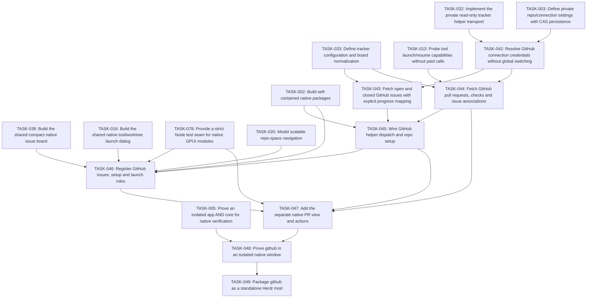

# Plan: Mission Control GitHub

## Overview

One standalone GitHub mod supplies compact issues and a separate pull-request view, both available in the overview and Classic side panels. Repo/account settings are independent of Jira; installed local tools handle issue work and PR actions.

Mode: **EXPANSION**. Review default: **codex**. Status: **draft**. Tasks: **8**.

Canonical source: [mission-control-github.json](mission-control-github.json).

## Scope Challenge

The approved feature scope is frozen. The implementation is greenfield native GPUI, so EXPANSION accurately describes the repository work; it does not add features beyond DESIGN-NOTES.md. Codex remains the review default. Atomic three-file scopes explain the task count.

## Prerequisites

- Herdr app 0.1.9 / hc 0.1.14 were observed; re-read installed declarations before execution and stop on incompatible contracts.
- All plans must pass founder review at their current hashes before implementation.
- Source, mounted native UI, authenticated provider checks, install and public publishing are separate gates.

Cross-plan prerequisites:

- TASK-032: [mission-control-jira](mission-control-jira.md) — Implement the private read-only tracker helper transport
- TASK-003: [mission-control](mission-control.md) — Define private repo/connection settings with CAS persistence
- TASK-033: [mission-control-jira](mission-control-jira.md) — Define tracker configuration and board normalization
- TASK-013: [mission-control-agent-menu](mission-control-agent-menu.md) — Probe tool launch/resume capabilities without paid calls
- TASK-002: [mission-control](mission-control.md) — Build self-contained native packages
- TASK-038: [mission-control-jira](mission-control-jira.md) — Build the shared compact native issue board
- TASK-016: [mission-control-agent-menu](mission-control-agent-menu.md) — Build the shared native tool/worktree launch dialog
- TASK-078: [mission-control](mission-control.md) — Provide a strict Node test seam for native GPUI modules
- TASK-020: [mission-control-spaces](mission-control-spaces.md) — Model scalable repo-space navigation
- TASK-005: [mission-control](mission-control.md) — Prove an isolated app AND core for native verification

## Non-Goals

- No modification of shipped mods/layouts, generated Herdr type files, AGENTS.md, existing user sessions or credential stores.
- No Jira/GitHub workflow mutation, autonomous issue assignment or paid agent calls for fetching boards.
- No claim that the HTML mockup or load-only native check proves live behavior.

## Contracts

- Native GPUI JavaScript only: gpui-kit / gpui-base / herdr are runtime externals. No DOM, Node, CSS or setTimeout in GPUI. Helpers run out of process through exec; cx is not retained across awaits.
- Source paths are observed under src/, scripts/, tests/ and evidence/. Existing completed foundation and mod outputs are recorded in .ulpi/execution.json; new targets remain explicit task-owned creates. A changed completed contract reopens its owner task, marks its current files Modify and removes the old scheduling completion until replacement evidence passes. Prototypes and external examples remain references, not native reuse.
- All TASK IDs are globally unique. dependsOn can refer to another plan; externalDependencies records the owning JSON and its provided capability. The generated index resolves and validates the union DAG. There is no master execution plan.
- Canonical JSON is the source of truth. Markdown, dependency maps, execution layers and critical paths are derived. A change invalidates the reviewed SHA256 of that plan and all materially affected consumers.
- Build compilation may produce multiple artifacts. generatedArtifacts are compiler / capture outputs, never hand-edited source. Each task has at most three authored files. The package builder owns compilation and materialization; output manifests enumerate hashes and source provenance.
- Every standalone package is <name>/mods/<name>/ plus RECIPE.md, actual preview.png, optional keys.json and notices; no layouts/. It must work after copying only that mod directory. Shared source is bundled inside main.js / backend.mjs or copied as collector.py inside that same mod, with no runtime cross-mod code imports.
- Layout package mission-control/ contains both layouts and byte-equivalent copies of required standalone mods. One public GitHub repository may hold all complete package folders and both topics herdr-mod and herdr-layout, as the installed sharing rules explicitly allow.
- IDs and caches qualify machine, canonical repo root, source, account/connection, site and issue/session ID. A null machine means local. Never select a different repo or account as fallback. Remote paths are not local paths.
- Herdr exec(command,args,{cwd,on}) has no stdin or env option, rejects unreachable hosts and bounds requests to 30 s / 8 MiB. Use argv arrays, not interpolated shell. run returns null, not created IDs. Acknowledged creation uses exec("herdr-app",["do","tab.new",JSON.stringify(args)]) and validates its actual result shape before recording success.
- Settings persist in appHome()/mission-control/config.json via writeTextFile(path,text,expected) CAS. Credentials never enter shared state, logs, exported packages, arguments or screenshots. Shared keys are mission-control-* and versioned. CAS conflict reloads and retries boundedly or reports conflict.
- RepoBinding v1: {machine:null|string,repoRoot:string,jira?:{connectionId,project?:string,jql?:string},github?:{connectionId,owner,repo,status?:{labels?:{todo:[],inProgress:[],done:[]},project?:{owner,number,fieldId,options:{todo:string[],inProgress:string[],done:string[]},unmapped:"error"}}},mountedLocalPath?:string}. Reusable connections are configured separately; migration or invalid v1 data never overwrites the original.
- LaunchRequest v1: {requestId:string,idempotencyKey:string,originId:string,spaceId,machine,repoRoot,checkoutRoot?:string,toolKey,source?:{kind,connectionId,site,id,key,url,title,body},worktree:boolean,worktreePath?:string,branch?,model?,reasoning?,instructions?,skill?,subagents?}. LaunchResult is {ok:true,tabId,terminalId?,folder,reused:boolean} or {ok:false,code,message,recovery?}; unsupported options fail before spawning. repoRoot is canonical repository identity; checkoutRoot captures the actual selected worktree execution root and defaults explicitly to repoRoot only for tracker-bound cards without a live checkout. Before launch, validate checkoutRoot belongs to the same canonical Git common directory; current-checkout launches use checkoutRoot, never the common main checkout by accident.
- Source Issue v1: {identity:{kind,connectionId,site,id},key,title,url,body,statusGroup:"todo"|"inProgress"|"done",statusName,priority?,repoBinding,updatedAt?}. Source categories/mappings determine status; running agents do not move issue cards. Invalid status / wrong identity is an error, not an arbitrary category.
- Snapshot<T> v1: {data:T[],fetchedAt,scope,cursor?,truncated:boolean,error?:{code,message,retryAt?}}. Scope/account changes clear visible old-scope data immediately; same-scope failures may show timestamped stale data. Cap 1000 records per scope, page 50, explicit Load more / truncated label, concurrency <=4 and one in-flight request per scope.
- Only read-only Jira/GitHub/MCP requests are in scope. Each connection is opt-in, has an allowlisted HTTPS origin and explicit adapter. Redirects and tool responses cannot redirect credentials to another origin. Helper output is normalized and redacted; external prose is task data, never an executable shell command.
- UI uses graphite chrome #101114, surfaces #17191d, subdued #2a2d33 separators, muted labels and blue focus. Agent task titles get actual tool icons. Icons are local SVG/image assets or declared shipped icons, never font glyph dependencies or mojibake.
- Native isolation is owned once by TASK005 in mission-control.json: use its exact NativeIsolationReceiptV2, FixtureEnvironment ABI and validateNativeIsolationReceipt(receipt,{receiptPath?}) contract. Existing app/core instances are never queried or mutated. New proof binds fresh private selector roots, task-created Unix listeners and process generations; no new receipt claims an observed unchanged user PID. Package checks consume the canonical validator, including only the exact pinned historical legacy receipts. Missing, failed, downgraded or tampered proof cannot release a package or publishable preview.
- Node >=22 and Python >=3 are declared optional-helper prerequisites, probed on the execution host. Remote collector runs as exec("python3",["-c",ownCollectorSource,JSON.stringify(request)],{on:machine}); no assumption that a local helper file exists remotely. Missing Python reports unsupported host metrics/history without hiding agents or blocking terminals.
- SessionIdentity v1 is {machine:null|string,provider:string,credentialScope:string,providerRoot:string,sessionId:string}. All context/history/bindings carry the full value. TerminalIdentity is {machine,address,createdMs,foregroundPid}; a changed generation invalidates correlation. Active agents have no native provider-session field in the observed hc schema. Only caller-assigned exact IDs, explicit resume argv or a verified provider-native/PID-file handshake bind them; cwd/title/recency never do.
- TabNameOwnership v1 is owned upstream by TASK-070, keyed by stable originId with optional exact SessionIdentity and current tab instance. launch/resume/reopen transfer ownership only after acknowledgment; observers bundled into standalone tabs/sessions/reopen record manual edits under one CAS lease. Unknown imported histories use reported-title fallback and have no invented manual name.
- Generic launch idempotencyKey identifies one UI intent, not every new-agent request in a repo. Separate generic intents mint distinct keys; retries retain the same key. Issue/PR quick-start dedup uses qualified host/repo/source/connection/site/item plus tool policy. Origin IDs remain distinct from source item keys and from ephemeral tab IDs.
- knownAgents().installed/run is authority for base generic launch, including shell functions/wrappers. Help probes only grant advanced/model/reasoning/caller-session/resume capabilities. A failed probe disables those options; it does not block a supported base run. An explicitly requested unsupported advanced option fails before side effects.
- JiraConnection v1 is discriminated: api {id,kind:"api",site:httpsOrigin,cloudId?:uuid,auth:{kind:"basic",usernameEnv,tokenEnv}|{kind:"bearer",tokenEnv}}; cli {id,kind:"cli",site,execution:{machine:null,command,argsTemplate:string[]},mapping:{issuesPath,nextCursorPath?,fields,statusGroups}}; mcp-stdio {id,kind:"mcp-stdio",site,execution:{machine:null,command,args:string[],envRefs:Record<string,string>},search:{tool,argsTemplate,resultMapping}}; mcp-http {id,kind:"mcp-http",site,url:httpsURL,auth?:{kind:"basic",usernameEnv,tokenEnv}|{kind:"bearer",tokenEnv},search:{tool,argsTemplate,resultMapping}}. Basic username/token are resolved only in helper memory. credentialEnv/envRefs contain environment variable names, never credentials. In this entire union, site means the canonical Jira serverInfo.baseUrl HTTPS origin, not a custom displayUrl; issue links deliberately use that canonical site.
- Jira API routing is explicit: Basic without cloudId uses the configured tenant site (unscoped token); an explicit cloudId routes Basic/Bearer through https://api.atlassian.com/ex/jira/{cloudId}, and serverInfo.baseUrl must match the configured canonical tenant origin before fetching issues. Setup labels site as canonical Jira base URL; if a custom displayUrl differs, show canonical-base-URL guidance and publish no mismatched cards, without silently rewriting the saved site. Bearer without cloudId discovers https://api.atlassian.com/oauth/token/accessible-resources, selects the unique Jira-scoped resource matching the exact tenant URL, then uses that gateway route. Never infer token type or select the first accessible site. OAuth access tokens are existing env references; this release does not implement OAuth login/refresh. Credential origins are only the configured tenant or the fixed official gateway for the selected route; issue links always retain the tenant site. cloudId/auth/profile/query changes invalidate cursors and cached scope.
- Jira CLI and stdio MCP execute locally in the panel helper in this release; execution.machine must be null and a remote value is a setup error, never local fallback. Repo execution machine is independent and can be remote. A remote integration may expose explicitly configured HTTPS MCP; no local backend path is assumed present on a server. Existing agent MCP configuration requires explicit server/tool/profile selection, not automatic process sharing.
- GitHub Projects mapping uses stable fieldId and option IDs grouped into todo/inProgress/done; setup fetches field/options and saves explicit selection. Unknown/unmapped or multiply mapped option is an actionable configuration error. Without any status mapping, closed is Done and open is To do with an explicit unmapped-progress explanation.
- PullRequest v1 is owned by TASK044 and has exact shape {identity:{kind:"github-pr",connectionId,site,owner,repo,number},key,title,url,body,author:{login:null|string,url:null|string},repoBinding,state:"open"|"closed"|"merged",draft:boolean,head:{ref,sha,repoFullName:null|string,available:null|boolean},base:{ref,sha,available:null|boolean},review:{state:"approved"|"changesRequested"|"reviewRequired"|"unavailable",reason?},discussions:DiscussionAggregate,checks:{state:"pending"|"success"|"failure"|"unavailable",reason?},linkedIssues:[{kind,id,url}],updatedAt}. Author maps the actual REST user login/html_url, or both null for a deleted/unavailable author; TASK047 renders login or Deleted account. Reference available=null means not verified, false means source reports missing/deleted, true requires a matching source ref/commit. Never infer ref existence from the retained ref name/SHA. List summaries set both available=null; selected detail reads verify ref existence and exact expected SHAs. PRActionRequest v1 is exactly {action:"review"|"addressComments"|"fixChecks",pull:PullRequest,checkoutRoot?:string,toolKey,requestId}. It captures card repo/account/machine plus current-space resolved worktreeRoot or All-spaces captured checkoutRoot before async work. Only tracker cards without a live checkout may explicitly default checkoutRoot to canonical repoRoot. Forward the captured value unchanged to LaunchRequest; never consult later active-space state.
- All Node tests that import GPUI modules use node --import ./tests/support/native-loader.mjs --test <owned test>. TASK-078 supplies a strict recording tree/action seam, not a real renderer. Actual UI proof requires TASK-077 PID-bound native input plus before/after status/frame assertions; structural commands alone never prove a click.
- Usage/history source access implements the already-requested features: read-only documented standard provider session roots on their own host, with source settings and exact path disclosures, no extra permission prompt. Extra roots/legacy cache paths are explicitly configured. Disable/change cancels publication, clears related bindings/caches and stops subsequent reads. No auth files, credential copying or automatic hook rewrites.
- Launch source.id is stable provider identity; source.key is a visible naming snapshot (Jira WEB-142, GitHub GH-38, PR GH-PR-42). Issue mapping copies identity.id separately from key. GitHub PR mapping uses canonical lower-case owner+"/"+repo+"#"+String(number), e.g. acme/web#42, so rebinding one local repo to another GitHub repository cannot reuse its same-number PR. TASK044 owns this mapping in pull-model.js; no shared launch/journal format change. worktreePath is optional absolute fresh target, invalid for worktree=false; existing/symlink/unsafe targets fail before mutation. A rebound repo whose default space/key worktree already exists must report the normal path collision and require an explicit fresh path, never focus or adopt the old repo work.
- GitHubConnection v1 is the integrated042 schema: {id,kind:"github",site:httpsOrigin,apiBase:httpsBase,credentialEnv:EnvRef} or the same base fields with gh:{host,account}; exactly one credential source. auth.mjs validates public/Enterprise API routing before credential lookup, strips ambient token overrides only in copied child env, and uses no-refresh when installed help advertises it. Helpers keep resolved headers out of public serialization.
- TASK044 owns src/mods/mission-control-github/pull-model.js as a new pure module under its observed existing parent; it imports only native-safe shared tracker-model/config helpers. It exports validatePullRequest(value,{scope?}), pullIdentityKey(pull), validatePRActionRequest(value), prActionAvailability(pull,action)->{enabled,reason?}, prReasonText(code)->human text, prDetailCursor(pull)->JSON string, and prLaunchSource(actionRequest)->LaunchRequest.source. TASK045 and047 import it directly inside the same mod. No new runtime dependency on another custom mod is introduced.
- PR detail cursor v1 is JSON.stringify({v:1,kind:"pr-detail",identity:PullRequest.identity,headSha:pull.head.sha,baseSha:pull.base.sha}) in the existing operation=pulls cursor string. The adapter validates exact keys, identity against connection/binding, and expected SHA syntax before effects; after selected-provider reads, any changed full identity/head/base rejects detail publication with reload guidance. A detail response remains Snapshot<PullRequest> v1 with one row and no pagination cursor. List continuations are distinct adapter-owned cursors and cannot be used as detail selectors.
- PR availability/reason codes are owned by the pure044 model and rendered through prReasonText: NOT_LOADED, REFS_UNAVAILABLE, REVIEW_UNAVAILABLE, NO_REVIEW_DECISION, DISCUSSIONS_UNAVAILABLE, DISCUSSIONS_PARTIAL, NO_ACTIONABLE_COMMENTS, CHECKS_UNAVAILABLE, NO_CHECKS, CHECKS_PARTIAL, PR_CLOSED, FORK_READ_ONLY. Review/check/discussion list placeholders use NOT_LOADED; head/base available=null also requires selected detail before a start. Detail with unavailable/missing refs disables all starts with REFS_UNAVAILABLE while retaining exact raw source refs. Review may read an accessible fork, including a closed PR with verified refs. Address comments and Fix checks require an open PR, head repository matching the bound owner/repo, and verified refs; the first additionally requires discussions.state=actionable, the second checks.state=failure from complete readable check metadata. Reasons and independent aggregates cannot convert unknown/partial metadata into approval, success or actionable comments.
- PR work preserves the existing shared launch deduplication slot for the full PR identity and tool. Same-slot requests focus existing work; no new action is sent. TASK047 must visibly label existing work Open agent and report a reused result as focus-only, not as a newly started Review/Address/Fix task. A closed slot retains the existing explicit resume/history guidance. No terminal message injection, provider write or implicit fork checkout is added.
- Projects setup discovery uses the existing operation=probe cursor JSON.stringify({v:1,kind:"github-project-fields",owner,number}). TASK045 owns its parsing, selected-account read-only GraphQL field/option discovery, bounded pagination/permissions and normalized public probe result. Only a chosen stable single-select fieldId and mapped option IDs are saved through CAS; no field names/agent status are guessed. Invalid/denied/incomplete discovery preserves the prior configuration.
- DiscussionAggregate is an exact tagged union: {state:"actionable",count:integer1..100}, {state:"none",count:0,reason:"NO_ACTIONABLE_COMMENTS"}, or {state:"unavailable",reason:"NOT_LOADED"|"DISCUSSIONS_UNAVAILABLE"|"DISCUSSIONS_PARTIAL"}. List summaries use unavailable/NOT_LOADED. Selected GraphQL reviewThreads(first:100) uses isResolved/isOutdated: only unresolved, non-outdated threads count as actionable, and only when the collection is complete/readable. Denied/null data yields DISCUSSIONS_UNAVAILABLE; hasNextPage or malformed/partial thread data yields DISCUSSIONS_PARTIAL without publishing a count. Zero complete actionable threads yields none. Aggregate reviewDecision remains independent: null is review unavailable/NO_REVIEW_DECISION even with actionable discussions; approved/changes-requested/review-required never implies comments access.
- TASK044 prLaunchSource(request) maps action to a controlled title prefix and body that reach the existing universal tab.new.task path, independently of optional instructions/model flags. Prefixes are exactly Review pull request, Address review comments, Fix failing checks, followed by ": "+pull.title, truncated only after preserving the full prefix to the existing512-character Source title bound. Body starts with "Mission Control action: "+prefix+"\nGoal: "+goal; goals are respectively "Review the changes and report findings without posting a review.", "Inspect unresolved review threads and implement the required local code fixes without replying to or resolving threads.", "Investigate the reported failing checks and implement local code fixes without changing check status." Then include exact repository owner/repo, source URL, base ref/SHA and head repository/ref/SHA, a directive to inspect those refs before changing code, and a labeled untrusted source description. Native-safe UTF-8 truncation keeps the complete controlled preamble and total Source body<=60000bytes. No shell, tool-flag or terminal-message construction from PR prose. TASK047 tests actual shared launch tab.new.task for all three first starts, including a tool with no advanced instruction capability; reuse focuses only and sends no task.
- TASK045 public helper packets have exact top-level shapes: failure {v:1,ok:false,error:publicTrackerError}; issues success {v:1,ok:true,operation:"issues",snapshot:Snapshot<Issue>,progressHint:string<=1024}; pulls success {v:1,ok:true,operation:"pulls",snapshot:Snapshot<PullRequest>}; probe success {v:1,ok:true,operation:"probe",connection:GitHubConnection,probe:RepoProbe|ProjectFieldsProbe}. RepoProbe is exactly {kind:"repository",site,owner,repo,repositoryId:string,issuesEnabled:boolean}, adapting the existing probeGithubApi output. ProjectFieldsProbe is exactly {kind:"project-fields",site,owner,number,projectId,fields:[{id,name,options:[{id,name}]}],complete:true}, with only single-select fields and stable field/option IDs. Both probes echo the validated selected site/owner/repo or project identity. Discovery is <=3 GraphQL pages of100fields, <=300fields, <=250options per field, <=4HTTP requests total and <=25s; any permission/unknown/overflow/remaining-page condition returns the normal redacted error packet (INCOMPLETE_RESULTS for incomplete data), never a partial success or savable choices. Error packets never carry config/cursor/source text/headers. Issue progressHint is the exact githubProgressHint(binding) output and is validated/retained in the native view model.
- PR rendering ownership: TASK045 indexes each validated immutable PR snapshot once; membership lookup stays account/repository/scope/head/base checked and old snapshots cannot be mutated. TASK047 owns retained card Views created/updated/released only from root-owned native tasks, never during render/layout. Use the installed gpui-kit Context.new(ViewClass,props)->Entity, Entity.set_props/release and gpui-kit list(id,count,get_key,render(index,cx))->Element with gpui-base Scrollbar.vertical(id). A lazy row renderer only wraps already-created card Entity handles; it registers no handlers/state and never retains a render element or cx. Root computes filter counts and row keys cheaply, prepares validated card presentations/entities in bounded batches through its current task AsyncContext.sleep(0), and marks a data generation ready atomically. No old-account cards are displayed during preparation. Native card Views own real per-card handlers and render only when visible. Data/details/tool pins/slots/machine availability update child props through the root pool task; stale jobs cannot publish or overwrite newer child props. Preserve all 60 initial cards, Show more, source pagination and all three pinned actions; do not solve the budget failure by reducing records, hiding controls, suppressing errors or raising host limits. Bound the pool to the current <=1000-record collection plus temporarily retained active-launch origins. Pruning must retain a clicked origin while its captured launch is pending, so switching spaces during delayed details still completes against that original target. Release obsolete children after that launch settles and every child on module close. Search/filter/resize and queued clicks retain stable full-source identity, and expansion uses variable-height native list rows.
- Captured PR origin lease (TASK045 producer, TASK047 consumer): acquirePullOrigin(pull)->opaque lease is synchronous, requires current visible validated full scope/identity/head/base, and captures that immutable entry/version before any await. At most64 leases per bridge, TTL120000ms on its injected clock; overflow/expired/foreign/released/revoked leases fail with REQUEST_CANCELLED and do not create a launch. pullOriginCurrent(lease)->boolean verifies that captured generation and any newly observed membership/head/base/source invalidation, independent of later UI visibility. validatePullOrigin(lease)->Promise<true> rereads existing Mission Control config and compares the captured canonical machine/repo binding, selected connection/account/site and complete scope fingerprint without consulting active focus; mismatch/malformed config/close revokes and rejects. releasePullOrigin(lease) is idempotent and drops its private refcount. loadPullDetails(pull,{force=false,origin:lease}={}) and detailCurrent(pull,{origin:lease}={}) use that captured origin, same qualified helper queue and exact-head/base protocol. Navigation removes hidden leased entries from publication/polling but retains their immutable membership and explicit in-flight detail request; nonleased work is still cancelled. Account/repository/config rebind, changed/removed PR/head/base when observed, TTL, close and final fresh-config validation still reject stale work. Last release/expiry deletes hidden entry/detail state; close revokes all leases and prevents late publication. Hidden retained origins never reappear in the visible board or start background polling. TASK047 acquires before its first await, uses origin-aware current/detail checks, performs validatePullOrigin immediately before the final launch/options side effect, and releases in finally; module close revokes through bridge.close. The retained UI pool separately preserves the launching child until that captured task settles. Tests in045 prove the bridge survives visibility-only removal and cleans up leases but rejects changed account/head/config/expiry/capacity/foreign tokens;047 and048 prove an actual delayed captured launch after active-space/source removal still reaches the original machine/repo/tool with no retarget or resend.



## Existing Code Leverage

| Observed path / reference | Classification | Use |
| --- | --- | --- |
| AGENTS.md | inspected reference | Existing repository guidance; preserve this file unchanged. |
| DESIGN-NOTES.md | inspected reference | Accepted requirements and explicit packaging / planning instructions. |
| work/mission-control-two-views.html | inspected reference | Visual / interaction reference only; no HTML is used by the native runtime. |
| /Users/ciprian/.config/herdr-app/AGENTS.md | inspected reference | Installed Herdr rules, read on 2026-10-30, including sharing / recipe requirements at lines 403-457. |
| /Users/ciprian/.config/herdr-app/herdr.d.ts | inspected reference | Installed API truth: exec, knownAgents, readTextFile, writeTextFile, spaces, agents, layout and overlay commands. |
| /Users/ciprian/.config/herdr-app/mods/tabs/main.js | inspected reference | External installed implementation inspected for tab semantics; do not import or read another mod at runtime. |
| src/mods/mission-control-github/auth.mjs | observed local implementation | Integrated042 selected-account/HTTPS routing; native code never imports this Node module. |
| src/mods/mission-control-github/issues.mjs | observed local implementation | Integrated043 issue adapter and repo probe; reopening043 only adds bounded HTTP concurrency for045. |
| src/shared/tracker-model.js | observed local implementation | Native-safe scope/binding/Snapshot<T> validation accepts explicit PR validateItem/itemKey callbacks; it does not already implement a PR model. |
| src/shared/launch.js | observed local implementation | Existing shared source-qualified dedupe returns reused focus-only; preserve its behavior, do not claim a different PR task was delivered. |

## Tasks

### TASK-042: Resolve GitHub connection credentials without global switching

Support explicit HTTPS API origins and credentialEnv, or gh auth token --hostname <host> --user <account> when supported by installed gh help. Token retrieval is helper-local and redacted; do not run gh auth switch. GitHub.com and enterprise origins remain isolated; unavailable account selection errors before any API call.

**Type:** feature  
**Priority:** P1  
**Effort:** L  
**Agent:** nodejs-cli-senior-engineer  
**Review:** codex  
**Depends on:** TASK-032, TASK-003

**Acceptance Criteria:**

- Two GitHub profiles can fetch distinct repos/accounts concurrently without modifying global gh auth state.
- Unsupported gh account flags, missing token/account or API-host mismatch returns setup error; token values never appear in native/helper output or command args.

**Write scope:**

| File | Action | Role |
| --- | --- | --- |
| src/mods/mission-control-github/auth.mjs | Create | Connection-scoped token resolution and host/API validation. |
| tests/github-auth.test.mjs | Create | Real temporary gh fixture and HTTP tests for selected-account tokens, unsupported flags, wrong host and no token logging. |

**Validate:**

```sh
node --test tests/github-auth.test.mjs
```

### TASK-043: Fetch open and closed GitHub issues with explicit progress mapping

REOPENED for native integration: modify the existing adapter/tests and replace its completion after adding an explicit options.concurrency integer in1..4 (default4) to bound Projects HTTP enrichment. TASK045 backend passes concurrency:1 because its native bridge runs up to4 helper processes; nested pools must not multiply the bridge limit. Fetch repository issues with pagination and exclude PR-shaped issues. Closed maps Done; open status comes from configured label mapping or explicit Projects v2 status field. Without progress mapping show ordinary open issues in To do and clearly explain that In progress needs configuration; never infer it from agents. Record source-native URL/status. Projects v2 uses explicit stable fieldId + option ID mapping stored in the pinned binding contract; unrecognized or multiply mapped options produce a configuration error, not a guessed category.

**Type:** feature  
**Priority:** P1  
**Effort:** L  
**Agent:** nodejs-cli-senior-engineer  
**Review:** codex  
**Depends on:** TASK-042, TASK-033

**Acceptance Criteria:**

- To do/In progress/Done reflect configured source status including completed items, and issue links target the exact selected repo/account host.
- Unavailable Projects permission or ambiguous mappings are reported without fabricating progress; wrong repo/cursor or malformed items cannot become launchable cards.
- An explicit concurrency:1 option serializes owned HTTP enrichment, invalid0/>4 values fail before network, and the original all-state/status/cursor behavior remains intact.

**Write scope:**

| File | Action | Role |
| --- | --- | --- |
| src/mods/mission-control-github/issues.mjs | Modify existing source or prior task output | REST/GraphQL issue adapter using scoped auth, shared snapshot/issue schema and status configuration. Modify existing completed adapter with bounded per-helper HTTP concurrency; default4 remains supported. |
| tests/github-issues.test.mjs | Modify existing source or prior task output | HTTP fixture integration for pages, open/closed/PR exclusion, labels/Projects fields, denied project scope and 429. |

**Validate:**

```sh
node --test tests/github-issues.test.mjs
```

### TASK-044: Fetch GitHub pull requests, checks and issue associations

Provide paginated PR summaries with open/merged/closed, draft/review decision, checks state, head/base refs and linked Jira/GitHub identifiers when present. Limit enrichment to visible/selected cards with <=4 requests, preserve unavailable permissions and timestamp. Own PR actions review / address-comments / fix-checks task construction using source details, not Jira API development guesses. Emit exactly PullRequest v1 and accept only the pinned PRActionRequest v1; preserve unavailable review/check reasons, exact head/base refs and bound repo identity. PR card/action mapping carries the immutable captured checkoutRoot in PRActionRequest alongside pull.repoBinding. Current-space linked-worktree actions use the resolved worktreeRoot; All-spaces cards retain their captured root or explicit canonical default. Capture the full action before async work and pass checkoutRoot unchanged to LaunchRequest. Tests cover linked current checkout and changing the active space during an All-spaces action. Create the pure mod-local pull-model.js first; Node-only pulls.mjs must never be imported into GPUI. The adapter and later045/047 consumers reuse this one model. Pin exports validatePullRequest(value,{scope?}), pullIdentityKey(pull), validatePRActionRequest(value), prActionAvailability(pull,action), prReasonText(reason), prDetailCursor(pull), prLaunchSource(request). prLaunchSource uses canonical lower-case owner/repo#number source.id and GH-PR-<number> display key. It emits controlled action-specific title/body through the pinned universal task contract. List results use review/check unavailable with NOT_LOADED. Targeted metadata reads use the exact detail-cursor contract below, at most4 HTTP enrichment requests per selected PR, an overall<=25s deadline and options.concurrency in1..4; the native backend passes1. Revalidate expected head/base SHAs and full PR identity before publishing details. Add author, explicit ref-availability and independent DiscussionAggregate fields exactly as contracted; no hidden state or overloaded review reason carries comment access. Explicit refs-unavailable / partial / denied states cannot masquerade as actionable data.

**Type:** feature  
**Priority:** P1  
**Effort:** L  
**Agent:** nodejs-cli-senior-engineer  
**Review:** codex  
**Depends on:** TASK-042, TASK-033, TASK-013

**Acceptance Criteria:**

- PR cards retain actual author, code-host URL, state, refs and source identity; linked issues are associations. All three prLaunchSource actions emit the pinned controlled title/body with canonical owner/repo#number identity and bounded untrusted description.
- Fork/deleted-ref/denied/partial check and discussion data disable unsafe starts. Null reviewDecision plus complete actionable threads enables Address comments independently; null reviewDecision never fabricates approval or review-required.
- The pure model loads without Node/GPUI APIs. Wrong-shaped/cross-scope cursors and changed refs cannot publish details. Bounded selected enrichment and plain ESM tests validate exact author/ref/discussion unions and independent action availability.

**Write scope:**

| File | Action | Role |
| --- | --- | --- |
| src/mods/mission-control-github/pulls.mjs | Create | GitHub PR/check/review/linked-issue read adapters and safe task actions. |
| src/mods/mission-control-github/pull-model.js | Create | Pure native-safe PullRequest/author/DiscussionAggregate/PRAction validators, identity, detail cursor, availability/reason text and controlled action-specific LaunchSource mapping; imported inside own Node helper/native bridge/view without effects. |
| tests/github-pulls.test.mjs | Create | Pure-model and owned HTTPS/GraphQL tests for author/deleted refs, null review versus independent actionable/none/partial/denied discussions, action task payload mapping, canonical repo identity, selected enrichment bounds, forks/checks/linked issues and pagination. |

**Validate:**

```sh
node --test tests/github-pulls.test.mjs
```

### TASK-045: Wire GitHub helper dispatch and repo setup

Own issues/pulls/probe backend operations, scoped native cache/refresh and repo-account setup. Resolve owner/repo and connection independently from Jira. Setup can use explicit existing gh credentials but does not change them. Bind All spaces to each selected card origin. The native bridge and Node helper import the pure044 pull-model.js for PR snapshot/action validation; do not duplicate validators or import Node adapters into GPUI. Implement targeted PR enrichment through operation=pulls plus prDetailCursor(pull); serialize list/detail jobs per qualified scope, keep details keyed by full PR identity+head/base SHAs+scope generation, and discard late account/repo/head results. Native queue concurrency is<=4 helper jobs, and backend adapters get concurrency:1 so nested HTTP pools do not multiply that bound. Preserve githubProgressHint in the public helper packet/view model and render it under046 when no In-progress mapping exists. Setup owns opt-in Projects field discovery via the probe cursor contract below, returns stable field/option IDs and clears stale choices on connection/project changes. Emit and validate the exact helper/probe packet unions below, with no partial discovery success. Read-only field discovery is bounded and profile/project changes clear transient choices; save checks selected stable IDs against the complete probe and performs CAS only after successful selected-repo and mapping validation. Index validated PR snapshot membership once per immutable data-array generation, reuse it across render-time detail lookups and reject cached rows changed/removed by a new snapshot or head/base/account/repository generation. Unloaded detail presentation stays read-only; do not rescan/revalidate the entire list per card. Tests instrument row traversal independently of wall-clock timing and retain all existing boundary checks. Captured PR origin lease (TASK045 producer, TASK047 consumer): acquirePullOrigin(pull)->opaque lease is synchronous, requires current visible validated full scope/identity/head/base, and captures that immutable entry/version before any await. At most64 leases per bridge, TTL120000ms on its injected clock; overflow/expired/foreign/released/revoked leases fail with REQUEST_CANCELLED and do not create a launch. pullOriginCurrent(lease)->boolean verifies that captured generation and any newly observed membership/head/base/source invalidation, independent of later UI visibility. validatePullOrigin(lease)->Promise<true> rereads existing Mission Control config and compares the captured canonical machine/repo binding, selected connection/account/site and complete scope fingerprint without consulting active focus; mismatch/malformed config/close revokes and rejects. releasePullOrigin(lease) is idempotent and drops its private refcount. loadPullDetails(pull,{force=false,origin:lease}={}) and detailCurrent(pull,{origin:lease}={}) use that captured origin, same qualified helper queue and exact-head/base protocol. Navigation removes hidden leased entries from publication/polling but retains their immutable membership and explicit in-flight detail request; nonleased work is still cancelled. Account/repository/config rebind, changed/removed PR/head/base when observed, TTL, close and final fresh-config validation still reject stale work. Last release/expiry deletes hidden entry/detail state; close revokes all leases and prevents late publication. Hidden retained origins never reappear in the visible board or start background polling. TASK047 acquires before its first await, uses origin-aware current/detail checks, performs validatePullOrigin immediately before the final launch/options side effect, and releases in finally; module close revokes through bridge.close. The retained UI pool separately preserves the launching child until that captured task settles. Tests in045 prove the bridge survives visibility-only removal and cleans up leases but rejects changed account/head/config/expiry/capacity/foreign tokens;047 and048 prove an actual delayed captured launch after active-space/source removal still reaches the original machine/repo/tool with no retarget or resend.

**Type:** feature  
**Priority:** P1  
**Effort:** L  
**Agent:** nodejs-cli-senior-engineer  
**Review:** codex  
**Depends on:** TASK-043, TASK-044, TASK-002

**Acceptance Criteria:**

- Exact issues/pulls/error/repository-probe/Projects-probe packets round-trip through the helper and native bridge, including progressHint; no Jira config is required, and GitHub edits preserve Jira settings.
- Owned fixture tests prove exact project-fields cursor parsing, bounded multi-page discovery, permission/incomplete failure preserving original config bytes, explicit field/option validation and CAS; changed profile/project clears transient choices.
- Both adapters receive concurrency:1; at most4 native helper jobs run and list/detail serialize per scope. Tests reject list/detail cursor confusion, wrong account/repo and changed head/base generations before publication, discard late results and keep errors redacted. Per-card detail presentation does not traverse unrelated rows, immutable cached membership cannot be edited, and a new snapshot immediately rejects removed/stale-head members. A bounded origin lease survives visibility-only navigation without becoming visible or polled; wrong/expired/foreign/released tokens and actual source/head/config changes reject before launch, and last release/close cleans retained state.

**Write scope:**

| File | Action | Role |
| --- | --- | --- |
| src/mods/mission-control-github/backend.mjs | Modify existing source or prior task output | Own-folder helper dispatch through selected credentials and shared transport. |
| src/mods/mission-control-github/data.js | Modify existing source or prior task output | Native async bridge, repo setup view model, scoped cache and bounded refresh. Own captured-origin lease/refcount/expiry APIs, visibility-independent detail requests and final fresh-config validation. |
| tests/github-backend.test.mjs | Modify existing source or prior task output | Subprocess/helper and native-safe bridge contracts: exact public packet/probe schemas, selected Projects cursor and bounded pagination, prior-config preservation/CAS, profile changes, concurrency:1 forwarding to both adapters, <=4 helper jobs, list/detail separation and account/repo/head/base invalidation. |

**Validate:**

```sh
node --test tests/github-backend.test.mjs
```

**Generated outputs (not authored source):**

- mission-control-github/mods/mission-control-github/backend.mjs

### TASK-046: Register GitHub issues, setup and launch roles

Wire the standalone GPUI mod to the shared compact board and same-mod launch dialog. Expose setup and props view=issues, matching three installed pins and deterministic GH-<number> worktree names. Source tab icon and title are sufficient; do not repeat GitHub issues below it. Map Issue.identity.id and Issue.key to separate LaunchRequest.source.id/key fields. Use TASK-020 src/shared/space-repo.js for current-space/setup scope before resolveBinding; ambiguous/unbound states require a repo choice. All-spaces cards keep their captured RepoBinding and must never be re-resolved against a subsequently active space. Current-space cards capture checkoutRoot from the live resolved worktree separately from canonical RepoBinding.repoRoot; All-spaces cards retain that captured root or explicitly default checkoutRoot to their canonical repoRoot. Tests must distinguish live current-checkout selection from immutable All-spaces routing across later selection changes. Render the explicit unmapped-progress explanation from045; source-native GitHub status, not agent activity, determines the three workflow groups.

**Type:** feature  
**Priority:** P1  
**Effort:** L  
**Agent:** general-purpose  
**Review:** codex  
**Depends on:** TASK-045, TASK-038, TASK-016, TASK-002, TASK-078, TASK-020

**Acceptance Criteria:**

- Issues mount standalone or docked with To do/In progress/Done and one-click saved-agent starts in the card repo.
- No Jira connection is required; unconfigured GitHub shows setup, and repeated/conflicting starts follow shared launch safety.

**Write scope:**

| File | Action | Role |
| --- | --- | --- |
| src/mods/mission-control-github/main.js | Create | Native issue/setup/launch View and event wiring; PR role added by the next task. |
| src/mods/mission-control-github/mod.json | Create | GitHub mod manifest, panel props and refresh command. |
| tests/github.test.mjs | Create | Issues/setup/one-click routing, direct links and pin preference integration contracts. |

**Validate:**

```sh
node --import ./tests/support/native-loader.mjs --test tests/github.test.mjs && node scripts/project.mjs check mission-control-github
```

**Generated outputs (not authored source):**

- mission-control-github/mods/mission-control-github/main.js
- mission-control-github/mods/mission-control-github/mod.json
- mission-control-github/mods/mission-control-github/assets/*.svg

### TASK-047: Add the separate native PR view and actions

Add view=pulls rendering compact PR cards with host icon, actual author, state/review/discussion/check metadata, links and pinned installed-agent action menus. Wire into existing main.js without changing issue-board behavior. PR actions create/focus task worktrees under the same safe launch contracts; do not automatically check out an untrusted fork head or mutate PR status. Capture the complete PRActionRequest from the clicked card before opening options/launch; later active-space changes cannot rebind it. PR action mapping explicitly provides source.id as canonical lower-case owner/repo#number and source.key=GH-PR-<number> for the default worktree label. PR card/action mapping carries the immutable captured checkoutRoot in PRActionRequest alongside pull.repoBinding. Current-space linked-worktree actions use the resolved worktreeRoot; All-spaces cards retain their captured root or explicit canonical default. Capture the full action before async work and pass checkoutRoot unchanged to LaunchRequest. Tests cover linked current checkout and changing the active space during an All-spaces action. Import the pure044 pull-model.js for typed snapshots, availability, reason text and Source mapping. Capture full target plus PRActionRequest before any detail fetch. A NOT_LOADED card action may load its captured details first; recheck same generation/head/base, independent discussions/checks availability and captured target before the selected-tool start. Use prReasonText for human copy rather than exposing reason codes. Preserve the existing shared one-PR/tool slot: a reused result is focus-only, never reports the newly clicked action as started and never injects a new task into an existing terminal. Existing work is visibly labeled Open agent; a closed slot reports the existing resume/history boundary without creating a duplicate. Each first launch forwards prLaunchSource title/body into the actual shared launch universal tab.new.task; never depend on optional tool instructions flags. Display the real author and human-readable unavailable states. Source IDs distinguish same-number PRs across a binding change; exact-same-PR/tool actions reuse focus-only. A pre-existing default worktree from an old binding stays protected by the existing collision error. PR rendering ownership: TASK045 indexes each validated immutable PR snapshot once; membership lookup stays account/repository/scope/head/base checked and old snapshots cannot be mutated. TASK047 owns retained card Views created/updated/released only from root-owned native tasks, never during render/layout. Use the installed gpui-kit Context.new(ViewClass,props)->Entity, Entity.set_props/release and gpui-kit list(id,count,get_key,render(index,cx))->Element with gpui-base Scrollbar.vertical(id). A lazy row renderer only wraps already-created card Entity handles; it registers no handlers/state and never retains a render element or cx. Root computes filter counts and row keys cheaply, prepares validated card presentations/entities in bounded batches through its current task AsyncContext.sleep(0), and marks a data generation ready atomically. No old-account cards are displayed during preparation. Native card Views own real per-card handlers and render only when visible. Data/details/tool pins/slots/machine availability update child props through the root pool task; stale jobs cannot publish or overwrite newer child props. Preserve all 60 initial cards, Show more, source pagination and all three pinned actions; do not solve the budget failure by reducing records, hiding controls, suppressing errors or raising host limits. Bound the pool to the current <=1000-record collection plus temporarily retained active-launch origins. Pruning must retain a clicked origin while its captured launch is pending, so switching spaces during delayed details still completes against that original target. Release obsolete children after that launch settles and every child on module close. Search/filter/resize and queued clicks retain stable full-source identity, and expansion uses variable-height native list rows. Consume the exact TASK045 captured-origin lease ABI before any await, including the final async config assertion and finally/close release; retain the UI child while launching so both native task and provider-origin lifetimes survive navigation.

**Type:** feature  
**Priority:** P1  
**Effort:** L  
**Agent:** general-purpose  
**Review:** codex  
**Depends on:** TASK-046, TASK-044, TASK-078, TASK-045

**Acceptance Criteria:**

- Dedicated PR cards show actual author/deleted-account fallback, direct links, linked IDs and independent review/discussion/check states. First Review, Address comments and Fix checks send their exact controlled action through actual tab.new.task even for tools without advanced instruction flags. Use retained native card Views in a lazy variable-height list, keeping the same links/details/agent controls; source membership and action validations remain authoritative.
- Denied/partial discussions, null review decision, forks and unavailable refs obey pure-model action rules. Same local repo/profile rebound to two GitHub repos with PR#42 cannot focus the old PR; an existing default worktree is preserved and reports a collision.
- Delayed details preserve checkout/head/account capture. Same full PR/tool reuse is visibly Open agent/focus-only, sends no new task and never claims a different action started; issue-role, pin and account-isolation behavior remains intact. A large multi-account collection renders only the explicitly visible child rows; scrolling, filter/resize, metadata and pin updates preserve capture and child lifetime. Bounded task preparation rejects stale generations and close/prune releases owned handles without cancelling an in-flight captured origin. The captured bridge lease and retained child both survive visibility-only source removal while a detail response is held; changed binding/head/profile or close still causes zero new launches.

**Write scope:**

| File | Action | Role |
| --- | --- | --- |
| src/mods/mission-control-github/pulls-view.js | Modify existing source or prior task output | Native PR list/cards and action selection. Own retained PullCard View, native lazy row composition, immutable presentation cache and bounded card-pool lifecycle. |
| src/mods/mission-control-github/main.js | Modify existing source or prior task output | Modify entry role dispatch to the PR view and shared launch dialog. |
| tests/github-prs.test.mjs | Modify existing source or prior task output | PR role/author/independent metadata contracts, actual shared launch tab.new.task for every first action without advanced flags, same-number/different-repo rebind regression, exact-same-PR focus-only/no-resend, linked-checkout/late-detail capture, and retained issue role. |

**Validate:**

```sh
node --import ./tests/support/native-loader.mjs --test tests/github-prs.test.mjs && node scripts/project.mjs check mission-control-github
```

### TASK-048: Prove github in an isolated native window

Mount GitHub alone with two fixture account/repo bindings, verify complete workflow groups and separate PR view, links, checks/review errors and one-click issue/PR local-agent actions. Confirm a Jira-less repo works and repeat launch focuses existing work. In All spaces, click a PR from repo B/account B while A is active, change active space again before action completion, and assert the resulting tool/worktree/argv stays on B's original host/repo/account. Verify the actual author, independently unavailable review/discussion metadata, and action-specific first-launch task payload with fixture tools. Distinguish exact-same-PR reuse from same-number PRs in a rebound GitHub repo; old default worktrees must remain untouched. Export only explicit synthetic fixtureEnvironment for the TASK005 private runtime instead of mutating ambient process.env. The GitHub core-free preflight supplies that export to its own child environment explicitly. Preserve all current scenario assertions and exact preview/source-hash gates. Use the exact plain-record FixtureEnvironment ABI owned by TASK005, no aliases of ambient credentials. Import must leave parent process.env unchanged, and children get only the ordinary allowlist plus explicit synthetic entries and immutable private selectors. Retain the complete existing eleven PR variants per account. Add an owned 120-PR paginated fixture phase and actual native scrolling/Show more to prove an offscreen card becomes interactive without a render-error banner; reset to normal variants before the final preview. Fixture responses use real per_page/page and same-origin Link pagination, not an oversized fake page. Verify active-launch target retention while the source leaves the visible list. Native error banners must fail even when app status.errors is empty. Hold a selected detail response, switch from All/current origin visibility to another repository, then release it and prove original-host/repo/action/tool delivery. The producer lease is the only allowed reason hidden-origin details remain current; rebind/head-change variants must still reject.

**Type:** test  
**Priority:** P1  
**Effort:** L  
**Agent:** general-purpose  
**Review:** codex  
**Depends on:** TASK-047, TASK-005

**Acceptance Criteria:**

- A standalone install containing only this mod passes herdr-app check and the mounted scenario; capture its actual rendered preview with zero app errors.
- A missing capability / empty-state scenario is exercised; no generated success receipt or screenshot is accepted when an assertion or isolation proof fails. The core-free preflight imports this actual scenario under sentinel environment values and proves unchanged parent environment and the exact allowlisted/synthetic child handoff. Actual native initial/full-card and large-list scrolling/Show more checks must pass with the standard host budget and no render-error banner.

**Write scope:**

| File | Action | Role |
| --- | --- | --- |
| tests/native/github.mjs | Modify existing source or prior task output | Native scenario, uses the shared harness and asserts actual UI / command outcomes. |
| evidence/native/github.json | Create | Machine-readable commands, outcomes, isolation identities, errors and screenshot hashes; generated evidence, no private content. |

**Validate:**

```sh
node tests/native/github.mjs fixture-check && node scripts/native-harness.mjs run github
```

**Generated outputs (not authored source):**

- mission-control-github/preview.png

### TASK-049: Package github as a standalone Herdr mod

Write the six-part reconstruction brief from the finished files. Validate the package in a fresh folder with no other custom mod installed; include access / program / network disclosures and applicable attribution.

**Type:** docs  
**Priority:** P1  
**Effort:** L  
**Agent:** general-purpose  
**Review:** codex  
**Depends on:** TASK-048

**Acceptance Criteria:**

- Copying only mods/mission-control-github/ is sufficient; no sibling mod code or repository path is read at runtime.
- The exact preview hash matches the passed native receipt; missing recipe, fake/absent preview or any layouts/ folder fails package validation.

**Write scope:**

| File | Action | Role |
| --- | --- | --- |
| mission-control-github/RECIPE.md | Create | Recipe in Herdr order: summary + preview, What you see, How it behaves, Built from, Watch out, Done when. |
| tests/package-github.test.mjs | Create | Asserts self-contained runtime imports, own assets/helpers, recipe sections and absence of layouts/. |
| mission-control-github/preview.png | Create | Actual native frame from the preceding scenario, not a browser mock or generated illustration. |

**Validate:**

```sh
node scripts/project.mjs build mission-control-github && node --test tests/package-github.test.mjs
```

**Generated outputs (not authored source):**

- mission-control-github/mods/mission-control-github/main.js
- mission-control-github/mods/mission-control-github/mod.json
- mission-control-github/mods/mission-control-github/assets/*.svg

## Failure Modes

| Failure | Containment / recovery |
| --- | --- |
| Invalid / outdated config | Keep the original bytes, display the validation error and edit/retry; never reset silently. |
| Offline host / missing executable / timeout | Keep correctly scoped timestamped data, disable only the affected action, show host and retry; never execute locally as fallback. |
| Partial install / package collision | Refuse overwrites, retain the previous layout and owned-file receipt; rollback removes only newly installed matching-hash files. |
| Wrong account or malformed provider output | Reject the response, redact error details and clear wrong-scope data. Authentication never switches global CLI state. |
| Task-local assertion / native check failure | Do not advance dependent tasks, install or publish. Fix within the task scope, rerun its scoped validation and refresh any invalidated consumer evidence. |
| Native PR render budget or retained/lazy lifecycle failure | Index immutable members once, lazily render retained card entities, batch root-owned preparation, reject stale generation publication and prove 120-record native scrolling. Keep full action metadata and origin lifetime; do not shrink the workload or suppress the renderer error. |

## Ship Cut

Do not publish or install a partially working package. A checked, self-contained standalone mod may ship after its own native evidence, recipe and real preview; the layout waits for all mandatory mod plans.

## Test Coverage Map

| Task | Paths | Gate |
| --- | --- | --- |
| TASK-042 | src/mods/mission-control-github/auth.mjs, tests/github-auth.test.mjs | subprocess / network integration: node --test tests/github-auth.test.mjs |
| TASK-043 | src/mods/mission-control-github/issues.mjs, tests/github-issues.test.mjs | subprocess / network integration: node --test tests/github-issues.test.mjs |
| TASK-044 | src/mods/mission-control-github/pulls.mjs, src/mods/mission-control-github/pull-model.js, tests/github-pulls.test.mjs | pure model plus owned HTTPS/GraphQL; exact author/ref/discussion unions and controlled action-source mapping: node --test tests/github-pulls.test.mjs |
| TASK-045 | src/mods/mission-control-github/backend.mjs, src/mods/mission-control-github/data.js, tests/github-backend.test.mjs | subprocess/helper/native-safe bridge; exact packets, Projects pagination/CAS, concurrency forwarding and detail generation: node --test tests/github-backend.test.mjs |
| TASK-046 | src/mods/mission-control-github/main.js, src/mods/mission-control-github/mod.json, tests/github.test.mjs | unit / contract plus native gate: node --import ./tests/support/native-loader.mjs --test tests/github.test.mjs && node scripts/project.mjs check mission-control-github |
| TASK-047 | src/mods/mission-control-github/pulls-view.js, src/mods/mission-control-github/main.js, tests/github-prs.test.mjs | unit / actual shared-launch payload contracts plus native gate; repo-rebind identity and focus-only reuse: node --import ./tests/support/native-loader.mjs --test tests/github-prs.test.mjs && node scripts/project.mjs check mission-control-github |
| TASK-048 | tests/native/github.mjs, evidence/native/github.json | mounted native integration: node tests/native/github.mjs fixture-check && node scripts/native-harness.mjs run github |
| TASK-049 | mission-control-github/RECIPE.md, tests/package-github.test.mjs, mission-control-github/preview.png | artifact / package validation: node scripts/project.mjs build mission-control-github && node --test tests/package-github.test.mjs |

## Execution Summary

| Metric | Derived value |
| --- | --- |
| Tasks | 8 |
| Local roots | TASK-042 |
| Union DAG layers reached | 4, 5, 6, 9, 10, 11, 12 |
| Critical path including prerequisite plans | TASK-001 → TASK-003 → TASK-012 → TASK-013 → TASK-071 → TASK-015 → TASK-016 → TASK-038 → TASK-046 → TASK-047 → TASK-048 → TASK-049 |
| Cross-plan task dependencies | 10 |

Layers (global prerequisite depth, not arbitrary serial order):

- Layer 4: TASK-042
- Layer 5: TASK-043, TASK-044
- Layer 6: TASK-045
- Layer 9: TASK-046
- Layer 10: TASK-047
- Layer 11: TASK-048
- Layer 12: TASK-049

## Task Dependencies

```json
{
  "TASK-042": [
    "TASK-032",
    "TASK-003"
  ],
  "TASK-043": [
    "TASK-042",
    "TASK-033"
  ],
  "TASK-044": [
    "TASK-042",
    "TASK-033",
    "TASK-013"
  ],
  "TASK-045": [
    "TASK-043",
    "TASK-044",
    "TASK-002"
  ],
  "TASK-046": [
    "TASK-045",
    "TASK-038",
    "TASK-016",
    "TASK-002",
    "TASK-078",
    "TASK-020"
  ],
  "TASK-047": [
    "TASK-046",
    "TASK-044",
    "TASK-078",
    "TASK-045"
  ],
  "TASK-048": [
    "TASK-047",
    "TASK-005"
  ],
  "TASK-049": [
    "TASK-048"
  ]
}
```
