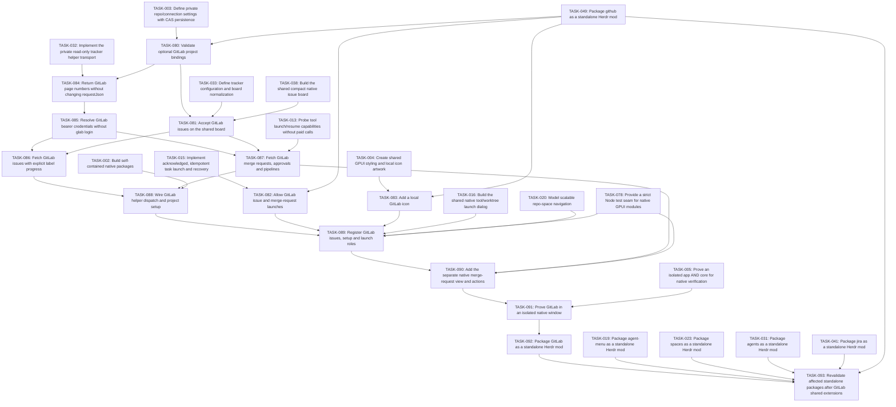

# Plan: Mission Control GitLab

## Overview

One self-contained GitLab mod supplies compact issues and a separate merge-request view. It works without either custom layout installed and is also bundled into Mission Control and Classic beside Jira/GitHub through separate icon-labeled source tabs. Read-only GitLab REST access and installed local tools handle issue work and explicitly supported merge-request actions.

Mode: **EXPANSION**. Review default: **codex**. Status: **awaiting-founder-review**. Tasks: **14**.

Canonical source: [mission-control-gitlab.json](mission-control-gitlab.json).

## Scope Challenge

The user supplied the prepared GitLab plan and explicitly requested the same standalone-plus-layout behavior as Jira. EXPANSION and the existing Codex review default remain appropriate. This plan owns the new mod and shared GitLab schema extensions; TASK063 owns navigation, TASK006 composes both layouts, TASK007 proves integration, and TASK008/009/011 own documentation, bundle and publication. Issues, merge requests and their supported local-tool actions are in scope. Provider write-back, epics, incidents and credential switching remain excluded. The implementation follows GitHub in execution order.

## Prerequisites

- Herdr app 0.1.9 / hc 0.1.14 were observed; re-read installed declarations before execution and stop on incompatible contracts.
- All plans must pass founder review at their current hashes before implementation.
- Source, mounted native UI, authenticated provider checks, install and public publishing are separate gates.
- GitLab REST behavior below was checked against docs.gitlab.com on 2026-10-31: personal, project, and group access tokens authenticate with PRIVATE-TOKEN or Authorization Bearer; offset pagination exposes x-next-page and Link; issues accept issue_type=issue; merge request web URLs use /-/merge_requests/<iid>; GET merge request approvals returns approved and, on Enterprise Edition, approvals_left; head_pipeline.status is success, failed, running, or pending; discussion notes expose resolvable and resolved. glab is not installed here, and the reviewed glab auth docs show login and logout writing credentials, not a read-only selected-account token command.

Cross-plan prerequisites:

- TASK-003: [mission-control](mission-control.md) — Define private repo/connection settings with CAS persistence
- TASK-049: [mission-control-github](mission-control-github.md) — Package github as a standalone Herdr mod
- TASK-033: [mission-control-jira](mission-control-jira.md) — Define tracker configuration and board normalization
- TASK-038: [mission-control-jira](mission-control-jira.md) — Build the shared compact native issue board
- TASK-015: [mission-control-agent-menu](mission-control-agent-menu.md) — Implement acknowledged, idempotent task launch and recovery
- TASK-004: [mission-control](mission-control.md) — Create shared GPUI styling and local icon artwork
- TASK-032: [mission-control-jira](mission-control-jira.md) — Implement the private read-only tracker helper transport
- TASK-013: [mission-control-agent-menu](mission-control-agent-menu.md) — Probe tool launch/resume capabilities without paid calls
- TASK-002: [mission-control](mission-control.md) — Build self-contained native packages
- TASK-016: [mission-control-agent-menu](mission-control-agent-menu.md) — Build the shared native tool/worktree launch dialog
- TASK-078: [mission-control](mission-control.md) — Provide a strict Node test seam for native GPUI modules
- TASK-020: [mission-control-spaces](mission-control-spaces.md) — Model scalable repo-space navigation
- TASK-005: [mission-control](mission-control.md) — Prove an isolated app AND core for native verification
- TASK-019: [mission-control-agent-menu](mission-control-agent-menu.md) — Package agent-menu as a standalone Herdr mod
- TASK-023: [mission-control-spaces](mission-control-spaces.md) — Package spaces as a standalone Herdr mod
- TASK-031: [mission-control-agents](mission-control-agents.md) — Package agents as a standalone Herdr mod
- TASK-041: [mission-control-jira](mission-control-jira.md) — Package jira as a standalone Herdr mod

## Non-Goals

- No layouts/ directory inside the standalone GitLab package and no requirement for either custom layout to use it. Layout integration is required and owned by the separate tabs/layout plan tasks.
- No glab auth login, logout, config set, keyring read, or config-file parse. No PRIVATE-TOKEN header. No change to requestJson's returned JSON value.
- No GitLab subdirectory relative_url_root, incidents, tasks, test cases, epics, milestones, wiki, snippets, container registry, or environments.
- No approve, merge, comment, label, or close writes. No checkout of a fork source branch. No Jira connection is required.
- No modification of shipped mods, generated Herdr type files, AGENTS.md, DESIGN-NOTES.md, existing user sessions, or credential stores.
- No claim that the HTML mockup or a load-only native check proves live behavior.

## Contracts

- Native GPUI JavaScript only: gpui-kit / gpui-base / herdr are runtime externals. No DOM, Node, CSS or setTimeout in GPUI. Helpers run out of process through exec; cx is not retained across awaits.
- Source paths are observed under src/, scripts/, tests/ and evidence/. New GitLab targets are explicit task-owned creates. Shared files already exist and are modified only by the task that depends on their current writer. A change must keep existing Jira and GitHub validation results. TASK093 rebuilds and revalidates the previously completed standalone packages affected by these shared-source changes; TASK007/009 then prove the combined layout and byte-equivalent distribution. Prototypes and external docs are references, not local reuse.
- All TASK IDs are globally unique. dependsOn can refer to another plan; externalDependencies records the owning JSON and its provided capability. Canonical JSON is the source of truth.
- Every standalone package is <name>/mods/<name>/ plus RECIPE.md, actual preview.png and optional keys.json; no layouts/. Copying only mods/mission-control-gitlab/ must run. Shared source is bundled inside that mod. No runtime import of another mod.
- GitLabConnection v1 is {id, kind:"api", site:httpsOrigin, auth:{kind:"bearer", tokenEnv}}. site is an HTTPS origin with no path, query, user, or fragment. API base is that origin plus /api/v4. The project selector is encodeURIComponent(projectPath), so nested slashes become %2F. tokenEnv is an environment-variable name. credentialHeaders builds Authorization: Bearer in helper memory. The token never enters argv, URLs, logs, config, screenshots, or error text.
- TASK-080 exports gitlabProjectPath(value) from src/shared/config.js. A valid projectPath is 1 to 255 characters, 1 to 21 slash-separated segments (up to twenty group levels plus the project), each matching ^[A-Za-z0-9](?:[A-Za-z0-9_.-]*[A-Za-z0-9])?$. Reject an empty segment, a leading or trailing slash, percent-encoding, and a segment that is a single dot or a double dot. Config, tracker-model, and transport all call this function rather than copying the expression.
- RepoBinding gains optional gitlab:{connectionId, projectPath, status?:{labels:{todo:string[], inProgress:string[], done:string[]}}}. Label groups are case-insensitive and disjoint. Jira and GitHub fields stay as they are. Saving GitLab changes only the gitlab key. Invalid v1 data throws and does not write.
- trackerScope source gitlab and gitlab-mr are added beside jira, github, and github-pr. validateTrackerRequest accepts source gitlab with operation issues, merges, or probe. Jira still cannot call merges or pulls. GitHub's existing operations stay unchanged. The GitLab helper validates its connection with its own exact-key validator and then validateTrackerRequest; it does not reuse validateJiraConnection.
- requestJson still returns only the JSON value. TASK084 adds requestJsonPage(url, options) -> {value,nextPage}, with list mode requirePageHeader. A present x-next-page must be empty (terminal) or a strictly increasing decimal page matching ^[1-9][0-9]{0,5}$. If absent, accept one RFC Link rel=next only after validating the same HTTPS origin, exact endpoint pathname, unchanged non-page query parameters including per_page/filter/order, no credentials/fragments/duplicate parameters, and a strictly increasing bounded page. Extract only the page number and apply it to the original URL; never fetch the raw Link URL. Contradictory next-page headers/links fail INVALID_RESPONSE. A valid Link set without rel=next marks terminal; if both metadata forms are absent, a short list (<50) is terminal and a full list fails INCOMPLETE_RESULTS rather than claiming completeness. Object calls omit list mode and accept absent page metadata. Returned metadata never contains credentials or other response headers.
- Issue reads are GET /api/v4/projects/:id/issues?state=all&issue_type=issue&per_page=50&page=N. Closed maps to done. With no label mapping, opened maps to todo and the board says In progress needs labels. With a mapping, one matching label selects its group; no matching label stays todo; labels in two groups exclude that issue and set snapshot error STATUS_MAPPING_REQUIRED. Agents never move cards. identity.id is the decimal global id. key is GL-<iid>. URL is origin/projectPath/-/issues/<iid> and must match web_url. Description null becomes an empty body. Confidential issues remain ordinary cards with no extra Issue field.
- Pagination stays inside one helper exec and the 30 second / 8 MiB bound. One in-flight request per scope, concurrency at most 4. A numeric nextPage continues until 1000 records, a null next page, a 429, or fewer than 2 seconds remain. Stopping early sets truncated and cursor to the next page. A cursor from another scope is rejected. Cap and page size match Snapshot v1.
- MergeRequest v1 is {identity:{kind:"gitlab-mr", connectionId, site, projectPath, id, number}, key, title, url, body, repoBinding, state:"open"|"closed"|"merged"|"locked", draft:boolean, head:{ref, sha, repoFullName:null|string}, base:{ref, sha:null|string}, review:{state:"approved"|"changesRequested"|"reviewRequired"|"unavailable", reason?}, discussions:{state:"readable"|"unavailable", unresolvedCount?:number, complete?:boolean, reason?:string}, checks:{state:"pending"|"success"|"failure"|"unavailable", reason?}, actionContext:{comments:{notes:[{id,body,position:null|{oldPath:null|string,newPath:null|string,oldLine:null|number,newLine:null|number}}],truncated:boolean},pipeline:null|{id,url,sha,ref,status:"failed",jobs:[{id,name,stage,url,failureReason:null|string}],jobsUnavailable:boolean,jobsTruncated:boolean}}, linkedIssues:[{kind, id, url}], updatedAt}. key is GL-MR-<iid>. identity.id is the decimal global MR id. number is iid. URL is origin/projectPath/-/merge_requests/<iid>. draft uses the draft field; work_in_progress is used only when draft is absent. State maps opened to open, closed to closed, merged to merged, and locked to locked. Readable discussions require unresolvedCount (integer0..10000) and complete:boolean; unavailable discussions require one bounded reason and omit count/complete. A full100-discussion page with no unresolved note is readable but incomplete, so review remains unavailable/DISCUSSIONS_PARTIAL and the comments action is disabled/DISCUSSIONS_PARTIAL when no validated unresolved note was captured. A partial page with at least one captured unresolved note may enable comments with an explicit partial marker. Approval failure never changes the separate discussions state. actionContext is required. Unenriched data has empty notes/comments.truncated:true and pipeline:null. Comments contain only unresolved resolvable notes from the bounded discussion page, max50 notes, max4000 UTF-8 bytes per body and24000 UTF-8 bytes for the complete notes JSON; omission/body clipping marks truncated. Position paths are bounded relative Git paths (1024 chars), no absolute/dotdot/control segments; unavailable positions are null. Lines are null or positive safe integers. Pipeline evidence is present only for a validated failed head_pipeline with decimal id, exact configured-origin project/-/pipelines/id URL, SHA and ref; jobs are max50 failed jobs, total JSON12000 UTF-8 bytes, with exact project/-/jobs/id URLs and bounded name/stage/failureReason. Missing/denied jobs are explicit jobsUnavailable and do not invent diagnostic output; job truncation is explicit.
- MR enrichment fetches at most one detail GET /api/v4/projects/:id/merge_requests/:iid per visible/selected item, plus one approvals GET, one discussions page (per_page=100), and one closes_issues GET. The project MR list does not provide head_pipeline. Detail global id, iid and project_id must match the list item and bound project before any fields are published. All requests share a single <=25s helper deadline, <=4 active HTTP operations and the existing page/count/output budgets; defer enrichment with honest unavailable metadata when the budget is insufficient. Review precedence: approvals/discussions 401/403 makes that metadata unavailable; otherwise unresolved resolvable notes mean changesRequested, then approved boolean, else reviewRequired. CE may omit approvals_left; never recompute rules. A full discussions page with no unresolved note does not claim all discussions resolved. checks derives only from validated detail.head_pipeline.status: success -> success; failed -> failure; running/pending -> pending; missing/other -> unavailable with a bounded reason. Do not call detailed_status.action. Add a fixture whose list lacks head_pipeline and whose detail supplies it, including wrong-project/id detail rejection. Discussion readability/count/completeness is exported explicitly in the discussions field, independently from approval/review state; never infer it from review.reason. If any required enrichment is skipped for budget, keep its metadata unavailable with BUDGET_EXHAUSTED. Detail identity/ref mismatch fails INVALID_SCOPE before publishing enrichment. Discussions use ctx.call(auth,url,{list:false}) because this is a single page of up to100; manually validate the array and notes.99 terminal discussions may be complete; exactly100 stays incomplete even with an empty next header. For a same-project failed pipeline, allow one bounded GET /projects/:encoded/pipelines/:pipeline_id/jobs?scope[]=failed&per_page=50&page=1 to collect failed-job evidence. Verify the returned job pipeline/commit identity when supplied; never follow job actions, download traces or run provider mutations. Fork pipelines never trigger foreign-project requests. All six per-item endpoint types share the same existing deadline/concurrency/output budget.
- A source_project_id different from project_id is a fork; head.repoFullName remains null and no action automatically fetches or checks out its head. All supported actions use the bound project's captured checkout. Locked MRs disable all actions. Review is allowed for a readable MR, including forks, even if approval metadata is unavailable. Address-comments requires same-project MR, readable discussions and at least one validated unresolved note in actionContext.comments.notes. A complete readable zero-note result is disabled/NO_ACTIONABLE_COMMENTS; an incomplete readable zero-note result is disabled/DISCUSSIONS_PARTIAL. Partial/truncated nonempty evidence may enable the action with an explicit partial marker. Fix-checks requires same-project MR and a readable failed pipeline. A denied approvals endpoint alone affects review metadata, not a readable local review action. Missing required action data disables only that action with a reason. closes_issues links stay on the configured origin; Jira-like keys are task text and never trigger Jira requests.
- Launch source.kind gitlab and gitlab-mr are accepted by validateLaunchRequest and worktree source identity. source.id is the global id and source.key is GL-<iid> or GL-MR-<iid>. Existing jira, github, and github-pr values still validate. Wrong kinds still fail before mutation.
- Setup probe is GET /api/v4/projects/:encoded. Save path_with_namespace only when its web_url origin equals the configured site and gitlabProjectPath accepts it. A mismatch shows the canonical path and publishes no cards. It does not rewrite the site.
- Icons: add an original MIT gitlab svg to src/assets/icons.json. Reuse the existing pull-request icon for merge requests. No remote image and no GitLab trademark file.
- IDs and caches qualify machine, canonical repo root, source, connection, site, and global id. Null machine means local. Never fall back to another project or account. Snapshot, CAS, read-only origin, and isolated-core rules from the GitHub plan still apply to this mod.
- MRActionRequest v1 is {v:1,action:"review"|"addressComments"|"fixChecks",merge:MergeRequest,checkoutRoot:string,toolKey:string,requestId:string}. Clone and validate it synchronously on click before any dialog/fetch. Its merge carries immutable machine, canonical repoRoot, connectionId, site, projectPath, global id and iid. Capture checkoutRoot from the live current worktree, or explicitly use the All-spaces card's captured checkout/canonical root. Revalidate same-Git-common-directory ownership before launch, preserve requestId across retries, and forward checkoutRoot unchanged to LaunchRequest. Per-action availability follows the preceding fork/permission rules; titles/body/ref strings never become shell commands.
- Required layout integration uses mc-work-stack children jira/github/pulls/gitlab/merges/sessions. GitLab props are view:"issues" or view:"merges", hideHeader:true in embedded source slots; standalone defaults retain one useful heading. TASK063 supplies distinct GitLab icons/labels and narrow icon-only controls with tooltips/accessibility labels. TASK006 instantiates both roles in both layouts, TASK007 proves real swaps and account routing, TASK009 copies the exact standalone GitLab runtime, and TASK011 publishes its complete package with herdr-mod. Standalone operation never depends on those layout tasks.
- Execution ordering is explicit: TASK080/082/083 depend on completed GitHub standalone package TASK049. Sessions TASK050 and its transitive Reopen consumers depend on GitLab TASK090 before building their shared-source bundles; Tabs TASK063 already depends090. These are build-time ordering edges only, never runtime imports or requirements for a GitLab installation.
- Native isolation is owned once by TASK005 in mission-control.json: use its exact NativeIsolationReceiptV2, FixtureEnvironment ABI and validateNativeIsolationReceipt(receipt,{receiptPath?}) contract. Existing app/core instances are never queried or mutated. New proof binds fresh private selector roots, task-created Unix listeners and process generations; no new receipt claims an observed unchanged user PID. Package checks consume the canonical validator, including only the exact pinned historical legacy receipts. Missing, failed, downgraded or tampered proof cannot release a package or publishable preview.
- TASK087 creates src/mods/mission-control-gitlab/merge-model.js as a native-safe module with only native-safe shared imports. It exports validateMergeRequest(value,{scope}={}), mergeIdentityKey(value), validateMRActionRequest(value,{scope}={}), mrActionAvailability(value,action), mrReasonText(code), mrDetailCursor(value), and mrLaunchSource(request). The Node adapter merges.mjs imports that model; native data.js and merges-view.js import merge-model.js, never merges.mjs or issues.mjs. A neutral-platform bundle and isolated VM test prove this module needs no Node APIs, process, DOM, network or timers. TASK088 owns bridge imports; TASK090 owns UI imports and captured-action wiring.
- mrDetailCursor(value) emits bounded JSON {v:1,kind:"mr-detail",identity,machine,repoRoot,headSha,baseSha}. The adapter checks every selector identity field, machine/root and captured head/base against its requested GitLab-MR scope and fetched detail. List continuations are a separate base64url kind:"mr-list" cursor qualified by the full trackerScopeKey fingerprint, project ID, count and age. The native bridge always supplies the originating captured connection/binding envelope, including credential references; stale or rebound scopes cannot borrow a later active scope. Captured action toolKey/requestId/checkoutRoot are required, v is exactly1 and checkoutRoot is canonical with no fallback. Native shared launch performs the existing same-Git-common-directory check before worktree mutation. baseSha:null means unknown and permits the first validated detail SHA; a non-null captured baseSha and every captured headSha must match detail exactly (case-insensitive hex). Missing/malformed detail refs do not invent equality.
- MR list requests are exactly GET /api/v4/projects/:encoded/merge_requests?state=all&per_page=50&page=N&order_by=updated_at&sort=desc through list:true. The adapter always requests50; a metadata-free20-row response to that explicit50 request is a short terminal page, while a metadata-free50-row response is INCOMPLETE_RESULTS. A default20-row request is never sent. Selected enrichment uses one validated detail selector rather than enriching the entire collection.
- mrLaunchSource(request) returns exactly {kind:"gitlab-mr",connectionId,site,id,key,title,url,body}, preserving global decimal id and GL-MR-iid. Controlled titles are "Review merge request: <title>", "Address review comments: <title>" and "Fix failing pipeline: <title>" (clip to512 chars). Body starts with a controlled action/goal plus captured project URL, base/head refs and SHAs. Review goal: inspect changes and report findings without local or provider writes. Comments goal: inspect supplied unresolved-note text/positions and implement local fixes without replying or resolving threads. Checks goal: investigate the supplied failed pipeline/jobs, reproduce using the repository CI configuration and implement local fixes without rerunning jobs or changing provider state. State explicitly when comments/jobs are truncated or unavailable and never invent full logs. All provider title/body/comment/path/pipeline/job fields are labeled untrusted task data; never convert them into shell syntax. Include the complete bounded action-specific evidence before the issue description and clip only description with an explicit marker so source.body<=60000 UTF-8 bytes. The source is passed unchanged to shared launch with the captured checkoutRoot/toolKey/requestId; TASK087 tests actual shared launch task delivery for all three actions in isolated first-launch fixtures, including hostile text and missing evidence. Those tests do not claim later different-action clicks resend a task. Same-project readable comments remain distinct from approvals; fixChecks requires the validated failed-pipeline action context, and all locked actions are disabled.
- Shared launch retains the existing one-slot-per-exact-MR/tool identity: machine+repoRoot+source(kind,connectionId,site,global id)+toolKey. The first acknowledged action delivers its task. Any later action on that same MR/tool focuses that existing agent with no new task sent; never encode action in source.id or claim that the later requested action started. TASK090 renders occupied tool slots as Open agent with a truthful tooltip/result toast ("Opened existing agent; no new task sent"), while preserving the first task identity. A closed slot follows the existing PREVIOUS_SESSION_CLOSED/history-resume boundary and is never silently recreated. TASK090 tests sequential Review then Fix checks/Comments for the same MR/tool, exactly one tab/task delivery, truthful reuse UI, and closed-slot zero recreation. TASK091 covers the same behavior with actual native fixture inputs. Independent concurrent action identities are not introduced by this mod.



## Existing Code Leverage

| Observed path / reference | Classification | Use |
| --- | --- | --- |
| .ulpi/plans/mission-control-github.md | inspected reference | Shape and packaging gate for this plan: standalone mod, issues plus a second code-review view, native proof, recipe, and preview. |
| src/shared/config.js | extend | Extend persisted bindings with optional gitlab and export gitlabProjectPath. Existing Jira and GitHub binding checks stay. |
| src/shared/tracker-model.js | extend | Extend scope, issue validation, and saveRepoIntegration for gitlab. Current exact() optional keys reject a gitlab field. |
| src/shared/issue-board.js | extend | Extend validLink so nested /-/issues/ URLs open. Jira and GitHub link checks stay in the same function. |
| src/shared/launch.js | extend | Allow source kinds gitlab and gitlab-mr. The current allowlist is jira, github, and github-pr. |
| src/shared/worktrees.js | extend | Allow the same two source kinds before any worktree mutation. |
| src/shared/tracker-transport.mjs | extend | Reuse requestJson and credentialHeaders. Add requestJsonPage and a gitlab source check without changing requestJson's return value. The header allowlist already accepts authorization. |
| src/assets/icons.json | extend | Add one original gitlab icon beside the existing jira, github, and pull-request entries. |
| src/mods/mission-control-jira/backend.mjs | inspected reference | Observed helper dispatch, cursor binding, and publicTrackerError redaction. GitLab gets its own helper and does not import this mod. |
| scripts/project.mjs | reuse as-is | Package name mission-control-gitlab already matches the builder's mission-control-* rule. The builder bundles src/shared into the mod. |
| scripts/native-harness.mjs | reuse as-is | run gitlab loads tests/native/gitlab.mjs. No harness edit is required. |
| DESIGN-NOTES.md | inspected reference | Accepted requirement: separate GitLab issues/MR mod, standalone plus Mission Control/Classic source views. Integration is task-owned in tabs/layout plans. |
| work/repo-jira-flow.html | inspected reference | Illustrative GitLab row only. It is not native behavior. |
| https://docs.gitlab.com/api/rest/authentication/ | external reference, not local code | Bearer and PRIVATE-TOKEN are both documented. This plan sends Bearer only. |
| https://docs.gitlab.com/api/merge_request_approvals/ | external reference, not local code | GET approvals fields and the Free versus Enterprise Edition response difference. |
| .ulpi/plans/mission-control-tabs.json | extend planned integration | TASK063 owns the six-source navigation and stable stack IDs; no sibling runtime code imports. |
| .ulpi/plans/mission-control.json | extend planned integration | TASK006/007/008/009 consume GitLab roles, native proof, package and provenance; TASK079 refreshes the six-source Settings overview artwork. |
| src/mods/mission-control-github/pull-model.js | inspected reference, no sibling runtime import | Observed pure native-safe model beside a separate Node HTTP adapter. GitLab TASK087 follows that boundary with its own merge-model.js and merges.mjs; it does not reuse the GitHub DTO or infer discussion access from approval state. |

## Tasks

### TASK-080: Validate optional GitLab project bindings

Export gitlabProjectPath and accept an optional gitlab key on a repository binding. The path grammar is 1 to 255 characters and 1 to 21 segments (twenty group levels plus a project) matching ^[A-Za-z0-9](?:[A-Za-z0-9_.-]*[A-Za-z0-9])?$. Status, when present, is the existing case-insensitive disjoint label groups. Jira and GitHub objects on the same binding are preserved. Validation failure throws and does not write.

**Type:** feature  
**Priority:** P1  
**Effort:** M  
**Agent:** nodejs-cli-senior-engineer  
**Review:** codex  
**Depends on:** TASK-003, TASK-049

**Acceptance Criteria:**

- A binding that already has Jira and GitHub accepts gitlab.projectPath group/sub/proj, and a GitLab save leaves the Jira and GitHub objects byte-for-byte unchanged. A 21-segment path within the declared 255-character cap is accepted; 22 segments are rejected without writing.
- Paths ../x, group//proj, a., .hidden, a trailing slash, or a missing connection fail, and the original config file bytes stay unchanged.

**Write scope:**

| File | Action | Role |
| --- | --- | --- |
| src/shared/config.js | Modify existing source or prior task output | Optional gitlab binding validation and the single gitlabProjectPath export. |
| tests/gitlab-config.test.mjs | Create | Temporary-file tests for nested paths, rejected paths, and preserved Jira/GitHub keys. |

**Validate:**

```sh
node --test tests/gitlab-config.test.mjs
```

### TASK-081: Accept GitLab issues on the shared board

Extend tracker scope with sources gitlab and gitlab-mr, and validateIssue for kind gitlab. Issue scope source is gitlab, not gitlab-mr. identity.id is the decimal global id, key is GL-<iid>, and the URL is origin/projectPath/-/issues/<iid> using gitlabProjectPath. saveRepoIntegration accepts source gitlab and writes only that key. Issue-board validLink accepts that nested URL only when validateIssue accepts the card. Existing Jira and GitHub issues and links still pass. Merge-request body validation stays in the merges adapter.

**Type:** feature  
**Priority:** P1  
**Effort:** L  
**Agent:** nodejs-cli-senior-engineer  
**Review:** codex  
**Depends on:** TASK-080, TASK-033, TASK-038

**Acceptance Criteria:**

- A nested GitLab issue URL validates and renders as a board link, while one existing Jira fixture and one existing GitHub fixture still validate and link.
- A GitHub-style /issues/ URL, an iid that does not match GL-<iid>, kind gitlab without a gitlab binding, or a label listed in two groups is not a launchable card.

**Write scope:**

| File | Action | Role |
| --- | --- | --- |
| src/shared/tracker-model.js | Modify existing source or prior task output | GitLab scope, issue identity, URL grammar, and gitlab-only binding saves. |
| src/shared/issue-board.js | Modify existing source or prior task output | Board link acceptance for the same GitLab issue URL, leaving Jira and GitHub checks in place. |
| tests/gitlab-model.test.mjs | Create | Model and board tests for nested paths, old Jira/GitHub fixtures, and rejected identities. |

**Validate:**

```sh
node --import ./tests/support/native-loader.mjs --test tests/gitlab-model.test.mjs
```

### TASK-082: Allow GitLab issue and merge-request launches

Accept LaunchRequest and worktree source kinds gitlab and gitlab-mr. source.id stays the global id and source.key stays GL-<iid> or GL-MR-<iid>. https origins and nested /-/issues or /-/merge_requests URLs pass. jira, github, and github-pr still pass. An unknown kind, a non-https site, or a URL with embedded credentials fails before any filesystem or git mutation.

**Type:** feature  
**Priority:** P1  
**Effort:** M  
**Agent:** nodejs-cli-senior-engineer  
**Review:** codex  
**Depends on:** TASK-015, TASK-049

**Acceptance Criteria:**

- validateLaunchRequest and worktree source identity accept gitlab and gitlab-mr, and an existing github-pr request still validates.
- Kind invented, an http site, or a user:password URL fails with no worktree command started.

**Write scope:**

| File | Action | Role |
| --- | --- | --- |
| src/shared/launch.js | Modify existing source or prior task output | Add gitlab and gitlab-mr to the launch source allowlist without changing other kinds. |
| src/shared/worktrees.js | Modify existing source or prior task output | Add the same kinds to the pre-mutation source check. |
| tests/gitlab-launch.test.mjs | Create | Acceptance and rejection tests for both new kinds and the existing github-pr kind. |

**Validate:**

```sh
node --test tests/gitlab-launch.test.mjs
```

### TASK-083: Add a local GitLab icon

Add an original gitlab svg to the shared catalog with source and MIT license. Do not download the GitLab trademark. The existing jira, github, and pull-request entries stay. Merge requests reuse pull-request. The package builder's svg safety rules apply: an svg root, no script, and no external href.

**Type:** feature  
**Priority:** P1  
**Effort:** S  
**Agent:** general-purpose  
**Review:** codex  
**Depends on:** TASK-004, TASK-049

**Acceptance Criteria:**

- icons.json has a gitlab entry that the package svg checks accept, and the jira, github, and pull-request entries remain.
- A catalog entry with an external href or a missing license is rejected by the same check.

**Write scope:**

| File | Action | Role |
| --- | --- | --- |
| src/assets/icons.json | Modify existing source or prior task output | One original gitlab icon and its provenance. |
| tests/gitlab-icon.test.mjs | Create | Catalog safety test for the new icon and presence of the existing brand icons. |

**Validate:**

```sh
node --test tests/gitlab-icon.test.mjs
```

### TASK-084: Return GitLab page numbers without changing requestJson

Add backward-compatible requestJsonPage beside unchanged JSON-only requestJson. List mode accepts an empty/numeric x-next-page or a rigorously validated same-origin Link rel=next fallback. Preserve the original endpoint and every non-page query parameter, reject credentials/fragments/duplicates/non-increasing pages/contradictory metadata, and continue only by setting page on the original URL. A short list without metadata is terminal; a full list without metadata reports INCOMPLETE_RESULTS. Object reads accept absent metadata. Also allow GitLab issues/merges/probe through the source-specific request validator using gitlabProjectPath; Jira/GitHub operation rules stay unchanged.

**Type:** feature  
**Priority:** P1  
**Effort:** L  
**Agent:** nodejs-cli-senior-engineer  
**Review:** codex  
**Depends on:** TASK-032, TASK-080

**Acceptance Criteria:**

- Existing requestJson callers receive the same JSON value; numeric/empty x-next-page and a valid same-origin rel=next fallback produce the expected page/null. Single-object reads accept absent metadata.
- Foreign-origin/path/filter-changing links, duplicate parameters, contradictory metadata, non-increasing pages and invalid source/operation pairs fail without a follow-up request or leaked credentials. A metadata-free 50-row page cannot claim completeness; a shorter page can.

**Write scope:**

| File | Action | Role |
| --- | --- | --- |
| src/shared/tracker-transport.mjs | Modify existing source or prior task output | Backward-compatible page metadata and the gitlab operation check. |
| tests/gitlab-transport.test.mjs | Create | Local HTTPS fixture for page headers, rejected links, unchanged requestJson, and source/operation pairs. |

**Validate:**

```sh
node --test tests/gitlab-transport.test.mjs
```

### TASK-085: Resolve GitLab bearer credentials without glab login

Own GitLabConnection v1 and helper-local bearer resolution through credentialHeaders. Requests stay on the configured origin's /api/v4 base and use requestJsonPage. Do not run glab, do not read its config, and do not send PRIVATE-TOKEN. Two tokenEnv names can be used at the same time. Missing env, an http or pathed site, a redirect off origin, and 401 or 429 return redacted tracker errors.

**Type:** feature  
**Priority:** P1  
**Effort:** L  
**Agent:** nodejs-cli-senior-engineer  
**Review:** codex  
**Depends on:** TASK-084

**Acceptance Criteria:**

- Two profiles with different tokenEnv names send distinct Bearer tokens to https://gitlab.com/api/v4 and https://gitlab.example.com/api/v4 and do not create or read a glab config file.
- A missing variable, a site with a path, a cross-origin redirect, or a 401 returns a redacted error whose message, argv, and URL contain no token.

**Write scope:**

| File | Action | Role |
| --- | --- | --- |
| src/mods/mission-control-gitlab/auth.mjs | Create | Connection validator and bearer request helper over requestJsonPage. |
| tests/gitlab-auth.test.mjs | Create | Temporary env and local HTTPS tests for two accounts, rejected sites, redirects, and redaction. |

**Validate:**

```sh
node --test tests/gitlab-auth.test.mjs
```

### TASK-086: Fetch GitLab issues with explicit label progress

GET /api/v4/projects/:id/issues with state=all, issue_type=issue, and per_page=50. Follow nextPage until a null page, 1000 records, a 429, or under 2 seconds remain in the helper budget. Map closed to done. Without labels, opened is todo. With labels, one match selects the group and two groups exclude the issue with STATUS_MAPPING_REQUIRED. Emit Issue v1 with global id, GL-<iid>, and the canonical /-/issues URL. Do not request incidents, tasks, or test cases.

**Type:** feature  
**Priority:** P1  
**Effort:** L  
**Agent:** nodejs-cli-senior-engineer  
**Review:** codex  
**Depends on:** TASK-085, TASK-081

**Acceptance Criteria:**

- Opened and closed issue_type=issue rows land in todo and done, keep global id distinct from GL-<iid>, and continue while x-next-page is a page number, stopping when that header is empty.
- A 429, a project-path mismatch, an incident-only fixture, or a label in two groups produces no launchable card and a redacted scoped error. A deadline mid-list sets truncated and the next page cursor.

**Write scope:**

| File | Action | Role |
| --- | --- | --- |
| src/mods/mission-control-gitlab/issues.mjs | Create | REST issue adapter, label mapping, and bounded pagination. |
| tests/gitlab-issues.test.mjs | Create | HTTP fixtures for pages, closed/open mapping, rejected types, ambiguous labels, and 429. |

**Validate:**

```sh
node --test tests/gitlab-issues.test.mjs
```

### TASK-087: Fetch GitLab merge requests, approvals and pipelines

Fetch project MR list items, then bounded visible/selected enrichment: one single-MR detail GET /api/v4/projects/:id/merge_requests/:iid, one approvals GET, one discussions page of100 and one closes_issues GET. Validate detail global id/iid/project_id against the list and binding. Share <=4 active HTTP operations, a <=25s helper deadline and output/count budgets across all calls; skipped enrichment stays explicitly unavailable. Only detail.head_pipeline.status supplies pipeline state. Preserve CE/EE approval handling and truncated-discussion uncertainty. Create merge-model.js for native-safe MergeRequest/MRActionRequest validation, action availability, detail selector and launch task data; merges.mjs remains the Node-only HTTP adapter. Export independent discussions readability/count/completeness, so denied approval metadata cannot masquerade as denied discussions. TASK088/090 consume merge-model.js, never the Node adapter; forks permit readable local review only, same-project/readable-discussion comments and readable-failed-pipeline fixes follow the pinned per-action rules. Never fetch/check out a fork head or POST provider writes. Pin the explicit50-row MR query and100-row object-mode discussions read. Add bounded actionContext with actual unresolved note text/positions and validated pipeline/failed-job identity; read at most one failed-jobs page under the same budget. Implement exact controlled mrLaunchSource text and prove the shared launch delivers useful action evidence as untrusted data. Null list base SHA can acquire a validated detail value; known SHA drift rejects.

**Type:** feature  
**Priority:** P1  
**Effort:** L  
**Agent:** nodejs-cli-senior-engineer  
**Review:** codex  
**Depends on:** TASK-085, TASK-081, TASK-013

**Acceptance Criteria:**

- An opened draft MR whose list response omits head_pipeline is enriched by a validated detail GET; review, pipeline and closing issues are accurate within the shared concurrency/deadline budget. The query always requests50; metadata-free20 rows are terminal only for that explicit50 request, and metadata-free50 rows are incomplete. Null-to-known base SHA enriches successfully; a known base/head mismatch fails before metadata publication.
- Wrong-project/id/iid detail, forks, approvals403, unreadable discussions, unresolved notes, failed pipelines, locked MRs and hostile text cannot retarget work or trigger provider writes; skipped/denied enrichment remains explicit. Approval403 with readable discussions permits address-comments; discussions403 independently disables only comments/review aggregation. A full100-row resolved discussion page stays incomplete, and a denied/partial/budget-skipped result never claims full review certainty. Discussions use object mode:99 terminal rows may be complete,100 stay incomplete, and malformed/oversized data is unavailable. Action evidence includes bounded actual unresolved notes/positions and same-project pipeline/job identity; denied jobs remain explicitly unavailable, and no foreign job/trace request is sent. Complete empty discussion evidence disables comments/NO_ACTIONABLE_COMMENTS; incomplete empty disables/DISCUSSIONS_PARTIAL; partial nonempty enables only with an explicit marker.
- MRActionRequest captures checkoutRoot, full project/account/machine identity, action/tool/request id before asynchronous work; validation rejects missing/mutated scope and never consults a later active space. The native model bundles with a neutral platform and evaluates in an isolated VM without Node/process/DOM/timer/network globals; GPUI consumers import only that model. Isolated first-launch shared launch tests for each action assert controlled goals, captured refs and action-specific evidence in the task sent to the selected tool; hostile provider prose is labeled untrusted, description clipping preserves evidence and missing required context has zero launch effects.

**Write scope:**

| File | Action | Role |
| --- | --- | --- |
| src/mods/mission-control-gitlab/merge-model.js | Create | Native-safe DTO/scope/action validation, explicit independent discussion state, detail selectors and bounded launch task data shared by helper and native consumers. Exact controlled Source task with bounded comment/pipeline evidence and no credential dependency. |
| src/mods/mission-control-gitlab/merges.mjs | Create | Merge request, approval, discussion, pipeline, and closing-issue reads plus safe action payloads. MR list and selected detail enrichment, one bounded failed-jobs read and explicit budgets/partiality. |
| tests/gitlab-merges.test.mjs | Create | Fixtures for forks, denied approvals, unresolved notes, pipeline statuses, locked state, and request bounds. Real HTTPS fixtures, pure native bundle/VM checks and actual shared launch task delivery regressions. |

**Validate:**

```sh
node --test tests/gitlab-merges.test.mjs
```

### TASK-088: Wire GitLab helper dispatch and project setup

Own issues, merges, and probe dispatch, scoped cache, and project setup. Issue selections call selectTracker and allTrackerBindings with source gitlab. Merge-request selections use source gitlab-mr. Never use the jira default. Probe GET /projects/:encoded and save path_with_namespace only when its origin matches the site and gitlabProjectPath accepts it. A mismatch publishes no cards and does not rewrite the site. All-spaces rows keep the card binding. An older in-flight project response is dropped after selection changes. Jira and GitHub keys on the same binding stay untouched. Import native-safe validation from merge-model.js; only backend.mjs imports the Node merges.mjs adapter. Details use the originating connection/binding and MR selector, independently of later visible selection.

**Type:** feature  
**Priority:** P1  
**Effort:** L  
**Agent:** nodejs-cli-senior-engineer  
**Review:** codex  
**Depends on:** TASK-086, TASK-087, TASK-002

**Acceptance Criteria:**

- A space with only GitLab fetches issues and merge requests, and an existing Jira binding on that repository is unchanged.
- A late response for the previously selected project is discarded, a canonical-path mismatch shows setup without cards, and helper errors stay redacted.

**Write scope:**

| File | Action | Role |
| --- | --- | --- |
| src/mods/mission-control-gitlab/backend.mjs | Create | Own-folder probe, issues, and merges dispatch through the GitLab auth helper. |
| src/mods/mission-control-gitlab/data.js | Create | Native async bridge, project setup model, scoped cache, and bounded refresh. |
| tests/gitlab-backend.test.mjs | Create | Subprocess fixtures for GitLab-only setup, preserved Jira data, and stale overlapping responses. |

**Validate:**

```sh
node --test tests/gitlab-backend.test.mjs
```

**Generated outputs (not authored source):**

- mission-control-gitlab/mods/mission-control-gitlab/backend.mjs

### TASK-089: Register GitLab issues, setup and launch roles

Wire the standalone GPUI mod to the shared compact board and the same-mod launch dialog. Props view=issues. One-click starts use saved pins and worktree label GL-<iid>, while LaunchRequest.source.id remains the global id. The tab title is enough; do not repeat a GitLab issues heading. Current-space setup uses TASK-020 space resolution. All-spaces cards keep their captured binding and checkoutRoot across later space changes. Unconfigured GitLab shows setup and does not require Jira. Support hideHeader:true for the custom layout's selected source tab and a single useful heading otherwise; expose the same roles when opened as a standalone mod.

**Type:** feature  
**Priority:** P1  
**Effort:** L  
**Agent:** general-purpose  
**Review:** codex  
**Depends on:** TASK-088, TASK-082, TASK-083, TASK-016, TASK-078, TASK-020

**Acceptance Criteria:**

- The mod mounts standalone or docked, shows To do / In progress / Done, and one-click starts the saved tool in the card repository.
- No Jira connection is required. An unbound project shows setup. A repeated start follows shared launch safety, and an All-spaces card does not retarget after the active space changes.

**Write scope:**

| File | Action | Role |
| --- | --- | --- |
| src/mods/mission-control-gitlab/main.js | Create | Native issue, setup, and launch view. The merge-request role is added by the next task. |
| src/mods/mission-control-gitlab/mod.json | Create | Standalone manifest, panel or overlay placement, and refresh command. |
| tests/gitlab.test.mjs | Create | Issue, setup, link, and one-click routing contracts, including a Jira-less repository. |

**Validate:**

```sh
node --import ./tests/support/native-loader.mjs --test tests/gitlab.test.mjs && node scripts/project.mjs check mission-control-gitlab
```

**Generated outputs (not authored source):**

- mission-control-gitlab/mods/mission-control-gitlab/main.js
- mission-control-gitlab/mods/mission-control-gitlab/mod.json
- mission-control-gitlab/mods/mission-control-gitlab/assets/*.svg

### TASK-090: Add the separate native merge-request view and actions

Add view=merges using compact cards, the MR icon and bounded state/draft/review/pipeline metadata. Honor hideHeader in embedded slots. Dispatch only a synchronously cloned/validated MRActionRequest from TASK087: readable review can run in the bound checkout for same-project or fork MRs; address-comments requires same-project and readable discussions; fix-checks requires same-project and a readable failed pipeline; locked disables all. Approval403 makes metadata unavailable without blocking an otherwise readable review. Capture checkoutRoot, source global id/display key and full binding before dialog/fetch. No automatic foreign-head fetch/checkout. Preserve the issue role and its pinned starts. Import shared validators/actions from merge-model.js. Render review aggregation separately from discussions readability; approval errors cannot silently disable a readable comments action. Follow the shared one-exact-MR/tool launch slot: once occupied, show Open agent and report no new task sent when focused; a different action click never claims a second task was delivered. Closed slots remain on the existing history/resume boundary. Require at least one captured unresolved note for comments, with complete-empty/incomplete-empty/partial-nonempty states as pinned above.

**Type:** feature  
**Priority:** P1  
**Effort:** L  
**Agent:** general-purpose  
**Review:** codex  
**Depends on:** TASK-089, TASK-087, TASK-078

**Acceptance Criteria:**

- The separate merge-request role exposes direct links and the exact three actions with per-action reasons; both embedded roles hide duplicate headings while standalone remains usable. Complete empty and incomplete empty comments are disabled with distinct reasons; partial nonempty evidence retains its visible partial marker.
- A fork still permits a readable local review in its captured bound checkout, but disables comments/check-fix actions; denied approval metadata cannot invent approval or disable an otherwise readable review, and locked/missing-required-data actions have zero launch effects. Sequential Review then Fix checks/Comments on the same MR/tool creates one tab and sends only the first task; occupied-slot UI says Open agent and no new task sent. Closed slots do not recreate or misreport the later action.

**Write scope:**

| File | Action | Role |
| --- | --- | --- |
| src/mods/mission-control-gitlab/merges-view.js | Create | Native merge-request cards and action capture. |
| src/mods/mission-control-gitlab/main.js | Modify existing source or prior task output | Dispatch view=merges without changing issue behavior. |
| tests/gitlab-mrs.test.mjs | Create | Merge-request role and action contract, plus the issue role remaining separate. |

**Validate:**

```sh
node --import ./tests/support/native-loader.mjs --test tests/gitlab-mrs.test.mjs && node scripts/project.mjs check mission-control-gitlab
```

### TASK-091: Prove GitLab in an isolated native window

Mount this mod alone with two fixture sites and projects. Exercise all three workflow groups, the merge-request view, links, denied approvals, and one-click issue and merge-request actions. Confirm a repository with no Jira connection works. In All spaces, start an action for project B while A is active, change the active space before it finishes, and assert the tool argv stays on B's site, project, and account. Use the existing harness entry tests/native/gitlab.mjs. Do not edit the harness and do not touch the user core. Exercise both public roles and hideHeader in fixture containers; the complete custom-layout integration is separately owned by TASK007.

**Type:** test  
**Priority:** P1  
**Effort:** L  
**Agent:** general-purpose  
**Review:** codex  
**Depends on:** TASK-090, TASK-005

**Acceptance Criteria:**

- A copy containing only this mod passes herdr-app check and the mounted scenario, and the captured preview is the actual frame with zero app errors. Native inputs also prove sequential different-action/exact-MR/tool focus-only reuse with truthful no-new-task feedback and no closed-slot recreation.
- The empty-setup and failed-isolation paths write no success receipt and no preview.

**Write scope:**

| File | Action | Role |
| --- | --- | --- |
| tests/native/gitlab.mjs | Create | Native scenario asserting visible groups, links, and captured project routing. |
| evidence/native/gitlab.json | Create | Command, isolation, error, and screenshot-hash receipt with no private content. |

**Validate:**

```sh
node scripts/native-harness.mjs run gitlab
```

**Generated outputs (not authored source):**

- mission-control-gitlab/preview.png

### TASK-092: Package GitLab as a standalone Herdr mod

Write the six-part recipe from the finished files. Validate in a fresh folder that contains no other custom mod and no layouts directory. Disclose network access to the configured GitLab origin, the token environment variable, and local node and herdr-app use. The preview hash must match the native receipt.

**Type:** docs  
**Priority:** P1  
**Effort:** M  
**Agent:** general-purpose  
**Review:** codex  
**Depends on:** TASK-091

**Acceptance Criteria:**

- Copying only mods/mission-control-gitlab/ is enough to check and run. The package reads no sibling mod and contains no layouts directory.
- A missing recipe, a preview hash that differs from the native receipt, or a layouts directory fails package validation.

**Write scope:**

| File | Action | Role |
| --- | --- | --- |
| mission-control-gitlab/RECIPE.md | Create | Recipe in Herdr order: summary and preview, What you see, How it behaves, Built from, Watch out, Done when. |
| tests/package-gitlab.test.mjs | Create | Self-contained imports, owned assets, recipe sections, and absence of layouts/. |
| mission-control-gitlab/preview.png | Create | Actual native frame from the preceding scenario. |

**Validate:**

```sh
node scripts/project.mjs build mission-control-gitlab && node --test tests/package-gitlab.test.mjs
```

**Generated outputs (not authored source):**

- mission-control-gitlab/mods/mission-control-gitlab/main.js
- mission-control-gitlab/mods/mission-control-gitlab/mod.json
- mission-control-gitlab/mods/mission-control-gitlab/assets/*.svg

### TASK-093: Revalidate affected standalone packages after GitLab shared extensions

Shared config/model/board/launch/worktree/icon changes alter previously built bundles. Prove a single repo binding carrying Jira, GitHub and GitLab still selects each source independently. Rebuild the five earlier standalone packages, run their existing native scenarios sequentially with the current isolated harness, refresh only generated receipts/previews/manifests and run their existing package checks. Verify each current artifact/source/preview equals its actual passing receipt; retain failed receipts without success. No provider calls or user-home install. Later sessions/reopen/tabs build from current sources and retain their own gates.

**Type:** test  
**Priority:** P1  
**Effort:** L  
**Agent:** general-purpose  
**Review:** codex  
**Depends on:** TASK-092, TASK-019, TASK-023, TASK-031, TASK-041, TASK-049

**Acceptance Criteria:**

- Mixed Jira/GitHub/GitLab configuration preserves all selections and independent scope/account identities; the five earlier standalone builds pass their actual sequential native and copied-mod-only package gates at current artifact/source hashes.
- A schema regression, old native manifest/preview, source mismatch, failed scenario or isolation failure leaves the compatibility receipt failed and blocks layout packaging; never reuse a historical success for changed runtime bytes.

**Write scope:**

| File | Action | Role |
| --- | --- | --- |
| scripts/verify-gitlab-compatibility.mjs | Create | Allowlisted sequential existing build/native/package gate orchestrator and current-hash reconciliation. |
| tests/gitlab-compatibility.test.mjs | Create | Mixed-provider binding preservation/scope and stale-receipt rejection; old provider behavior remains covered. |
| evidence/native/gitlab-compatibility.json | Create | Generated current-hash native/package reconciliation or explicit failed gate. |

**Validate:**

```sh
node --import ./tests/support/native-loader.mjs --test tests/gitlab-compatibility.test.mjs && node scripts/verify-gitlab-compatibility.mjs
```

**Generated outputs (not authored source):**

- mission-control-agent-menu/mods/**
- mission-control-agent-menu/build-manifest.json
- mission-control-agent-menu/preview.png
- evidence/native/agent-menu.json
- mission-control-spaces/mods/**
- mission-control-spaces/build-manifest.json
- mission-control-spaces/preview.png
- evidence/native/spaces.json
- mission-control-agents/mods/**
- mission-control-agents/build-manifest.json
- mission-control-agents/preview.png
- evidence/native/agents.json
- mission-control-jira/mods/**
- mission-control-jira/build-manifest.json
- mission-control-jira/preview.png
- evidence/native/jira.json
- mission-control-github/mods/**
- mission-control-github/build-manifest.json
- mission-control-github/preview.png
- evidence/native/github.json

## Failure Modes

| Failure | Containment / recovery |
| --- | --- |
| Invalid or outdated config | Keep the original bytes, show the validation error, and retry. Never reset the file or rewrite the site to a guessed path. |
| Missing token, 401, 403, 404, or 429 | Disable only the affected read or action, keep same-scope timestamped data, and honor Retry-After. Never send the token to another origin or print it. |
| Pagination header missing, contradictory, or pointed at another origin | Accept validated same-origin Link fallback or an unambiguously terminal short list; reject conflicting/foreign/unknown-completeness metadata without fetching it, and retain only honest same-scope cached data. |
| Fork, locked merge request, or untrusted text | Do not check out the foreign head, approve, merge, or pass text to a shell. Offer only the bound repository's captured checkout. |
| Shared Jira or GitHub regression | The task's compatibility assertion fails. Do not publish this mod or rebuild other packages from a red slice. |
| Native assertion or isolation failure | Write no success receipt and do not install. Fix inside the owning task and rerun its scoped command. |
| Native consumer imports Node-only transport or loses independent discussion access | TASK087 owns a pure native-safe merge-model.js and a neutral-bundle/VM gate. TASK088/090 import only that model. Explicit discussions DTO fields retain readable/partial/denied/budget state independently of approval aggregation. |
| Aggregate action button lacks actionable note/pipeline evidence | TASK087 actionContext captures bounded unresolved note content/positions and validated failed-pipeline/job context; controlled mrLaunchSource includes this evidence before clipped description, labels all provider prose untrusted, and actual shared launch task assertions gate each action. |
| Later MR action accidentally claims to start a new task in an occupied slot | Preserve the established exact MR/tool source identity and focus-only repeat. Occupied slots say Open agent/no new task sent; isolated first-launch payload tests remain separate from sequential native/UI reuse tests. |

## Ship Cut

Publish the self-contained GitLab mod only after its native gate, recipe and real preview; it must run without a custom layout. The requested overall delivery additionally requires GitLab issues/MRs in Mission Control/Classic, the six-source navigation, mixed Jira/GitHub/GitLab binding compatibility and byte-equivalent bundle inclusion. TASK093 revalidates affected previously built standalones after shared changes. Final layout installation/public release cannot complete until these cross-plan consumers pass.

## Test Coverage Map

| Task | Paths | Gate |
| --- | --- | --- |
| TASK-080 | src/shared/config.js, tests/gitlab-config.test.mjs | feature: node --test tests/gitlab-config.test.mjs |
| TASK-081 | src/shared/tracker-model.js, src/shared/issue-board.js, tests/gitlab-model.test.mjs | feature: node --import ./tests/support/native-loader.mjs --test tests/gitlab-model.test.mjs |
| TASK-082 | src/shared/launch.js, src/shared/worktrees.js, tests/gitlab-launch.test.mjs | feature: node --test tests/gitlab-launch.test.mjs |
| TASK-083 | src/assets/icons.json, tests/gitlab-icon.test.mjs | feature: node --test tests/gitlab-icon.test.mjs |
| TASK-084 | src/shared/tracker-transport.mjs, tests/gitlab-transport.test.mjs | feature: node --test tests/gitlab-transport.test.mjs |
| TASK-085 | src/mods/mission-control-gitlab/auth.mjs, tests/gitlab-auth.test.mjs | feature: node --test tests/gitlab-auth.test.mjs |
| TASK-086 | src/mods/mission-control-gitlab/issues.mjs, tests/gitlab-issues.test.mjs | feature: node --test tests/gitlab-issues.test.mjs |
| TASK-087 | src/mods/mission-control-gitlab/merge-model.js, src/mods/mission-control-gitlab/merges.mjs, tests/gitlab-merges.test.mjs | feature: node --test tests/gitlab-merges.test.mjs |
| TASK-088 | src/mods/mission-control-gitlab/backend.mjs, src/mods/mission-control-gitlab/data.js, tests/gitlab-backend.test.mjs | feature: node --test tests/gitlab-backend.test.mjs |
| TASK-089 | src/mods/mission-control-gitlab/main.js, src/mods/mission-control-gitlab/mod.json, tests/gitlab.test.mjs | feature: node --import ./tests/support/native-loader.mjs --test tests/gitlab.test.mjs && node scripts/project.mjs check mission-control-gitlab |
| TASK-090 | src/mods/mission-control-gitlab/merges-view.js, src/mods/mission-control-gitlab/main.js, tests/gitlab-mrs.test.mjs | feature: node --import ./tests/support/native-loader.mjs --test tests/gitlab-mrs.test.mjs && node scripts/project.mjs check mission-control-gitlab |
| TASK-091 | tests/native/gitlab.mjs, evidence/native/gitlab.json | test: node scripts/native-harness.mjs run gitlab |
| TASK-092 | mission-control-gitlab/RECIPE.md, tests/package-gitlab.test.mjs, mission-control-gitlab/preview.png | docs: node scripts/project.mjs build mission-control-gitlab && node --test tests/package-gitlab.test.mjs |
| TASK-093 | scripts/verify-gitlab-compatibility.mjs, tests/gitlab-compatibility.test.mjs, evidence/native/gitlab-compatibility.json | test: node --import ./tests/support/native-loader.mjs --test tests/gitlab-compatibility.test.mjs && node scripts/verify-gitlab-compatibility.mjs |

## Execution Summary

| Metric | Derived value |
| --- | --- |
| Tasks | 14 |
| Local roots | TASK-080, TASK-082, TASK-083 |
| Union DAG layers reached | 13, 14, 15, 16, 17, 18, 19, 20, 21, 22 |
| Critical path including prerequisite plans | TASK-001 → TASK-003 → TASK-012 → TASK-013 → TASK-071 → TASK-015 → TASK-016 → TASK-038 → TASK-046 → TASK-047 → TASK-048 → TASK-049 → TASK-080 → TASK-084 → TASK-085 → TASK-086 → TASK-088 → TASK-089 → TASK-090 → TASK-091 → TASK-092 → TASK-093 |
| Cross-plan task dependencies | 17 |

Layers (global prerequisite depth, not arbitrary serial order):

- Layer 13: TASK-080, TASK-082, TASK-083
- Layer 14: TASK-081, TASK-084
- Layer 15: TASK-085
- Layer 16: TASK-086, TASK-087
- Layer 17: TASK-088
- Layer 18: TASK-089
- Layer 19: TASK-090
- Layer 20: TASK-091
- Layer 21: TASK-092
- Layer 22: TASK-093

## Task Dependencies

```json
{
  "TASK-080": [
    "TASK-003",
    "TASK-049"
  ],
  "TASK-081": [
    "TASK-080",
    "TASK-033",
    "TASK-038"
  ],
  "TASK-082": [
    "TASK-015",
    "TASK-049"
  ],
  "TASK-083": [
    "TASK-004",
    "TASK-049"
  ],
  "TASK-084": [
    "TASK-032",
    "TASK-080"
  ],
  "TASK-085": [
    "TASK-084"
  ],
  "TASK-086": [
    "TASK-085",
    "TASK-081"
  ],
  "TASK-087": [
    "TASK-085",
    "TASK-081",
    "TASK-013"
  ],
  "TASK-088": [
    "TASK-086",
    "TASK-087",
    "TASK-002"
  ],
  "TASK-089": [
    "TASK-088",
    "TASK-082",
    "TASK-083",
    "TASK-016",
    "TASK-078",
    "TASK-020"
  ],
  "TASK-090": [
    "TASK-089",
    "TASK-087",
    "TASK-078"
  ],
  "TASK-091": [
    "TASK-090",
    "TASK-005"
  ],
  "TASK-092": [
    "TASK-091"
  ],
  "TASK-093": [
    "TASK-092",
    "TASK-019",
    "TASK-023",
    "TASK-031",
    "TASK-041",
    "TASK-049"
  ]
}
```
