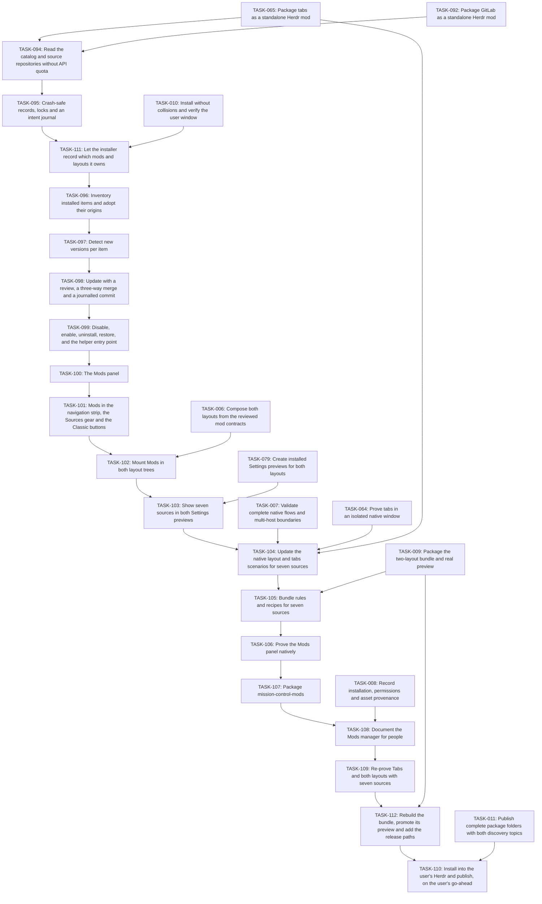

# Plan: Mission Control mods

## Overview

One standalone mod, mission-control-mods, manages the mods and layouts installed in the Herdr app home: it lists them, shows which have a newer version on GitHub, updates them with a review first, and disables, enables and uninstalls them. Like GitHub and Jira it installs on its own or as the seventh work source (Mods) in both Mission Control layouts. Its origins come from the herdr.dev catalog (assets.herdr.dev mods and layouts indexes, built from the public herdr-mod and herdr-layout GitHub topics) and from per-file git blob hashes, because no Herdr listing carries a version.

Mode: **EXPANSION**. Review default: **codex**. Status: **draft**. Tasks: **19**.

Canonical source: [mission-control-mods.json](mission-control-mods.json).

## Scope Challenge

Scope follows the user's request (list, detect new versions, update, enable/disable, uninstall for mods and layouts) and the published practice of four existing community managers (manastalukdar/herdr-pkg, jacksonpires/herdr-app-mod-manager, atleugim/herdr-mod-manager, linziyanleo Mods Plus), adopting their working mechanisms and avoiding their documented failures. Installing new items from the gallery is out of scope for this plan; the catalog is used only to identify and update what is already installed.

## Prerequisites

- Herdr app 0.1.11+ with hc 0.1.16+; re-read the installed ~/.config/herdr-app/AGENTS.md, herdr.d.ts and gpui-kit.d.ts before execution and stop on incompatible contracts.
- The founder (the user) approves this plan at its current JSON and Markdown hashes before implementation.
- Node.js 22+ on this computer for the helper (same requirement as the Jira, GitHub and GitLab helpers) and git for partial clones and three-way merges. No GitHub account or token is used: only public repositories are read.

Cross-plan prerequisites:

- TASK-065: [mission-control-tabs](mission-control-tabs.md) — Package tabs as a standalone Herdr mod
- TASK-092: [mission-control-gitlab](mission-control-gitlab.md) — Package GitLab as a standalone Herdr mod
- TASK-006: [mission-control](mission-control.md) — Compose both layouts from the reviewed mod contracts
- TASK-079: [mission-control](mission-control.md) — Create installed Settings previews for both layouts
- TASK-007: [mission-control](mission-control.md) — Validate complete native flows and multi-host boundaries
- TASK-064: [mission-control-tabs](mission-control-tabs.md) — Prove tabs in an isolated native window
- TASK-009: [mission-control](mission-control.md) — Package the two-layout bundle and real preview
- TASK-008: [mission-control](mission-control.md) — Record installation, permissions and asset provenance
- TASK-011: [mission-control](mission-control.md) — Publish complete package folders with both discovery topics
- TASK-010: [mission-control](mission-control.md) — Install without collisions and verify the user window

## Non-Goals

- No installing new items from the gallery; no publishing; no rating or reporting.
- No management of Herdr's shipped mods and layouts (the keys of appHome()/installed.json): they are listed read-only as Built into Herdr, because Herdr restores and updates them itself.
- No editing of shipped layouts, no automatic layout switching, no change to Herdr settings.
- No credentials: only public github.com repositories are read through git with GIT_TERMINAL_PROMPT=0; private repositories are reported as unreachable.
- Not a security reviewer: the capability scan is a disclosure of what the files reach, never a proof of safety.

## Contracts

- Native GPUI JavaScript only in main.js; every network, git, file and herdr-app check operation runs in the Node helper (node <appHome>/mods/mission-control-mods/backend.mjs, the same launch as the GitHub helper) through exec, which Herdr limits to 30 s and 8 MiB: each helper call is bounded to 25 s and long work is split into resumable passes.
- Records live in appHome()/mission-control/mods/ (packages.json, journal.json, log.jsonl, cache/, stage/, backup/, disabled/, removed/, conflicts/), following this repository's appHome()/mission-control/ convention, not Herdr's own data/ folder. Backups keep the newest three per item.
- Writes to packages.json, journal.json and keys.json are temp-file-plus-rename under a lock whose stale timeout is 60 s (longer than the 25 s helper bound plus a margin) (a Node helper cannot use Herdr's writeTextFile compare-and-set). Changes to mods/, layouts/ or keys.json are journalled first and rolled forward or back at the next helper start.
- Classification: built-in = keys of installed.json; personal clone = mod.json cloned_from; installer-managed = files listed in appHome()/mission-control/installed-packages.json, the ownership manifest scripts/install.mjs writes on install and removes on rollback (updated with the installer, shown read-only); without that manifest Mission Control items count as installed by hand and are managed like any user item; this manager = mission-control-mods itself (read-only). Only user items are updated, disabled or removed.
- Origin: the catalog at https://assets.herdr.dev/{mods,layouts}/index.json (built hourly by herdr.dev from the public herdr-mod and herdr-layout GitHub topics) matched on modNames/layoutFiles, never repo names; an item's subtree is <path>/mods/<name>/, <path>/layouts/<file> and <path>/keys.json; the commit whose tree holds every installed blob wins; several candidates without one are ambiguous; none is untracked until a pasted GitHub link. Several exact matches (identical forks) prefer the repository already recorded for the item, otherwise the item is ambiguous until the user picks once. Items adopted from a pasted link are re-checked with git ls-remote.
- Git, not the GitHub API: blob-less partial clones (git clone --filter=blob:none) read history, trees and blobs without rate limits; only items whose catalog headCommit changed are re-checked; github.com URLs only, except file:// and a QA catalog URL under QA_MODS_FIXTURE=1 for the native gate. A clone or fetch that cannot finish within one call continues as a detached git process with a status file; after three failed passes the item reads too large or slow to fetch.
- Update available means a commit touching the item's subtree changed, added or removed a file relative to the recorded commit; a repository commit elsewhere is not an update.
- Updates stage outside mods/, merge edited text files with git merge-file, treat edited binary files as conflicts, show a review, pass herdr-app check on the stage, then write changed files in place (hot reload watches the installed folder) and delete only unedited removed files. A conflict writes nothing and offers Keep mine, Take theirs or Open the merged files.
- keys.json: an item's bindings are added only where free or already equal; every added key is recorded; update and uninstall change or remove a key only while it still equals what the item set.
- Disable and uninstall are journalled moves to disabled/ and removed/<name>/<time>/, restorable, and removed items older than 30 days are pruned at the next check; refused for built-in, installer-managed and self items, the active layout and mods the active layout uses; other referencing layouts are named and confirmed.
- Mods is a work source with a fixed All installed scope and caption, reusing an existing icon so icons.json and the other packages are unchanged; with seven sources the strip uses short labels at 1024 px.



## Existing Code Leverage

| Observed path / reference | Classification | Use |
| --- | --- | --- |
| src/mods/mission-control-github/data.js | local pattern | Helper launch pattern: io.exec('node', [appHome/mods/<mod>/backend.mjs, request]). |
| scripts/install.mjs | local pattern | Owned-file hashing, herdr-app check and rollback patterns; its receipt marks installer-managed items. |
| src/shared/ui.js | local reuse | Graphite colors, icons and buttons. |
| src/mods/mission-control-tabs/navigation.js | local reuse | Work-source list, Sources gear and Classic buttons gain Mods. |
| https://assets.herdr.dev/mods/index.json | external data, read at runtime | Catalog of herdr-mod repos: owner, repo, path, headCommit, modNames. |
| https://assets.herdr.dev/layouts/index.json | external data, read at runtime | Catalog of herdr-layout repos: owner, repo, path, headCommit, layoutFiles. |
| https://github.com/manastalukdar/herdr-pkg | external inspiration, clean-room | Prior art: per-file blob records, subtree-scoped update checks, git merge-file updates, in-place writes for hot reload. |

## Tasks

### TASK-094: Read the catalog and source repositories without API quota

Fetch https://assets.herdr.dev/{mods,layouts}/index.json (one-hour cache) and keep a blob-less partial clone of each referenced github.com repository (git clone --filter=blob:none --no-checkout, then git fetch) under appHome()/mission-control/mods/cache/, reading history, trees and individual blobs through git so no GitHub API rate limit applies. Every call is bounded to finish inside one exec; a QA_MODS_CATALOG_URL and file:// remotes are honoured only when QA_MODS_FIXTURE=1, for the native gate. A fetch that cannot finish within one call continues detached with a status file and ends as too large or slow to fetch after three failed passes; git runs with GIT_TERMINAL_PROMPT=0.

**Type:** feature  
**Priority:** P1  
**Effort:** M  
**Agent:** nodejs-cli-senior-engineer  
**Review:** codex  
**Depends on:** TASK-065, TASK-092

**Acceptance Criteria:**

- Catalog entries with empty and nested path both resolve; a non-github.com URL is refused outside the fixture mode; truncated or failed fetches keep the previous cache with a stated reason.
- A path-scoped history query, a tree read and a blob read work from the partial clone with no network call once fetched; each call returns inside 25 s or reports that it needs another pass.

**Write scope:**

| File | Action | Role |
| --- | --- | --- |
| src/mods/mission-control-mods/source.mjs | Create | Catalog cache and git partial-clone reads (history, trees, blobs), bounded per exec, with fixture overrides. |
| tests/mods-source.test.mjs | Create | Local bare repositories and a fixture catalog for paths, caching, refusal and time bounds. |

**Validate:**

```sh
node --test tests/mods-source.test.mjs
```

### TASK-095: Crash-safe records, locks and an intent journal

Records live in appHome()/mission-control/mods/ (packages.json, journal.json, log.jsonl). Every write is a temp file plus rename under a lock file with a stale timeout. Any change to mods/, layouts/ or keys.json is preceded by a journal entry listing each planned file operation and its backup; every helper start first rolls an open journal forward or back. Temp files use hidden names outside the watched folders.

**Type:** feature  
**Priority:** P1  
**Effort:** L  
**Agent:** nodejs-cli-senior-engineer  
**Review:** codex  
**Depends on:** TASK-094

**Acceptance Criteria:**

- Killing the helper at any point during a journalled commit leaves, after the next helper start, either the complete old or the complete new state of every touched file and of keys.json.
- Two helpers racing on packages.json never lose an update; a stale lock is reclaimed only after its timeout.

**Write scope:**

| File | Action | Role |
| --- | --- | --- |
| src/mods/mission-control-mods/store.mjs | Create | Lock, temp-plus-rename writes, intent journal and recovery. |
| tests/mods-store.test.mjs | Create | Real child processes killed mid-commit, concurrent writers and stale locks. |

**Validate:**

```sh
node --test tests/mods-store.test.mjs
```

### TASK-096: Inventory installed items and adopt their origins

List mods/* and layouts/*.json; classify built-in (installed.json keys), personal clones (cloned_from), installer-managed (listed in appHome()/mission-control/installed-packages.json; without it, Mission Control items are treated as installed by hand), the manager itself, disabled and user items; hash every file as a git blob. Match an item by folder name against catalog modNames or layoutFiles (and a layout entry folder's mods/), define its subtree as <path>/mods/<name>/, <path>/layouts/<file> and <path>/keys.json, and choose among candidates: the commit whose tree holds every installed blob wins; with several candidates and no exact match the item is ambiguous and lists them; with none it is untracked until the user pastes a GitHub folder link.

**Type:** feature  
**Priority:** P1  
**Effort:** L  
**Agent:** nodejs-cli-senior-engineer  
**Review:** codex  
**Depends on:** TASK-111

**Acceptance Criteria:**

- A fixture app home with built-in, clone, installer-managed, self, exact, older-commit, edited, ambiguous, disabled and unknown items yields exactly those states.
- A layout and the mods in its folder are recorded as one package; built-in, clone, installer-managed and self items never get an origin.

**Write scope:**

| File | Action | Role |
| --- | --- | --- |
| src/mods/mission-control-mods/inventory.mjs | Create | Scan, classification, blob hashing, catalog matching and adoption. |
| tests/mods-inventory.test.mjs | Create | Fixture app homes against local bare repositories and a fixture catalog. |

**Validate:**

```sh
node --test tests/mods-inventory.test.mjs
```

### TASK-097: Detect new versions per item

Re-check only items whose catalog headCommit changed since the last check: find the newest commit touching the item's subtree and compare its tree with the recorded commit (added, changed, removed files), with that commit's date and subject. Items adopted from a pasted link are re-checked with git ls-remote.

**Type:** feature  
**Priority:** P1  
**Effort:** M  
**Agent:** nodejs-cli-senior-engineer  
**Review:** codex  
**Depends on:** TASK-096

**Acceptance Criteria:**

- A repository commit outside the subtree is not an update; an added, changed or removed file inside it is, listing the files.
- An unchanged catalog headCommit costs no git fetch, an item adopted from a pasted link is re-checked through git ls-remote, and offline keeps the last result with its time.

**Write scope:**

| File | Action | Role |
| --- | --- | --- |
| src/mods/mission-control-mods/updates.mjs | Create | Subtree-scoped update detection with cached results. |
| tests/mods-updates.test.mjs | Create | Local repositories with in-path and out-of-path commits, removals and offline. |

**Validate:**

```sh
node --test tests/mods-updates.test.mjs
```

### TASK-098: Update with a review, a three-way merge and a journalled commit

Phase 1 (one exec, outside mods/): stage the new version under the records folder, merge each locally edited text file with git merge-file against the recorded base, treat edited binary files as conflicts, compute the review (changed files, newly disclosed network/program/file access, key changes) and run herdr-app check on the stage. Phase 2 (one exec, local only): journal, back up, write changed files in place, delete unedited removed files, merge keys by ownership, record the new commit. A conflict writes nothing and offers Keep mine, Take theirs or Open the merged files.

**Type:** feature  
**Priority:** P1  
**Effort:** L  
**Agent:** nodejs-cli-senior-engineer  
**Review:** codex  
**Depends on:** TASK-097

**Acceptance Criteria:**

- A clean merge applies; a conflict or a binary edit writes nothing to mods/ and offers the three resolutions, each of which completes or restores.
- A failing check, a write error or a killed helper leaves the installed folder and keys.json as they were (via the journal); generated *.d.ts, jsconfig.json and runtime.json are never touched.

**Write scope:**

| File | Action | Role |
| --- | --- | --- |
| src/mods/mission-control-mods/apply.mjs | Create | Stage, merge, review, check and journalled commit with conflict resolution. |
| tests/mods-apply.test.mjs | Create | Real git merge-file, binary conflicts, a fake herdr-app check, rollback and key ownership. |

**Validate:**

```sh
node --test tests/mods-apply.test.mjs
```

### TASK-099: Disable, enable, uninstall, restore, and the helper entry point

Journalled moves to appHome()/mission-control/mods/disabled/ and removed/<name>/<time>/; restore from either; prune backups to the newest three per item; Restore everything before the manager is removed. Refuse built-in, installer-managed and self items, the active layout and any mod the active layout uses; ask for confirmation, naming each layout, for mods other layouts use. backend.mjs dispatches every operation in one bounded exec.

**Type:** feature  
**Priority:** P1  
**Effort:** M  
**Agent:** nodejs-cli-senior-engineer  
**Review:** codex  
**Depends on:** TASK-098

**Acceptance Criteria:**

- Disable then enable, and uninstall then restore, return identical bytes and keys; every refusal states its reason.
- Each operation returns within the exec limit or reports a continuation; the entry point recovers an open journal before doing anything else.

**Write scope:**

| File | Action | Role |
| --- | --- | --- |
| src/mods/mission-control-mods/lifecycle.mjs | Create | Disable, enable, uninstall, restore, pruning and reference rules. |
| src/mods/mission-control-mods/backend.mjs | Create | Bounded helper entry point with journal recovery first. |
| tests/mods-lifecycle.test.mjs | Create | Refusals, references, keys, restore and Restore everything through the entry point. |

**Validate:**

```sh
node --test tests/mods-lifecycle.test.mjs
```

### TASK-100: The Mods panel

Sections Updates, Layouts, Mods, Disabled and Built into Herdr; per-row status (up to date, update available with date and subject, edited, conflict, ambiguous, disabled, untracked, personal clone, managed by the installer, this manager) and actions; review screen before applying; Update all applies only clean updates without new access or key clashes; two-step Uninstall whose confirmation says removed items can be restored for 30 days and are then deleted; conflict resolution; Check now with last checked time; search; paste-a-link adoption. Caption reads All installed; runs with hideHeader in the layouts. Opening the panel first asks the helper to recover any open journal, so a half-applied change is finished or undone before anything is shown.

**Type:** feature  
**Priority:** P1  
**Effort:** L  
**Agent:** frontend-senior-engineer  
**Review:** codex  
**Depends on:** TASK-099

**Acceptance Criteria:**

- Every status renders with exactly its allowed actions, and each action calls the helper and redraws from its result.
- The review screen appears before any write; helper errors keep the last list with a reason.

**Write scope:**

| File | Action | Role |
| --- | --- | --- |
| src/mods/mission-control-mods/main.js | Create | Native panel, review and conflict screens, actions. |
| src/mods/mission-control-mods/mod.json | Create | Manifest reusing existing icon assets only. |
| tests/mods-panel.test.mjs | Create | Recorded-native tests for statuses, actions, review and errors. |

**Validate:**

```sh
node --import ./tests/support/native-loader.mjs --test tests/mods-panel.test.mjs
```

### TASK-101: Mods in the navigation strip, the Sources gear and the Classic buttons

Add Mods (reusing the existing layout icon, so icons.json and every other package stay unchanged) with a fixed All installed scope and caption, and the source-mods command. Seven sources need about 850 px for full labels: the strip shows short labels at 1024 px and keeps every short label whole at 736 px.

**Type:** feature  
**Priority:** P1  
**Effort:** M  
**Agent:** frontend-senior-engineer  
**Review:** codex  
**Depends on:** TASK-100

**Acceptance Criteria:**

- Mods is selectable from the strip, the Classic button and source-mods, and can be turned off in the Sources gear; its caption reads All installed.
- At 1024 px the strip shows seven whole short labels and at 736 px seven whole short labels; icons.json is unchanged.

**Write scope:**

| File | Action | Role |
| --- | --- | --- |
| src/mods/mission-control-tabs/navigation.js | Modify existing source or prior task output | Seventh source, fixed scope, widths. |
| src/mods/mission-control-tabs/main.js | Modify existing source or prior task output | source-mods command. |
| tests/navigation.test.mjs | Modify existing source or prior task output | Seven sources, widths, caption and Sources gear. |

**Validate:**

```sh
node --import ./tests/support/native-loader.mjs --test tests/navigation.test.mjs
```

### TASK-102: Mount Mods in both layout trees

Add a mods child running mission-control-mods with hideHeader to mc-work-stack in both layouts, keeping node IDs and the six sources unchanged.

**Type:** feature  
**Priority:** P1  
**Effort:** S  
**Agent:** frontend-senior-engineer  
**Review:** codex  
**Depends on:** TASK-101, TASK-006

**Acceptance Criteria:**

- Both trees mount exactly seven sources in navigation order, each with hideHeader.
- The Classic panel still starts hidden and leaves the terminals more than 100 px at 736 px.

**Write scope:**

| File | Action | Role |
| --- | --- | --- |
| src/layouts/mission-control.json | Modify existing source or prior task output | Overview stack gains mods. |
| src/layouts/mission-control-classic.json | Modify existing source or prior task output | Classic panel stack gains mods. |
| tests/layouts.test.mjs | Modify existing source or prior task output | Seven-source trees. |

**Validate:**

```sh
node --test tests/layouts.test.mjs
```

### TASK-103: Show seven sources in both Settings previews

Redraw the two Settings layout previews with seven source slots.

**Type:** feature  
**Priority:** P2  
**Effort:** S  
**Agent:** frontend-senior-engineer  
**Review:** codex  
**Depends on:** TASK-102, TASK-079

**Acceptance Criteria:**

- Both SVGs draw seven source slots in order and pass the preview checks.
- They remain authored artwork; the bundle preview.png is recaptured from the native layout gate.

**Write scope:**

| File | Action | Role |
| --- | --- | --- |
| src/layouts/mission-control.svg | Modify existing source or prior task output | Overview preview, seven sources. |
| src/layouts/mission-control-classic.svg | Modify existing source or prior task output | Classic preview, seven sources. |
| tests/layout-previews.test.mjs | Modify existing source or prior task output | Seven-slot checks. |

**Validate:**

```sh
node --test tests/layout-previews.test.mjs
```

### TASK-104: Update the native layout and tabs scenarios for seven sources

Update tests/native/layout.mjs (SOURCES, navFull/navShort geometry, six-source checks) and tests/native/tabs.mjs (wide navigation now short labels at 1024 px) and the required check list in tests/package-tabs.test.mjs. These are test and recipe edits whose syntax is checked here; they are proven by the native gates and package tests in TASK-109 and TASK-112, which this task does not replace.

**Type:** test  
**Priority:** P1  
**Effort:** M  
**Agent:** qa-automation-engineer  
**Review:** codex  
**Depends on:** TASK-103, TASK-007, TASK-064, TASK-065

**Acceptance Criteria:**

- Both scenarios check seven sources with short labels at 1024 and 736 px and select Mods natively.
- The tabs package test requires exactly the scenario's labels.

**Write scope:**

| File | Action | Role |
| --- | --- | --- |
| tests/native/layout.mjs | Modify existing source or prior task output | Seven-source geometry and checks. |
| tests/native/tabs.mjs | Modify existing source or prior task output | Seven-source navigation checks. |
| tests/package-tabs.test.mjs | Modify existing source or prior task output | Required labels. |

**Validate:**

```sh
node --check tests/native/layout.mjs && node --check tests/native/tabs.mjs
```

### TASK-105: Bundle rules and recipes for seven sources

Add mission-control-mods to DESTINATIONS and BUNDLED_MODS in tests/package-layout.test.mjs and describe the seventh source in the bundle and tabs recipes. These are test and recipe edits whose syntax is checked here; they are proven by the native gates and package tests in TASK-109 and TASK-112, which this task does not replace.

**Type:** docs  
**Priority:** P1  
**Effort:** S  
**Agent:** technical-writer  
**Review:** codex  
**Depends on:** TASK-104, TASK-009

**Acceptance Criteria:**

- The bundle test requires eight bundled mods and seven destinations.
- Both recipes describe Mods, its short-label behaviour at 1024 px and its fixed All installed scope.

**Write scope:**

| File | Action | Role |
| --- | --- | --- |
| tests/package-layout.test.mjs | Modify existing source or prior task output | Eight mods, seven destinations. |
| mission-control/RECIPE.md | Modify existing source or prior task output | Bundle recipe. |
| mission-control-tabs/RECIPE.md | Modify existing source or prior task output | Tabs recipe. |

**Validate:**

```sh
node --check tests/package-layout.test.mjs
```

### TASK-106: Prove the Mods panel natively

Native scenario in the private Herdr harness with QA_MODS_FIXTURE=1, a fixture catalog and local bare repositories, gh forced off: detect an update, review and apply it and see the updated mod hot-reload in place; add and remove a key and see it take effect; park a conflict and resolve it; disable/enable; uninstall/restore; refuse a built-in item and the active layout; open Mods from the strip and the Classic button.

**Type:** test  
**Priority:** P1  
**Effort:** L  
**Agent:** qa-automation-engineer  
**Review:** codex  
**Depends on:** TASK-105

**Acceptance Criteria:**

- The gate passes with real input and zero native errors and captures the mods-preview frame.
- Every action in the panel is exercised at least once against real files in the private app home.

**Write scope:**

| File | Action | Role |
| --- | --- | --- |
| tests/native/mods.mjs | Create | Native Mods scenario. |
| evidence/native/mods.json | Create | Native receipt written by the harness. |

**Validate:**

```sh
node scripts/native-harness.mjs run mods
```

### TASK-107: Package mission-control-mods

Standalone package (mods/mission-control-mods/, RECIPE.md with the full access disclosure, the native preview.png from the passed receipt, build manifest) and the bundled copy.

**Type:** feature  
**Priority:** P1  
**Effort:** S  
**Agent:** nodejs-cli-senior-engineer  
**Review:** codex  
**Depends on:** TASK-106

**Acceptance Criteria:**

- herdr-app check passes on the standalone and bundled copies, which are byte-identical to the tested build.
- The package test fails on a missing or outdated file, a non-native preview or a recipe without the access disclosure.

**Write scope:**

| File | Action | Role |
| --- | --- | --- |
| mission-control-mods/RECIPE.md | Create | Recipe and access disclosure. |
| mission-control-mods/preview.png | Create | Native preview promoted from the passed receipt. |
| tests/package-mods.test.mjs | Create | Package bytes, recipe and preview provenance. |

**Validate:**

```sh
node scripts/project.mjs check mission-control-mods && node --test tests/package-mods.test.mjs
```

### TASK-108: Document the Mods manager for people

README features and packages table (with its screenshot) and the access row in docs/access.md, in plain language; a docs test checks the required statements. The docs state that removed items are kept for 30 days and then deleted.

**Type:** docs  
**Priority:** P2  
**Effort:** S  
**Agent:** technical-writer  
**Review:** codex  
**Depends on:** TASK-107, TASK-008

**Acceptance Criteria:**

- README and docs/access.md describe statuses, actions, what it reads and changes, its network use and what it never touches.
- tests/docs-mods.test.mjs fails if those statements, the 30-day restore-then-delete statement for removed items, or the package row are missing.

**Write scope:**

| File | Action | Role |
| --- | --- | --- |
| README.md | Modify existing source or prior task output | Features and packages table. |
| docs/access.md | Modify existing source or prior task output | Access row and limits. |
| tests/docs-mods.test.mjs | Create | Required statements. |

**Validate:**

```sh
node --test tests/docs-mods.test.mjs
```

### TASK-109: Re-prove Tabs and both layouts with seven sources

Re-run the tabs and layout native gates on the final build and promote the tabs preview from the new tabs receipt.

**Type:** test  
**Priority:** P1  
**Effort:** M  
**Agent:** qa-automation-engineer  
**Review:** codex  
**Depends on:** TASK-108

**Acceptance Criteria:**

- The tabs and layout receipts pass at the current harness with seven sources.
- The tabs package test passes against the new receipt and its promoted preview.

**Write scope:**

| File | Action | Role |
| --- | --- | --- |
| evidence/native/tabs.json | Modify existing source or prior task output | Re-proved tabs receipt. |
| evidence/native/layout.json | Modify existing source or prior task output | Re-proved layout receipt. |
| mission-control-tabs/preview.png | Modify existing source or prior task output | Tabs preview promoted from the new receipt. |

**Validate:**

```sh
node scripts/native-harness.mjs run tabs && node scripts/native-harness.mjs run layout && node --test tests/package-tabs.test.mjs
```

### TASK-110: Install into the user's Herdr and publish, on the user's go-ahead

Only after the user explicitly says so: roll back the current install receipt, install the bundle, verify it, push, and record the release receipt.

**Type:** chore  
**Priority:** P1  
**Effort:** S  
**Agent:** devops-engineer  
**Review:** codex  
**Depends on:** TASK-112, TASK-011

**Acceptance Criteria:**

- Nothing in this task runs without the user's explicit go-ahead in the conversation.
- After the install verifies and the user's terminals keep running, the release preflight passes, the push succeeds and the release receipt verifies against GitHub.

**Write scope:**

| File | Action | Role |
| --- | --- | --- |
| evidence/native/install.json | Modify existing source or prior task output | Install receipt for the eight-mod bundle. |
| evidence/release.json | Modify existing source or prior task output | Release receipt. |

**Validate:**

```sh
node scripts/install.mjs --verify-receipt evidence/native/install.json && node scripts/release.mjs preflight --paths-from .ulpi/release-paths.txt && node scripts/release.mjs verify --receipt evidence/release.json
```

### TASK-111: Let the installer record which mods and layouts it owns

scripts/install.mjs writes appHome()/mission-control/installed-packages.json (package name, source path, owned files and their hashes, receipt path) when an install succeeds and removes it on rollback, so the Mods manager can show installer-managed items read-only. Existing installs gain the manifest on their next install.

**Type:** feature  
**Priority:** P1  
**Effort:** S  
**Agent:** nodejs-cli-senior-engineer  
**Review:** codex  
**Depends on:** TASK-095, TASK-010

**Acceptance Criteria:**

- Install writes and rollback removes the manifest; a failed install leaves no manifest; the manifest never lists files the installer did not write.
- The verify-receipt check still passes and the existing install tests still pass.

**Write scope:**

| File | Action | Role |
| --- | --- | --- |
| scripts/install.mjs | Modify existing source or prior task output | Ownership manifest on install, removal on rollback. |
| tests/install.test.mjs | Modify existing source or prior task output | Manifest written, removed and absent on failure. |

**Validate:**

```sh
node --test tests/install.test.mjs
```

### TASK-112: Rebuild the bundle, promote its preview and add the release paths

Promote the layout-preview frame of the new layout receipt as mission-control/preview.png, rebuild the bundle with eight mods, add mission-control-mods and evidence/native/mods.json to the release paths and pass the package tests. The release preflight needs the new install and runs in TASK-110.

**Type:** chore  
**Priority:** P1  
**Effort:** S  
**Agent:** devops-engineer  
**Review:** codex  
**Depends on:** TASK-109, TASK-009

**Acceptance Criteria:**

- The bundle holds eight mods byte-identical to their standalone builds and its preview equals the new layout receipt frame.
- The release paths include the Mods package and its receipt, and the package tests pass.

**Write scope:**

| File | Action | Role |
| --- | --- | --- |
| mission-control/preview.png | Modify existing source or prior task output | Bundle preview promoted from the new layout receipt. |
| .ulpi/release-paths.txt | Modify existing source or prior task output | Release paths gain the Mods package and receipt. |

**Validate:**

```sh
node scripts/project.mjs bundle && node --test tests/package-tabs.test.mjs tests/package-layout.test.mjs tests/package-mods.test.mjs
```

## Failure Modes

| Failure | Containment / recovery |
| --- | --- |
| Helper killed mid-operation (30 s exec limit, crash) | The intent journal is rolled forward or back at the next helper start; no half-written mod or keys.json survives. |
| Catalog or GitHub unreachable | Keep the last result with its time and reason; Update stays disabled until a fresh check. |
| Local edits conflict, or an edited binary file | Write nothing; offer Keep mine, Take theirs or Open the merged files. |
| herdr-app check fails on the stage | Do not apply; show the output; installed files unchanged. |
| Mod used by the active layout | Refuse disable and uninstall; name other referencing layouts and ask before acting. |
| Built-in, installer-managed or the manager itself | Read-only, with the reason shown. |
| Several catalog candidates or none | Ambiguous lists the candidates; untracked accepts a pasted GitHub folder link. |

## Ship Cut

Ship nothing partially working: the package ships only after its native gate, recipe and real preview; the layouts gain Mods only after the tabs and layout gates pass with seven sources; installation and publication wait for the user's go-ahead.

## Test Coverage Map

| Task | Paths | Gate |
| --- | --- | --- |
| TASK-094 | src/mods/mission-control-mods/source.mjs, tests/mods-source.test.mjs | feature: node --test tests/mods-source.test.mjs |
| TASK-095 | src/mods/mission-control-mods/store.mjs, tests/mods-store.test.mjs | feature: node --test tests/mods-store.test.mjs |
| TASK-096 | src/mods/mission-control-mods/inventory.mjs, tests/mods-inventory.test.mjs | feature: node --test tests/mods-inventory.test.mjs |
| TASK-097 | src/mods/mission-control-mods/updates.mjs, tests/mods-updates.test.mjs | feature: node --test tests/mods-updates.test.mjs |
| TASK-098 | src/mods/mission-control-mods/apply.mjs, tests/mods-apply.test.mjs | feature: node --test tests/mods-apply.test.mjs |
| TASK-099 | src/mods/mission-control-mods/lifecycle.mjs, src/mods/mission-control-mods/backend.mjs, tests/mods-lifecycle.test.mjs | feature: node --test tests/mods-lifecycle.test.mjs |
| TASK-100 | src/mods/mission-control-mods/main.js, src/mods/mission-control-mods/mod.json, tests/mods-panel.test.mjs | feature: node --import ./tests/support/native-loader.mjs --test tests/mods-panel.test.mjs |
| TASK-101 | src/mods/mission-control-tabs/navigation.js, src/mods/mission-control-tabs/main.js, tests/navigation.test.mjs | feature: node --import ./tests/support/native-loader.mjs --test tests/navigation.test.mjs |
| TASK-102 | src/layouts/mission-control.json, src/layouts/mission-control-classic.json, tests/layouts.test.mjs | feature: node --test tests/layouts.test.mjs |
| TASK-103 | src/layouts/mission-control.svg, src/layouts/mission-control-classic.svg, tests/layout-previews.test.mjs | feature: node --test tests/layout-previews.test.mjs |
| TASK-104 | tests/native/layout.mjs, tests/native/tabs.mjs, tests/package-tabs.test.mjs | test: node --check tests/native/layout.mjs && node --check tests/native/tabs.mjs |
| TASK-105 | tests/package-layout.test.mjs, mission-control/RECIPE.md, mission-control-tabs/RECIPE.md | docs: node --check tests/package-layout.test.mjs |
| TASK-106 | tests/native/mods.mjs, evidence/native/mods.json | test: node scripts/native-harness.mjs run mods |
| TASK-107 | mission-control-mods/RECIPE.md, mission-control-mods/preview.png, tests/package-mods.test.mjs | feature: node scripts/project.mjs check mission-control-mods && node --test tests/package-mods.test.mjs |
| TASK-108 | README.md, docs/access.md, tests/docs-mods.test.mjs | docs: node --test tests/docs-mods.test.mjs |
| TASK-109 | evidence/native/tabs.json, evidence/native/layout.json, mission-control-tabs/preview.png | test: node scripts/native-harness.mjs run tabs && node scripts/native-harness.mjs run layout && node --test tests/package-tabs.test.mjs |
| TASK-110 | evidence/native/install.json, evidence/release.json | chore: node scripts/install.mjs --verify-receipt evidence/native/install.json && node scripts/release.mjs preflight --paths-from .ulpi/release-paths.txt && node scripts/release.mjs verify --receipt evidence/release.json |
| TASK-111 | scripts/install.mjs, tests/install.test.mjs | feature: node --test tests/install.test.mjs |
| TASK-112 | mission-control/preview.png, .ulpi/release-paths.txt | chore: node scripts/project.mjs bundle && node --test tests/package-tabs.test.mjs tests/package-layout.test.mjs tests/package-mods.test.mjs |

## Execution Summary

| Metric | Derived value |
| --- | --- |
| Tasks | 19 |
| Local roots | TASK-094 |
| Union DAG layers reached | 29, 30, 31, 32, 33, 34, 35, 36, 37, 38, 39, 40, 41, 42, 43, 44, 45, 46, 47 |
| Critical path including prerequisite plans | TASK-001 → TASK-003 → TASK-012 → TASK-013 → TASK-071 → TASK-015 → TASK-016 → TASK-038 → TASK-046 → TASK-047 → TASK-048 → TASK-049 → TASK-080 → TASK-084 → TASK-085 → TASK-086 → TASK-088 → TASK-089 → TASK-090 → TASK-050 → TASK-055 → TASK-056 → TASK-060 → TASK-061 → TASK-062 → TASK-063 → TASK-064 → TASK-065 → TASK-094 → TASK-095 → TASK-111 → TASK-096 → TASK-097 → TASK-098 → TASK-099 → TASK-100 → TASK-101 → TASK-102 → TASK-103 → TASK-104 → TASK-105 → TASK-106 → TASK-107 → TASK-108 → TASK-109 → TASK-112 → TASK-110 |
| Cross-plan task dependencies | 10 |

Layers (global prerequisite depth, not arbitrary serial order):

- Layer 29: TASK-094
- Layer 30: TASK-095
- Layer 31: TASK-111
- Layer 32: TASK-096
- Layer 33: TASK-097
- Layer 34: TASK-098
- Layer 35: TASK-099
- Layer 36: TASK-100
- Layer 37: TASK-101
- Layer 38: TASK-102
- Layer 39: TASK-103
- Layer 40: TASK-104
- Layer 41: TASK-105
- Layer 42: TASK-106
- Layer 43: TASK-107
- Layer 44: TASK-108
- Layer 45: TASK-109
- Layer 46: TASK-112
- Layer 47: TASK-110

## Task Dependencies

```json
{
  "TASK-094": [
    "TASK-065",
    "TASK-092"
  ],
  "TASK-095": [
    "TASK-094"
  ],
  "TASK-096": [
    "TASK-111"
  ],
  "TASK-097": [
    "TASK-096"
  ],
  "TASK-098": [
    "TASK-097"
  ],
  "TASK-099": [
    "TASK-098"
  ],
  "TASK-100": [
    "TASK-099"
  ],
  "TASK-101": [
    "TASK-100"
  ],
  "TASK-102": [
    "TASK-101",
    "TASK-006"
  ],
  "TASK-103": [
    "TASK-102",
    "TASK-079"
  ],
  "TASK-104": [
    "TASK-103",
    "TASK-007",
    "TASK-064",
    "TASK-065"
  ],
  "TASK-105": [
    "TASK-104",
    "TASK-009"
  ],
  "TASK-106": [
    "TASK-105"
  ],
  "TASK-107": [
    "TASK-106"
  ],
  "TASK-108": [
    "TASK-107",
    "TASK-008"
  ],
  "TASK-109": [
    "TASK-108"
  ],
  "TASK-110": [
    "TASK-112",
    "TASK-011"
  ],
  "TASK-111": [
    "TASK-095",
    "TASK-010"
  ],
  "TASK-112": [
    "TASK-109",
    "TASK-009"
  ]
}
```
