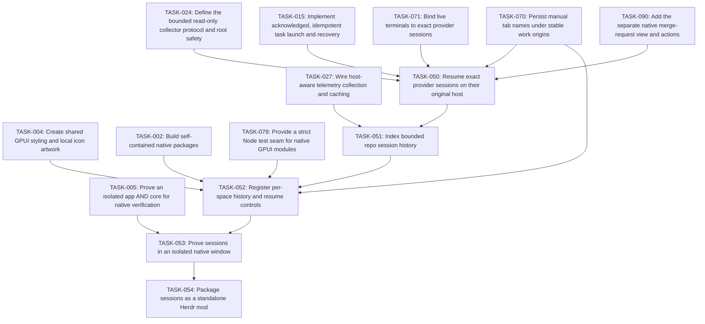

# Plan: Mission Control sessions

## Overview

Expose searchable previous sessions per repo/worktree and machine, with exact-ID resume and safe focus of already-running sessions. This plan owns shared resume behavior used by reopening.

Mode: **EXPANSION**. Review default: **codex**. Status: **awaiting-founder-review**. Tasks: **5**.

Canonical source: [mission-control-sessions.json](mission-control-sessions.json).

## Scope Challenge

The approved feature scope is frozen. The implementation is greenfield native GPUI, so EXPANSION accurately describes the repository work; it does not add features beyond DESIGN-NOTES.md. Codex remains the review default. Atomic three-file scopes explain the task count.

## Prerequisites

- Herdr app 0.1.9 / hc 0.1.14 were observed; re-read installed declarations before execution and stop on incompatible contracts.
- All plans must pass founder review at their current hashes before implementation.
- Source, mounted native UI, authenticated provider checks, install and public publishing are separate gates.

Cross-plan prerequisites:

- TASK-024: [mission-control-agents](mission-control-agents.md) — Define the bounded read-only collector protocol and root safety
- TASK-015: [mission-control-agent-menu](mission-control-agent-menu.md) — Implement acknowledged, idempotent task launch and recovery
- TASK-070: [mission-control](mission-control.md) — Persist manual tab names under stable work origins
- TASK-071: [mission-control-agents](mission-control-agents.md) — Bind live terminals to exact provider sessions
- TASK-090: [mission-control-gitlab](mission-control-gitlab.md) — Add the separate native merge-request view and actions
- TASK-027: [mission-control-agents](mission-control-agents.md) — Wire host-aware telemetry collection and caching
- TASK-004: [mission-control](mission-control.md) — Create shared GPUI styling and local icon artwork
- TASK-002: [mission-control](mission-control.md) — Build self-contained native packages
- TASK-078: [mission-control](mission-control.md) — Provide a strict Node test seam for native GPUI modules
- TASK-005: [mission-control](mission-control.md) — Prove an isolated app AND core for native verification

## Non-Goals

- No modification of shipped mods/layouts, generated Herdr type files, AGENTS.md, existing user sessions or credential stores.
- No Jira/GitHub workflow mutation, autonomous issue assignment or paid agent calls for fetching boards.
- No claim that the HTML mockup or load-only native check proves live behavior.

## Contracts

- Native GPUI JavaScript only: gpui-kit / gpui-base / herdr are runtime externals. No DOM, Node, CSS or setTimeout in GPUI. Helpers run out of process through exec; cx is not retained across awaits.
- Source paths are observed under src/, scripts/, tests/ and evidence/. Existing completed foundation and mod outputs are recorded in .ulpi/execution.json; new targets remain explicit task-owned creates. A changed completed contract reopens its owner task, marks its current files Modify and removes the old scheduling completion until replacement evidence passes. Prototypes and external examples remain references, not native reuse.
- All TASK IDs are globally unique. dependsOn can refer to another plan; externalDependencies records the owning JSON and its provided capability. The generated index resolves and validates the union DAG. There is no master execution plan.
- Canonical JSON is the source of truth. Markdown, dependency maps, execution layers and critical paths are derived. A change invalidates the reviewed SHA256 of that plan and all materially affected consumers.
- Build compilation may produce multiple artifacts. generatedArtifacts are compiler / capture outputs, never hand-edited source. Each task has at most three authored files. The package builder owns compilation and materialization; output manifests enumerate hashes and source provenance.
- Every standalone package is <name>/mods/<name>/ plus RECIPE.md, actual preview.png, optional keys.json and notices; no layouts/. It must work after copying only that mod directory. Shared source is bundled inside main.js / backend.mjs or copied as collector.py inside that same mod, with no runtime cross-mod code imports.
- Layout package mission-control/ contains both layouts and byte-equivalent copies of required standalone mods. One public GitHub repository may hold all complete package folders and both topics herdr-mod and herdr-layout, as the installed sharing rules explicitly allow.
- IDs and caches qualify machine, canonical repo root, source, account/connection, site and issue/session ID. A null machine means local. Never select a different repo or account as fallback. Remote paths are not local paths.
- Herdr exec(command,args,{cwd,on}) has no stdin or env option, rejects unreachable hosts and bounds requests to 30 s / 8 MiB. Use argv arrays, not interpolated shell. run returns null, not created IDs. Acknowledged creation uses exec("herdr-app",["do","tab.new",JSON.stringify(args)]) and validates its actual result shape before recording success.
- Settings persist in appHome()/mission-control/config.json via writeTextFile(path,text,expected) CAS. Credentials never enter shared state, logs, exported packages, arguments or screenshots. Shared keys are mission-control-* and versioned. CAS conflict reloads and retries boundedly or reports conflict.
- RepoBinding v1: {machine:null|string,repoRoot:string,jira?:{connectionId,project?:string,jql?:string},github?:{connectionId,owner,repo,status?:{labels?:{todo:[],inProgress:[],done:[]},project?:{owner,number,fieldId,options:{todo:string[],inProgress:string[],done:string[]},unmapped:"error"}}},mountedLocalPath?:string}. Reusable connections are configured separately; migration or invalid v1 data never overwrites the original.
- LaunchRequest v1: {requestId:string,idempotencyKey:string,originId:string,spaceId,machine,repoRoot,checkoutRoot?:string,toolKey,source?:{kind,connectionId,site,id,key,url,title,body},worktree:boolean,worktreePath?:string,branch?,model?,reasoning?,instructions?,skill?,subagents?}. LaunchResult is {ok:true,tabId,terminalId?,folder,reused:boolean} or {ok:false,code,message,recovery?}; unsupported options fail before spawning. repoRoot is canonical repository identity; checkoutRoot captures the actual selected worktree execution root and defaults explicitly to repoRoot only for tracker-bound cards without a live checkout. Before launch, validate checkoutRoot belongs to the same canonical Git common directory; current-checkout launches use checkoutRoot, never the common main checkout by accident.
- Source Issue v1: {identity:{kind,connectionId,site,id},key,title,url,body,statusGroup:"todo"|"inProgress"|"done",statusName,priority?,repoBinding,updatedAt?}. Source categories/mappings determine status; running agents do not move issue cards. Invalid status / wrong identity is an error, not an arbitrary category.
- Snapshot<T> v1: {data:T[],fetchedAt,scope,cursor?,truncated:boolean,error?:{code,message,retryAt?}}. Scope/account changes clear visible old-scope data immediately; same-scope failures may show timestamped stale data. Cap 1000 records per scope, page 50, explicit Load more / truncated label, concurrency <=4 and one in-flight request per scope.
- Only read-only Jira/GitHub/MCP requests are in scope. Each connection is opt-in, has an allowlisted HTTPS origin and explicit adapter. Redirects and tool responses cannot redirect credentials to another origin. Helper output is normalized and redacted; external prose is task data, never an executable shell command.
- UI uses graphite chrome #101114, surfaces #17191d, subdued #2a2d33 separators, muted labels and blue focus. Agent task titles get actual tool icons. Icons are local SVG/image assets or declared shipped icons, never font glyph dependencies or mojibake.
- Native isolation is owned once by TASK005 in mission-control.json: use its exact NativeIsolationReceiptV2, FixtureEnvironment ABI and validateNativeIsolationReceipt(receipt,{receiptPath?}) contract. Existing app/core instances are never queried or mutated. New proof binds fresh private selector roots, task-created Unix listeners and process generations; no new receipt claims an observed unchanged user PID. Package checks consume the canonical validator, including only the exact pinned historical legacy receipts. Missing, failed, downgraded or tampered proof cannot release a package or publishable preview.
- Node >=22 and Python >=3 are declared optional-helper prerequisites, probed on the execution host. Remote collector runs as exec("python3",["-c",ownCollectorSource,JSON.stringify(request)],{on:machine}); no assumption that a local helper file exists remotely. Missing Python reports unsupported host metrics/history without hiding agents or blocking terminals.
- SessionIdentity v1 is {machine:null|string,provider:string,credentialScope:string,providerRoot:string,sessionId:string}. All context/history/bindings carry the full value. TerminalIdentity is {machine,address,createdMs,foregroundPid}; a changed generation invalidates correlation. Active agents have no native provider-session field in the observed hc schema. Only caller-assigned exact IDs, explicit resume argv or a verified provider-native/PID-file handshake bind them; cwd/title/recency never do.
- TabNameOwnership v1 is owned upstream by TASK-070, keyed by stable originId with optional exact SessionIdentity and current tab instance. launch/resume/reopen transfer ownership only after acknowledgment; observers bundled into standalone tabs/sessions/reopen record manual edits under one CAS lease. Unknown imported histories use reported-title fallback and have no invented manual name.
- Generic launch idempotencyKey identifies one UI intent, not every new-agent request in a repo. Separate generic intents mint distinct keys; retries retain the same key. Issue/PR quick-start dedup uses qualified host/repo/source/connection/site/item plus tool policy. Origin IDs remain distinct from source item keys and from ephemeral tab IDs.
- knownAgents().installed/run is authority for base generic launch, including shell functions/wrappers. Help probes only grant advanced/model/reasoning/caller-session/resume capabilities. A failed probe disables those options; it does not block a supported base run. An explicitly requested unsupported advanced option fails before side effects.
- JiraConnection v1 is discriminated: api {id,kind:"api",site:httpsOrigin,cloudId?:uuid,auth:{kind:"basic",usernameEnv,tokenEnv}|{kind:"bearer",tokenEnv}}; cli {id,kind:"cli",site,execution:{machine:null,command,argsTemplate:string[]},mapping:{issuesPath,nextCursorPath?,fields,statusGroups}}; mcp-stdio {id,kind:"mcp-stdio",site,execution:{machine:null,command,args:string[],envRefs:Record<string,string>},search:{tool,argsTemplate,resultMapping}}; mcp-http {id,kind:"mcp-http",site,url:httpsURL,auth?:{kind:"basic",usernameEnv,tokenEnv}|{kind:"bearer",tokenEnv},search:{tool,argsTemplate,resultMapping}}. Basic username/token are resolved only in helper memory. credentialEnv/envRefs contain environment variable names, never credentials. In this entire union, site means the canonical Jira serverInfo.baseUrl HTTPS origin, not a custom displayUrl; issue links deliberately use that canonical site.
- Jira API routing is explicit: Basic without cloudId uses the configured tenant site (unscoped token); an explicit cloudId routes Basic/Bearer through https://api.atlassian.com/ex/jira/{cloudId}, and serverInfo.baseUrl must match the configured canonical tenant origin before fetching issues. Setup labels site as canonical Jira base URL; if a custom displayUrl differs, show canonical-base-URL guidance and publish no mismatched cards, without silently rewriting the saved site. Bearer without cloudId discovers https://api.atlassian.com/oauth/token/accessible-resources, selects the unique Jira-scoped resource matching the exact tenant URL, then uses that gateway route. Never infer token type or select the first accessible site. OAuth access tokens are existing env references; this release does not implement OAuth login/refresh. Credential origins are only the configured tenant or the fixed official gateway for the selected route; issue links always retain the tenant site. cloudId/auth/profile/query changes invalidate cursors and cached scope.
- Jira CLI and stdio MCP execute locally in the panel helper in this release; execution.machine must be null and a remote value is a setup error, never local fallback. Repo execution machine is independent and can be remote. A remote integration may expose explicitly configured HTTPS MCP; no local backend path is assumed present on a server. Existing agent MCP configuration requires explicit server/tool/profile selection, not automatic process sharing.
- GitHub Projects mapping uses stable fieldId and option IDs grouped into todo/inProgress/done; setup fetches field/options and saves explicit selection. Unknown/unmapped or multiply mapped option is an actionable configuration error. Without any status mapping, closed is Done and open is To do with an explicit unmapped-progress explanation.
- GitHub PullRequest v1 and PRActionRequest v1 are defined once by TASK044 in .ulpi/plans/mission-control-github.json, including author, explicit ref availability, independent discussion access and action-specific task mapping. That owning contract is canonical; this plan does not duplicate or redefine the PR schema. The layout consumes the GitHub mod views; unrelated mods do not acquire a runtime dependency on its model.
- All Node tests that import GPUI modules use node --import ./tests/support/native-loader.mjs --test <owned test>. TASK-078 supplies a strict recording tree/action seam, not a real renderer. Actual UI proof requires TASK-077 PID-bound native input plus before/after status/frame assertions; structural commands alone never prove a click.
- Usage/history source access implements the already-requested features: read-only documented standard provider session roots on their own host, with source settings and exact path disclosures, no extra permission prompt. Extra roots/legacy cache paths are explicitly configured. Disable/change cancels publication, clears related bindings/caches and stops subsequent reads. No auth files, credential copying or automatic hook rewrites.
- Launch source.id is stable provider identity; source.key is the visible naming snapshot. Issue mappings copy identity.id separately from key. GitHub PR canonical owner/repo#number identity, immutable captured checkout and action task mapping are owned by TASK044 in .ulpi/plans/mission-control-github.json. Existing source/path/ref snapshots stay immutable for acknowledged requests; unsafe or occupied fresh worktree targets remain errors.



## Existing Code Leverage

| Observed path / reference | Classification | Use |
| --- | --- | --- |
| AGENTS.md | inspected reference | Existing repository guidance; preserve this file unchanged. |
| DESIGN-NOTES.md | inspected reference | Accepted requirements and explicit packaging / planning instructions. |
| work/mission-control-two-views.html | inspected reference | Visual / interaction reference only; no HTML is used by the native runtime. |
| /Users/ciprian/.config/herdr-app/AGENTS.md | inspected reference | Installed Herdr rules, read on 2026-10-30, including sharing / recipe requirements at lines 403-457. |
| /Users/ciprian/.config/herdr-app/herdr.d.ts | inspected reference | Installed API truth: exec, knownAgents, readTextFile, writeTextFile, spaces, agents, layout and overlay commands. |
| /Users/ciprian/.config/herdr-app/mods/tabs/main.js | inspected reference | External installed implementation inspected for tab semantics; do not import or read another mod at runtime. |

## Tasks

### TASK-050: Resume exact provider sessions on their original host

Own resume(session,io) using verified CLI capabilities and shared launch acknowledgment/journal. Claude --resume <exactId> and codex resume <exactId> are used only after help verification; tools without an exact resume capability are labeled unsupported. Match live sessions by exact host/provider/session ID; never use --last or --continue as identity. Consume TASK-070 stable ownership and TASK-071 bindings: register exact provider/session identity for the acknowledged replacement tab, transfer a previously captured manual name once, and keep unknown history names as reported fallback. Reuse the shared name observer when installed standalone. If no exact live binding matches but a live same-host/provider/canonical-repo candidate is unbound, return AMBIGUOUS_RUNNING_SESSION without agent.focus, tab.new or resume side effects. Offer locate/retry binding/close existing and retry; do not infer identity by cwd/title. When proof binds that terminal to selected A, focus A; when proof binds it to different B, A may resume through the verified path. A documented provider safe-attach/single-active guarantee may replace this guard only if capability evidence explicitly proves it. This plan does not add an automatic or implicit duplicate-launch override. Build only after the GitLab shared config/launch/worktree extensions in TASK090, preserving this standalone package and transitive Reopen receipts at current source hashes. This is build-time ordering; no GitLab runtime mod is imported or required.

**Type:** feature  
**Priority:** P1  
**Effort:** L  
**Agent:** general-purpose  
**Review:** codex  
**Depends on:** TASK-024, TASK-015, TASK-070, TASK-071, TASK-090

**Acceptance Criteria:**

- Selecting one of several same-repo sessions resumes its exact ID on the original host, or focuses its proven live terminal.
- Missing cwd/offline host/unsupported tool or ambiguous identity never launches a new unrelated conversation; offers locate/retry without changing saved identity. A plausible unbound live terminal prevents silent duplicate exact resume; after exact proof of A focus once, after exact proof of B allow A resume, preserving request-key idempotency.

**Write scope:**

| File | Action | Role |
| --- | --- | --- |
| src/shared/resume.js | Create | Exact-ID resume/focus, cwd checks, missing-worktree recovery and metadata/name propagation. |
| tests/resume.test.mjs | Create | Exact CLI argv and same-session double-click races, wrong host/ID and missing worktree tests. |

**Validate:**

```sh
node --test tests/resume.test.mjs
```

### TASK-051: Index bounded repo session history

Consume the shared collector and telemetry transport for per-repo and All spaces results with title/tool/time/branch/worktree/machine and running state, search/filter/page. Retention is display limit 1000 per scope with explicit pagination, no deletion of provider history. Canonical repo/worktree relationship determines membership; similarly named directories do not.

**Type:** feature  
**Priority:** P1  
**Effort:** L  
**Agent:** general-purpose  
**Review:** codex  
**Depends on:** TASK-027, TASK-050

**Acceptance Criteria:**

- Each space lists only its canonical repo/worktree sessions, sorted by activity with stable exact identity.
- Missing or renamed paths show a recoverable unavailable state; unrelated sibling repos and stale running matches are never merged.

**Write scope:**

| File | Action | Role |
| --- | --- | --- |
| src/mods/mission-control-sessions/model.js | Create | History normalization, repository/worktree membership, paging and running-session identity. |
| tests/sessions-model.test.mjs | Create | Multiple same-name repos/hosts, worktree association, malformed history and >1000 records. |

**Validate:**

```sh
node --test tests/sessions-model.test.mjs
```

### TASK-052: Register per-space history and resume controls

Render the standalone native sessions list/dockable panel with search/tool filters, exact session resume/focus and visible host/worktree details. Wire active-space/explicit-props/All spaces scope, entry refresh and errors. No provider transcript is displayed or exported in screenshots. Start the shared name observer while this standalone View is alive and use the own-folder compiled ownership helper, never the tabs runtime mod.

**Type:** feature  
**Priority:** P1  
**Effort:** L  
**Agent:** general-purpose  
**Review:** codex  
**Depends on:** TASK-051, TASK-004, TASK-002, TASK-070, TASK-078

**Acceptance Criteria:**

- Per-space history is reachable and a selected exact session resumes/focuses once with its original repo/host and preserved manual tab name.
- A second click during resume cannot duplicate the terminal; unsupported/missing sessions keep readable metadata and an actionable reason.

**Write scope:**

| File | Action | Role |
| --- | --- | --- |
| src/mods/mission-control-sessions/main.js | Create | Native list and same-mod recovery props, collector refresh and shared resume actions. |
| src/mods/mission-control-sessions/mod.json | Create | Standalone session-history manifest and scope/refresh commands. |
| tests/sessions.test.mjs | Create | View/scope/resume action contract, double-click loading state and empty/offline rows. |

**Validate:**

```sh
node --import ./tests/support/native-loader.mjs --test tests/sessions.test.mjs && node scripts/project.mjs check mission-control-sessions
```

**Generated outputs (not authored source):**

- mission-control-sessions/mods/mission-control-sessions/main.js
- mission-control-sessions/mods/mission-control-sessions/mod.json
- mission-control-sessions/mods/mission-control-sessions/assets/*.svg
- mission-control-sessions/mods/mission-control-sessions/collector.py

### TASK-053: Prove sessions in an isolated native window

Provide at least two exact IDs per repo in fixture provider history; select the non-last session, assert resume argv/ID/cwd, live-session focus and unsupported/offline paths. Preserve manually named tabs and verify the per-space scope. Required regression: manually rename exact session A, close its tab, keep newer same-repo B, select non-last A, assert exact resume argv/cwd/host, a new tab ID and A's restored manual name exactly once. Also import a history-only session with no saved name and verify truthful reported fallback. Include historical A plus unbound live same-host/provider/root: assert zero focus-by-heuristic and zero tab.new/resume, then bind it to A and focus once; repeat with proof of B and permit A resume. Double clicks remain idempotent.

**Type:** test  
**Priority:** P1  
**Effort:** L  
**Agent:** general-purpose  
**Review:** codex  
**Depends on:** TASK-052, TASK-005

**Acceptance Criteria:**

- A standalone install containing only this mod passes herdr-app check and the mounted scenario; capture its actual rendered preview with zero app errors.
- A missing capability / empty-state scenario is exercised; no generated success receipt or screenshot is accepted when an assertion or isolation proof fails.

**Write scope:**

| File | Action | Role |
| --- | --- | --- |
| tests/native/sessions.mjs | Create | Native scenario, uses the shared harness and asserts actual UI / command outcomes. |
| evidence/native/sessions.json | Create | Machine-readable commands, outcomes, isolation identities, errors and screenshot hashes; generated evidence, no private content. |

**Validate:**

```sh
node scripts/native-harness.mjs run sessions
```

**Generated outputs (not authored source):**

- mission-control-sessions/preview.png

### TASK-054: Package sessions as a standalone Herdr mod

Write the six-part reconstruction brief from the finished files. Validate the package in a fresh folder with no other custom mod installed; include access / program / network disclosures and applicable attribution.

**Type:** docs  
**Priority:** P1  
**Effort:** L  
**Agent:** general-purpose  
**Review:** codex  
**Depends on:** TASK-053

**Acceptance Criteria:**

- Copying only mods/mission-control-sessions/ is sufficient; no sibling mod code or repository path is read at runtime.
- The exact preview hash matches the passed native receipt; missing recipe, fake/absent preview or any layouts/ folder fails package validation.

**Write scope:**

| File | Action | Role |
| --- | --- | --- |
| mission-control-sessions/RECIPE.md | Create | Recipe in Herdr order: summary + preview, What you see, How it behaves, Built from, Watch out, Done when. |
| tests/package-sessions.test.mjs | Create | Asserts self-contained runtime imports, own assets/helpers, recipe sections and absence of layouts/. |
| mission-control-sessions/preview.png | Create | Actual native frame from the preceding scenario, not a browser mock or generated illustration. |

**Validate:**

```sh
node scripts/project.mjs build mission-control-sessions && node --test tests/package-sessions.test.mjs
```

**Generated outputs (not authored source):**

- mission-control-sessions/mods/mission-control-sessions/main.js
- mission-control-sessions/mods/mission-control-sessions/mod.json
- mission-control-sessions/mods/mission-control-sessions/assets/*.svg

## Failure Modes

| Failure | Containment / recovery |
| --- | --- |
| Invalid / outdated config | Keep the original bytes, display the validation error and edit/retry; never reset silently. |
| Offline host / missing executable / timeout | Keep correctly scoped timestamped data, disable only the affected action, show host and retry; never execute locally as fallback. |
| Partial install / package collision | Refuse overwrites, retain the previous layout and owned-file receipt; rollback removes only newly installed matching-hash files. |
| Wrong account or malformed provider output | Reject the response, redact error details and clear wrong-scope data. Authentication never switches global CLI state. |
| Task-local assertion / native check failure | Do not advance dependent tasks, install or publish. Fix within the task scope, rerun its scoped validation and refresh any invalidated consumer evidence. |

## Ship Cut

Do not publish or install a partially working package. A checked, self-contained standalone mod may ship after its own native evidence, recipe and real preview; the layout waits for all mandatory mod plans.

## Test Coverage Map

| Task | Paths | Gate |
| --- | --- | --- |
| TASK-050 | src/shared/resume.js, tests/resume.test.mjs | unit / contract plus native gate: node --test tests/resume.test.mjs |
| TASK-051 | src/mods/mission-control-sessions/model.js, tests/sessions-model.test.mjs | unit / contract plus native gate: node --test tests/sessions-model.test.mjs |
| TASK-052 | src/mods/mission-control-sessions/main.js, src/mods/mission-control-sessions/mod.json, tests/sessions.test.mjs | unit / contract plus native gate: node --import ./tests/support/native-loader.mjs --test tests/sessions.test.mjs && node scripts/project.mjs check mission-control-sessions |
| TASK-053 | tests/native/sessions.mjs, evidence/native/sessions.json | mounted native integration: node scripts/native-harness.mjs run sessions |
| TASK-054 | mission-control-sessions/RECIPE.md, tests/package-sessions.test.mjs, mission-control-sessions/preview.png | artifact / package validation: node scripts/project.mjs build mission-control-sessions && node --test tests/package-sessions.test.mjs |

## Execution Summary

| Metric | Derived value |
| --- | --- |
| Tasks | 5 |
| Local roots | TASK-050 |
| Union DAG layers reached | 20, 21, 22, 23, 24 |
| Critical path including prerequisite plans | TASK-001 → TASK-003 → TASK-012 → TASK-013 → TASK-071 → TASK-015 → TASK-016 → TASK-038 → TASK-046 → TASK-047 → TASK-048 → TASK-049 → TASK-080 → TASK-084 → TASK-085 → TASK-086 → TASK-088 → TASK-089 → TASK-090 → TASK-050 → TASK-051 → TASK-052 → TASK-053 → TASK-054 |
| Cross-plan task dependencies | 10 |

Layers (global prerequisite depth, not arbitrary serial order):

- Layer 20: TASK-050
- Layer 21: TASK-051
- Layer 22: TASK-052
- Layer 23: TASK-053
- Layer 24: TASK-054

## Task Dependencies

```json
{
  "TASK-050": [
    "TASK-024",
    "TASK-015",
    "TASK-070",
    "TASK-071",
    "TASK-090"
  ],
  "TASK-051": [
    "TASK-027",
    "TASK-050"
  ],
  "TASK-052": [
    "TASK-051",
    "TASK-004",
    "TASK-002",
    "TASK-070",
    "TASK-078"
  ],
  "TASK-053": [
    "TASK-052",
    "TASK-005"
  ],
  "TASK-054": [
    "TASK-053"
  ]
}
```
