# Mission Control for Herdr

Run lots of coding agents across lots of repositories, without losing track of any of them.

Mission Control is a set of layouts and mods for the [Herdr](https://herdr.dev) desktop app. It puts your spaces, your running agents and your work queue (Jira, GitHub and GitLab issues, pull and merge requests, and past agent sessions) in one window, and starts an agent on any of it with one click.

[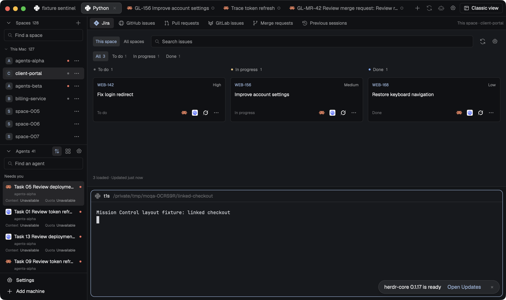](mission-control/preview.png)

## What you get

- **Every space and agent at a glance.** A left rail lists your spaces, with search, and every running agent, with the agent's real tool icon, what it is working on, and how much context and quota it has left.
- **Your work queue next to your terminals.** Jira, GitHub issues, GitHub pull requests, GitLab issues, GitLab merge requests and previous sessions, each as its own tab. Issues are grouped into To do, In progress and Done.
- **One click to start work.** Every issue card has buttons for your pinned tools (Claude Code, Codex, Grok…). Clicking one starts that agent in the right repository, on the right machine, in a fresh worktree named after the issue, for example `client-portal-WEB-142`. Clicking again takes you to the agent that is already on it.
- **Review help for pull and merge requests.** Review, Address comments and Fix checks each send a ready-made task to an agent in that branch's checkout.
- **Tabs that name themselves.** Tabs take the agent's own title or the issue key, and a name you type always wins.
- **Undo for closing.** Reopen last tab brings back a closed shell in its folder. Reopen last agent resumes the exact conversation you closed.
- **Two views, one button.** **Mission Control** is the overview. **Classic** keeps your terminals front and centre and opens the work queue as a side panel only when you ask: a button for each source, with its service's icon, sits right after the view swap. The button at the top right swaps between them without closing anything.
- **Show only what you use.** The gear next to that button turns individual sources off, for example GitLab if you don't use it.
- **Keep your mods and layouts up to date.** The Control panel lists every mod and layout you have installed, with each one's own preview image, and tells you when a newer version is on GitHub. You see exactly what an update changes before anything is written, and edits you made yourself are kept and merged. You can also disable, enable, uninstall and restore them.

## Install

You need the Herdr desktop app, Node.js 22 or newer, Python 3 and `git`.

**From Herdr.** Ask the agent in your Herdr to add Mission Control from `herdr.dev/layouts`. Herdr shows you what the mods can access, copies them in and switches to the layout.

**With the installer**, which also lets you uninstall in one command:

```sh
git clone https://github.com/CiprianSpiridon/herdr-mission-control
cd herdr-mission-control
node scripts/install.mjs --dry-run      # shows what it will add and what the mods can access; changes nothing
node scripts/install.mjs --app-home ~/.config/herdr-app --layout mission-control
```

The installer never overwrites anything you already have, and your terminals keep running. Press `ctrl-shift-l` to go back to your previous layout, or remove everything it added with:

```sh
node scripts/install.mjs --rollback --app-home ~/.config/herdr-app
```

**Just one piece.** Every mod also works on its own. Copy `<name>/mods/<name>/` into `~/.config/herdr-app/mods/` and run `herdr-app check` on it. The [packages](#packages) below show what each one does.

## Connect your trackers

Open a source (Jira, GitHub issues, GitLab issues…) in a space and press **Set up**. You choose:

1. **A connection:** the site (for example `https://yourcompany.atlassian.net`) and the **name of an environment variable** that holds your token. Mission Control never stores the token itself, only the variable's name. GitHub can also use the account you are already signed in to with `gh`.
2. **What this space shows:** the Jira project, GitHub repository or GitLab project for this repository.

Each space can use different accounts and projects, and a space with no tracker simply shows nothing. Your settings are saved in `~/.config/herdr-app/mission-control/config.json`. [docs/configuration.md](docs/configuration.md) has a full example and every option.

## Context and quota

Each agent row shows **Context**, how much of the conversation window is left, and **Quota**, how much of your plan's usage is left, but only when the tool itself reports them for that exact conversation. Otherwise the row says *Unavailable* rather than guess.

- **Agents started from Mission Control** (the + menu, a card button, Reopen or Previous sessions) are tracked from the moment they start.
- **Claude Code agents you started yourself** are picked up too, using the process record Claude Code keeps for each running session.
- **Codex and Grok agents you started yourself** stay *Unavailable*, because those tools don't record which process is which conversation. Start them from Mission Control to see their readings.
- **Claude Code's context percentage** comes from its status line. If your Claude Code status line writes a `claude-statusline.json` snapshot (herdr-agent-usage does), add that folder to the Claude source's `cacheRoots` (see [configuration](docs/configuration.md#context-and-quota-sources)).
- **An idle agent** keeps showing its last reading, dimmed, with its age in the tooltip.

## Packages

Each folder is a complete package with its own recipe and screenshot. Click a screenshot to see it full size.

| Package | Screenshot | What it is |
| --- | --- | --- |
| [`mission-control/`](mission-control/RECIPE.md) | <a href="mission-control/preview.png"></a> | Both layouts with everything below that they use. Start here. |
| [`mission-control-tabs/`](mission-control-tabs/RECIPE.md) | <a href="mission-control-tabs/preview.png">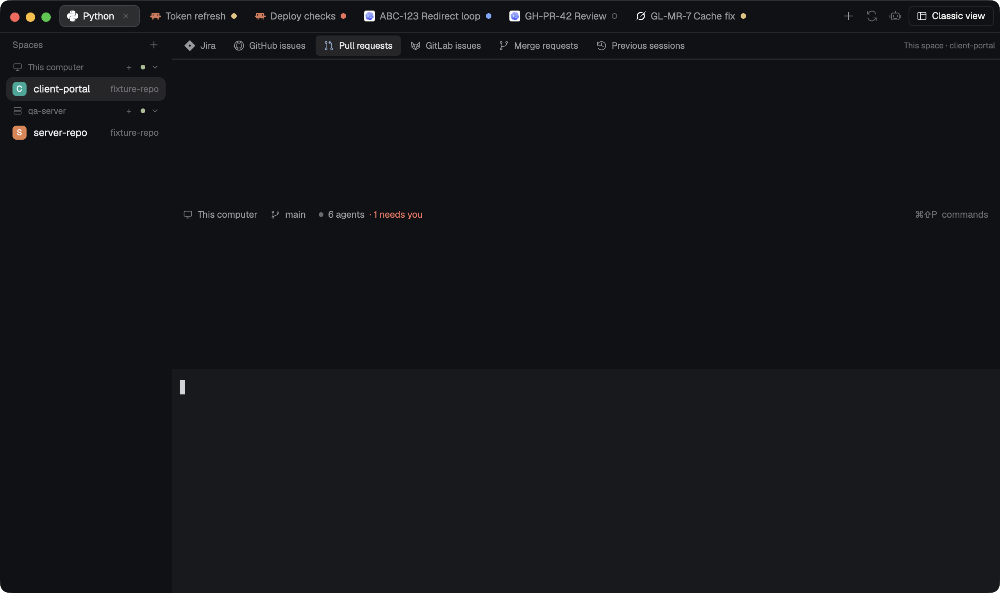</a> | The top tab bar: self-naming tabs, the + agent menu, Reopen, the view swap, the Sources gear and Classic's source buttons. |
| [`mission-control-spaces/`](mission-control-spaces/RECIPE.md) | <a href="mission-control-spaces/preview.png">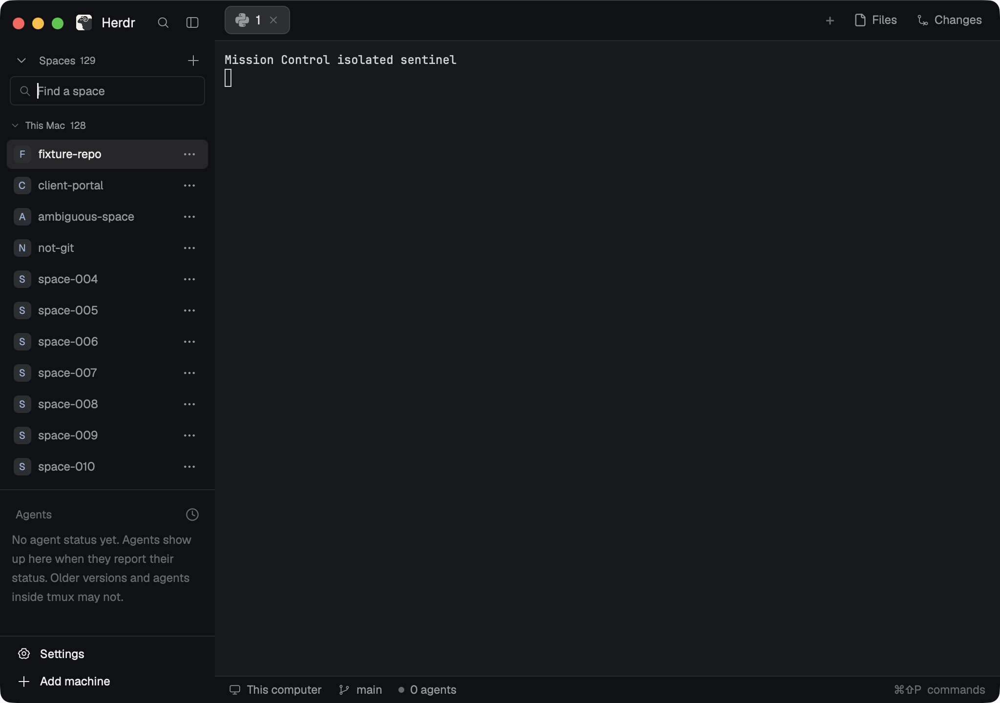</a> | The Spaces list, with a right-click menu per space and Settings / Add machine at the bottom. |
| [`mission-control-agents/`](mission-control-agents/RECIPE.md) | <a href="mission-control-agents/preview.png">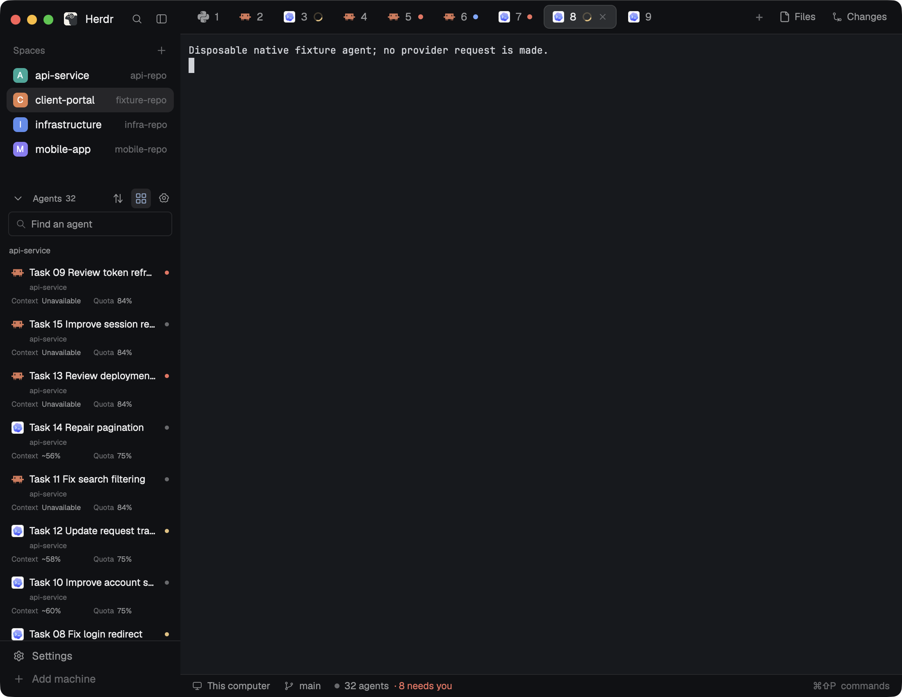</a> | Every running agent with its tool icon, task, context and quota. |
| [`mission-control-jira/`](mission-control-jira/RECIPE.md) | <a href="mission-control-jira/preview.png">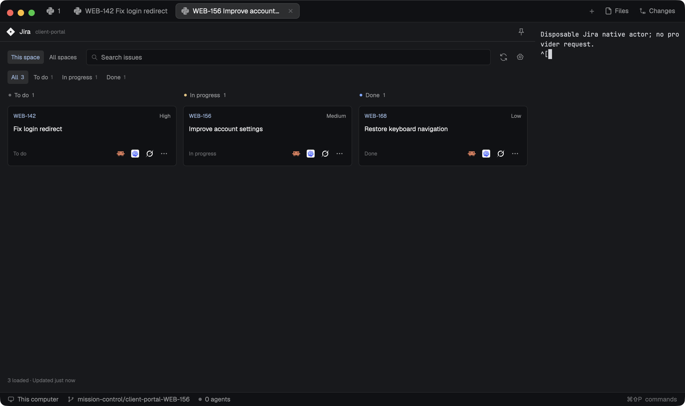</a> | Jira board with one-click agent starts. |
| [`mission-control-github/`](mission-control-github/RECIPE.md) | <a href="mission-control-github/preview.png">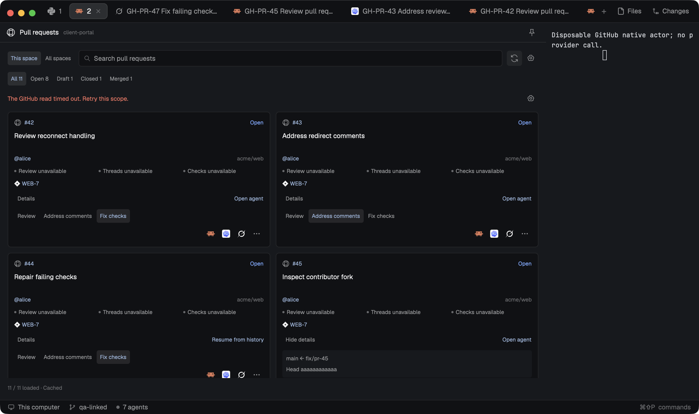</a> | GitHub issues and pull requests. |
| [`mission-control-gitlab/`](mission-control-gitlab/RECIPE.md) | <a href="mission-control-gitlab/preview.png">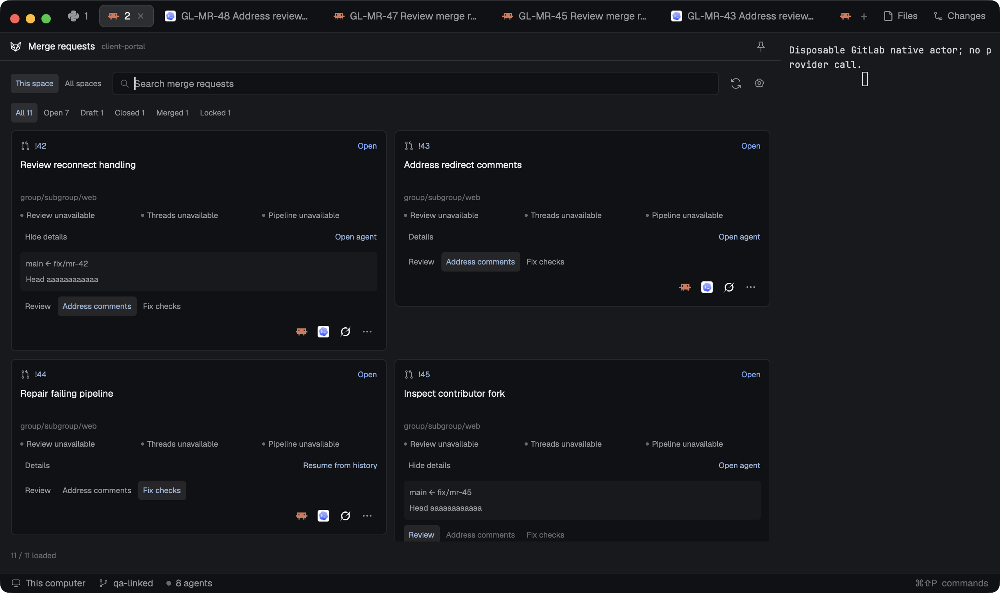</a> | GitLab issues and merge requests. |
| [`mission-control-sessions/`](mission-control-sessions/RECIPE.md) | <a href="mission-control-sessions/preview.png">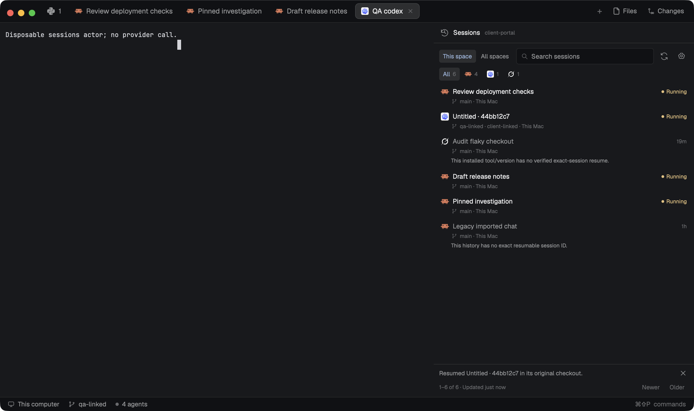</a> | Previous agent conversations for a space, resumable exactly. |
| [`mission-control-control-panel/`](mission-control-control-panel/RECIPE.md) | <a href="mission-control-control-panel/preview.png">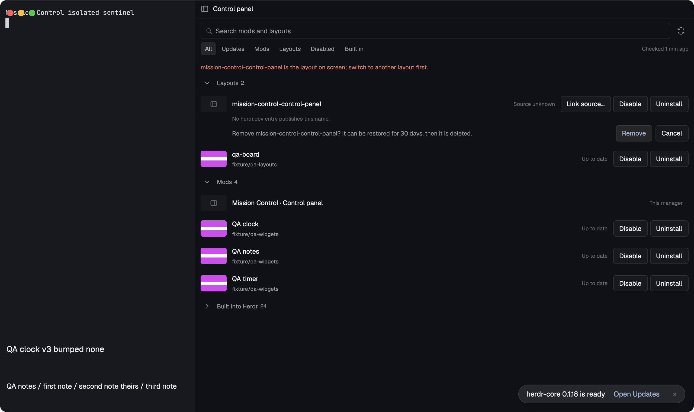</a> | Your installed mods and layouts: new versions, reviewed updates, disable, enable, uninstall and restore. |
| [`mission-control-agent-menu/`](mission-control-agent-menu/RECIPE.md) | <a href="mission-control-agent-menu/preview.png">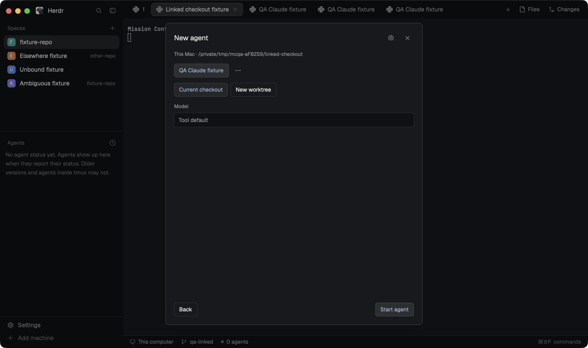</a> | The new-agent menu on its own, for your own layouts. |
| [`mission-control-reopen/`](mission-control-reopen/RECIPE.md) | <a href="mission-control-reopen/preview.png">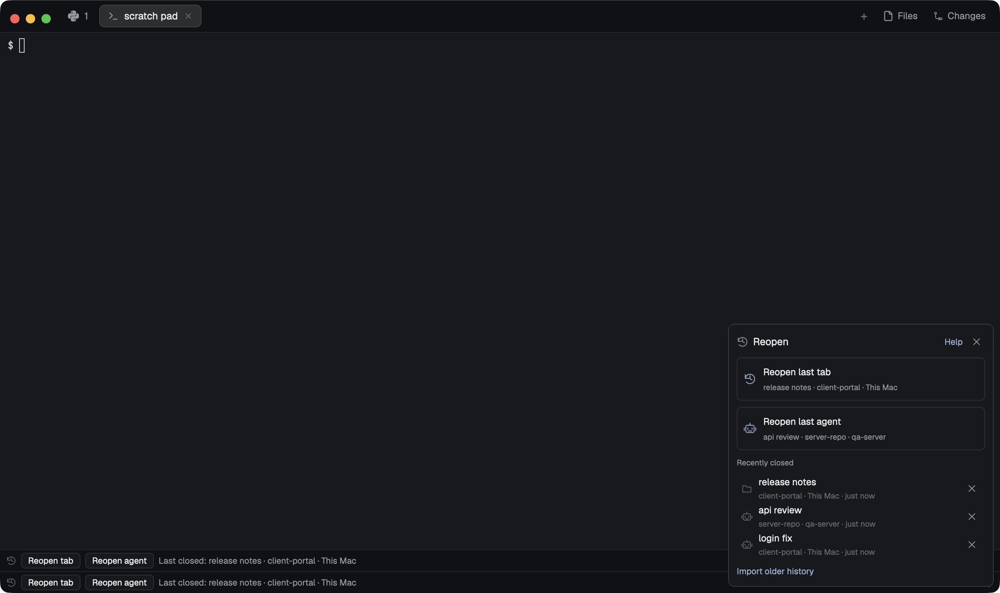</a> | Reopen last tab / last agent on its own, for your own layouts. |
| [`mission-control-jarvis/`](mission-control-jarvis/RECIPE.md) | <a href="mission-control-jarvis/preview.png">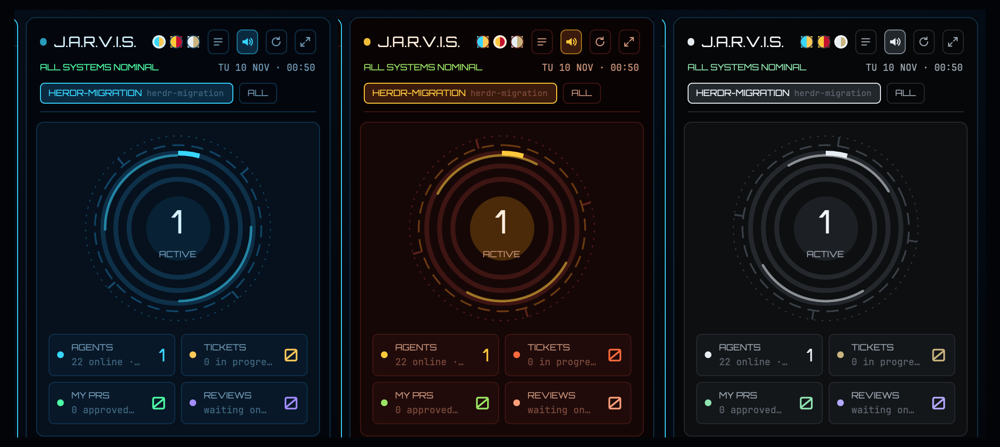</a> | An optional sci-fi HUD layout on top of Classic: arc-reactor dashboard, activity and workload graphs, per-session tickets and PRs with one-click worktree + agent starts, spoken alerts, and Arc / Mark III / Stealth colour suits. Needs `mission-control/`. |

The layouts include the tabs, spaces, agents, Jira, GitHub, GitLab, sessions and Control panel mods. Install the layout bundle or the separate mods, not both: they share names.

## What it can access

Mission Control only reads your trackers. It never changes an issue, comment, review or pipeline.

- **Network:** only the Jira, GitHub and GitLab sites you configure.
- **Tokens:** read from environment variables you name, or from `gh` for GitHub. Never written anywhere.
- **Files:** its own settings under `~/.config/herdr-app/mission-control/`, and your coding tools' session history (for example `~/.claude/projects` and `~/.codex/sessions`), read-only. It never reads tools' login files.
- **Programs:** `git`, `python3`, Herdr's `hc`, the coding agent you choose, and Node.js for the tracker helpers.

### The Control panel

The Control panel is the one part of Mission Control that changes files, and only when you click a button and confirm.

- **What it shows:** each item's state: Up to date, Edited by you, Update available, Conflict, Source unknown, Disabled, Built into Herdr. Mission Control packages and the Control panel itself use the same update states.
- **What it reads:** your installed mods and layouts, Herdr's `installed.json` and your `keys.json`.
- **What it changes, when you confirm:** an item's own files when you update, disable, enable, uninstall or restore it, and only the keys that item added to `keys.json`. A key you already use for something else is never replaced.
- **Updates:** Mission Control layouts, their bundled mods and the Control panel itself offer **Update…** when a newer version is available, including the layout on screen and mods it uses. Update all updates the Control panel last.
- **Removal protections:** Herdr's built-in mods and layouts are never changed. Installer-managed items, this panel, the layout on screen and any mod that layout uses cannot be disabled or removed here.
- **Removed items** are kept for 30 days so you can restore them, and then deleted.
- **Network:** the herdr.dev catalog (`https://assets.herdr.dev/`) and each item's own public repository on `https://github.com/`. No account or token is used.
- **Its own files:** records, backups and cached preview images under `~/.config/herdr-app/mission-control/control-panel/`.

The full per-mod list is in [docs/access.md](docs/access.md), and each package's recipe repeats its own part.

## Good to know

- Tracker support has been tested against realistic local test servers. It hasn't been tested yet against a real company's Jira, GitHub or GitLab account.
- Resume uses the exact conversation ID only. It never falls back to "the last conversation".
- Reopen brings back the main terminal of a tab, not split panes.
- Agents keep whatever account they are signed in with. Mission Control doesn't switch accounts.
- Jira command-line and local MCP helpers run on this computer, even for spaces on another machine.

## Contributing

[docs/development.md](docs/development.md) explains the repository, the build and the tests. Every mod is tested in a real, private Herdr window before it ships. [docs/evidence.md](docs/evidence.md) lists those results.

## Credits and license

These projects inspired individual mods. No code or artwork was copied from them:

- [dantech99/herdr-linear](https://github.com/dantech99/herdr-linear): issue boards and agent launch
- [amster93/herdr-agent-menu](https://github.com/amster93/herdr-agent-menu): the agent menu
- [mustafaTokmak/herdr-reopen-tab](https://github.com/mustafaTokmak/herdr-reopen-tab): reopening closed tabs
- [longwave/herdr-auto-tabs](https://github.com/longwave/herdr-auto-tabs): automatic tab names

MIT licensed. See [LICENSE](LICENSE). [NOTICE.md](NOTICE.md) lists the third-party code inside the Jira helper.
