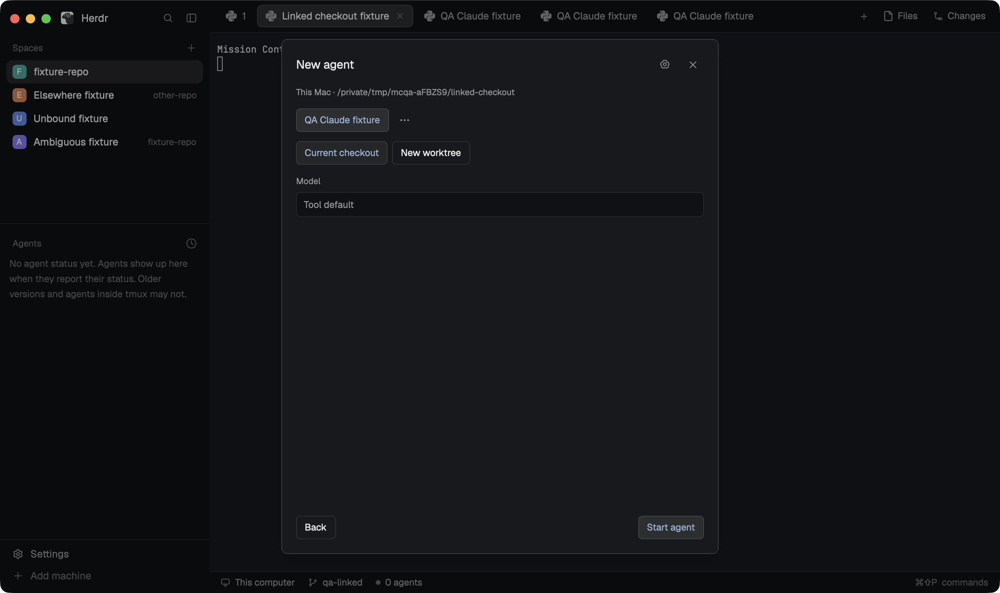

# Mission Control Agent Menu

A native Herdr dialog for choosing an installed coding agent and deciding where its work starts. Search the tools on the destination machine, keep three quick shortcuts, and launch in the selected checkout or a fresh worktree. The preview shows a disposable fixture agent in the real application.

## What you see

A centered 560 × 660 px dialog with 18 px padding and 12 px gaps. Follow Herdr's theme: graphite defaults are `#101114` chrome, `#17191d` surfaces, `#2a2d33` borders, muted labels, and blue emphasis. Use 12 px body text, an approximately 15 px heading, and local SVG controls.

The menu shows a heading, destination machine/checkout, search field, and 40 px installed-tool rows with the actual tool icon, name, and numbered shortcut. Its footer offers Terminal, New space, and Worktree. The gear opens Agent shortcuts.

The launch view shows pinned tools plus an overflow picker, Current checkout/New worktree choices, optional path/branch fields, and verified model, reasoning, instructions, or subagent options. Back and Start agent anchor the bottom. Settings offers pin/unpin, move-earlier, hide/show, default worktree preference, tool defaults, and Save shortcuts.

## How it behaves

Capture the originating space, host, and live pane before taking keyboard focus or awaiting discovery. Resolve Git identity from that pane. A linked checkout keeps the common repository identity while work runs in its own checkout. Conflicting unfocused repositories require a focused terminal; unbound/offline destinations show a reason and cannot start.

Numbers 1–9 select a visible tool while the menu has focus; search typing takes precedence. Selecting a tool opens choices rather than starting it. Escape uses Herdr's overlay dismissal. Tooltips identify icon-only controls. Menu rows retain their appearance regardless of existing sessions being working, blocked, done, or idle; running-session status belongs to Herdr's Agents surface.

Show at most three pinned installed tools, defaulting to Claude/Codex/Grok when available. Other tools stay searchable. Settings persist across copies/layouts. Unsupported flags fail before creation; failed launches retain the form. A repeated acknowledged intent focuses its existing tab. Uncertain creation requires recovery and never blindly spawns twice.

## Built from

Ship only `mods/mission-control-agent-menu/`, this recipe, and `preview.png`; no `layouts/` or sibling custom mod is required. The folder has a bundled ESM `main.js`, `mod.json` with `place: "none"` and the dialog dimensions, local `assets/*.svg`, and artwork notices. Original control artwork is MIT; tool artwork comes from Herdr's program metadata with its declared tint.

Default-export a native GPUI `View`. Read Herdr context through `props()`; support `view: "menu" | "launch" | "settings"`, captured `spaceId`/`machine`, optional immutable `target`, task `source`, and `toolKey`. Open this same mod with `openOverlay`; close using `props().overlay`. Retain InputState objects outside render and use fresh callback contexts.

Use `spaces`, `panes`, `focused`, `knownAgents`, `theme`, file CAS APIs, and `exec`. Commands include `tab.new`, `space.new`, `space.select`, `tab.select`, `pane.focus`, and `tab.rename`. A standalone opening command is `herdr-app do mod.open '{"name":"mission-control-agent-menu"}'`.

**Access disclosure:** this mod runs programs and reads/writes outside its own folder. It uses Git, target-host Python 3 for guarded worktree creation, `hc get`, `herdr-app do/ls`, bounded `sleep`, local `mkdir`, and tool `--help`/`--version` probes. It reads repository metadata and stores private CAS config, launch journal, exact-session bindings, and name ownership under `appHome()/mission-control/`. It makes no tracker/network request itself; the selected agent uses its normal authentication and network access when started. Credentials are not copied or switched.

## Watch out

Keep canonical `repoRoot` separate from captured `checkoutRoot`. Generic launches must supply the latter; only validated tracker cards without a captured checkout may explicitly default to their canonical root. Verify both belong to the same Git common directory. New worktree names use `<space>-<issue-key>` for tasks or `<space>-task-<request-digest>` for independent generic intents, with `mission-control/<leaf>` branches. Never overwrite an existing unowned path/ref or traverse symlinks.

Trust `knownAgents().installed/run` for base launches, including configured shell functions. Help grants advanced capabilities, not permission to invent flags. Verified Codex starts include `--no-daemon`. Bind usage only through acknowledged exact session/terminal proof; absent or multiple provider profiles stay unbound. Protect active mappings and retain interrupted-creation recovery state.

Herdr's `run` returns no created IDs. Validate the real `tab.new` acknowledgment and full terminal generation/labels before committing. Preserve manual names across acknowledged transfers. Bound CAS retries and fail without overwriting malformed private files. Use supported native color literals and put tooltips on a plain wrapper around SVG/images.

## Done when

- `herdr-app check` passes after copying only this mod folder into a clean app home.
- Native clicks and number shortcuts select tools; closing removes their keyboard scope; saved pins/order and overflow remain usable.
- A stale space creation folder cannot override its focused linked checkout; changing active space after opening cannot retarget work.
- Two independent native worktree starts create distinct paths/branches; replaying one acknowledged intent creates no duplicate terminal.
- A fresh consumer reads the committed exact-session mapping; malformed acknowledgment or failed commit preserves safe recovery.
- Unbound and ambiguous destinations create no work; all mounted checks pass with zero app errors, and `preview.png` matches the passed native capture.
