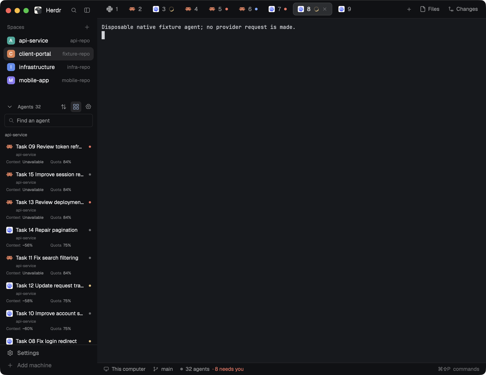

# Mission Control Agents

A native Herdr sidebar for monitoring many coding sessions across machines. Tool icons sit beside task names; session context and account quota appear underneath. Priority and Spaces are one-click grouping modes. The preview uses disposable provider fixtures in a real Herdr window; it does not show authenticated customer sessions.

## What you see

Use Herdr's theme with graphite chrome `#101114`, surface `#17191d`, border `#2a2d33`, muted secondary text and blue selection. The flexible 220–320 px column has a 32 px Agents header: collapse, total count, icon-only Priority, Spaces and source-settings controls. Below are a retained 30 px search field and an independently scrolling list. Default standalone size is 320 × 560 px.

Each group has a quiet 23 px heading. Each approximately 59 px row contains a 15 px actual tool icon, 12 px truncated task title, status dot, 9 px space/machine subtitle, and two subordinate inline readings: Context and Quota. Indent sub-agents by 10 px per level, bounded at four levels. Working, blocked, done and idle dots follow their corresponding Herdr theme colors. Selected rows use the theme's selection color; hover reveals the complete task and destination. Do not repeat provider names beside task titles.

Source settings is a 720 × 660 px native dialog with provider, host, profile, exact metadata paths, enable/disable, edit and add-profile controls. The form has retained inputs for profile, provider root, session roots and explicitly configured sanitized cache roots.

## How it behaves

Priority orders Needs you, Done, Working and Idle. A completion becomes Idle after Herdr marks it viewed. Spaces preserves native workspace order and host identity. Search matches task, space, host and status; a matching parent keeps its children visible. Collapse, mode and query persist in versioned shared state independently of Spaces. Keyboard navigation follows the displayed grouping; hidden search results remain appended once.

Click a native row to focus its exact agent. Pane-less children open their own terminal peek; they never inherit a parent's context or quota. A child's urgent state elevates its parent group. Use manual task names before native task/title fallbacks. Titles, cwd and recency never establish provider-session identity.

Show context remaining only for a committed exact host/provider/profile/root/session binding and unchanged full terminal generation. A reported compaction threshold is authoritative; a reported model window produces an explicitly marked `~` estimate. Missing capacity, unknown dates, stale observations and unbound fresh sessions display Unavailable or Stale. Never subtract lifetime token totals from a guessed model limit.

Quota shows the lowest remaining reported window. Share it only when fresh provider evidence proves the same account, pool, profile and host. Otherwise keep it session-local; the tooltip explains the scope, windows and reported reset times. Missing quota never becomes 100%.

Configured sources load before advisory tool discovery. Poll live metadata at most every 30 seconds, explicit cache roots every 60 seconds and source settings every two seconds. Queue operations per host with at most four hosts active. Disable/change clears readings, invalidates durable mappings, cancels late publication and stops subsequent scans. Closing cancels tasks/timers and releases inputs.

## Built from

Ship `mods/mission-control-agents/` with bundled native ESM `main.js`, `mod.json`, a self-contained `collector.py`, original local SVG `assets/` and `NOTICE.md`; put this recipe and actual `preview.png` beside `mods/`. No `layouts/`, sibling code, Node runtime or custom key binding is required. Open with `herdr-app do mod.open '{"name":"mission-control-agents"}'` or mount its default list role in a layout slot.

Default-export a GPUI View reading `herdr.props()`. Support default `view: "list"`, `"sources"` and `"source-form"`; forms capture their immutable source ID, host, profile and root fingerprint. Use native agents, terminals, spaces, machines, program artwork, theme, shared/CAS file APIs, overlays, exec and source-scoped helpers. Call `setAgentOrder`, `agent.focus` and `terminal.peek` with the exact displayed native targets. Keep all shared implementation compiled into this mod. The Python collector combines its foundation and Codex, Claude and Grok parsers without third-party imports.

**Access disclosure:** reads provider session metadata from configured roots on their own machine. Standard defaults are `.codex/sessions`, `.codex/archived_sessions`, `.claude/projects` and `.grok/sessions` for installed tools; additional or sanitized cache roots require explicit configuration. Reads/writes only Mission Control config, session bindings and name ownership under `appHome()/mission-control/`. Runs read-only `hc`, Python 3 and tool discovery, plus local `mkdir` for private persistence. Remote reads use Herdr's configured machine transport. It makes no provider API request, starts no paid turn, reads no auth files and changes no login, hook or global tool configuration. For a Claude Code agent that Mission Control did not start, it also reads Claude Code's own process records `<claude root>/sessions/<pid>.json` (read-only, only the foreground PID's record and its job's record; never the `.key` files beside them) to adopt that agent's current conversation, including after a conversation change in the same process. Codex usage also accepts its session hook's terminal label after matching the exact PID and process start; Grok usage accepts the single session events file the process holds open. These lookups use the same read-only process helper as restart recovery (`ps`, plus `lsof` or Linux `/proc` for Grok). For Codex, a bounded read-only query of `state_5.sqlite` selects only requested `id`/`rollout_path` pairs; configured-root checks and canonical file-header identity checks still apply. This avoids exhausting the history-walk budget before reaching a running conversation. No hook is installed by this mod. An unidentified Codex row points to Set up Codex resume in Sources. A newly identified conversation refreshes metadata immediately instead of reusing the previous conversation's scan interval.

## Watch out

Read full `hc get` data, including creation time and foreground PID, before and after collection. Terminal suffixes are opaque lowercase alphanumeric addresses, such as `t1b`; retain explicit machine prefixes. A kept agent recovering to a shell must lose its mapping even when it disappears from the agent list. A new Codex process without an exact session handshake stays unbound.

Bound scans to 1,000 indexed records, 50 observations per page, 4 MiB per request, 10 seconds and limited JSONL head/tail reads. Reject symlink ancestors, malformed/oversized responses, wrong scope and unsupported formats; compressed JSONL is explicitly unsupported. Partial scans stay explicit. Use only documented reported fields: Claude/Grok standard logs may lack a context window or account quota, so unavailable is expected. Preserve source timestamps; a refreshed merged cache cannot freshen old session data.

Prepare session context and shared-account quota once per refresh; rendering reads snapshots. Revalidating every source observation for every rendered row can exhaust the native rendering budget. Start the first serialized source read directly in its native task; deferring it through a Promise callback can bind the effect to another starting GPUI task. Never retain an ordinary callback context. Use fresh task contexts, wrapper tooltips around SVGs and native hex colors. Validate compare-and-set source fingerprints so an old dialog cannot overwrite newer profile/root edits.

## Done when

- Copying only the mod folder into a clean app home passes `herdr-app check`; all imports, artwork and the collector resolve locally.
- With 32 real disposable fixture agents, actual native search, Priority/Spaces toggles, collapse, parent focus, child peek and keyboard order work without errors.
- Two exact same-repo sessions show different context estimates; proven same-account sessions share quota, while missing/unbound sessions stay unavailable.
- Disabling one provider through the native dialog invalidates its bindings, blocks a late collector result and preserves the other provider's readings.
- Unexpected kept-agent process loss invalidates its old mapping; the empty state remains usable after fixtures end.
- Installed-provider format compatibility is verified separately from fixtures, all evidence pins the current build, and `preview.png` is the actual native capture.
