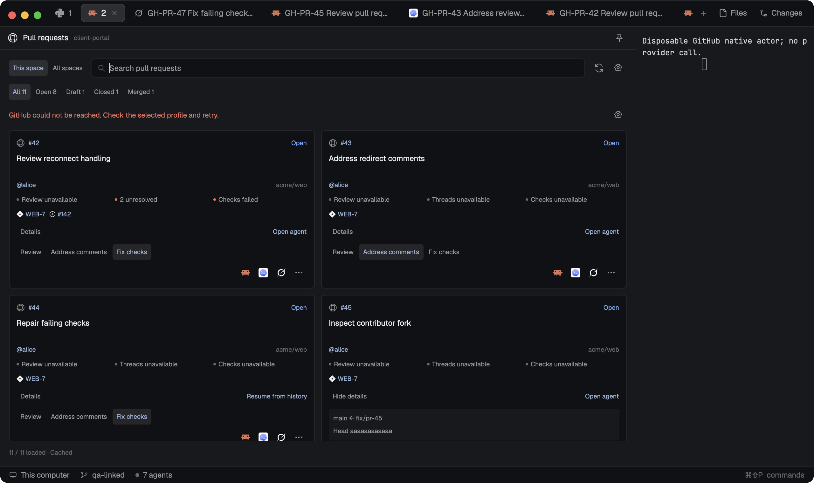

# Mission Control GitHub

A native GitHub integration with separate issue and pull-request views for one repository or all configured spaces. Compact issue cards group work into To do, In progress and Done. PR cards show authors, review threads and checks, with one-click local-agent actions. Setup, pinned-agent settings and worktree options belong to this standalone mod. The preview shows synthetic accounts and disposable tool actors in a real Herdr window.

## What you see

Follow Herdr's theme: graphite chrome `#101114`, surface `#17191d`, border `#2a2d33`, muted secondary text and blue links/selection. Default docking is right at 380 px; the mod-open dialog is 1080 × 760 px. A 38 px header has the local GitHub icon, one source title, repository/configured-space caption and an icon-only agent-shortcut control. Allow the surrounding layout to suppress this header.

Use 10–14 px padding. Put This space / All spaces beside retained search and refresh/settings icons; wrap the toolbar in narrow panels. Issues have All / To do / In progress / Done filters with counts, three scrolling columns at widths of 768 px or more, and stacked groups below that. Cards have 10 px padding, a 6 px radius, two-line 12 px titles, 10 px source/priority text and three 25 px tool-icon buttons plus an ellipsis. The footer shows counts, update age, cached errors and continuation controls. Show a mapping-settings hint when In progress is undefined.

The separate PR view has All / Open / Draft / Closed / Merged filters. Its variable-height native list uses one column below 720 px, two at 720–1099 px and three above. Cards have 11 px padding, 10 px gaps between rows, a number/title link, actual author or Deleted account, repository, state, independent review/thread/check indicators and up to three linked issues. Display GitHub links as `#142` or `owner/repo#142`, never opaque node IDs. Details expand branch names and a shortened head SHA. Review / Address comments / Fix checks selects the action; three 26 px tool icons start it. Show 60 cards initially, then Show more in batches of 60. Never repeat tool names or an Actions heading on cards.

## How it behaves

Combine search and status filters; retain issue and PR filters independently. Search PR titles, numbers, authors, repositories and linked IDs. Clicking source keys, titles, authors or linked issues opens their validated URLs. Hovers explain full origins, actions and unavailable states. Dialogs support native text editing and Escape; this mod adds no global keys.

GitHub closed issues are Done. Open issues default to To do; In progress requires explicit label or Projects status mapping. Herdr's working, blocked, done and idle agent states never change provider workflow. Save up to three pinned installed tools, initially Claude, Codex and Grok where available; expose other tools and worktree/model options through the owning mod's dialogs.

One-click issue starts use saved defaults. A default new worktree combines workspace and source key, such as `client-portal-GH-142` or `client-portal-GH-PR-42`, with a `mission-control/` branch. Preserve the selected linked checkout as the starting point. All spaces keeps each card's account, machine and repository separate and requires a matching open repository space before starting work.

Capture the complete PR action/target before asynchronous reads. Review asks for findings without posting a review; Address comments asks for local fixes without replying/resolving threads; Fix checks asks for local fixes without changing check state. Load details when necessary and independently validate discussion/check completeness and exact head/base refs. Forks remain reviewable but disable local fix actions; missing refs disable starts. Partial threads do not hide complete failing checks, and unavailable aggregate review is never invented as approval.

An existing exact PR/tool slot says Open agent and only focuses that agent: selecting another action never resends a task. A closed slot says Resume from history and reports the exact-session boundary without duplicating work. A pending captured launch may finish after its source leaves view, but changed account, repository, head/base, expired ownership or closed mod cancels it. Refresh manually or every 60 seconds; retain cached data only within the same source scope, and clear old-account cards on rebinding.

## Built from

Ship `mods/mission-control-github/` with bundled native ESM `main.js`, `mod.json`, self-contained Node ESM `backend.mjs`, local SVG `assets/` and `NOTICE.md`. Place this recipe and real `preview.png` beside `mods/`; include no `layouts/`, sibling custom mod or `node_modules`. Open issues with `herdr-app do mod.open '{"name":"mission-control-github"}'`. Support `props.view` roles `panel`/`issues`, `pulls`, `setup`, `launch`, `settings` and `menu`, plus `hideHeader`, `scope: "space" | "all"` and captured repository `target` props.

Use GPUI views, retained inputs, root-owned `cx.spawn` tasks, variable-height `list`, retained card entities and native scrollbars. Yield with the current task's `cx.sleep(0)` before retained-view effects scheduled from render; batch preparation and prune obsolete entities before allocating replacements. Lazy layout callbacks only wrap existing handles. Publish generations atomically, reject stale jobs and retain launching children until their tasks settle.

Read Herdr spaces, panes, focus, machines and installed agents. Use overlays, shared-state notifications, CAS configuration/journal writes, `tab.new`'s universal task and exact tab/pane focus. Persist versioned configuration, machine/canonical-root bindings and launch/session/name journals under `appHome()/mission-control/`. Connections contain an ID, GitHub site/API endpoint and either a credential environment-variable name or explicit existing `gh` host/account. Repository bindings select owner/repo and optional labels or stable Projects field/option IDs. Keep Jira configuration independent.

The backend performs scoped REST issue/PR/repository reads and GraphQL PR detail/Projects discovery; use GitHub's [pull-request schema](https://docs.github.com/en/graphql/reference/pulls#pullrequest) and [check/status types](https://docs.github.com/en/graphql/reference/commits#statuscheckrollup). It returns bounded, validated snapshots to the native bridge. Index immutable PR membership once. Captured-origin leases are opaque, capped at 64 with a 120-second TTL; navigation hides leased sources from publication/polling, final configuration validation rereads the saved binding, and release/close removes retained state.

**Access disclosure:** reads/writes Mission Control files outside the mod folder. Runs local Node.js 22+, optional read-only `gh auth token` selection, Git/Python 3 and the selected agent on its execution host. Creates worktrees and sends the captured task to the agent. Opens source URLs through the system browser. Network reads reach only the selected GitHub API origin; agent programs retain their normal network capabilities. Credentials stay in helper memory and existing environment/CLI storage: no login/logout, token persistence or automatic OAuth refresh. Use Herdr's installed program icons, original local SVG controls and included notices.

## Watch out

Keep Node/URL APIs in the external helper. Never retain a render/event context across an await, create child entities during render/layout, or register handlers inside lazy row callbacks. All card controls must survive scrolling, filtering, resize and generation replacement without stale-source launches.

Do not fall back to the active `gh` account. Require proven host/user selection without refresh, or ask for an environment reference. Derive public/enterprise endpoints from the selected site; refuse off-origin redirects, cursor/scope confusion and partial Projects discovery. Preserve raw API profile spelling in scope fingerprints, source IDs separately from human labels, and canonical repo identity separately from checkout paths.

Use 50-record pages, at most four shared helper jobs with per-scope serialization, and a 1,000-record / 7 MiB accumulated board limit. Bound deadlines/output and report truncation, permission errors and unavailable metadata honestly. Never adopt an occupied worktree, replay a lost terminal command, auto-checkout an untrusted fork or mutate GitHub issue/PR/review/check state. Authenticated provider access remains separate from fixture proof.

## Done when

- The copied mod alone passes `herdr-app check`, with every import/helper/asset resolved and no adjacent custom mod or dependencies.
- Native issue filters, source links, setup, label mappings and pinned tools work; all three PR actions deliver their controlled task through the selected tool's universal task input.
- Account/repository/head isolation, linked checkouts, focus-only reuse, closed history and collision protection hold; a delayed remote launch survives visibility-only source removal without retargeting.
- Eleven PR variants per account and real 120-PR pagination in 50/50/20 pages render under the normal host budget; Show more and native scrolling expose an interactive offscreen card.
- The passed ownership-v2 receipt has zero app errors, verified private cleanup, actual native inputs, the exact preview hash and exact current source/build hashes.
