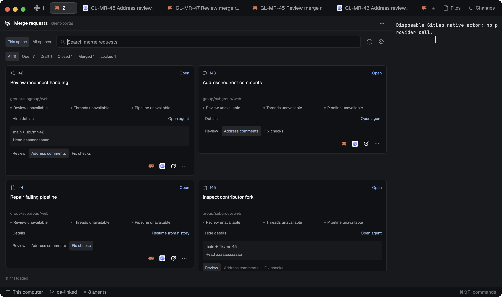

# Mission Control GitLab

A native GitLab integration with separate issue and merge-request views for one repository or all configured spaces. Compact issue cards group work into To do, In progress and Done. Merge-request cards show approvals, unresolved discussions and pipelines, with one-click local-agent actions. Setup, pinned-agent settings and worktree options belong to this standalone mod, so it works without Jira, GitHub or either Mission Control layout. The preview shows synthetic GitLab projects and disposable tool actors in a real Herdr window.

## What you see

Follow Herdr's theme: graphite chrome `#101114`, surface `#17191d`, border `#2a2d33`, muted secondary text and blue links/selection. Default docking is right at 380 px; the mod-open dialog is 1080 × 760 px. A 38 px header has the local GitLab icon, one source title (GitLab or Merge requests), the repository/configured-space caption and an icon-only agent-shortcut control. A layout can suppress this header with `hideHeader`.

Use 10–14 px padding. Put This space / All spaces beside retained search and refresh/settings icons; wrap the toolbar in narrow panels. Issues have All / To do / In progress / Done filters with counts, three scrolling columns at 768 px or wider and stacked groups below that. Cards have 10 px padding, a 6 px radius, two-line 12 px titles, 10 px source/priority text and three 25 px tool-icon buttons plus an ellipsis. Issue keys read `GL-142`. The footer shows counts, update age, cached errors and continuation controls, and transient action feedback in the same footer row so the toolbar never moves.

The separate merge-request view has All / Open / Draft / Closed / Merged / Locked filters. Its variable-height native list uses one column below 720 px, two at 720–1099 px and three above. Cards show `!42` and the title as links, the project path, state, and independent review, thread and pipeline indicators; linked issues read `#142`, never opaque global IDs. Details expand branch names and a shortened head SHA. Review / Address comments / Fix checks selects the action; three 26 px tool icons start it. Show 60 cards initially, then Show more in batches of 60. Never repeat tool names or an Actions heading on cards.

## How it behaves

Combine search and status filters; retain issue and merge-request filters independently. Clicking keys, titles or linked issues opens their validated GitLab URLs in the system browser. Hovers explain full origins, actions and unavailable states. Dialogs support native text editing and Escape; this mod adds no global keys.

Closed GitLab issues are Done. Open issues default to To do; In progress requires an explicit label mapping in the repository binding. Herdr's working, blocked, done and idle agent states never change provider workflow. Save up to three pinned installed tools, initially Claude, Codex and Grok where available; expose other tools and worktree/model options through the owning mod's dialogs.

One-click starts use saved defaults. A default new worktree combines workspace and source key, such as `client-portal-GL-142` or `client-portal-GL-MR-42`, with a `mission-control/` branch, and starts from the selected linked checkout. All spaces keeps each card's account, machine and project separate and requires a matching open repository space before starting work.

Capture the complete merge-request action and target before asynchronous reads. Review asks for findings without approving or commenting; Address comments asks for local fixes without replying to or resolving threads; Fix checks asks for local fixes without retrying pipelines. Load details when needed and validate discussion/pipeline completeness and exact head/base refs independently. Denied approvals never hide readable discussions or failed pipelines; partial discussion evidence is marked as partial. Forks remain reviewable but disable local fix actions; locked merge requests disable starts.

An existing exact merge-request/tool slot says Open agent and only focuses that agent: another action never resends a task. A closed slot says Resume from history and reports the exact-session boundary without duplicating work. A held launch may finish after its source leaves view, but a changed account, project, head/base, expired ownership or closed mod cancels it. Refresh manually or every 60 seconds; keep cached data only within the same source scope and clear old-account cards on rebinding. If Herdr ends a load mid-flight, the view notices the orphaned load and retries it within five seconds instead of showing Loading for ever.

## Built from

Ship `mods/mission-control-gitlab/` with bundled native ESM `main.js`, `mod.json`, self-contained Node ESM `backend.mjs`, local SVG `assets/` and `NOTICE.md`. Place this recipe and the real `preview.png` beside `mods/`; include no `layouts/`, sibling custom mod or `node_modules`. Open issues with `herdr-app do mod.open '{"name":"mission-control-gitlab"}'`. Support `props.view` roles `panel`/`issues`, `merges`, `setup`, `launch`, `settings` and `menu`, plus `hideHeader`, `scope: "space" | "all"` and captured repository `target` props.

Use GPUI views, retained inputs, root-owned `cx.spawn` tasks, variable-height `list`, retained card entities and native scrollbars. Yield with the current task's `cx.sleep(0)` before retained-view effects scheduled from render; batch preparation and prune obsolete entities before allocating replacements. Publish generations atomically, reject stale jobs and retain launching children until their tasks settle.

Read Herdr spaces, panes, focus, machines and installed agents. Use overlays, shared-state notifications, CAS configuration/journal writes, `tab.new`'s universal task and exact tab/pane focus. Persist versioned configuration, machine/canonical-root bindings and launch/session/name journals under `appHome()/mission-control/`. A connection holds an ID, the GitLab site origin and a token environment variable name; a repository binding selects the canonical project path and optional progress labels. Keep Jira and GitHub configuration independent in the same repository binding.

The backend performs scoped GitLab REST v4 reads of projects, issues, merge requests, approvals, discussions, closing issues and head-pipeline jobs, following `x-next-page`/`Link` pagination in 50-record pages. It returns bounded, validated snapshots to the native bridge. A shared queue runs at most four helper reads with per-project serialization; detail reads count as weighted jobs. Captured-origin leases are opaque, capped at 64 with a 120-second TTL.

**Access disclosure:** reads/writes Mission Control files outside the mod folder. Runs local Node.js 22+, Git/Python 3 and the selected agent on its execution host. Creates worktrees and sends the captured task to the agent. Opens source URLs through the system browser. Network reads reach only the configured GitLab origin, authenticated with the bearer token named by the connection's token environment variable; agent programs keep their normal network capabilities. The token stays in helper memory: no `glab` login, token persistence or OAuth refresh. Use Herdr's installed program icons, original local SVG controls and included notices.

## Watch out

Keep Node/URL APIs in the external helper. Never retain a render/event context across an await, create child entities during render/layout, or register handlers inside lazy row callbacks. Herdr ends a long continuation without running `catch`/`finally`, so no loading flag, queue slot or tail may depend on a `finally` alone: each expires after a stale age beyond every helper deadline.

Derive the API base from the selected site; refuse off-origin redirects, cursor/scope confusion and non-canonical project paths. Keep opaque global merge-request IDs separate from human `!42`/`GL-MR-42` labels, and the canonical repository identity separate from checkout paths.

Use a 1,000-record / 7 MiB accumulated board limit. Bound deadlines/output and report truncation, permission errors and unavailable metadata honestly. Never adopt an occupied worktree, replay a lost terminal command, auto-checkout an untrusted fork or mutate GitLab issues, merge requests, approvals, discussions or pipelines. Authenticated provider access remains separate from fixture proof.

## Done when

- The copied mod alone passes `herdr-app check`, with every import/helper/asset resolved and no adjacent custom mod or dependencies.
- Native issue groups, filters, search, source links, setup and pinned tools work without a Jira connection; all three merge-request actions deliver their controlled task through the selected tool's universal task input.
- Account/project isolation, linked checkouts, focus-only reuse, closed history and the held cross-host launch hold; the embedded `hideHeader` copies show both views without a duplicate heading.
- Real 120-MR pagination in 50/50/20 pages renders; Show more and native scrolling expose an interactive offscreen card.
- The passed ownership-v2 receipt has zero app errors, verified private cleanup, actual native inputs, the exact preview hash and exact current source/build hashes.
