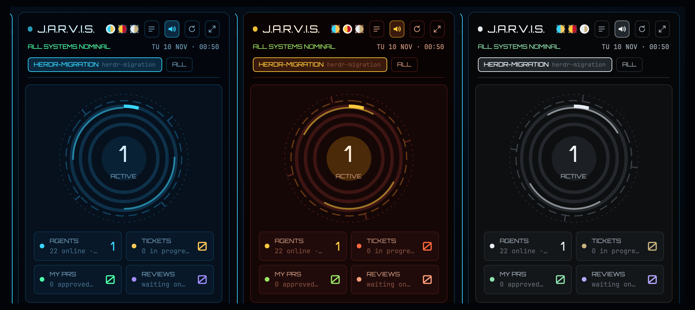

# Mission Control J.A.R.V.I.S.

A sci-fi heads-up display beside your terminals. A spinning arc reactor shows how many agents are working. Graphs show agent status, your Claude Code activity over the last 7 days, which repos took your week, your Jira tickets per board and your pull requests with their checks and reviews. Tickets and pull requests follow the session you're in. From any ticket or pull request, one click creates a worktree and starts a coding agent in it. JARVIS speaks too: a daily briefing, and an alert when an agent needs you or finishes, a ticket lands, a review is requested, a pull request is approved or a build breaks. It comes in three suits: Arc Reactor (cyan), Mark III (red and gold) and Stealth (silver).

## What you see

The `mission-control-jarvis` layout is Mission Control's Classic view with one extra block: `jarvis-hud`, 380 px wide (min 320, max 900), with a 10 px radius and 1 px border. It sits between the terminals and the work panel. The window background is a 160° gradient from `#06121f` to `#02050a`, and the root theme is `mission-control-jarvis`.

The HUD draws its own palette, not `theme()`. These are the Arc Reactor values; Mark III and Stealth swap every one of them (see `PALETTES` in `main.js`):

| Colour | Arc Reactor |
| --- | --- |
| background | `#03070d` |
| panel | `#06111d` |
| line | `#0e3049` |
| primary | `#38d6ff` |
| secondary | `#ffc857` |
| alert | `#ff4d5e` |
| success | `#4dffa6` |
| reviews | `#a28cff` |
| text | `#d4f1ff` |

Headings use Orbitron, which is bundled in `fonts/` under the SIL OFL. Numbers and metadata use JetBrains Mono.

From top to bottom:

1. **Header**
   - A pulsing status dot and "J.A.R.V.I.S." in 15 px Orbitron.
   - Three 14 px suit swatches.
   - 26 px icon buttons: Brief me, Voice on/off, Rescan and Full dashboard.
   - A status line: "ALL SYSTEMS NOMINAL", "N AGENTS AWAITING YOUR INPUT" (alert colour), "N BUILDS FAILING" (secondary colour) or "SYSTEM FAULT …".
   - The date and time on the right.
2. **Scope bar**
   - The focused session as a chip: its logo from `mission-control-spaces`, its name and its board · repo.
   - An **ALL** chip next to it.
3. **Core**
   - The arc reactor:
     - a dotted tick ring turning once a minute
     - a dashed ring turning every 24 s
     - two glowing arcs turning every 7 s
     - three data rings painted with `paint_path`: agents working / online (primary), tickets in progress / open (secondary) and pull requests approved / open (success)
     - a pulsing core showing the number of working agents
   - When any agent is blocked, the core turns to the alert colour, pulses faster and shows the blocked count with "NEED YOU".
   - Four stat cards: Agents, Tickets, My PRs and Reviews. They sit beside the reactor when the HUD is at least 470 px wide, and in a 2×2 grid under it when narrower.
4. **Agent telemetry**
   - A 6 px bar segmented blocked / working / done / idle, with a legend.
   - Up to 8 agents, most urgent first. Each row shows a status dot (pulsing while working or blocked), the tool icon, the title and the space.
5. **Claude activity · 7d**
   - Seven bars of replies per day. Today's bar is primary, the others dimmed.
   - The header shows total output tokens.
6. **Workload by repo · 7d**
   - The 7 busiest repos, with logo, name, "N live" and "N PR" chips, output tokens and a share bar.
7. **Jira**
   - In-progress / to-do / done-this-week bars per board.
   - Open tickets, in-progress first, each with a ▶ button.
8. **Pull requests**
   - Mine: failing ones first, with CI ✓ / ✕ / ●, an unresolved-comment count, APPROVED / CHANGES / DRAFT chips and age.
   - Awaiting your review.

The ⤢ button opens the same HUD as a 94% × 92% dialog with three columns: core and agents; activity, repos and Jira; pull requests.

## How it behaves

- **Scope.**
  - JARVIS finds the focused session's repository with `git rev-parse --git-common-dir`, so worktrees count as their main repository.
  - It shows only the Jira board and the GitHub repository bound to that repository in `mission-control/config.json`, the same bindings the Jira and GitHub mods use.
  - **ALL** shows everything. Sessions with no binding say "No Jira board linked to <space>".
- **Agents.**
  - Clicking an agent row runs `agent.focus`.
  - Status changes are live, from `agents()`.
- **Tickets ▶.**
  1. You pick a repository (only asked when the board is bound to several) and then any installed coding agent from `knownAgents()`.
  2. JARVIS creates `<repo parent>/.herdr-worktrees/<Space>-<KEY>` on branch `mission-control/<Space>-<KEY>`, based on HEAD. These are Mission Control's own names.
  3. It runs `tab.new` in the session that holds that repository, or `space.new` when none does. The agent gets the ticket as its first message.
  4. An existing worktree is reused.
- **Pull requests ▶.** The same three actions as Mission Control's pull-request board, with the same wording and the same task brief:
  - **Review** is always available. It works on the PR head, detached (`refs/pull/N/head`).
  - **Address comments** is enabled only when there are unresolved review threads.
  - **Fix checks** is enabled only when checks are failing.
  - Fork pull requests are review-only.
  - Address comments and Fix checks check out the PR's branch, falling back to detached when that branch is checked out elsewhere.
- **Voice.** JARVIS uses macOS `say -v Daniel -r 190`, queued so lines never overlap. Only the docked copy speaks, never the dialog. It says:
  - the daily briefing, once per day
  - "Sir, <space> needs your input" when an agent turns blocked
  - "… has finished" when an agent goes from working to done
  - new tickets assigned to you, new review requests, approvals, changes requested, and checks that fail or pass again (at most 4 per refresh)
  - "Deploying <agent> on <ticket>" when you start work
- **Suits.**
  - A swatch saves the suit and runs `app.theme`, so terminals and the other panels follow.
  - The themes are `mission-control-jarvis`, `mission-control-jarvis-mark` and `mission-control-jarvis-stealth`.
- **Refresh.**
  - Every 3 minutes, and on Rescan.
  - Agents are checked every 1.5 s, without redrawing.
  - The clock redraws once a minute.
  - Every animation is native (`spin`, `loop`, `frames`, `transition`).
- **Commands.** These reach the shown copy and can be bound in `keys.json`:
  - `mission-control-jarvis.palette-arc`, `.palette-mark` and `.palette-stealth`
  - `.brief`
  - `.mute` (toggles)
  - `.refresh`

## Built from

- `layouts/mission-control-jarvis.json`: Classic's node tree plus the `jarvis-hud` block `{ mod: "mission-control-jarvis", props: { view: "hud" } }`. The dialog uses `props: { view: "full" }`.
- `mods/mission-control-jarvis/main.js`:
  - Uses gpui-kit (`div`, `svg`, `image`, `PathBuilder`, `window.paint_path`) and gpui-base `h_flex` / `v_flex`.
  - Uses `herdr`: `agents`, `spaces`, `focused`, `knownAgents`, `exec`, `run`, `notify`, `openOverlay`, `closeOverlay`, `nextCommand`, `shared` / `setShared` (`mission-control-jarvis-v1`: `muted`, `briefed`, `scope`, `palette`), and reads `mission-control-spaces-icons-v1` for logos.
- `mods/mission-control-jarvis/backend.mjs`: run with Node, it prints one JSON snapshot.
  - **Bindings and connections:** read from `mission-control/config.json`, read-only.
  - **Jira:**
    - Calls `POST /rest/api/3/search/jql` with Basic or Bearer credentials taken from the environment variables that the connection names.
    - The JQL is `assignee = currentUser() AND project in (…) AND (statusCategory != Done OR updated >= -7d)`.
  - **GitHub:**
    - Uses `gh api graphql`, with two searches: `is:pr is:open author:@me` and `review-requested:@me`.
    - For each pull request it fetches refs, review decision, unresolved review threads and the rollup of checks.
  - **Claude Code activity:**
    - Reads `~/.claude/projects/**/*.jsonl` modified in the last 8 days.
    - Counts replies and output tokens per day.
    - Maps each session's `cwd` to its repository.
    - It reads incrementally, using `mission-control/jarvis/activity-cache.json`, so later runs only read new bytes.
- **Programs:** `node`, `gh`, `git`, `say` and `open`.
- **Art:** `assets/ring-*.svg` (tinted, spun), icon SVGs and `fonts/Orbitron.ttf`.
- **Themes:** `themes/mission-control-jarvis*.json`.

## Watch out

- **Needs Mission Control.** The layout uses the Classic mods, so install the `mission-control/` bundle first. The HUD alone also works in any layout block.
- **macOS only for voice.** On other systems `say` is missing and JARVIS stays silent; everything else works.
- **Worktrees are real.** ▶ creates real git worktrees and branches, and starts a real agent.
- **First run is slow.** The first activity scan reads every recent Claude Code transcript, which can take several seconds. Later scans read only what's new.
- **Writing inside the mod folder reloads it.** Keep caches out of `mods/` (this one uses `mission-control/jarvis/`), or the mod reloads in a loop.
- **No `let` reassignment of module-level palette constants.** The HUD swaps palettes with `Object.assign` on a `const`.

## Done when

- `herdr-app check mods/mission-control-jarvis` passes, and `layout.switch {"name":"mission-control-jarvis"}` shows the HUD with no errors in `herdr-app status`.
- In a session whose repository is bound, the scope chip names its board and repository, and Jira and Pull requests list only that board's tickets and that repository's pull requests. ALL lists everything.
- ▶ on a ticket, then an agent, creates `.herdr-worktrees/<Space>-<KEY>` and opens a tab with that agent briefed on the ticket.
- ▶ on a pull request offers Review, Address comments (count) and Fix checks, enabled per the rules above.
- `herdr-app do mission-control-jarvis.palette-mark` turns the HUD and terminals red and gold, and `.brief` speaks the briefing.
