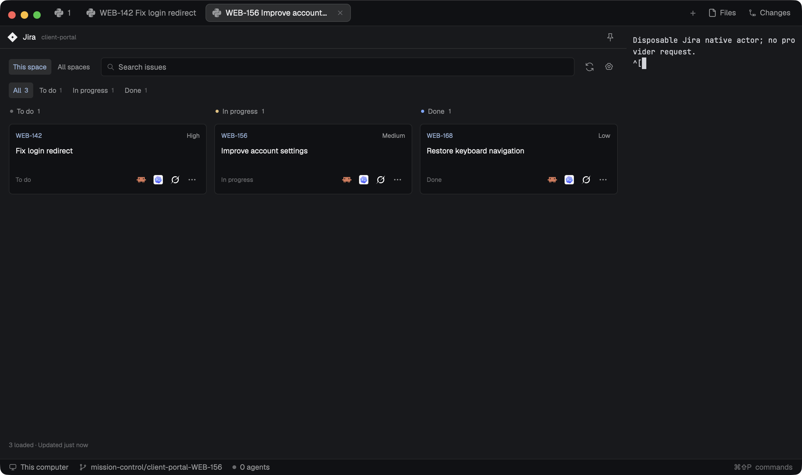

# Mission Control Jira

A native Jira board for the current repository or all configured spaces. Compact cards separate To do, In progress and Done, open their source issue, and start an installed coding tool with one click. The same standalone mod contains connection setup and agent/worktree options. The preview shows synthetic Jira accounts and disposable tool actors in a real Herdr window.

## What you see

Follow Herdr's theme: graphite chrome `#101114`, surface `#17191d`, border `#2a2d33`, muted secondary text and blue links/selection. Default docking is right, 380 px wide. A 38 px header shows the local Jira icon, one Jira title, repository caption and an icon-only agent-shortcut control. Suppress this header when the surrounding layout already names the source.

Inside 10–14 px padding, show This space / All spaces, a retained search field, refresh/settings icons, then All / To do / In progress / Done filters with counts. At 768 px and above, use three independently scrolling columns, each 220–360 px wide with 12 px gaps. Narrow panels stack groups vertically; below 360 px, wrap the filter controls. Cards have 10 px padding, a 6 px radius, 12 px two-line titles, 10 px source/priority text and a bottom row of up to three 25 px tool-icon buttons plus an ellipsis. Never repeat tool names or an Actions label.

The footer reports loaded counts, oldest update age, cached/error state and Load more when a continuation exists. Connection setup is a scrolling 680 × 760 px dialog; launch options use this mod's own native dialog.

## How it behaves

Search titles/keys while composing the chosen status filter. Use Jira's real status categories for REST; CLI/MCP profiles require explicit mappings. Working, blocked, done and idle agent states belong to Herdr and never move a source issue between groups.

Click a card's key or title to open its exact canonical Jira URL. Each tool icon starts that issue with the saved defaults; show the first three available pinned tools and put additional choices in the ellipsis dialog. Settings changes take effect across this mod's copies. Options choose tool, model/instructions and worktree behavior. A default new checkout concatenates workspace name and issue key, for example `client-portal-WEB-142`, with branch `mission-control/client-portal-WEB-142`. Repeating an acknowledged launch focuses its existing work without resending the task; conflicting requests cannot create duplicate work.

Capture the clicked card's machine, canonical repository, connection and current linked checkout before awaiting discovery. All spaces keeps each configured account/project separate and requires its repository to be open before starting work. Refresh every 60 seconds or manually, with bounded concurrency. Retain timestamped cached cards only for the identical source scope; changing account/project clears them. Missing credentials, offline machines, invalid mappings and unavailable CLI/MCP capabilities show actionable errors. Hover gives full titles, source destinations and tool actions. Native keyboard focus, text editing and Escape work in dialogs; this mod adds no global key binding.

## Built from

Ship only `mods/mission-control-jira/` containing bundled native ESM `main.js`, `mod.json`, self-contained Node ESM `backend.mjs`, local SVG `assets/` and `NOTICE.md`; place this recipe and real `preview.png` beside `mods/`. No `layouts/`, sibling custom mod or adjacent `node_modules` is needed. Open with `herdr-app do mod.open '{"name":"mission-control-jira"}'`. Default `props.view` is `panel`; support `setup`, `launch`, `settings` and `menu`, plus `hideHeader`, `scope: "space" | "all"` and immutable repository `target` props.

Use GPUI retained inputs, `cx.spawn`, timers and theme tokens. Read native spaces, panes, focus, machines and installed agents; use shared state for UI/config notifications, CAS file writes for configuration/journals, overlays for forms, `tab.new`/pane focus for launches and `exec` for helpers. Bundle the read-only REST, JSON CLI and official MCP SDK adapters into the backend. Persist versioned bindings under `appHome()/mission-control/`, keyed by machine and canonical repo root; store connection IDs, project/JQL, explicit status maps and credential environment-variable names.

**Access disclosure:** reads/writes Mission Control configuration and launch/session/name journals outside the mod folder. Runs local Node.js 22+, read-only configured CLI or stdio MCP programs, Git/Python 3 and the selected agent on the execution host. Creates worktrees and sends the issue task to that agent. Opens the source URL with the system browser. Network reads reach the selected Jira HTTPS origin, the official Atlassian gateway when explicitly routed, or the configured HTTPS MCP endpoint. Provider programs may access their own networks. Credentials are selected from existing environment references; this mod provides no login/logout, token storage or OAuth refresh. Use original local SVG artwork and retain dependency/art notices.

## Watch out

Keep slow work inside each callback's current `cx`; never retain a context or use Node APIs in the native UI. Node belongs only in the external helper. Preserve source REST ID separately from visible issue key. Reject mismatched canonical `serverInfo.baseUrl`; scoped credentials use the explicit cloud ID or exact accessible-resource match. Do not choose an account, machine or project implicitly.

CLI and stdio MCP execute locally even when the repository is remote; remote integrations require an explicitly configured HTTPS endpoint. MCP search tools must advertise read-only access and match the saved schema. Standard provider formats are not interchangeable JSON CLI mappings. Bound pages, deadlines and output: REST requests 50 issues/page; accumulated boards stop at 1,000 issues or 7 MiB. Report truncation and unavailable counts honestly. Never overwrite occupied worktrees, replay a lost terminal's command or alter Jira issue status. The preview proves fixture workflows; authenticated tenant access remains separate.

## Done when

- `herdr-app check <copied-mod-folder>` passes with only this custom mod installed.
- Native clicks prove all status groups, composed search/filters, source links and Claude/Codex/Grok shortcuts; no duplicate heading or missing icons appear.
- Two fixture accounts/projects stay separate in All spaces; starts use the clicked repository/worktree and repeat clicks focus existing work.
- Native setup validates cloud IDs, probes MCP Basic references, preserves failed edits and exposes API/CLI/MCP errors without leaking responses or stale-account cards.
- The passed ownership-v2 native receipt has zero app errors, verified private cleanup and the exact preview/build/source hashes; copying only the mod resolves every runtime import/helper/asset.
