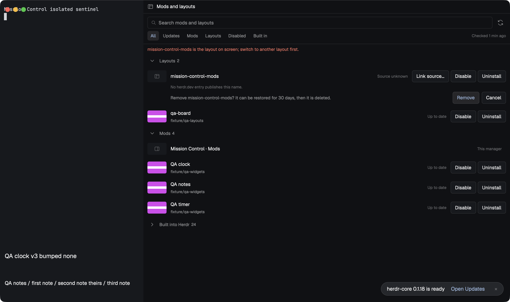

# Mission Control Mods

A native Herdr panel for managing the mods and layouts installed in this Herdr. It lists everything in the app home with each item's own preview image, shows which items have a newer version on GitHub, updates them after showing exactly what will change (including merging the person's own edits), and disables, enables, uninstalls and restores them. Built-in Herdr items and items managed by the Mission Control installer are shown but never changed. It works on its own or as the seventh source of the Mission Control layouts.

## What you see

Follow Herdr's theme with graphite fallbacks: chrome `#101114`, surface `#17191d`, border `#2a2d33`, foreground `#e5e7eb`, muted `#91969f`, dim `#6b7079`, accent `#89b4fa` and selection `#253044`; hover and blocked colors come from the theme. Standalone, the mod docks on the right at 420 px. Inside the Mission Control layouts it runs with `hideHeader: true` under the navigation strip, whose caption reads `All installed`.

- **Header (34 px, 10 px sides):** a 15 px layout glyph and `Mods and layouts`. Hidden with `hideHeader`.
- **Toolbar (10 px sides, 8 px vertical, 6 px gaps):** a 30 px `Search mods and layouts` field, a 28 px Check for updates icon button whose tooltip and accessible name say when it last checked, and, when updates exist, a primary `Update all (N)` button. Below it, filter chips (24 px, 11 px text): All, Updates (with its count), Mods, Layouts, Disabled, Built in; and a 10 px dim `Checked <age>` on the right.
- **Status line (11 px):** the busy step (`Loading…`, `Checking…`, `Preparing the update…`, `Applying…`), the last result (`qa-clock updated.`, `1 updated; qa-notes needs a review.`, the 30-day notice after an uninstall) or the helper's refusal in the blocked color. The list stays visible under an error.
- **Sections (collapsible 32 px headers with counts):** Updates, Layouts, Mods, Disabled, Built into Herdr (collapsed at start), and Removed (restorable for 30 days).
- **Rows (10 px sides, 6 px vertical):** a 48 × 30 px thumbnail, the repository's own `preview.png` from the herdr.dev catalog, cached locally (a generic layout or panel glyph when none exists); the item's title (from `mod.json`) or name; a 10 px muted source line (`owner/repo · folder`, or `installed with mission-control`); a 10 px state label (Up to date, Edited by you, Update available, Conflict, Choose its source, Source unknown, Checking…, Too large to check, Source unreachable, Disabled, Built into Herdr, Your own copy, Managed by the installer, This manager); and its actions. An update row adds a dim line: the commit subject, the number of files and its age.
- **Actions by state:** Update… (updates), Disable and Uninstall (installed user items), Enable and Uninstall (disabled), Choose source… (several catalog repositories match) and Link source… (no match: paste a github.com repository or folder link). Built-in, installer-managed, own-copy and self rows have no actions. Each button's accessible name includes its item (`Disable QA timer`).
- **Confirmations (inline under the row):** `Used by <layouts>. Disable <name> anyway?` and `Remove <name>? It can be restored for 30 days, then it is deleted.` with a primary Disable/Remove and Cancel.
- **Review (replaces the list):** `Update <title>`, the commit subject and age, then Changed or added, Removed, Kept (you edited them; removed upstream), New access (hosts, programs, files outside its folder) in the blocked color, Keys added, Keys removed and Keys left as you set them; `Apply update` and Cancel. A conflict instead reads `Your edits and the update change the same lines. Nothing was written.`, lists the files (binary files marked) and offers Keep mine, Take theirs, Open the merged files and Cancel.

## How it behaves

- **Opening:** the helper first finishes or rolls back any change a previous run was interrupted in, then lists, adopts and checks. It re-checks every hour while open and on Check for updates.
- **Adoption:** each user item is matched to its source in the herdr.dev catalog (`https://assets.herdr.dev/mods/index.json` and `/layouts/index.json`, cached for an hour) by its folder or file name, then to the exact commit whose files have the same git blob hashes. Files that differ from that commit are the person's edits. Several matching repositories make `Choose its source`; none makes `Source unknown`. A pasted github.com link adopts the item from that folder.
- **Update check:** only commits that touch the item's own folder or its own keys count; a commit elsewhere in the repository is not an update. An unchanged catalog `headCommit` costs no git work; linked items use `git ls-remote`. Sources are blob-less partial clones under the records folder; a slow first fetch continues in the background and the row says `Checking…`.
- **Keys:** a repository's root `keys.json` is shared, so each item owns only its own `mod:<name>` / `layout:<name>` section and the actions addressed to it (`<name>.<command>`); a single-item repository owns the whole file. An update adds free keys, never replaces a key the person uses for something else (listed as left as you set it), and changes or removes only keys it added that still have the value it set.
- **Update (two phases):** Prepare stages the new files outside `mods/`: an unedited file takes upstream; a file both sides changed is merged with `git merge-file`; a binary file both changed is a conflict; a file removed upstream is deleted unless the person edited it. A mod is staged whole and must pass `herdr-app check`. Nothing in the app home changes until Apply update, which backs the item up (newest three kept) and writes the files and keys in one journalled change, in place, so Herdr hot-reloads the mod. Update all applies only updates with no conflict, no new access and no key clash, and leaves the rest for a review.
- **Disable / Enable:** the folder (or layout JSON and SVG) moves to the records folder and back, identical. **Uninstall** moves it to `removed/` with the keys it added; Restore puts both back where they were. Removed items are deleted after 30 days.
- **Refusals:** built-in items (Herdr restores and updates them itself), installer-managed items, this manager itself, the layout on screen, and any mod the layout on screen uses. A mod another layout uses needs a confirmation naming that layout.
- **Crash safety:** one lock (stale after 60 s or when its process is gone), atomic writes, and an intent journal with backups; a helper killed mid-change is rolled back on the next start. Each helper call stays within about 24 s of Herdr's 30-second exec limit and says when more work remains.

## Built from

Ship `mods/mission-control-mods/` with bundled native ESM `main.js`, the bundled Node helper `backend.mjs`, `mod.json` (`title: "Mission Control · Mods"`, `place: "right"`, `size: 420`), original local SVG `assets/` (layout, panel, refresh, search, chevron-down, chevron-right) and `NOTICE.md`. Put this recipe and the actual `preview.png` beside `mods/`; there is no `layouts/`, `keys.json`, sibling mod or `node_modules`. Mount it in a layout block or open it from the right dock; the only prop is `hideHeader`.

The view is a GPUI `View` built from `div`, `v_flex`, `h_flex`, `svg`, `image` and retained `InputState` fields; it does no file work itself. Every action runs `node <appHome>/mods/mission-control-mods/backend.mjs '<json request>'` through `herdr.exec` with the app home and `shared("layout")` (the layout on screen); the helper answers one JSON object (`{v:1, ok, …}` or `{ok:false, code, message}`). Operations: `recover`, `inventory`, `check`, `prepare`, `commit`, `disable`, `enable`, `uninstall`, `restore`, `restore-all` and `link`.

The helper keeps its records in `appHome()/mission-control/mods/`: `packages.json` (adopted source, commit, file hashes, keys it owns, last check), `journal.json`, `log.jsonl`, `lock.json`, `cache/` (catalogs and preview thumbnails), `repos/` (partial clones), `stage/`, `conflicts/`, `backup/`, `disabled/` and `removed/`. The Mission Control installer lists the packages it owns in `appHome()/mission-control/installed-packages.json`; Herdr's own items are the keys of `installed.json`.

**Access disclosure:** the mod manages the person's own installed mods and layouts. It reads `appHome()/mods/`, `appHome()/layouts/`, `installed.json`, `keys.json` and `mission-control/installed-packages.json`. After a confirmed update, disable, enable, uninstall or restore it writes those items' files and only the keys an item added; it never changes built-in, installer-managed or its own files. It writes its records under `appHome()/mission-control/mods/`. Programs: local Node.js 22+ (the helper), `git` (blob-less clones and fetches of the items' own public github.com repositories with prompts disabled, `ls-remote`, `merge-file`), `herdr-app check`, and local `open` for the merged-files folder. Network: `https://assets.herdr.dev/` (the catalog and preview images) and `https://github.com/` (the items' repositories). No account, token or credential is read or sent.

## Watch out

- Herdr ends a mod's `exec` after 30 seconds and 8 MiB of output, so the helper must always answer in time and finish large work across calls; never move file work into the view.
- Write updates in place. Moving a mod's folder aside and back breaks Herdr's hot reload for that mod.
- Herdr regenerates `gpui-kit.d.ts`, `herdr.d.ts`, `jsconfig.json` and `runtime.json` inside mods; they are never compared, merged or reported as edits.
- A repository's `keys.json` belongs to every item in it; never treat one item's key change as another item's update, and never add another item's keys.
- Removing this manager must not strand what it holds: `restore-all` enables every disabled item and restores every removed one first.
- The native proof uses local fixture repositories and a local catalog (`QA_MODS_FIXTURE=1`), so it does not prove the live herdr.dev catalog or GitHub.

## Done when

- Copying only `mods/mission-control-mods/` into a clean app home passes `herdr-app check`; the view, helper and icons resolve inside that folder.
- Fixture mods and layouts are listed with their sources and preview thumbnails; an edited item reads Edited by you and an unknown one Source unknown; built-in items have no actions.
- A commit touching one mod is an update for that mod only; the review lists its files and key before anything is written; Apply update writes in place and the mounted mod hot-reloads; its new key reaches it, and a later update that drops the key removes it.
- Update all applies the safe update and leaves a conflicting one for a review; that conflict writes nothing until Take theirs (or Keep mine) and Apply update.
- Disable/Enable and Uninstall/Restore return identical files and keys; the layout on screen and a mod it uses are refused; a mod another layout uses asks first, naming that layout.
- A helper killed in the middle of any change leaves no half-written item after the next start.
- The passed ownership-v2 receipt has zero app errors, real native input, the exact preview hash and the current source and build hashes.
