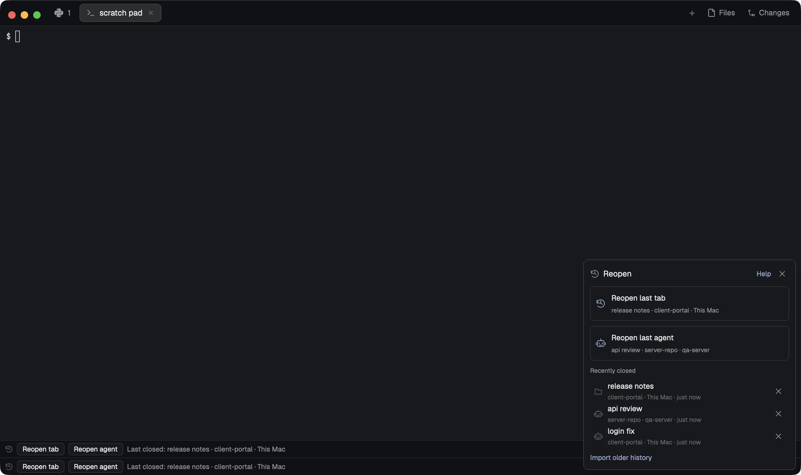

# Mission Control Reopen

A slim bar along the bottom of the window brings back what you just closed. **Reopen tab** restores the most recently closed tab in its original space on its original machine; **Reopen agent** does the same for the most recently closed agent and skips shell-only tabs. A shell comes back in the folder it started in, an agent comes back only through its exact saved session, and a compact popup lists recent closes with a visible reason and recovery for anything that could not come back. The preview shows the popup in a real Herdr window after disposable fixture tabs were closed on this Mac and on a second private machine.

## What you see

Follow the Herdr theme: `theme()` colors over a graphite fallback of chrome `#101114`, surface `#17191d`, border `#2a2d33`, foreground `#e5e7eb`, muted `#91969f`, dim `#6b7079` and accent `#89b4fa`. Failures use the theme's blocked color, success its done color.

**Bar** (docks at the bottom, 28 px tall, full width): chrome background, a 1 px top border, 8 px side padding, 6 px gaps, 11 px text. Left to right:

- a 13 px dim history icon;
- two 20 px pill buttons, **Reopen tab** and **Reopen agent** (8 px horizontal padding, 5 px radius, 1 px border). Ready pills have the surface fill and foreground text; with nothing to reopen, or while a reopen runs, they are transparent and dim and do nothing. Their tooltip names the target (`Reopen last tab: release notes`), its space and machine, "Imported history" when it came from an import, and the last failed attempt;
- while agents from before a restart are waiting, a 20 px **Resume N agents** pill (accent 1 px border, surface fill, foreground text) whose tooltip lists each waiting command and its reason; clicking it resumes them all. It is absent otherwise;
- a status line that fills the rest and truncates: `Nothing closed yet`, `Reading closed tabs…`, `Last closed: <title> · <space> · <machine>`, `Reopening last tab…` / `Reopening last agent…`, `Reopened <title> · <space> · <machine>`, `Older history is partial: choose a tab in More.`, or the failure reason in the blocked color. The machine reads `This Mac` for this computer;
- a 22 px ⋯ icon button ("Closed tabs and recovery") that opens the popup, and an accent **Help** link.

**Popup** (340 × 440, surface, 10 px padding, 8 px gaps, 12 px text), top to bottom:

- a 24 px header: 15 px muted history icon, "Reopen" at 13 px, a Help link and a 22 px × close button;
- two action cards, **Reopen last tab** (history icon) and **Reopen last agent** (agent icon): 8 px padding, 6 px radius, 1 px border, a 16 px accent icon (dim when unavailable), the 12 px label and a 10 px muted line `title · space · machine`. When nothing can be reopened that line holds the reason instead ("No closed agent has been recorded yet. Shell-only tabs are skipped.", or why the target cannot be resumed), and a ready card whose agent has no exact session adds a dim 10 px line "Opens a shell in its folder: this agent has no exact session to resume.";
- after an action, a result card: a 13 px check or × in the done/blocked color, `Reopened <title> · <space> · <machine>` or the failure message, 10 px muted notices ("Only its main pane came back.", "Opened as a shell: the agent had no exact session.", "Its saved name could not be restored.", "A helper shell tab stayed open.") and accent recovery links;
- when agents from before a restart are waiting, "From before the restart" (10 px muted) with **Resume all** and **Dismiss** links, then one bordered 34 px row per agent: a 14 px agent icon, the exact command (for example `claude --resume <id>`, prefixed with `cd '<folder>' &&` when the shell is elsewhere), a 10 px dim line `machine · reason`, a **Resume** link and a 22 px × Dismiss. Where Codex is installed without its session hook, a muted line "Codex on this Mac can come back after a restart once its session hook is set up." with a **Set up Codex resume** link; after an action, a 10 px muted status line;
- "Recently closed" (10 px muted) and up to six 34 px rows: a 14 px agent or folder icon, the title, a 10 px dim line `space · machine · just now | 3 min ago | 2 h ago | 4 d ago` (imported rows say `imported` or `imported · order unverified`; after a failed attempt the line turns the blocked color and ends with that reason), and a 22 px × "Forget this closed tab". With no records it shows "Nothing to reopen yet" and "Tabs you close while this bar or the Mission Control tab bar runs appear here. Import older history to look further back.";
- a footer with the **Import older history** link (`Importing…` while it runs) and a 10 px dim, truncated import result.

**Help dialog** (520 × 460, 18 px padding): "Reopen: what comes back" at 14 px beside a 16 px history icon, a × close button and a scrolling list of 4 px dim bullets in muted text, exactly:

- Reopen last tab restores the most recently closed tab in its original space on its original machine. Reopen last agent does the same for the most recently closed agent and skips shell-only tabs.
- A shell reopens in the folder it started in, not its last cd. Its old command is never run again.
- An agent reopens only through its exact saved session ID on the same machine and provider profile (for example claude --resume &lt;id&gt;). --last and --continue are never guessed. An agent without an exact session cannot be resumed; Reopen last tab opens a shell in its folder instead.
- If the closed tab was the last one in its space, the space is recreated from its saved folder on the same machine, only after that folder is verified there.
- Split layout, extra panes and mod panes are not recorded; only the main terminal comes back.
- Closes are recorded every 2 seconds while this bar or the Mission Control tab bar is running. Closes while a machine is offline, or while Herdr is closed, are not recorded. Older history can be imported from herdr-core; partial imports are labelled and their order is unverified.
- The last 100 closed tabs are kept in mission-control/closed.json in the Herdr app folder: names, titles, folders and program names only, never command arguments.
- A manual tab name returns with its tab; automatic names stay automatic.
- Commands: mission-control-reopen.reopen-tab, mission-control-reopen.reopen-agent and mission-control-reopen.open. No keys are bound by default; add your own in keys.json. Commands reach a shown copy of this mod only.
- After a reboot, logout or Herdr core crash, Herdr brings each terminal back as a plain shell. Mission Control then types the agent’s own resume command with its exact session ID into that shell (for example claude --resume &lt;id&gt;), so each agent comes back in the tab it ran in.
- Agents you quit stay closed. An agent that crashes inside a tab returns you to that tab’s shell, which looks exactly like quitting, so it is not resumed.
- It types only into a sh, bash, zsh, dash or ksh shell that is still idle, in the same folder, less than 15 minutes after the shell came back. Otherwise it offers Resume here instead.
- Codex sessions are learned through a small Codex hook. Use Set up Codex resume; Codex then asks you to trust the hook once. Start Codex with --no-daemon so the hook runs in your terminal.
- Turn it off with "resumeAfterRestart": false under preferences in mission-control/config.json.

## How it behaves

- **Seeing closes.** Every bar copy ticks every 2 s (hidden copies too), but only the copy holding the shared lease (10 s, renewed when under 5 s remain, compare-and-set on the journal file) observes. It snapshots spaces, tabs, panes, agents and live terminals on every ready machine and reads each new terminal's creation generation and starting folder with `hc get` on that machine (4 per tick, 3 tries). A tab that vanished between two observations of the same ready machine less than 25 s apart, with none of its terminals still live, is recorded once. A pane whose terminal keeps running was parked, not closed: it waits 6 s and is never recorded. A machine that is offline, loading, reconnecting or was not seen recently rebaselines instead of inventing closes. A copy redraws only when the record list (ids, claims, errors) changes.
- **What a record keeps.** Machine; space id, name, named flag and folder; tab id, name, named flag and position; up to 8 terminals (machine-qualified address, creation generation, starting folder, program key and name, agent flag, title); the pane count; name ownership; and, for agents, the exact provider session from a committed launch/resume binding of that same tab, terminal and generation. A tab is an agent tab when Herdr reports any of its terminals as an agent (program, agent list, status or app) or one has that binding. Command arguments and terminal text are never stored. The newest 100 records are kept.
- **Choosing.** Reopen tab takes the newest observed or confirmed record of any kind; Reopen agent takes the newest one with an agent. Imported history is used only when nothing observed exists, and only if its scan was complete; otherwise it asks you to choose a row. A record being reopened (60 s claim) shows as busy.
- **Restoring.** An agent with an exact session resumes through the shared exact resume on its original machine and space: the tool's own verified exact-ID flag (`claude --resume <id>`), never `--last` or `--continue`, in its recorded checkout after the folder is verified as the same Git repository there. If that exact session is already running, its terminal is focused and nothing new starts. Every other tab opens the machine's default shell in the folder its first terminal started in (else the space's saved folder), never its last `cd`, and never re-runs the old command. A tab whose space is gone gets the space recreated from its saved folder on the same machine, only after `test -d` proves the folder exists; for an agent, the helper shell tab is closed again once the agent tab appears.
- **Consuming.** The record is claimed before any work, and the attempt is persisted (the record's "attempting" phase, or the shared launch journal for a resume) before Herdr is asked to create anything. It is removed only after Herdr's `tab.new` / `space.new` acknowledgment or the shared resume's acknowledged result, then the space, tab and pane are focused. A definite failure frees the record and stores its reason; an unacknowledged creation keeps it for explicit recovery so it is never opened twice blindly.
- **Failures stay visible.** Offline or loading machine, closed space, missing folder or checkout, unknown folder, no exact session, a tool without verified exact resume, an unacknowledged or malformed creation, a concurrent reopen and journal conflicts each show their reason in the bar or popup and keep the record. Recovery links: **Retry**, **Open it anyway** (after an unconfirmed creation), **Show its space**, **Show running agent**, **Forget it** and **Import older history**.
- **Names.** A named tab's name, or a manual name from name ownership, is passed with the new tab or applied once after the agent resume; automatic names stay automatic.
- **One reopen at a time.** A copy ignores clicks while its reopen runs (guard expires after 90 s). A key command reaches every shown copy; the first takes it and the others skip the same command for 750 ms (shared key `mission-control-reopen-command-v1`), and the record claim stops any second consumer. A key-started failure also posts a warning toast.
- **Import older history** (popup link or the `import` command) asks each machine, up to 32, in turn; one that is offline or loading reports its history unavailable. On that machine a bounded helper reads `hc ls --all --json` and hydrates finished terminals with `hc get`, within one 4 MiB / 5 s budget and 80 terminals per run (a cursor continues next time), killing only its own `hc` client. It returns labels, generations, folders, titles and program names only. Partial, oversized, failed and offline imports keep the current history and say why; imported rows are labelled.
- **Resume after restart.** Every bar copy also runs a restart runner every 5 s (its own lease in `running-agents.json`, 15 s, so one copy observes; at most 8 commands per tick). It watches every agent terminal on every ready machine (agents, agent-program panes and every terminal it already recorded) and records `{terminal, tool, exact session}`: Claude Code from its own PID record whose start matches the process, Grok from the one `events.jsonl` that process holds open, Codex from the `mission-control.codex-session` label its hook sets, an explicit `--resume <id>` / `resume <id>` argv, or a Mission Control binding; never cwd, title or recency. An agent you quit (the same terminal process, no agent any more) or a closed terminal is forgotten. When Herdr gives a recorded terminal a new process at the same address, creation time and labels, the entry is lost and one pass decides: type the verified resume command with `hc send` after an O_EXCL claim on that machine and a fresh check that the same idle shell is in front, or offer it (non-POSIX shell, other folder, shell over 15 minutes old, tool or exact resume not verified), or skip it (setting off). Time powered off does not expire the saved agent; the 15-minute limit applies to the restored shell, including after overnight battery loss. A failed or unconfirmed send becomes an offer and is never retried by itself. One toast per restart names the resumed tabs and gives the command for each one that needs you.
- **Popup and help.** Rows reopen that exact record with Reopen-tab rules; × forgets it. A successful action closes the popup. Esc closes the popup or dialog.

## Built from

- Package: `mods/mission-control-reopen/` with bundled native ESM `main.js`, `mod.json` (`{"title":"Mission Control · Reopen","place":"bottom","size":28,"overlay":{"kind":"popup","width":340,"height":440}}`), `assets/` (original `sessions`, `agent`, `folder`, `more`, `close` and `check` SVGs, tinted with `svg()`) and `NOTICE.md`; this recipe and the real `preview.png` sit beside `mods/`. No `layouts/`, backend, collector, sibling mod or `node_modules`. Only `gpui-kit` (`View`, `div`), `gpui-base` (`h_flex`, `v_flex`) and `herdr` stay external.
- Roles from props: `view: "popup"` or an overlay id → popup; `view: "help"` → help dialog; anything else → bar. Bars run the watcher; popups only read the journal.
- Commands delivered to `nextCommand()`: `reopen-tab`, `reopen-agent`, `open`, `help`, `import`. No keys are bound; bind one yourself, for example `"global": {"ctrl-shift-y": "mission-control-reopen.reopen-agent"}` in keys.json.
- `herdr` functions: `props`, `spaces`, `panes`, `agents`, `terminals`, `machines`, `knownAgents`, `exec`, `readTextFile`, `writeTextFile` (with the expected previous text), `appHome`, `run`, `openOverlay`, `closeOverlay`, `notify`, `shared`, `setShared`, `nextCommand`; `cx.timer.every(2000)` and `cx.timer.every(5000)` (restart runner, bars only), `cx.spawn`, `cx.notify`. App commands it runs: `space.select`, `tab.select`, `pane.focus`, `agent.focus`, `tab.rename`, and `tab.close` / `space.close` only for its own helper shell; `herdr-app do tab.new | space.new` and `herdr-app ls` for acknowledged creation.
- Compiled-in shared code: the restart journal, rules and runner, its bounded host helper (a Python string run with `exec("python3",["-c",…],{on})`) and the Codex hook installer; the closed-tab journal, watcher and bounded import helper; reopen orchestration; the shared exact resume, launch journal, session bindings, name ownership, checkout checks and capability probing; UI helpers.
- Journal `appHome()/mission-control/closed.json` v1: `{v, revision, seq, lease, hosts, records, suppress, imports}`; at most 100 records, 32 hosts, 400 tabs per host snapshot, 64 suppressions and 900 KiB (host snapshots are halved before records are dropped). Invalid data is reported and left untouched.
- Restart journal `appHome()/mission-control/running-agents.json` v1: `{v, revision, lease, machines:{"local"|<machine>:{observedAt, lastContinuousAt, terminals}}}`; at most 500 entries per machine and 900 KiB; a corrupt file is kept aside as `running-agents.json.invalid-<time>`, a newer version is left untouched and the feature idles.
- **Access disclosure:** reads and writes only Mission Control files under `appHome()/mission-control/` outside its own folder: `closed.json`, `running-agents.json`, `session-bindings.json`, `names.json` and `launches.json` (the last three when an exact resume or name transfer runs), and reads `config.json` to confirm the session's provider profile. Programs run on the closed tab's own machine (`exec` with `on`): `hc get` / `hc ls --json`, `python3` (the bounded history helper and the checkout check), `git rev-parse` / `git worktree list`, `test -d`, and the agent's own `--help` / `--version` probes and exact resume command. On this computer it runs `herdr-app do` / `herdr-app ls`, `mkdir -p` and `sleep`. For resume after restart, on each agent's own machine: a read-only Python helper reads the process list (`ps`), the open-file list of an agent process (`lsof`, or `/proc/<pid>/fd` on Linux) and Claude Code's own `<claude root>/sessions/<pid>.json` records, never transcripts, and creates single-use claim files under `~/.local/state/mission-control/restart-claims/`; `hc send` types the verified resume command into a restored terminal and `hc label` clears a lost terminal's Codex label. **Set up Codex resume**, only when clicked, writes `mission-control-session-hook.py` into Codex's home and appends one SessionStart group to its `hooks.json` after a dated backup, leaving other hooks byte-for-byte unchanged; Codex's trust settings are never written. No network: the mod makes no requests of its own; a resumed agent keeps its normal network access. Nothing it stores contains command arguments, terminal text or credentials.
- Attribution: the two-action idea follows [mustafaTokmak/herdr-reopen-tab](https://github.com/mustafaTokmak/herdr-reopen-tab) (MIT) as a behavior reference only; no code is copied, and its `--last` / `--continue` resume and last-folder replay are deliberately not used. Artwork is original Mission Control artwork (MIT), listed in `NOTICE.md`.

## Watch out

- Herdr ends a long continuation without running `catch` or `finally`. No flag may depend on `finally`: the poll flag expires after 15 s, the import flag after its full budget plus 30 s, a copy's busy guard after 90 s and a reopen claim after 60 s.
- Lease renewals rewrite `closed.json` every few seconds. Redraw only when the record list (ids, claims, errors) changes, or every copy repaints the window constantly.
- Closes are seen only while a bar (or the Mission Control tab bar that bundles the same controller) is running and the machine is reachable; closes made while Herdr is closed or a machine is offline are not recorded. Import older history fills that gap with labelled, possibly unordered history.
- Exact agent resume needs an exact session recorded by a Mission Control launch or resume (the binding of that tab's terminal generation). Agents started any other way reopen only as a shell in their folder through Reopen tab; Reopen agent says why.
- Split layout, extra panes and mod panes are not recorded; only the main terminal comes back, with a notice. Never claim split geometry or last-`cd` restoration.
- Machine-qualified ids matter: the same `tb1` / `t1` exists on every machine. Remote folders are paths on that machine and are checked there, never locally; a remote failure never falls back to this computer.
- `<mod>.<command>` reaches shown copies only. Every shown copy receives it, so dedupe across copies and rely on the record claim, not on a single listener.
- An unacknowledged creation is not retried automatically: the person checks the space and chooses Open it anyway.
- Resume after restart covers a lost terminal process, not a crashed agent: Herdr starts a tab's agent inside a shell wrapper that turns back into a shell in the same process when the agent exits, so a crash inside a tab looks exactly like quitting. Never claim crashed agents come back.
- Labels survive keep recovery and PIDs restart low after a reboot: clear the Codex label when an entry is lost, and match it by PID and start time.
- Codex records nothing until its hook is trusted in Codex (`/hooks`); a Herdr integration update can rewrite `hooks.json`, so re-check the hook's status at start.

## Done when

- The copied `mods/mission-control-reopen/` alone passes `herdr-app check`; its `main.js` resolves every import inside the folder except `gpui-kit`, `gpui-base` and `herdr`, and all six SVGs and `NOTICE.md` are present.
- With two bars mounted, closing an exact agent on this Mac, an exact agent with the same local tab/terminal ids on a second machine and a newer split shell records exactly three machine-qualified records, once each, under one lease holder.
- Reopen agent resumes the remote agent with `--resume <its id>` in its folder on its own machine, then the local agent in its linked checkout, skipping the newer shell; Reopen tab brings the shell back in its starting folder (not its last `cd`) with one pane, its manual name and no replayed command. Each record disappears only once its new tab exists.
- An offline machine, a tool without verified exact resume and a deleted folder each keep the record with a visible reason; Retry succeeds once the folder exists again. A transient disconnect and reconnect invent no closure.
- An exact session already running elsewhere is focused, not duplicated; a double click opens one tab; one key command reaching two copies reopens once; Reopen agent with only shell records starts nothing.
- Import older history on a machine with more finished terminals than one batch reports partial history and adds nothing already recorded. The empty state shows before the first close and after the last reopen.
- Set up Codex resume installs the hook through the popup. Claude-, Grok- and Codex-shaped agents on this Mac and a second machine, started as kept programs and through `tab.new`, are recorded with their exact sessions; one is quit and forgotten. With the bars out of the app, every terminal process is killed and comes back as a shell at its address; after the bars return, a fresh runner types each exact resume once, in its own folder on its own machine, nothing for the quit agent and nothing more after a reload. An unverified resume is offered, never typed, and Resume types it once.
- The passed ownership-v2 native receipt has zero app errors, verified private cleanup, real pointer and key input, this exact preview hash and the exact current source and build hashes.
