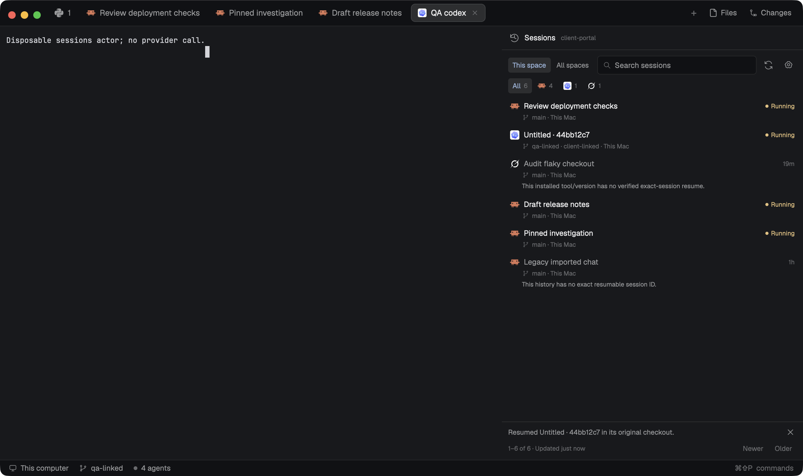

# Mission Control Sessions

A native Herdr panel that lists the previous coding-agent sessions of the focused repository space, or of every open space, newest first. Each row shows the tool's own icon, the session's manual or reported title, its branch or worktree, host and age. One click resumes that exact provider session in its original checkout on its original machine, or focuses it when it is already running; it never starts an unrelated conversation. The preview shows disposable fixture history and tool actors in a real Herdr window, not customer sessions.

## What you see

Follow Herdr's theme with graphite fallbacks: chrome `#101114`, surface `#17191d`, border `#2a2d33`, foreground `#e5e7eb`, muted `#91969f`, dim `#6b7079`, accent `#89b4fa` and selection `#253044`; hover, working and blocked colors come from the theme. The mod docks on the right at 360 px; opened with `mod.open` it is a 720 × 640 px dialog.

- **Header (38 px, 12 px sides):** a 16 px local sessions glyph, `Sessions` in 12 px semibold, then a 10 px dim caption with the focused space's name or `All spaces`. The dialog adds a close icon. A layout can hide the header with `hideHeader`.
- **Toolbar (10 px sides, 9 px top, 6 px gaps):** `This space` and `All spaces` pills (24 px high, 11 px text, 4 px radius; the active one uses accent text on the selection color), a retained 30 px `Search sessions` field with a 13 px search glyph on chrome, and two 26 px icon buttons: Refresh and History sources and paths.
- **Tool filters:** an `All` pill with its count, then one pill per provider that has rows (Claude Code, Codex, Grok), drawn as that program's installed icon at 13 px plus a 10 px count. Opened with a pinned `session` prop, a `Show all` pill sits on the right.
- **Sources panel (toggle):** a bordered chrome block with `Read-only provider metadata on each machine. History is never modified or deleted.`, then each enabled source as `Provider · host · profile` followed by its exact root paths in 10 px dim text.
- **Error banner (when a source fails):** one 11 px line in the blocked color, `Provider on host: message`, a `+N` count for more, and a Retry icon.
- **List:** independently scrolling rows with 7 × 6 px padding, a 5 px radius and 3 px gaps. Line one (17 px): the 15 px actual tool icon, the truncated 12 px title (foreground when actionable, muted otherwise) and, on the right, `Opening…`/`Focusing…` in accent while busy, a 5 px working-color dot with `Running`, or the age (`just now`, `5m`, `3h`, `2d`, an ISO date after a week). Line two (13 px): a 10 px branch glyph and `branch · folder · space · host` in 10 px dim; the folder appears for linked worktrees or when no branch is known (a detached checkout reads `detached`), the space name only in All spaces, the host always (`This Mac` locally). Line three when needed: the reason (muted) or the last outcome (blocked color), with 20 px icons for Show the running terminal or its tab, Locate this checkout, Retry or Retry its binding, and Dismiss.
- **Titles:** the manual tab name captured for that exact session, else the provider's reported title (Claude `ai-title`/`custom-title`, Grok `generated_title`), else `Untitled · ` plus the first 8 characters of the session ID. Codex history reports no title.
- **Empty states (11 px dim, 16 px padding):** `Loading sessions…`, `Select a repository space to see its sessions.`, the space's repository reason (for example `No live terminal in this space has a Git repository.`), `No session history sources are enabled on This Mac.`, `No matching sessions.`, `No previous sessions in this repository yet.`
- **Footer (1 px top border):** an optional info line with Dismiss (`Resumed <title> in its original checkout.`, `Focused the running session.`), then `1–50 of N · Updated 2m ago · Updating · N unreadable`, a `Most recent 1000` tag when capped, and `Newer`/`Older` pills that page 50 rows at a time.

## How it behaves

**Scope.** This space follows the focused space, or the space named by `props.target.spaceId`/`props.spaceId` (with an optional expected `machine`). Its repository comes from the space's focused or last-focused live terminal folder: Git's primary worktree is the repository identity, and every worktree Git lists belongs to it, missing ones included. All spaces resolves every open space, four at a time, reusing a space's resolution for five minutes while its terminal folder is unchanged; it also lists sessions that no open space contains. Scope, search and the tool filter persist in versioned shared state `mission-control-sessions-ui-v1`; `props.scope` `"all"` or `"space"` overrides it. Switching scope or space clears the old rows at once; refreshing the same scope keeps them until new data arrives.

**Membership.** A session belongs to a repository only when its recorded working folder is a checkout Git lists, a subfolder whose own Git top level is such a checkout, or an acknowledged Mission Control launch recorded for that exact session. A nested independent repository never joins its parent folder's repository. Titles and recency never decide membership or identity.

**Loading.** Each enabled source is read in pages of 50 by the mod's own collector on the source's host. This space reads up to six pages until it has 50 matching rows; All spaces and refreshes read one page; `Older` reads further pages. At most 1,000 records per source and 1,000 rows per scope are kept, newest first. Refresh runs on the button and every 60 seconds. A cursor invalidated by changed provider files restarts once from the newest page; a failing source keeps its timestamped rows and shows the banner. Disabling or changing a source removes its rows immediately.

**Row states.** Ready rows resume on click. Running means an exact live binding to that session; the click focuses it. Herdr's working, blocked, done and idle states do not change rows: a session stays `Running` in any of them while its exact terminal generation lives. Offline means the host is not ready (Retry). Unassigned (All spaces) means no open space contains the folder. Missing means the worktree or checkout is gone on its host (Locate on this Mac, Retry). Unsupported means the history has no exact UUID, the tool is not installed on that host, or the installed tool's own help does not verify exact resume.

**Resume.** A click resumes the exact ID on its original host and checkout: Claude Code `--resume <id>` and Codex `resume <id>` (with `--no-daemon` when Codex's help lists it), each only after that host's installed command help verified the option; Grok resumes only when its help lists `--resume`. `--last` and `--continue` are never used. The tab opens in the row's space through `tab.new` with the original checkout as its folder; the mod verifies the acknowledgment, the terminal's exact argv, generation and space/tab labels, commits the exact session binding and focuses the new tab. The tab first takes the tool's program name, then the session's reported title as an automatic name, or the captured manual name, restored once.

**Running and ambiguous sessions.** If the exact session is already bound to a live terminal, the click only runs `agent.focus`. If another live terminal of the same provider runs in the same repository on that host without an exact binding, the click refuses with `A running claude terminal in this repository has no exact session binding…`: no focus, no tab and no resume. Once exact proof binds that terminal to the selected session, the click focuses it; once proof binds it to a different session, the click resumes.

**Clicks.** A click marks the row `Opening…` and ignores further clicks until it settles; the launch journal deduplicates retries. Only an attempt whose side effects may exist keeps its request ID for a retry; any other click is a new intent. A busy row or load older than 90 seconds is recovered by a 5-second timer. Locate opens the folder picker (`Use this checkout`) for local sessions only and resumes from the chosen checkout after Git confirms it belongs to the same repository. Remote sessions run only on their own host; an offline host never falls back to this Mac.

**Names.** While the panel lives, it observes tab names every two seconds under a ten-second shared lease and records a person's renames of tabs that Mission Control launched in `names.json`. A manual name wins across close and resume; giving the tab Herdr's automatic name again returns it to automatic naming. Imported history without a saved name keeps its reported title.

**Commands.** `mission-control-sessions.refresh`, `.all-spaces`, `.this-space` and `.older` are delivered through `herdr-app do`. The mod adds no key bindings. Closing it cancels its timers and tasks, releases the search input and releases its name lease.

## Built from

Ship `mods/mission-control-sessions/` with bundled native ESM `main.js`, `mod.json` (`title: "Mission Control · Sessions"`, `place: "right"`, `size: 360`, a 720 × 640 dialog overlay), a self-contained `collector.py`, original local SVG `assets/` and `NOTICE.md`. Put this recipe and the actual `preview.png` beside `mods/`; there is no `layouts/`, `keys.json`, sibling mod or `node_modules`. Open it with `herdr-app do mod.open '{"name":"mission-control-sessions"}'` or mount it in a layout block; props are `target`, `spaceId`, `machine`, `scope`, `session` and `hideHeader`.

Default-export a GPUI `View` built from `div`, `v_flex`, `h_flex`, `svg`/`image` and a retained `InputState` search. Start work with `cx.spawn`, yield with the task's own `sleep(0)` between bounded batches, and use `cx.timer.every` for the 60-second refresh, 5-second recovery and 2-second name observer. Use `herdr` `props`, `shared`/`setShared`, `spaces`, `panes`, `focused`, `machines`, `terminals`, `agents`, `knownAgents`, `exec`, `readTextFile`/`writeTextFile` (compare-and-set), `appHome`, `home`, `pickFolder`, `closeOverlay`, `nextCommand`, `theme` and `run` with `agent.focus`, `space.select`, `tab.select`, `pane.focus` and `tab.rename`. Exact-resume, launch-journal, binding and name-ownership code is compiled into `main.js`.

`collector.py` is one Python 3 standard-library script combining the bounded protocol with Codex, Claude and Grok parsers; the mod reads it from its own folder and runs it as `python3 -c <collector> <request>` on the source's host. It indexes up to 1,000 `.jsonl` files (and Grok `.json` summaries), reads at most a 64 KiB head and 256 KiB tail of each, at most 4 MiB in 10 seconds per page, and publishes only the session ID, title, working folder, timestamps and reported token counts; the Sessions view uses no token data.

**Access disclosure:** the mod reads provider session metadata under configured roots on each source's own machine. On first open it adds standard defaults for tools Herdr reports installed: `~/.claude/projects`, `~/.codex/sessions`, `~/.codex/archived_sessions` and `~/.grok/sessions` (profile `standard`); other roots require explicit configuration. Symlinks and credential-named paths are skipped, and history is never modified or deleted. It reads and writes only `appHome()/mission-control/config.json` (history sources), `launches.json` (launch journal), `session-bindings.json` and `names.json`. Programs it runs: Python 3 for the collector (plus a home-folder probe on remote hosts), `git` (`rev-parse`, `worktree list`), `hc ls`/`hc get`, `herdr-app do tab.new` and `herdr-app ls`, `mkdir -p`, `sleep`, each provider CLI's `--help`/`--version` (and `codex resume --help`), and, on a click, the provider CLI with its exact resume argv. The mod itself makes no network request; remote hosts are reached only through Herdr's configured machine transport, and a resumed CLI keeps its own login and network access. Nothing is uploaded. The included artwork is original Mission Control SVG under MIT (see `NOTICE.md`); tool icons are Herdr's installed program icons, and no third-party code is bundled. For a Claude Code agent that Mission Control did not start, it also reads Claude Code's own process records `<claude root>/sessions/<pid>.json` (read-only, only the foreground PID's record and its job's record; never the `.key` files beside them) to adopt that agent's current conversation. Its shared telemetry also reads Codex's PID/start-bound session label and Grok's single open session events file through the read-only process helper (`ps`, plus `lsof` or Linux `/proc` for Grok). Codex's read-only `state_5.sqlite` index locates requested rollout files by exact ID, within the configured session roots; the rollout header still proves identity. This mod installs no hook.

## Watch out

Herdr ends a long continuation without running `catch` or `finally`, and a cancelled task never settles. No busy flag, load or resume guard may depend on `finally` alone: each expires after 90 seconds, and an abandoned history read is recovered by replacing the transport. Keep every collector page well under that.

Only caller-assigned IDs, exact resume argv or a verified provider handshake bind a live terminal to a session. Working folder, title and recency never do. Compare the full terminal generation (address, creation time, foreground PID): `hc` keeps finished terminals until removal and reuses addresses. A session ID that is not a UUID is labelled unsupported rather than passed to a CLI.

Resume checks the session's provider root and profile against the one enabled source for that provider on its host. With several enabled profiles for one provider on a host it cannot tell which login the installed CLI uses and resumes under whichever login is active; it never switches accounts. Authenticated provider access remains separate: the native proof uses fixture history and disposable actors, so it does not prove a real provider login or conversation continuity.

Python 3 must exist on every host whose history is read; without it that host's sources show the error banner and no rows, while its terminals keep working. The collector must stay under 64 KiB because it travels as a remote argument. Compressed `.jsonl.zst` history is reported unsupported. Lists stop at 1,000 rows per scope (`Most recent 1000`); older provider history remains untouched. Locate is local only: restore a missing remote worktree on its host. Paths are compared canonically, so macOS `/private/tmp` checkouts must appear exactly as Git lists them.

## Done when

- Copying only `mods/mission-control-sessions/` into a clean app home passes `herdr-app check`; every import, icon and the collector resolve inside that folder.
- With at least two exact sessions per repository, This space shows only its repository, newest first; another space shows only its own; All spaces shows every space and the remote host with host labels.
- Selecting the non-last session opens exactly one tab running `--resume <id>` in its original checkout on its host; a double click adds no second tab; clicking a running row only focuses it.
- A manual rename made through the tab menu survives closing and resuming, restored exactly once on the new tab while a newer same-repository session is unaffected; history without a saved name keeps its reported or `Untitled ·` fallback.
- An unbound live same-provider terminal blocks the click with no focus, tab or resume; exact proof for that session focuses it, and proof for another session permits the resume.
- Unsupported, offline, no-repository and no-source states explain themselves and start nothing; provider history files are byte-identical afterwards.
- The passed ownership-v2 receipt has zero app errors, real native input, the exact preview hash and the current source and build hashes.
