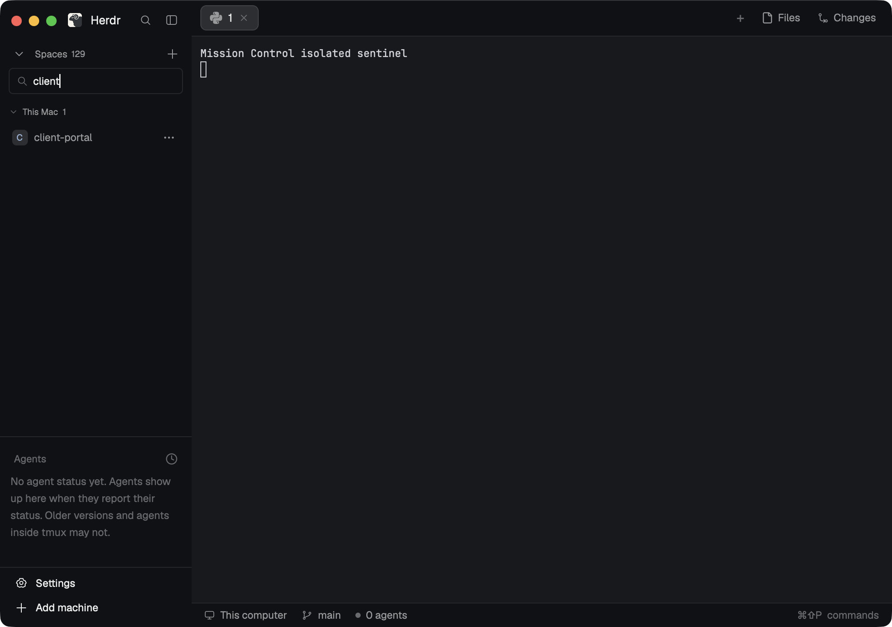

# Mission Control Spaces

A compact native Herdr sidebar for finding repositories across machines. Spaces collapse independently of Agents, and a right-click menu acts on the clicked repository. Settings and Add machine stay at the bottom. The real preview shows search within 129 disposable fixture spaces; it is not a complete Mission Control layout.

## What you see

Use a 220–280 px sidebar with graphite chrome `#101114`, surface `#17191d`, border `#2a2d33`, muted labels and blue selection. Follow Herdr's current theme. The 32 px Spaces header has an icon-only collapse button, total count and plus button. Below are a retained 30 px search field, collapsible 25 px machine headings, and independently scrolling 30 px space rows.

Each row has an 18 px initial tile or folder icon, truncated name, optional status dot and a 24 px ellipsis button. Body text is 12 px; machine labels are 10 px. The separate 69 px footer contains two 28 px Settings/Add machine rows. A 268 × 244 px context popup shows the clicked space, New agent, optional Previous sessions and Open in Finder.

## How it behaves

Search matches space name, branch and machine; local spaces precede named machines. Collapse state, machine groups and query survive rerenders through versioned shared state. Left-click selects a space; right-click or ellipsis opens its menu without selecting it. Hover reveals full name, branch and host. Space status uses Herdr's working, blocked, done and idle colors; absent status has no dot. The separately installed Agents surface owns individual agent rows.

New agent opens this mod's bundled tool/worktree chooser. Capture the clicked space and live panes before asynchronous work. Current checkout uses the actual linked checkout; a new worktree starts from its HEAD. Show installed tools on that host, at most three saved pins, overflow and verified options. Failed starts retain the form. Finder opens the validated local checkout; remote spaces need an explicit validated local mount. Unbound, ambiguous, deleted or unreachable targets show a reason and disable both actions.

Settings opens native Settings. Add machine opens the shipped host-add dialog. The plus invokes native New space. Escape dismisses overlays through Herdr. Optional Previous sessions appears only when its public installed manifest exists and opens that mod with the same immutable target.

## Built from

Ship `mods/mission-control-spaces/` containing bundled ESM `main.js`, `mod.json`, original local SVG `assets/` and artwork notice, plus this recipe and actual `preview.png`. No `layouts/`, sibling code or custom key binding is required. Open it with `herdr-app do mod.open '{"name":"mission-control-spaces"}'`.

Default-export a native GPUI View reading `herdr.props()`. Support `view: "list"` (default), `"footer"`, `"context"`, and bundled `"launch"`, `"menu"`, `"settings"` roles. Context props carry `spaceId`, `machine` and actual overlay ID; launch props carry captured `target`. In a layout, place list in a flexible left column and footer at its bottom. The standalone default is a 280 × 560 px popup; it does not change an existing layout.

Use `spaces`, `machines`, `panes`, `focused`, `window`, theme, shared state, CAS file APIs, overlay APIs and `knownAgents`. Commands are `space.select`, `space.new`, `app.settings`, `mod.open` with `machine-add`, and acknowledged launch/focus/name commands. Session integration reads only `mods/mission-control-sessions/mod.json`, never its code. All controls use self-contained MIT SVGs; agent choices use actual Herdr tool artwork.

**Access disclosure:** runs local/target-host Git, Python 3, tool help/version probes, `hc`, `herdr-app`, bounded sleep and local `mkdir`; Finder uses local `open`. Reads live Git metadata and private Mission Control config; launch stores CAS journal, exact session bindings and name ownership under `appHome()/mission-control/`. It makes no tracker/network request itself. Named-machine commands use Herdr's configured transport; the started agent uses its usual authentication/network access. It never copies credentials.

## Watch out

Resolve canonical repository identity from live terminal cwd and Git common directory, never a stale space creation folder. Inactive spaces must ignore stale pane-focus flags; conflicting repositories require explicit focus. Preserve canonical `repoRoot` separately from execution `checkoutRoot`. Never execute locally after a remote failure or open a server path as a local folder. Linked remote checkouts without their own mount remain unavailable.

Keep InputState outside render, release it on close, and use fresh callback contexts. Put tooltips on plain wrappers around SVGs and use native hex colors. Herdr `run` returns no created IDs; validate actual launch acknowledgments and full terminal generation before committing. Preserve manual names and interrupted-launch recovery. Never overwrite existing worktree paths/refs or malformed settings. Missing optional Sessions hides its action. Node is unnecessary at runtime; Python is required for guarded worktree/mount helpers.

## Done when

- Copying only this mod folder into a clean app home passes `herdr-app check` and all imports/assets resolve.
- In a 220 px sidebar, search reaches the 128th real space; section/group collapse preserves the query and keeps Agents and footer accessible.
- Actual footer clicks open native Settings and the shipped Add a machine dialog.
- With A selected, B's context starts an agent in B's actual host/repository/worktree and opens B in Finder.
- Ambiguous and non-Git targets have no launch/Finder fallback; unmapped remote Finder stays disabled and an explicit local mount works.
- A separate-core launch stays on that core, the native app reports zero errors, and `preview.png` matches the passed native capture.
