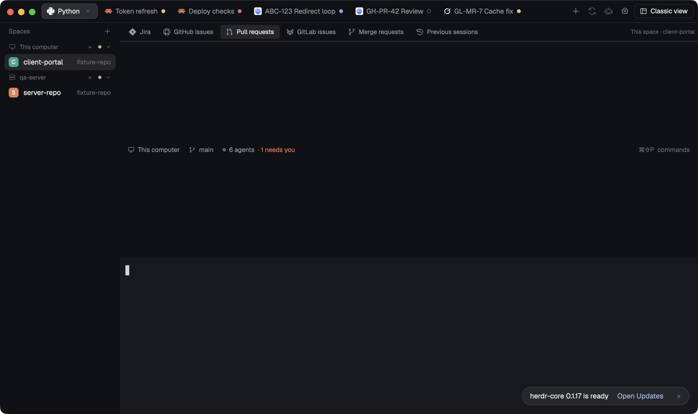

# Mission Control Tabs

One slim graphite strip across the very top of the window holds every tab of the shown space, each with its real tool icon, a task name it keeps up to date by itself and a small status mark. Right of the tabs sit a plus that opens this mod's own agent menu, **Reopen last tab** and **Reopen last agent**, the Classic work-panel toggle and one button that swaps between the Mission Control and Classic layouts. A second role draws the six work-source controls (Jira, GitHub issues, Pull requests, GitLab issues, Merge requests, Previous sessions) above the layout's work stack. Names follow what each agent reports, keep issue and PR keys, fall back to the running program or folder, and never overwrite a name you typed. The preview is the actual native frame from the mounted gate: the strip over the Mission Control test layout with disposable agents in all four statuses, issue/PR/MR-keyed tabs and the six sources.

## What you see

Follow the Herdr theme: `theme()` colors over a graphite fallback of chrome `#101114`, surface `#17191d`, border `#2a2d33`, foreground `#e5e7eb`, muted `#91969f`, dim `#6b7079`, accent `#89b4fa` and selected `#253044`. Raised, hover and the four status colors come from the theme only.

**Top bar** (`props.view` `topbar`, the default; a 42 px `window_drag` block as the layout's first child): chrome background, a 1 px bottom border, 8 px right padding, 4 px gaps, everything vertically centered. Its left padding leaves room for the macOS window buttons: with root `"titlebar": "none"`, `"traffic_lights": [x, y]` and the window not in full screen it is `ceil((x + 64) / zoom − the bar's left offset)` px (76 px for `[12, 14]` on a full-width bar), otherwise 10 px. Left to right:

- the tab strip: fills the bar, 3 px gaps, scrolls sideways when tabs overflow. One tab per tab of the shown space, settled ones included; nothing else draws a second strip. Each tab is a 28 px pill with 9 px horizontal padding, 6 px gaps, 7 px radius, a 1 px border and 12.5 px text: the shown tab has the theme's raised fill, a border-colored outline and foreground text; the others are chrome on chrome with muted text (dim when settled); hover shows the hover color. Inside: a 14 px tool icon (the program's own icon from Herdr's program table, tinted in its color when it is a one-color glyph, else drawn as a picture; this mod's agent, panel or folder art only when a tab has none), the name (at most 280 px, then cut with "…", an issue or PR key stays whole at the front), an 11 px dim layout icon when a pane is zoomed, a 7 px status mark when an agent reports one, and on the shown tab only a 16 px dim × (11 px close art, 4 px radius, tooltip "Close tab"). An unnamed tab shows what runs there (the agent's program name, else its folder, `~` for home) rather than its position;
- a 26 px plus icon button, tooltip `New agent or terminal in <space>`; disabled with "Select a space to start an agent" when no space is shown;
- two 26 px icon buttons, a circular-arrow **Reopen last tab** and an agent-figure **Reopen last agent**. Their tooltip names the target (`Reopen last tab: <title> · <space> · <machine>`, `This Mac` for this computer) or why nothing can be reopened ("No closed tab has been recorded yet. …", "No closed agent has been recorded yet. Shell-only tabs are skipped.", "This agent was not started with an exact session ID, so it cannot be resumed without guessing. …", "Reopening…"); they are dim and do nothing then;
- in Classic (or with `props.panel: true`) a 26 px panel icon button: "Show work panel" / "Hide work panel" (accent on a selected fill while open), or dim "Work panel unavailable: this layout has no mc-work-panel node.";
- the view swap: 26 px tall, 6 px radius, 1 px border, 12 px text, a 14 px layout icon. From 720 px of bar width it is labelled with the other view ("Classic view" or "Mission Control", "the other view" for a custom target) with 9 px padding; narrower it is a 28 px icon. Tooltip `Switch to <view>`; disabled and dim (labelled "Switch view") with `View swap unavailable: <reason>`: "this layout has no Mission Control nodes (mc-main).", "this layout names no other Mission Control view." or "the <view> layout (<name>) is not installed.";
- only where the system draws no window buttons (`window().buttons`, Linux and Windows): 26 px Minimize (a 10 × 1 px bar), Maximize / Restore (a 9 px outlined square) and Close window.

**Status marks** (7 px circles): working, blocked ("Needs input") and done are filled in the theme's working, blocked and done colors; idle is a hollow 1 px ring in the idle color (dim when the theme has none). A tab's mark is its most urgent agent status; plain shells have none.

**Tab tooltip** (hover): the full title (kept up to 200 characters), the status name, "Zoomed pane", "Settled · still running", and "Named by you" or "Automatic name". Its accessibility label is `<name> · <status> · shown`.

**Tab menu** (right click; this mod's own 240 × 170 popup, surface, 6 px padding, 12 px text): the tab's name (11 px dim, full name on hover), **Rename…**, **Use automatic name** (dim with "This tab is already named automatically" unless you named it), a 1 px divider and **Close tab**. A closed tab shows "This tab is no longer open."

**Work navigation** (`props.view` `navigation`, a 34 px block above `mc-work-stack`): chrome, 1 px bottom border, 6 px padding, 2 px gaps. Six 26 px source controls with 5 px radius and 11.5 px text, each with a 14 px icon (jira, github, pull-request, gitlab, branch, sessions art): the selected one has the selected fill, foreground text and an accent icon. When the strip fits (about 780 px) they read Jira, GitHub issues, Pull requests, GitLab issues, Merge requests, Previous sessions; from about 442 px Jira, GitHub, PRs, GitLab, MRs, Sessions; narrower they are icon-only buttons that share the width (18–26 px each) and still name themselves in tooltips. Tooltips: the full label, `· <reason>` when disabled ("Not in this layout.", "Unavailable: this layout has no work stack (mc-work-stack)."), and "(shown)" for the selected one. Right of labelled controls, when 110 px remain, a 10.5 px dim caption: "This space · <space>" or "All spaces" (the source's own scope); without a work stack the caption reads "Work sources unavailable: <reason>" in the blocked color whenever labels are shown. Inside a Classic panel a 24 px × "Hide work panel" closes it.

**Agent menu** (`props.view` `menu`, `launch` or `settings`; this mod's own 560 × 660 dialog, surface, 18 px padding): "Start working" with an Agent shortcuts gear and ×, the destination line `This Mac · <checkout>` or `<machine> · <checkout>`, a "Find an installed agent" search, 40 px rows of installed agents (18 px icon, name, number), and **Terminal**, **New space** and **Worktree** buttons. Choosing an agent shows "New agent": up to three pinned agent buttons, **Current checkout** / **New worktree**, worktree folder and branch fields, model / reasoning / instructions / subagents fields only where the installed tool supports them, **Back** and **Start agent** ("Starting…"). "Agent shortcuts" pins, orders and hides agents and sets the default checkout.

## How it behaves

- **Statuses:** an agent's OSC 7501 report sets its tab mark: working, blocked (Needs input), done (finished while you weren't looking; Herdr turns it idle once you look) and idle.
- **Select and reorder:** pressing a tab and releasing on the same tab runs `tab.select`; pressing one tab and releasing on another within 6 s, without leaving the bar, runs `tab.move` to that tab's position. A press that leaves the bar, a release on the empty strip, a release elsewhere or a drag that started outside the strip selects, moves and closes nothing, and the press never drags the window. A double press asks Herdr for the name (`tab.rename` without a name) and never also selects. One vertical wheel gesture over the bar runs `tab.prev` / `tab.next` once per 160 ms; sideways scrolling only scrolls the strip.
- **Close:** the shown tab's × and the menu's Close tab first capture the tab for Reopen, then run `tab.close`; a second click while it closes does nothing. The menu's close reaches the bar through the `mission-control-tabs-request-v1` shared request (valid 5 s, taken by one copy).
- **Automatic names:** every eligible tab (one with a terminal) is named, in this order: an issue / PR / MR key (`ABC-123`, `GH-42`, `GH-PR-42`, `GL-142`, `GL-MR-42`) kept whole before the reported conversation title, else the captured task title, else the tool; the agent's reported conversation title (its terminal title with spinner glyphs stripped); the captured task title from a launch, reopen or resume; the agent's tool name; a shell's running program; the shell's folder (`~` for home). Paths, numbers, `user@host:` prompts, command lines with flags, the tool's own or another installed agent's name, and titles whose first word is a shell (`bash`, `zsh`, `login`, …) are not titles. Names are written with at most 80 characters; a new name must be seen across two polls 2.5 s apart before it is written, and an identical name is never written again.
- **Your names win:** a rename you make (menu, prompt, key) is recorded and never overwritten, through layout swaps, close and Reopen, and resume. **Use automatic name** (or the `automatic-name` command) runs `tab.rename` with an empty name and naming resumes on the next pass. A name the bar cannot prove it wrote is treated as yours.
- **One writer:** every shown top bar ticks once a second; one CAS lease per app home in `tab-names.json` (12 s) lets exactly one copy derive and write names, at most four per pass and no more often than every 3 s, so two mounted bars still give one rename per change. Pending writes expire after 10 s and retries back off from 5 s to 60 s.
- **Plus:** opens this mod's own agent menu for the shown space and machine; Start agent launches there through an acknowledged, idempotent launch (exact caller session IDs where the installed tool and a provider profile support them). Terminal opens a shell tab in the checkout; New space runs `space.new` on that machine.
- **Reopen:** Reopen last tab restores the most recently closed tab in its original space on its original machine (a shell in the folder it started in; old commands never run again). Reopen last agent does the same for the most recently closed agent, skipping shell-only tabs, only through its exact saved session (`--resume <id>` style; never `--last` / `--continue`). A manual name returns exactly once on the new tab; automatic names stay automatic. One reopen runs at a time; the record is consumed only after the new tab is acknowledged.
- **Swap:** one click records the selected source, its scope and the focused space/tab in `mission-control-tabs-nav-v1`, then runs `layout.switch` only; no tab is created or closed. The view that starts selects the same source and, within 15 s, brings back a space/tab the switch lost.
- **Sources:** the gear left of the view swap (26 px, settings icon) opens a 300 × 318 popup, Mission Control sources: a title, one note and one row per work source (its icon, its label and an on/off switch). A source that is off leaves the navigation strip and the Classic panel, and its `source-<id>` command selects nothing; turning off the shown source selects the next one still on; with all off, the strip says so. The choice is shared state `mission-control-tabs-sources-v1` (`{ v: 1, hidden: [...] }`), which Herdr keeps across restarts; every strip redraws when it changes. The source mods stay installed.
- **Source buttons (Classic):** after the view swap, one 26 px icon button per work source that is on, each with its service's icon (Jira, GitHub issues, Pull requests, GitLab issues, Merge requests, Previous sessions), 2 px apart. A button selects its source in `mc-work-stack` and shows `mc-work-panel`; the button of the source already shown is highlighted and hides the panel. The overview has no such buttons: its navigation strip is always visible.
- **Sources and panel:** a source control runs `layout.select` on `mc-work-stack`; the panel toggle runs `layout.show` / `layout.hide` on `mc-work-panel`. Missing nodes disable only the controls that need them, with the reason; the strip keeps working.
- **Keys:** `keys.json` actions `mission-control-tabs.<command>` for `new`, `settings`, `sources`, `reopen-tab`, `reopen-agent`, `swap`, `panel`, `rename`, `automatic-name`, `close` and `source-jira`, `source-github`, `source-pulls`, `source-gitlab`, `source-merges`, `source-sessions`. None is bound by default; a command reaching several shown copies acts once (`mission-control-tabs-command-v1`, 750 ms).

## Built from

- **Mod folder** `mods/mission-control-tabs/`: `main.js` (one native GPUI bundle of this mod and its shared helpers), `mod.json` (`{"title":"Mission Control · Tabs","place":"none","overlay":{"kind":"dialog","width":560,"height":660}}`), 18 own SVGs in `assets/` (agent, branch, close, folder, github, gitlab, jira, layout, more, panel, pin, plus, priority, pull-request, refresh, search, sessions, settings) and `NOTICE.md`. Runtime imports are only `gpui-kit`, `gpui-base` and `herdr`; it reads no other mod. `place: "none"` keeps Herdr from docking a second strip.
- **Roles** (`props.view`): `topbar` (default; also `swapTo: "<layout>"` to name the other view and `panel: true` for the Classic toggle), `navigation`, `menu` / `launch` / `settings` (the agent menu), `context` (the tab menu). An unknown view shows `Unknown Mission Control tabs view "<view>". Use topbar or navigation.`; `sources` is the Sources popup.
- **Layout contract:** root `"titlebar": "none"` with `"traffic_lights"`; the top bar first; `mc-main` (marks a Mission Control view); `mc-work-stack`, a header-less stack whose children are `jira` (`mission-control-jira`, `{view:"panel",hideHeader:true}`), `github` (`mission-control-github`, `{view:"issues",hideHeader:true}`), `pulls` (`mission-control-github`, `{view:"pulls",hideHeader:true}`), `gitlab` (`mission-control-gitlab`, `{view:"issues",hideHeader:true}`), `merges` (`mission-control-gitlab`, `{view:"merges",hideHeader:true}`) and `sessions` (`mission-control-sessions`, `{hideHeader:true}`); in Classic, `mc-work-panel`, a `hidden: true` column holding the navigation block and the stack. The pair is `mission-control` ↔ `mission-control-classic` ("Mission Control" / "Classic view"). The source mods are separate packages; this mod only names them.
- **herdr:** `props`, `spaces`, `panes`, `focused`, `layout`, `layouts`, `shared` / `setShared`, `run`, `exec`, `knownAgents`, `machines`, `nextCommand`, `openOverlay` / `closeOverlay`, `notify`, `window`, `settings` (zoom), `home`, `appHome`, `readTextFile` / `writeTextFile` (compare-and-set), `theme`.
- **Commands it runs:** `tab.select`, `tab.move`, `tab.rename`, `tab.close`, `tab.prev`, `tab.next`, `tab.new`, `space.new`, `space.select`, `pane.focus`, `layout.switch`, `layout.select`, `layout.show`, `layout.hide`, `window.minimize`, `window.maximize`, `window.close`; launches and reopens go through `herdr-app do tab.new` so the result is acknowledged.
- **Shared state:** `mission-control-tabs-nav-v1` `{v:1, source, scope, swap:{id, from, to, at, space, tab, applied}}`, `mission-control-tabs-request-v1`, `mission-control-tabs-command-v1`; it reads each source mod's own scope key (`mission-control-jira-ui-v1`, `mission-control-github-ui-v1`, `mission-control-github-prs-ui-v1`, `mission-control-gitlab-ui-v1`, `mission-control-gitlab-mrs-ui-v1`, `mission-control-sessions-ui-v1`).
- **Files** under `appHome()/mission-control/`: `tab-names.json` (naming lease and per machine/tab entries), `names.json` (manual-name ownership by work origin and exact session), `closed.json` (close history, last 100), `launches.json`, `session-bindings.json`, `config.json`.
- **Access disclosure:** outside its own folder it reads and writes only Mission Control files under `appHome()/mission-control/`: `tab-names.json`, `names.json`, `closed.json`, `launches.json` and `session-bindings.json`, and it reads `config.json` (launch preferences and the provider profile used for exact session IDs), writing it only when you save Agent shortcuts. Programs run with `exec` on the tab's or destination's own machine (`on`): `hc get` / `hc ls --json` (terminal identity, close capture, live-session checks), `git` (repository and checkout checks, `git worktree list`, and `git worktree add` when you choose New worktree), `python3` (the worktree helper on the chosen machine and a mount check for a configured remote mount), `test -d`, and each installed agent's own `--help` / `--version` probes and its launch or exact resume command. On this computer it runs `herdr-app do` / `herdr-app ls`, `mkdir -p` and `sleep`. New worktrees go to `<repository parent>/.herdr-worktrees/<space>-task-<id>` on branch `mission-control/<space>-task-<id>`. No network: the mod makes no requests of its own; agents it starts keep their own network access. It stores names, titles, folders and program names, never command arguments, terminal text or credentials.
- **Art:** original Mission Control SVGs (MIT, listed in `NOTICE.md`); tool icons are Herdr's own program icons.

## Watch out

- Each layout starts its mods fresh: the swap survives only through `mission-control-tabs-nav-v1`, and the new view restores focus only within 15 s of the switch.
- The layout must not dock this mod by itself (`place: "none"`); one top bar per layout. Extra copies are safe (one naming lease, one close capture) but every copy ticks.
- A GPUI continuation can be interrupted with no `finally`: every in-flight flag (naming pass, close, reopen, press, request) is a timestamp with a staleness bound. Never retain `cx` across an await; use `cx.timer`, never `setTimeout`.
- Tab widths are estimated at 7 px per character (14 for wide characters); the real font decides the cut, `max_w(280)` plus `truncate()` enforces it. The navigation picks full / short / icon labels from the same estimate.
- The panel toggle and selected source read the live `layout()` tree (`hidden`, stack `active`); a layout file edited by hand changes them.
- Scope ("This space" / "All spaces") is whatever each source mod last stored; without those mods every source reads "This space". Sources missing from the stack are disabled, not hidden.
- A conversation title is only what the agent puts in its terminal title; tools that report none fall back to the task, tool, program or folder. A shell's own lowercase self-report such as `zsh` or `-zsh` is not a title; "Login loop" is.
- Exact resume needs a tool whose help shows a caller-session or resume flag and exactly one enabled provider profile for that tool and machine in `config.json`; otherwise Reopen last agent explains it cannot resume and starts nothing.
- A concurrent writer that renames a tab just before the bar's own rename lands can make the bar treat its automatic name as yours; it then stops naming that tab (it never overwrites).
- Window buttons are drawn only where `window().buttons` is true; on macOS the traffic lights stay and the strip leaves them room.
- Limits: 80 characters written per name, 200 kept for hover, 280 px per label, 4 renames per pass, 1000 tab entries, 100 closed tabs.

## Done when

- `herdr-app check mods/mission-control-tabs` passes in an app folder where it is the only Mission Control mod.
- In a layout with `"titlebar": "none"` and `"traffic_lights": [12, 14]`, one strip starts 76 px in, clear of the window buttons, and every tab of the shown space appears in it exactly once.
- Agent tabs show their real tool icons beside task names, and working, Needs input, done and idle show four different marks, idle as a hollow ring.
- Clicking a tab selects it; dragging one tab onto another moves it there; a drag released in the terminal, on the empty strip, or started outside the strip changes nothing and never moves the window; one wheel gesture switches one tab.
- The shown tab's × and the menu's Close tab close that tab and Reopen records it once.
- A generic agent takes its reported title, an issue / PR / MR tab keeps its key, a shell shows its running program and then its folder, a long title is cut at 280 px with the whole title on hover, a name you type is never overwritten, and Use automatic name or the `automatic-name` command brings the automatic name back.
- The plus opens "Start working" (never a shipped menu) and Start agent runs the chosen agent in the shown space's repository on that space's machine, a remote one included.
- With an agent and then a shell closed, Reopen last agent resumes that agent's exact session once in a new tab with your name on it, while a newer agent keeps its own name; Reopen last tab brings the shell back in its folder; with nothing to reopen, or only an agent without an exact session, both say why and start nothing.
- Swapping Mission Control ↔ Classic keeps every tab, terminal, name, focus and the selected source; the Classic work panel starts hidden and its toggle and × show and hide it.
- Beside a 220 px rail all six sources show full labels at 1024 px and short labels at 736 px, and stay reachable icon-only with tooltips in a 360 px panel.
- In a layout without `mc-main`, `mc-work-panel` or `mc-work-stack`, the swap and panel controls are disabled with their reasons, the sources show "Work sources unavailable", and the strip still selects tabs and opens the agent menu.
- With two bars mounted, one title change produces exactly one rename, and `herdr-app status` shows no errors.
