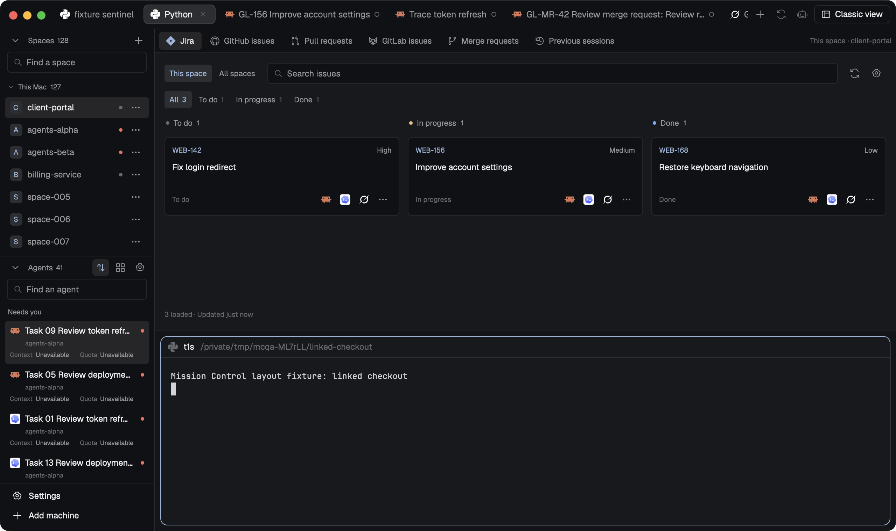

# Mission Control

Two native Herdr layouts for running many repository spaces and coding agents across machines. **Mission Control** is the overview: Spaces and Agents in a left rail, six separate work sources (Jira, GitHub issues, Pull requests, GitLab issues, Merge requests, Previous sessions) in the main area and the active tab's terminals below them. **Classic** is terminal-first, with the same sources in a side panel that starts closed. Both share one topmost tab bar with automatic tab names, an agent menu, Reopen last tab / Reopen last agent and one button that swaps views without closing anything. The preview is the full overview frame from the isolated native layout gate, with synthetic spaces, agents and tracker data. Classic evidence is kept separately in the repository: `evidence/native/mission-control-classic.png` and the Classic assertions of `evidence/native/layout.json`.



## What you see

Fixed graphite look: root `theme: "graphite"`, `titlebar: "none"`, `traffic_lights: [12, 14]`, canvas background, terminal padding `[14, 12]`. Chrome `#101114`, surface `#17191d`, 1 px border `#2a2d33` dividers, muted labels and a restrained blue focus accent.

**Both layouts, top to bottom:**

- `mc-topbar`, a 42 px window-dragging block: `mission-control-tabs` `topbar`. It starts 76 px in, clear of the macOS window buttons, and holds the shown space's tabs (28 px pills with the program's own tool icon, an automatic or manual name up to 280 px, a status mark), a plus for the agent menu, Reopen last tab and Reopen last agent, in Classic a work-panel toggle, and the view swap (labelled with the other view from 720 px of bar width, icon-only below).
- `mc-body`, a row split by a 1 px border divider. Its first child is the same rail in both layouts: `sidebar`, a 220 px chrome column (min 200, max 480, not resizable) with `mc-rail-lists` (Spaces `list` above Agents `list`, equal weights, each able to shrink to a 32 px header) and `mc-rail-footer`, a 69 px Settings / Add machine footer at the absolute bottom-left.

**Mission Control (`layouts/mission-control.json`):** right of the rail, `mc-main` is a column split by a 1 px divider:

- `mc-work` (weight 3, min 160): `mc-navigation`, a 34 px strip of six source controls, directly above `mc-work-stack`, a header-less stack showing `jira` first. The strip reads Jira, GitHub issues, Pull requests, GitLab issues, Merge requests, Previous sessions when it fits (1024 px window), Jira, GitHub, PRs, GitLab, MRs, Sessions when narrower (736 px), and icon-only controls with tooltips below that. A dim caption shows `This space · <space>` or `All spaces` when room remains. The selected control is the only heading; every embedded view runs with `hideHeader: true`.
- `mc-terminals` (weight 2, min 120, 8 px padding): the active tab's panes with 8 px gaps, 10 px radius, a 1 px border, an accent focus border and the shipped `pane` header (30 px, top, always shown).

**Classic (`layouts/mission-control-classic.json`):** `mc-main` is a row with 8 px padding and 8 px gap. The terminals block comes first and takes the width; `mc-work-panel`, a 360 px column (min 280, max 900), sits to its right, `hidden: true` at start, holding the same navigation strip (plus a × Hide work panel button) and the same six-source stack. With the panel closed the window is the rail plus terminals.

**Embedded sources (both layouts, same order and props):**

| Stack child | Mod | Props |
| --- | --- | --- |
| `jira` | `mission-control-jira` | `{ "view": "panel", "hideHeader": true }` |
| `github` | `mission-control-github` | `{ "view": "issues", "hideHeader": true }` |
| `pulls` | `mission-control-github` | `{ "view": "pulls", "hideHeader": true }` |
| `gitlab` | `mission-control-gitlab` | `{ "view": "issues", "hideHeader": true }` |
| `merges` | `mission-control-gitlab` | `{ "view": "merges", "hideHeader": true }` |
| `sessions` | `mission-control-sessions` | `{ "hideHeader": true }` |

Issue boards show compact To do / In progress / Done groups with linked keys and titles and up to three 25 px pinned tool buttons per card. Pull-request and merge-request lists show review, discussion and check/pipeline indicators with Review / Address comments / Fix checks actions. Sessions lists previous agent sessions for the space with the tool's own icon, title, branch, host and age. Agent rows show the actual tool icon beside the task name, then separate Context and Quota readings.

Settings uses the authored previews `layouts/mission-control.svg` (overview with all six source slots) and `layouts/mission-control-classic.svg`; they are artwork for Herdr's layout picker, not screenshots.

## How it behaves

- **One-button swap.** The swap records the selected source, its scope and the focused space/tab in shared state `mission-control-tabs-nav-v1`, then runs only `layout.switch` to the other layout. No tab is created or closed and terminals keep running. The view that starts selects the same source and, within 15 seconds of the switch, brings back a space or tab the switch lost. If the other layout is not installed the button is disabled with that reason.
- **Sources and panel.** A source control runs `layout.select` on `mc-work-stack`. In Classic, the panel toggle and × run `layout.show` / `layout.hide` on `mc-work-panel`; a source command may reveal the panel. Each source keeps its own This space / All spaces scope, filters and search. Missing nodes disable only the controls that need them, with the reason.
- **Rail.** Spaces and Agents collapse independently and keep their own search. Right-clicking a space acts on that space, not the selected one: New agent… (current checkout or a new worktree, then an installed tool on that space's machine), Previous sessions, Open in Finder for local checkouts. Agents toggles Priority and Spaces grouping; clicking a row focuses that exact agent. Context and quota show only reported values for an exactly bound session; otherwise Unavailable or Stale. Settings and Add machine open Herdr's native dialogs.
- **Issue and review work.** A card's key or title opens its tracker URL. A pinned tool button starts that tool with saved defaults in the card's own repository space and machine, in a worktree named from the workspace and key (for example `client-portal-WEB-142`). A repeat click focuses the existing agent instead of sending the task again. All spaces keeps each card's account, project and machine separate. Herdr's agent states never move tracker cards; trackers are read-only.
- **Tabs.** Names follow each agent's reported title, keep issue / PR / MR keys, then fall back to the task, program or folder. A name you type wins across swaps, close, Reopen and resume. Reopen last tab restores the newest closed tab in its original space and machine (a shell in the folder it started in, no command replay); Reopen last agent skips shell-only tabs and resumes only an exact saved session.
- **Keys.** The bundle ships no `keys.json` and binds nothing. Bind `mission-control-tabs.<command>` yourself for `new`, `settings`, `reopen-tab`, `reopen-agent`, `swap`, `panel`, `rename`, `automatic-name`, `close`, `source-jira`, `source-github`, `source-pulls`, `source-gitlab`, `source-merges` or `source-sessions`. `layout.toggle:sidebar` still finds the rail by its `sidebar` id.

## Built from

```text
mission-control/
  layouts/mission-control.json
  layouts/mission-control.svg
  layouts/mission-control-classic.json
  layouts/mission-control-classic.svg
  mods/mission-control-agents/
  mods/mission-control-github/
  mods/mission-control-gitlab/
  mods/mission-control-jira/
  mods/mission-control-sessions/
  mods/mission-control-spaces/
  mods/mission-control-tabs/
  RECIPE.md
  preview.png
  build-manifest.json
```

- `node scripts/project.mjs bundle` collects every `mission-control-*` mod the two layout trees reference, rebuilds each standalone package and copies its `mods/<name>/` byte for byte; `build-manifest.json` records the SHA-256 of every bundled file. Each mod folder carries its own `NOTICE.md`. These are the same mods as the standalone `mission-control-*` packages, each described by its own recipe.
- `mission-control-agent-menu` and `mission-control-reopen` are not referenced: the tabs mod compiles in the same agent menu and its own Reopen controls. The optional `mission-control-accounts` mod is neither referenced nor required.
- The only shipped Herdr mod used is the read-only `pane` header. No shipped tab strip (`tabs`, `terminals-bar`) or stack header is mounted, so there is exactly one tab strip.
- Layout node contract read by `mission-control-tabs`: `mc-topbar` first; `mc-main` in both; `mc-work-stack` with exactly the six children above; in Classic only, `mc-work-panel`, hidden at start, holding the navigation block and the stack. The tab bar's `swapTo` names the other layout (`mission-control` ↔ `mission-control-classic`); Classic adds `panel: true`.
- Rail props: `mission-control-spaces` `{ "view": "list" }` and `{ "view": "footer" }`, `mission-control-agents` `{ "view": "list" }`. Tab bar props: `{ "view": "topbar", "swapTo": … }` and `{ "view": "navigation" }`.
- Install with `node scripts/install.mjs --dry-run`, then `node scripts/install.mjs --app-home ~/.config/herdr-app --layout mission-control`. It refuses existing or shipped names, checks every mod with `herdr-app check`, switches layout and writes a rollback receipt.

**Access disclosure:** the bundled mods read and write only Mission Control files under `appHome()/mission-control/` outside their own folders: `config.json`, `launches.json`, `session-bindings.json`, `names.json`, `tab-names.json` and `closed.json`. They read provider session metadata, never auth files, under configured roots on each machine (defaults `~/.claude/projects`, `~/.codex/sessions`, `~/.codex/archived_sessions`, `~/.grok/sessions`). Programs: `hc`, `herdr-app do` / `ls`, `git` (including `git worktree add` for new worktrees), Python 3 (collectors and worktree/mount helpers), local Node.js 22+ (the Jira, GitHub and GitLab helpers), `mkdir`, `sleep`, `test -d`, local `open` for Finder, each installed agent's `--help` / `--version`, the chosen agent with its task or exact resume, optional read-only `gh auth token`, and configured local Jira CLI or stdio MCP programs. Network reads go only to configured tracker HTTPS origins: the Jira site (or the Atlassian gateway when a `cloudId` routes there, or a configured HTTPS MCP endpoint), the GitHub API origin and the GitLab site's `/api/v4`. Credentials come from environment variables named in the configuration (or existing `gh` storage) and stay in helper memory: no login, logout, token storage or OAuth refresh. Remote machines are reached only through Herdr's machine transport; started agents keep their own network access. Source links open in the system browser.

## Watch out

- Install the bundle or a standalone copy of a mod, not both: they share names and the installer refuses collisions.
- Never hand-edit a bundled mod. Rebuilding changes package bytes, and a bundled mod must equal its standalone build and that build's passed native receipt.
- Keep node IDs stable: the tab bar, the swap and `layout.toggle:sidebar` find nodes by id. One tab strip only; a stack `header` or shipped `tabs` block would add a second.
- Each layout starts its mods fresh. Selection survives a swap only through `mission-control-tabs-nav-v1`, and focus is restored only within 15 seconds.
- Classic must stay terminal-first: the terminals block first, the work panel hidden at start. At 736 px an open 360 px panel still leaves the terminals more than 100 px.
- Proof uses synthetic tracker servers, fixture accounts and disposable tool actors; authenticated provider access remains separate. No running-account switching, split-pane restore or `--last` / `--continue` resume exists.
- Jira CLI and stdio MCP run on this computer even for remote spaces. Python 3 must exist on every machine whose agents or history are read.
- `preview.png` is a native capture; the Settings SVGs are authored artwork. Neither replaces the other, and a browser mockup screenshot is never a valid preview.

## Done when

- `node scripts/project.mjs bundle` produces exactly the tree above: both layout files, both Settings SVGs and exactly the seven referenced mods.
- Every bundled mod is byte-identical to its standalone package build, and each of those packages passes its own native receipt, recipe and preview gate at current source hashes, `mission-control-gitlab` included, with the post-GitLab compatibility check passing.
- Both layouts keep both GitLab roles and all six navigation destinations, reachable at 1024 and 736 px beside a 220 px rail.
- In one isolated native run of both layouts, the one-button swap keeps the selected space, tab, running terminal addresses and manual names; Jira, GitHub issues, Pull requests, GitLab issues, Merge requests and Previous sessions stay separate in both views; Classic starts with the panel closed.
- Pinned starts, right-click targets, context/quota, history, Reopen and tab naming work across 128 spaces and dozens of agents, with an offline second machine and duplicate issue IDs routed to the right space, account and checkout.
- Every bundled mod passes `herdr-app check`, the run reports zero native app errors, `preview.png` equals the receipt's `layout-preview` frame, and the Classic frame is recorded separately.
- `node --test tests/package-layout.test.mjs` passes.
